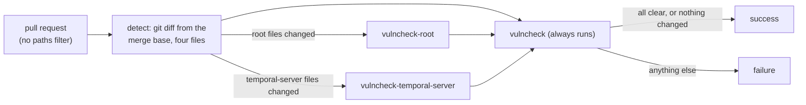

# ADR-001 erratum E4: when the vulnerability scan runs, and what a failure blocks

> **Status: PROPOSED.** Technical Architect critique pending.

> **Invariants source.** The project description is empty, so it defines no invariants. As with A1, this is checked against [[ADR-001-platform-blueprint]] §1 I1–I9. Against any separate list of eight the check is incomplete.

**What changes:** nothing in the product. The decision about our check for known security flaws now says when the check runs and what a failed check blocks. It also asks for one change to our build rules: a code change that updates a third-party library cannot merge while that check is red.
**Why:** the decision says a red check blocks every merge. That stopped being true on 10 November, when the check was moved and slowed down. Engineers and reviewers rely on a block that is only partly there.
**What you'll see when it's done:** every pull request (a proposed code change) into the main code shows a result named `vulncheck`. When no library list changed, it is green and nothing was scanned. When one changed, it is the result of the scan, and red means the change cannot be merged.
**Codes used below:** ADR-001 = the platform blueprint. ADR-001-A1 = its amendment pinning the Temporal server (our workflow engine) to v1.29.7; its numbered decisions include 3 (the scan) and 6 (the words of R7). R7 = the rule saying when that pin is looked at again. CI-A = A1's acceptance test "scan, zero findings". `govulncheck` = Go's scanner for known flaws, and the GitHub Actions workflow that runs it. *Required check* = a named result GitHub insists on before a merge into `main`. *Root module* / `temporal-server/` = our two Go modules that ship, each with its own library list (`go.mod`, `go.sum`). `ci.yml` = the main test workflow. TICK-641 moved the scan out of `ci.yml`. TICK-694 = the owner's request to scan every two days. TICK-1138 = the bug in whose review this was found. TICK-1140 = this erratum's issue. *The triad* = Solution Architect, Technical Architect and Technical Lead. *The agents* = the AI agents who write, review and merge all code here. FU = follow-up work, V = its tests, RS = risks, all below. I2 = the invariant "the tenant comes only from a verified source".

## Context: what is built

A1 Decision 3 today: *"**No vulncheck exception.** `make vulncheck-temporal-server` is a required `ci.yml` step that must report zero findings. If CI on 1.29.7 fails, that is a new decision for the triad, not a pre-approved exception."*

Read on 2026-11-25 at `main` 461484e7. Raw output: `docs/adr/ADR-001/E4/evidence.txt` (its section numbers in brackets).

| Question | Fact | Source |
|---|---|---|
| When does it run? | Cron `17 3 */2 * *`; by hand; `pull_request` (opened, synchronize, reopened) with a `paths` filter on the four `go.mod`/`go.sum` files. No push trigger. | `.github/workflows/govulncheck.yml`, `on:` [3] |
| What does it run? | Job `root`: `make vulncheck`. Job `temporal-server`: `make vulncheck-temporal-server`. Zero findings, no allow-list. | same file, `jobs:` |
| What does `main` require? | `changes`, `lint`, `unit`, `temporal-server`, `integration`, `stack`, `coverage`, `commit-check-budget`, `isolation`. `strict: true` (branch up to date), `enforce_admins: true`. | `GET /repos/Navaladi2019/TicketingSystem/branches/main/protection` [1]. The one ruleset matches no branch [2]. |
| Is a scan required? | **`root`: no. `temporal-server`: GitHub says yes, by accident.** `ci.yml` has a job with that name too (the module's unit tests and linter). On #579, #751 and #890, the three merged pull requests that changed a library list since 10 November, GitHub's `CheckRun.isRequired` is `true` for **both** jobs named `temporal-server` and `false` for `root`. | [4] |
| Which one decides when they differ? | **Unknown.** GitHub says only that the same job name in several workflows "can cause ambiguous status check results and block pull requests from being merged" ([About protected branches](https://docs.github.com/en/repositories/configuring-branches-and-merges-in-your-repository/managing-protected-branches/about-protected-branches)). No failed case in our history: 31 pull request runs, 0 failed [6]. | |
| How late can a new flaw show? | Scheduled runs start 8 to 10 h after 03:17 UTC, 47.5 to 49.8 h apart (8 runs) [5]. | |
| Who is told? | The `main-red` job comments on GitHub issue #259, open since 28 October and shared with every red `ci` run on `main` (25 comments) [7]. | |

So "not a required check", as TICK-1140 has it, is right for `root`, and not certain for `temporal-server`. The reverse is the worse risk: if the scan's green result can stand in for the `ci.yml` job, a red test of the Authorizer (the code in `temporal-server/` that checks every request and upholds I2) would not block. **Not verified either way.** No harm found: on all three pull requests both jobs were green.

## Decision

| # | Decision |
|---|---|
| **E4-1** Text | Decision 3 of A1 reads from now on: *"**No vulncheck exception.** `make vulncheck-temporal-server` must report zero findings, with no exception and no allow-list. It runs in `.github/workflows/govulncheck.yml`, beside the same scan of the root module: every second day on `main`, by hand, and on a pull request that changes `go.mod` or `go.sum` of either module. If it fails on 1.29.7 and no library update clears it, that is a new decision for the triad, not a pre-approved exception. What a failure blocks: ADR-001-E4."* In Decision 6 (R7), "the CI gate fails" reads "a `govulncheck` run fails". CI-A is met by a green `govulncheck` run on the pull request. A library update that clears a finding is an ordinary bug fix (as in TICK-1138) unless it moves `go.temporal.io/server`. |
| **E4-2** Until FU1 and FU2 land | Branch protection does not reliably block a red scan: never for `root`, not certainly for `temporal-server`. What stops the merge is a written rule, not a machine: every job is green before an agent merges (`docs/delivery/branching-strategy.md`, step 3 of the story merge; the workspace merge policy for task pull requests). A reviewer of a pull request that changes a library list opens the `govulncheck` run and the `ci` run and needs both green; a missing run counts as red. |
| **E4-3** Required, by a job that always reports | The pull request scan becomes a required check of `main`. The required name is one new job, `vulncheck`, in `govulncheck.yml`. Contract below. |
| **E4-4** Unique names | No required check name is used by two workflows. The scan jobs become `vulncheck-root` and `vulncheck-temporal-server`; `ci.yml` keeps `temporal-server`. `make check-ci-steps` fails when a name in a checked-in list of `main`'s required checks (FU1) is a job name in more than one workflow. The list is edited in the same change as the branch protection (FU2); nothing keeps the two equal, since reading branch protection needs an admin token that CI does not have. |
| **E4-5** Schedule | Every two days, unchanged: the owner's decision (TICK-694). A pull request that changes no library list is not scanned. |

### Contract of `vulncheck` (E4-3)

1. The `pull_request` trigger loses its `paths` filter. A workflow skipped by a filter leaves its checks "Pending", which blocks the merge ([workflow syntax](https://docs.github.com/en/actions/reference/workflows-and-actions/workflow-syntax)).
2. `detect` compares with the merge base (as `scripts/ci/temporal-server-changed.sh` does) and reports, per module, whether its `go.mod` or `go.sum` changed. Schedule and manual runs scan both modules, and both must succeed.
3. A pull request scans **only the module whose list it changed**, so a finding in one module cannot block the fix of the other. A finding in the module the pull request leaves alone does not block it; the schedule reports it.
4. `vulncheck` has `if: always()`. Without it, a job whose `needs` failed is skipped, and GitHub reports a skipped job as "Success" ([troubleshooting required checks](https://docs.github.com/en/pull-requests/collaborating-with-pull-requests/collaborating-on-repositories-with-code-quality-features/troubleshooting-required-status-checks)). It succeeds only if `detect` succeeded **and** each module is either `success`, or `skipped` with `detect` saying "unchanged". Everything else (failed, cancelled, timed out, an empty or unknown `detect` output) is a failure.
5. It stays out of `ci.yml`: there, adding any label but `ci:run` or `ci:full` starts a run that skips every job on the same commit, and a skipped required check counts as passed.

## Acceptance (the follow-up's tests)

| # | Test | Catches |
|---|---|---|
| V-1 | The gate script, a table test over every `detect` × job result (`success`, `failure`, `cancelled`, `skipped`, empty). Red first against a gate that returns 0. | a skip or cancel read as a pass |
| V-2 | `detect`, a table test: each of the four files, a `.go` file only, docs only, both modules, no merge base (must fail) | a missed or extra scan |
| V-3 | `check-ci-steps` fails on today's two `temporal-server` jobs and passes after the rename; fails when `if: always()` is removed or `paths` comes back | the name collision; traps 1 and 4 |
| V-4 | Live, after FU2: a docs-only pull request shows `vulncheck` green and no scan. A throwaway pull request that pins a module with a known, reachable flaw shows it red and GitHub's `mergeStateStatus` is `BLOCKED`; it is closed unmerged. | a gate that does not block |

There is no API operation, so no API test scenarios.

## Consequences

- **Cost.** One small run per pull request. The scan jobs took 36 to 102 s on the three pull requests [4]. `detect` plus `vulncheck` without a scan: estimated under a minute, not measured. Money: none. The repository is public, and standard runners are free there ([billing](https://docs.github.com/en/billing/managing-billing-for-your-products/about-billing-for-github-actions)).
- **A flaw with no fix blocks library changes to that module,** for admins too (`enforce_admins`). That is Decision 3's intent. It does not block other pull requests.
- **An outage of the Go vulnerability database** fails the scan: library changes wait, nothing else does.
- **Invariants.** I1–I9 unchanged. No tenant data, identity or runtime path is touched.

## Follow-up work (not in this pull request)

| # | Work | Owner | Order |
|---|---|---|---|
| FU1 | `govulncheck.yml`, detect and gate scripts, `required-govulncheck.yaml`, the list of required names, V-1 to V-3. Same pull request: the header of `govulncheck.yml`, the comment above `vulncheck-temporal-server` in `make/lint.mk`, `docs/quality/ci-pipeline.md` ("govulncheck workflow"), `docs/temporal-server.md` ("Vulnerability gate", which still says "a required step of the `temporal-server` CI job"), `docs/pins.md` line 141 | Technical Lead plans | 1 |
| FU2 | Add `vulncheck` (app 15368) to `main`'s required checks with an admin token, then V-4. Undo: remove it. | Technical Lead | 2: after FU1 is on `main` and `vulncheck` has reported on one docs-only and one library pull request |
| FU3 | A red scheduled scan gets an issue of its own in `scripts/ci/main-red.sh`, instead of one more comment on an issue open since 28 October; close #259 | Quality, Testing & CI Advisor | any |

FU1's rename removes the name collision, so it is worth doing even if E4-3 is contested.

## Risks and residuals

| # | Residual | Owner | Revisit trigger |
|---|---|---|---|
| RS1 (AR-TICK-1140-01) | A flaw published after a merge, or code that starts calling an already listed flaw, stays unseen on `main` up to about 50 h (the schedule is the owner's choice, TICK-694) | Technical Lead | a finding a tenant could reach, or more than 72 h between scheduled runs |
| RS2 (AR-TICK-1140-02) | Until FU1 and FU2, E4-2 applies, and what a `temporal-server` result means is not certain | Technical Lead | FU2 done |
| RS3 | Changing a pull request's base branch starts no new run, so `vulncheck` may have compared with the old base | Technical Lead | a base change on a pull request with a library change |
| RS4 | A pull request can edit the workflow or scripts that judge it, as for every check here | reviewers; `check-ci-steps` (V-3) | an edit of the gate in an unrelated pull request |

## Rejected options

| Option | Why |
|---|---|
| **Not required, as today** (text only) | Leaves the two `temporal-server` jobs ambiguous and `root` on a habit. In its favour: no red scan in 31 pull request runs. But half of it is already required by accident, so "as today" is a state nobody chose. |
| Required, `paths` filter kept | Most pull requests would wait for a check that never reports. |
| Required, scan on every pull request | Reverses the owner's request (TICK-694). |
| A conditional job in `ci.yml` | Fewer lines, but a skip counts as success and `labeled` events skip it (contract 5). |
| Scan both modules on any library change | A finding in one module blocks the fix of the other. |
| Drop the pull request scan | A new library is how a known flaw enters `main`; it would be seen up to about 50 h late. |
| No erratum | The record claims a block that is not there. |

**Open for the Technical Architect (verify-by-spike; the decision does not depend on it):** with two same-named checks on one commit, does a red scan `temporal-server` block, and can a green one stand in for a red `ci` job? E4-4 is right either way. The answer sets how urgent FU1 is.

**Dissent:** none yet.

## Competitive Gate (ADR-008)

**Result:** N/A. CI only: no axis, limit, API, configuration surface or upgrade path changes. Parity: I1–I9 unchanged.
