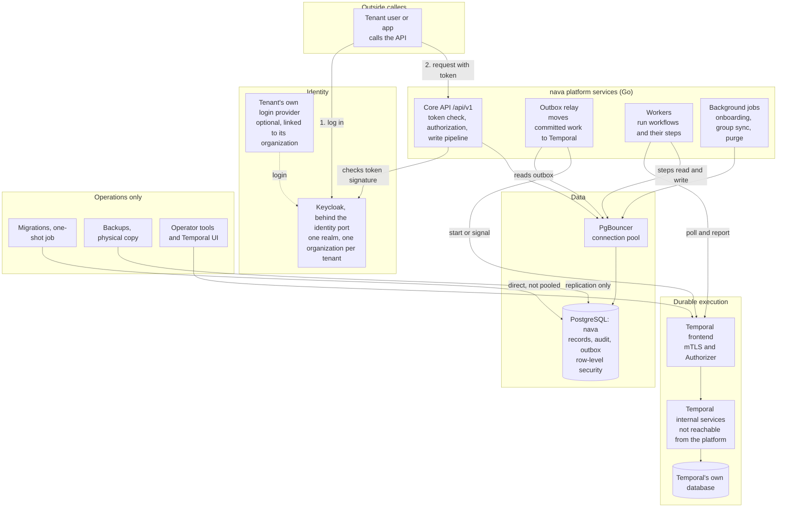
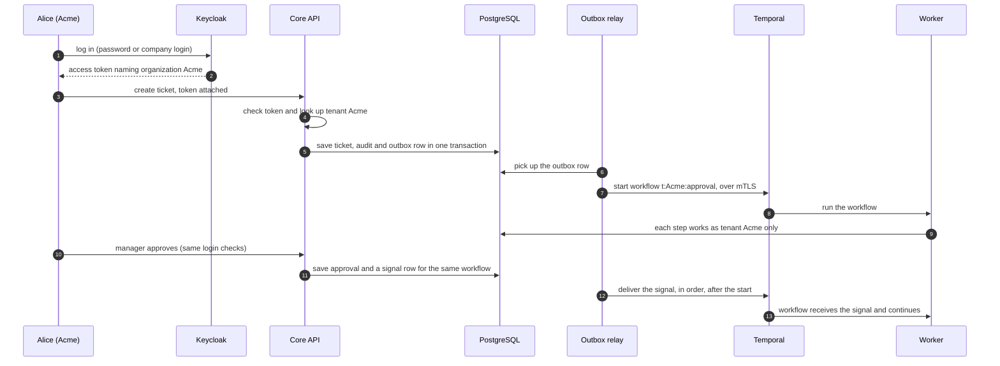

# ADR-001 explained

**What this is.** A plain-English guide to ADR-001. It changes nothing. ADR-001 is the decision. **You approved it on 2026-10-15, so it is now ACCEPTED**, together with the identity port (ADR Annex A.4). Where this guide simplifies, it cites the ADR section, for example "ADR §2" or "ADR Annex A.2". **One correction was made after approval, erratum E1; §8 explains it.**

**What ADR-001 is about, in one paragraph.** nava is a platform that many customer organisations (*tenants*) share. The biggest risk in such a platform is one tenant seeing or changing another tenant's data. ADR-001 fixes the ground rules (*invariants*) every later design must keep. It also makes the four choices Milestone 1 is waiting for:
- how people log in and how we know their tenant (**D26**)
- what the API looks like (**D6**)
- how background workflows stay separated by tenant (**D22**)
- which database accounts the platform's own background jobs use (**D28**)

How to read it, if you have 15 minutes:
- §1 and §3 give you the picture.
- §5 has the risks.
- §7 is what you approved.

---

## 1. The whole picture

*Not shown:* custom-function sandboxes, plugins and the AI service come in later epics. ADR-001 rules that they get **no route to Temporal and no database access** (ADR Annex A.2, invariant I8).

| Component | What it is | What we use it for | Why |
|---|---|---|---|
| **Core API** | Our Go service, reached at `/api/v1` | It checks who you are and which tenant you belong to. It checks what you may see or change, and saves records through one write pipeline. | It is the single front door. It is easier to guard one door than many (ADR §2 D6, I4, I5). |
| **Keycloak** | An open-source login server | Logins, users, groups, and one *organization* per tenant | It is the settled identity choice. Organizations let one installation hold many tenants safely (ADR §2 D26). |
| **Identity port** | Two small interfaces inside the core API: `IdentityResolver` and `DirectoryAdmin` | `IdentityResolver` turns a login token into "tenant, user, groups". `DirectoryAdmin` creates tenants, users and group memberships in Keycloak, for onboarding and group sync only. | Only these two know Keycloak exists. If we ever change login servers, only they change, not the whole platform (ADR Annex A.4). |
| **Tenant's own login provider** | For example the customer's Microsoft or Google login, linked to their organization | Lets a tenant's staff use their company login | Customers expect it. ADR-001 adds rules so it can't be used to break into another tenant (ADR Annex A.1). |
| **PostgreSQL** (database `nava`) | The main database | Records, audit history, the outbox and workflow references | It is the settled database. Its *row-level security* is our hard tenant wall (I1). |
| **PgBouncer** | A connection pooler in front of PostgreSQL | Lets many requests share a small number of database connections | It is needed for scale. ADR-001 makes sure one request's tenant can't leak into the next request on the same connection (I1, CI-2). |
| **Outbox relay** | A small Go process | It reads "work to do" rows (the *outbox*) that were saved together with a change, then starts or signals the matching workflow | If the system crashes between saving and starting a workflow, nothing is lost or done twice (I6, I7). |
| **Temporal frontend** | The entry point of Temporal, the workflow engine | It accepts start, signal and poll requests | It is locked down with certificates (*mTLS*) and an *Authorizer* that decides which caller may do what (ADR §2 D22). |
| **Temporal internal services and database** | Temporal's own engine and storage | They store workflow history and timers | They are kept separate from our data and are not reachable from the platform network (ADR Annex A.2). |
| **Workers** | Our Go processes that run workflow logic | Approvals, timers, notifications and anything that waits or retries | Work that has to survive restarts runs here, never inside a web request (I6). |
| **Background jobs** | Small platform jobs | Setting up a new tenant, copying groups from Keycloak, deleting expired rows | Each job has its own narrow database account (ADR §2 D28, Annex A.3). |
| **Migrations** | A one-shot job that changes the database structure | Creating and altering tables | It is the only account that owns tables. It never runs inside the live service (ADR Annex A.3, R2). |
| **Backups** | A physical copy of the database files | Disaster recovery | Its account can copy files but can't run queries (ADR Annex A.3). |
| **Operator tools** | The Temporal UI and command-line tools | Platform staff diagnosing problems | Operators only, on a separate network (ADR Annex A.2). |

---

## 2. What we are using, and what we are not

| Area | We use | For | We rejected | Why we rejected it |
|---|---|---|---|---|
| Tenants in Keycloak | **One realm, one *organization* per tenant** (ADR §2 D26) | Knowing which tenant a user belongs to | A separate realm per tenant | Every tenant admin would control their own realm and could create login tokens. Each realm also needs its own setup that drifts over time. |
| How we read the tenant from a login | **A platform lookup table keyed by the organization's fixed id** | Turning a login into a tenant | A "tenant id" field on the user or in the token | An admin could edit that field and claim another tenant. |
| Login server | **Keycloak, behind the identity port** (ADR Annex A.4) | Logins, users, groups | Zitadel | It has no built-in groups, which Epic 03 needs. Its AGPL licence is awkward when we ship it to customers on-premise. Our isolation tests were all run on Keycloak. It is better at letting tenants manage their own users, so we look again if that becomes a must (ADR Annex A.4). |
| Keycloak version | **26.1.3 or later** (26.8.1 recommended) | Running Keycloak | 26.0 to 26.1.2 | A test proved a user could pick an organization they don't belong to and get a valid login for it. |
| Company logins (federation) | **Create a new user only, and add them to that tenant's organization** | Letting staff sign in with their company login | Matching an existing account by email | Tenant A's login provider could claim Bob from tenant B's email and take over his account. |
| API style | **REST at `/api/v1`, from an OpenAPI contract** (ADR §2 D6) | Every read and write in Milestone 1 | GraphQL first, or REST and GraphQL together | It would mean two access-control surfaces to secure before the access layer is proven. GraphQL comes later, in Epic 23, for reads. |
| Tenant wall | **PostgreSQL row-level security, forced on every tenant table** (I1) | Making a query that forgets the tenant return nothing | Filtering in application code only | One forgotten filter leaks data. The database check can't be forgotten. |
| Platform database accounts | **One narrow account per job, none able to skip the tenant wall** (I3, ADR §2 D28) | Onboarding, group sync, relay, purge, migrations | One shared "system" account that skips the wall | One leaked password would read every tenant. |
| Backups | **A physical copy through a replication-only account** | Disaster recovery | `pg_dump` with an account that skips the wall | That account could run any query across tenants. |
| From "saved" to "workflow started" | **A transactional *outbox*, then a relay** (I6) | Making sure saved work always runs exactly once | Calling Temporal straight after saving | A crash between the two loses the work. A retry does it twice. |
| Workflow tenancy | **One Temporal namespace; the tenant travels in a checked header and in the workflow id** (ADR §2 D22) | Keeping every workflow tied to one tenant | One namespace per tenant | Worker connections grow with every tenant, onboarding needs an admin step, and Temporal's storage is shared anyway. |
| Workflow tenancy | (same) | | The tenant inside the workflow's input data | The caller shapes the input, so it can be forged. |
| Who may talk to Temporal | **Certificates (mTLS) plus our own Authorizer, which also checks the commands workers send** | Stopping forged starts and signals | Network rules only, Temporal's default token check, or checking API calls without the commands | A test proved a worker's certificate could create and signal workflows in another tenant through commands. |
| Duplicate starts | **"Reject duplicate" on a workflow id that is unique per outbox row** | No workflow runs twice | A request-id setting | Our version of the Temporal SDK doesn't expose it. |
| Message order | **First in, first out, per target, ordered by a number assigned under a lock** | "Approve" and "cancel" can't swap places | Unordered, or ordered by an id made before the lock | Both allow the swap. |
| Workflow data | **References only** (record ids, not record contents) | Keeping tenant data out of Temporal's history | Full record data in history | Temporal's storage holds every tenant together and isn't encrypted in Milestone 1 (R1). |
| Database layout | **Shared tables for all tenants**; the tenant id leads every index | Performance and simplicity | A separate database per tenant by default | Kept as an operator option for very large tenants, under the deployment decision D1 (ADR §1, G7). |
| Not in Milestone 1 | Temporal Schedules, cron and reset; partitioned tables; tenant self-service in Keycloak | — | — | Each one adds a path we haven't secured yet. They come back with their own decision when needed (ADR Annex A.2, A.3, R3). |

---

## 3. One request, end to end

**The story.** Alice from tenant *Acme* logs in. She raises a ticket. That starts an approval workflow. Later her manager approves, which sends the workflow a *signal*.

**Where tenant isolation is enforced, step by step:**

1. **Logging in.** Keycloak is version 26.1.3 or later, which fixes the "pick another organization" bug. If Alice uses her company login, it can only create a new Acme user. It can never take over an existing account. *(ADR §2 D26, Annex A.1)*
2. **The token.** The API checks:
   - the signature, and that the token came from our Keycloak;
   - that it is not expired, and is meant for this API;
   - that it names **exactly one** organization.

   It then asks the *identity port* (`IdentityResolver`) for the tenant. That looks the tenant up in our own table, using the organization's fixed id. If Alice signed in through a company login, that login must belong to Acme. Any doubt means *401, not logged in*. *(Annex A.1)*
3. **The database.** The API tells the database "this transaction is for Acme". That setting lasts for this one transaction only, so the shared connection pool can't carry it over. *Row-level security* then hides every non-Acme row, even if our code has a bug. *(I1, I3)*
4. **What Alice may see.** Acme's own rules (for example "requesters see their own tickets") are turned into the database query itself, so counts and pages are correct. Hidden fields are removed. A record that belongs to another tenant, one Alice may not read, and one that doesn't exist all give the same "not found". *(I5)*
5. **Saving.** The ticket, its audit entry and an *outbox* row ("start the approval workflow") are saved together, or not at all. The outbox row carries the tenant that the token proved. *(I4, I6)*
6. **Starting the workflow.** The relay builds the workflow id from the outbox row's tenant, for example `t:Acme:approval:…`. It connects to Temporal with its own certificate. Temporal's *Authorizer* lets the relay start and signal workflows, and nothing else. Starting the same row twice is rejected, so the workflow runs once. *(Annex A.2, I7)*
7. **Running the workflow.** The tenant travels with the workflow in a checked header. If the header is missing or doesn't match the id, the workflow stops. Each step tells the database "this is Acme", so row-level security applies again. If the workflow tries to start, signal or cancel a workflow belonging to another tenant, our worker code refuses. Temporal's Authorizer also refuses, even if a worker were compromised. *(Annex A.2)*
8. **The signal.** The manager's approval goes through the same login and database checks. The target workflow is found from our own table under row-level security, never from anything the browser sends. Signals to one workflow are delivered in order, never before the start. A signal claiming the wrong tenant is dropped and raises an alert. It never stops the workflow that received it. A repeated signal is applied only once. *(Annex A.2)*

---

## 4. The invariants (the ground rules)

These are the nine rules every later design must keep. Changing one needs a new ADR that you sign. *(ADR §1)*

| # | Rule, in plain words | What it means in practice | What goes wrong without it |
|---|---|---|---|
| **I1** | The database itself keeps tenants apart | Every tenant table has row-level security switched on and forced. Any exception is on a short named list. | One missing filter in code shows Acme's tickets to another tenant. |
| **I2** | We only trust the tenant from a source we verified | The tenant comes from a checked login or from a row we saved. Never from a form field, workflow input or message. | Anyone could type another tenant's id and act as them. |
| **I3** | Every platform account has the least power possible | No account can skip row-level security, own tables, or inherit power from another account. Every permission is written in one list. CI checks it. | A single leaked password, or a hidden inherited permission, opens every tenant. |
| **I4** | All saves go through one pipeline, and stale saves are refused | Checks, defaults, validation and audit run the same way for everyone. Saving an out-of-date copy gives a clear conflict error. | Two people edit one ticket and the second silently wipes the first. Rules get skipped by a "side door". |
| **I5** | One access layer, applied inside the database query | Access rules become part of the query. Lists, counts and exports are always correct. | Lists show the wrong totals, or reveal records you can't open. |
| **I6** | Long-running work runs in Temporal, and only through the outbox | Work that waits or retries is a workflow. It starts only from a row saved together with the change that caused it. | A crash loses approvals and SLA timers. Workflow logic behaves differently on replay. |
| **I7** | Every action is safe to repeat | Retries and redeliveries never act twice. That covers writes, emails, starts and signals. | Double emails, double approvals, double charges. |
| **I8** | Contracts are the boundary. Configuration, not code. AI only advises | Customer code, plugins and AI reach data only through our API or SDK. Tenant changes never alter the database structure, except operator-approved indexes. AI acts only above a confidence threshold, and its decisions are recorded. | Customer code touches the database directly. A tenant change needs a platform release. AI changes data unchecked. |
| **I9** | Chains of automatic actions have a limit | Each automatic write records what caused it and how deep the chain is. Past a limit, or in a loop, it stops with an error. | One rule triggers another forever, burning capacity for every tenant. |

---

## 5. The risks you accepted

ADR-001 lists six residual risks, R1, R2, R3, R7, R8 and R9, and you accepted them on 2026-10-15 *(ADR §5)*. R4, R5 and R6 were tracked during the design debate (archived RFC-001 §6). They are shown here for completeness, but they are **not** part of what you sign.

| # | The risk, in plain words | What could happen | How it's limited | Accepted by you? |
|---|---|---|---|---|
| **R1** | Temporal's history stores workflows from all tenants together, unencrypted | Someone who gets into Temporal's database sees workflow history for every tenant | Histories hold only ids, not record contents. Temporal has its own database, certificates and an operator-only UI. Encryption comes when a regulated tenant arrives or the key-holding decision (TICK-41) is made. | Yes |
| **R2** | Two accounts can see everything: the migration account and the backup copy | A stolen migration password or backup file exposes every tenant | Migrations run only as a one-off job. The backup account can't run queries. Backup files get the same protection as the live database. | Yes |
| **R3** | Tenants can't manage their own Keycloak users in Milestone 1 | Tenant admins depend on our API for user and group changes | It is deliberate: it stops tenant admins creating forged logins. Revisited when the admin console (Epic 26) is scoped. | Yes |
| R4 | A person in two tenants must pick one when logging in | Small inconvenience | A login option to choose the organization, proven to work | No (closed) |
| R5 | One Temporal namespace means one history-retention setting and one rate limit for everyone | A very busy tenant could slow others | Fair, per-tenant pickup by the relay. Per-tenant limits on workers. | No (tracked) |
| R6 | The deployment model (shared, on-premise, or both) is still open (D1) | Some details may change | The design works in both models | No (tracked) |
| **R7** | We run our own build of the Temporal server | Extra upkeep at every Temporal upgrade | The addition is small (the Authorizer), kept in its own code module, pinned to a version, and tested in CI | Yes |
| **R8** | A stolen relay, core or worker certificate can act for any tenant. A worker sees every tenant's tasks. | An attacker on a worker machine could read and write any tenant's data | Separate certificates per role. Tenant checks at every step. Temporal blocks cross-tenant commands. Closing it fully needs a worker pool per tenant: a later cost decision. | Yes |
| **R9** | A stuck message for one workflow holds up later messages to that same workflow | One ticket's workflow waits longer | Only that workflow waits. "Not found" ends a stuck message at once, and dead messages raise an alert. | Yes |

---

## 6. Glossary

| Term | Meaning |
|---|---|
| **Tenant** | One customer organisation using the shared platform. |
| **Multi-tenant** | Many tenants share the same software and database, kept apart by rules. |
| **Invariant** | A rule that must always hold. Later designs can't break it without a new signed ADR. |
| **ADR / RFC** | An *Architecture Decision Record* (the decision) and a *Request for Comments* (the proposal and its debate). |
| **Spike** | A short experiment that settles a factual question by actually running the software. |
| **Residual risk** | A risk we knowingly accept, with an owner and a trigger to revisit it. |
| **M1 / Epic** | Milestone 1 (Epics 01–09, shown through the API). An epic is one deliverable chunk of work. |
| **CI** | Automated tests that run on every change. ADR Annex B lists the ones this ADR requires. |
| **RLS (row-level security)** | A PostgreSQL feature: the database adds a hidden "only this tenant's rows" filter to every query. |
| **FORCE RLS** | Applies row-level security even to the table's owner. |
| **BYPASSRLS** | A database permission that skips row-level security. No platform service has it. |
| **Database role** | A database account with its own permissions. |
| **Superuser** | An all-powerful database account. Used only once, at setup. |
| **PUBLIC** | PostgreSQL's "everyone" group. We remove all its permissions. |
| **Grant manifest** | One file listing every permission every account has. CI checks the live database against it. |
| **Migration** | A controlled change to the database structure (*DDL*), run by a one-off job. |
| **DDL** | Statements that change the database structure, such as creating a table or an index. |
| **PgBouncer** | A connection pool that lets many requests share few database connections. |
| **Transaction** | A group of database changes that succeed or fail together. |
| **Outbox** | A table of "work to do" rows saved in the same transaction as the change that caused them. |
| **Relay** | The process that reads outbox rows and hands them to Temporal. |
| **Temporal** | A workflow engine. It runs long processes reliably: waits, retries, timers. |
| **Workflow / activity** | A workflow is the process logic. An activity is one step that does real work (database, email, external call). |
| **Signal** | A message to a running workflow, such as "approved". |
| **Namespace** | A partition inside Temporal. We use one, called `nava`. |
| **Worker** | Our process that runs workflow and activity code for Temporal. |
| **Task queue** | Where Temporal puts work for workers to pick up. |
| **Workflow id** | A workflow's unique name. Ours start with the tenant: `t:<tenant>:…`. |
| **Reject duplicate** | A Temporal setting: a second start with the same id is refused. |
| **Header / ContextPropagator** | Hidden metadata that travels with every workflow step. We use it to carry the tenant. |
| **Search attribute** | A label for finding workflows in Temporal's UI. For operators only; never trusted as the tenant. |
| **mTLS** | Mutual TLS: both sides prove who they are with certificates before talking. |
| **Certificate / CA** | A digital ID card, and the *certificate authority* that issues it. We run our own CA per installation. |
| **Internode** | Traffic between Temporal's own internal services. Also protected with mTLS. |
| **Continue-as-new** | How a long-running workflow restarts itself with a fresh history while keeping the same workflow id. |
| **Task token** | The ticket Temporal hands a worker with each piece of work. It names the workflow, so the Authorizer can read the tenant from it. |
| **Erratum** | A correction to an accepted ADR that fixes a mistake without changing a decision. |
| **Authorizer / ClaimMapper** | Code we add to Temporal. The ClaimMapper reads who a caller is from its certificate. The Authorizer decides what that caller may do, including what commands a worker sends. |
| **Keycloak** | Open-source login server. |
| **Port / adapter** | A *port* is an interface the platform depends on. An *adapter* is one product plugged into it. Keycloak is the adapter behind our identity port. |
| **IdentityResolver** | The identity port's "who is this, and which tenant" function. |
| **DirectoryAdmin** | The identity port's "create tenants, users and group memberships" function. Only onboarding and group sync may use it. |
| **Zitadel** | Another open-source login server. We assessed it and kept Keycloak (ADR §4). |
| **SCIM** | A standard for syncing users and groups between systems. |
| **Realm** | A fully separate space inside Keycloak, with its own users and settings. |
| **Organization** | A Keycloak feature: a group of users inside one realm. We use one organization per tenant. |
| **IdP / federation / brokered login** | A tenant's own login provider (for example Microsoft). *Federation* links it to Keycloak. A *brokered login* is a sign-in that goes through it. |
| **First-broker-login flow** | What Keycloak does the first time someone signs in through a company login. Ours only creates a new user and adds them to that tenant. |
| **OIDC / JWT / access token** | The login standard, the token format, and the token the API receives. |
| **Issuer (`iss`) / JWKS** | Which server issued a token, and the public keys used to check its signature. |
| **Claim** | A field inside a token, such as `organization` or `idp`. |
| **REST / OpenAPI / GraphQL** | REST is the API style we use. OpenAPI is the contract file it is generated from. GraphQL is a query-style API, coming later. |
| **RFC 9457** | A standard format for API error messages. |
| **Idempotency key** | A unique key a client sends with a write, so a retry doesn't create a duplicate. |
| **Version / ETag / If-Match** | A record's version number. A save must say which version it changes, so a stale save is refused. |
| **Cursor** | An opaque bookmark for paging through a list. Ours only works for the same tenant and user. |
| **ACL** | Access-control rules: who may read or change which records. |
| **Field mask** | Hiding or locking individual fields, such as salary, by role. |
| **Write pipeline** | The single path every save goes through: authorise, fill defaults, validate, check rules, save with audit. |
| **Causation depth** | How many automatic steps led to a write. Capped, to stop runaway chains. |
| **FIFO / target_seq** | First in, first out. `target_seq` is the order number that keeps one workflow's messages in order. |
| **Head-of-line blocking** | When the first message in a line is stuck, the ones behind it wait. |
| **Purge** | Deleting expired rows, such as old idempotency keys or delivered outbox rows. |
| **Physical backup / replication / WAL** | Copying the database's files and its change log (*WAL*), as opposed to exporting rows with queries. |
| **pg_hba** | PostgreSQL's rule file for who may connect, from where, and to what. |
| **Pin** | A fixed minimum or exact software version that we commit to. |

---

## 7. What you approved (2026-10-15)

1. **Nine ground rules (I1–I9)** that every future design must keep. The core one: the database itself keeps tenants apart.
2. **Logins:** one Keycloak with one organization per tenant, on version 26.1.3 or later, behind a thin identity port. Company logins can never take over existing accounts.
3. **API and workflows:** a REST API now, with GraphQL later. One Temporal setup, locked with certificates and our own access checks, fed only through the outbox.
4. **Database accounts:** one narrow account per platform job. None can skip the tenant wall. Backups can copy files but can't run queries.
5. **Six accepted risks (R1, R2, R3, R7, R8, R9).** R8 is the one to weigh: a stolen worker certificate can reach every tenant. Removing it means per-tenant workers, a later cost decision.

*You replied `APPROVED` on TICK-36 on 2026-10-15. ADR-001 is ACCEPTED. Planning continues in TICK-42 ("Plan ADR-001").*

---

## 8. Correction after approval: erratum E1

**What was wrong.** ADR Annex A.2 adopted a rule from the Technical Architect (TA-B3): Temporal's *Authorizer* checks the commands a worker sends back. One clause said: refuse a *continue-as-new* command that changes the workflow id. That clause could never fire. Temporal's continue-as-new command has no field for a workflow id, so the id never changes. A check that can't fail protects nothing.

**What replaced it** *(ADR Errata E1)*. When a worker reports back, the Authorizer now refuses:

| It refuses | Why |
|---|---|
| A task token it can't decode, or one whose workflow id has no `t:<tenant>:` prefix. It also raises an alert. | Without the prefix we can't tell which tenant the worker is acting for. |
| Starting, signalling or cancelling another workflow that belongs to another tenant, has no tenant, or sits in a namespace other than `nava` | The existing cross-tenant rule, tightened to cover the namespace. |
| A continue-as-new whose tenant header (`nava-tenant`) is missing or differs from the workflow's tenant, or that sets a cron schedule | The restarted workflow must stay in the same tenant. Cron is off in Milestone 1. |
| Any command type not on a written allow-list. Nexus commands are refused today. | A new Temporal feature can't open a path we haven't reviewed. |

**Why this is stronger.** The old clause checked something that can't happen. The new rules check things that can. The header check is a second line of defence, because our own worker sets the header. The main controls are the namespace check and "refuse anything not on the list".

**The test change (CI-6).** ADR Annex B CI-6 used to require that "continue-as-new with a changed id" is rejected, a test that couldn't be written. It now requires that these are rejected:
- continue-as-new with a missing or mismatched tenant header, or with a cron schedule;
- a command type that isn't on the allow-list;
- a task token that doesn't decode.

The allow path must still pass: a same-tenant child workflow completes.

**What did not change.** No invariant and no decision. I6, I7 and D22 stand as you approved them. The CTO ruled E1 in TICK-83 (PLAN-001 grooming), you approved it with PLAN-001, and Security supports it.
