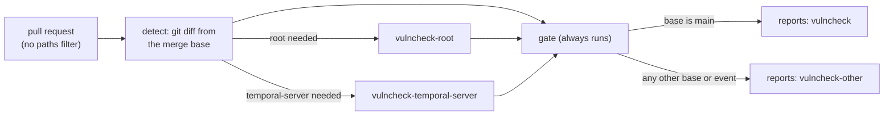

# The `vulncheck` job: contract of ADR-001-E4 E4-4

Binding for FU1 and FU2. A "pull request into `main`" has base branch `main`; *detect*, *gate* and the two scans are jobs of `.github/workflows/govulncheck.yml`.

## Rules

1. **No filter.** The `pull_request` trigger (opened, synchronize, reopened) loses its `paths` filter. A workflow skipped by a filter leaves its checks "Pending" ([workflow syntax](https://docs.github.com/en/actions/reference/workflows-and-actions/workflow-syntax)). `schedule` and `workflow_dispatch` stay; they scan both modules, and both must succeed.
2. **What detect scans.** It compares with the merge base, as `scripts/ci/temporal-server-changed.sh` does. No merge base is a failure.

   | Changed | Scanned |
   |---|---|
   | `go.mod`, `go.sum` | root |
   | `temporal-server/go.mod`, `temporal-server/go.sum` | `temporal-server` |
   | `govulncheck.yml`, its checked-in copy, the detect or gate script, `tools/ci/cisteps/`, a line naming `govulncheck` or `GOVULNCHECK_VERSION` in `Makefile` or `make/lint.mk` | both |
   | a `FROM golang:` line in any Dockerfile; any `go.work` | both |
   | anything else | none |

   The third row exercises an accidental break of the gate. It does not stop a deliberate one (RS3).
3. **One module at a time.** A finding in the module a pull request leaves alone does not block it; the schedule reports it.
4. **The gate.** `if: always()`, because a job whose `needs` failed is skipped, and a skipped job reports "Success" ([troubleshooting required checks](https://docs.github.com/en/pull-requests/collaborating-with-pull-requests/collaborating-on-repositories-with-code-quality-features/troubleshooting-required-status-checks)). It succeeds only if detect succeeded **and** each module is `success`, or `skipped` with detect saying "not needed". Everything else (failed, cancelled, timed out, empty or unknown output) is a failure.
5. **The name.** `name: ${{ github.base_ref == 'main' && 'vulncheck' || 'vulncheck-other' }}`. A check belongs to a commit, not to a pull request (#816 and #817 share head `e715ce2f` and its checks). So only a pull request into `main` may write the required name. E4-5's test reads both values as taken.
6. **Outside `ci.yml`.** There, adding any label but `ci:run` or `ci:full` starts a run that skips every job on the same commit.
7. **`GOWORK=off`** for both scans, and the build fails when a `go.work` is tracked. One beside the module changes the scanned versions without changing `go.mod` or `go.sum`.
8. **Same Go.** `toolchain` in a module's `go.mod` equals the version in every `FROM golang:` of that module: `temporal-server/Dockerfile`, and the seven under `deploy/compose/nava-*/` for the root module.
9. **The copy.** `make check-ci-steps` compares the whole of `govulncheck.yml` with a checked-in copy, byte for byte with comment lines removed. The Technical Architect asked for the `jobs:` block; the whole file costs the same code and also covers `on:`, top-level `env:` and `defaults.run.shell`. It also checks that `make -n vulncheck` prints exactly `govulncheck ./...` and `make -n vulncheck-temporal-server` exactly `cd temporal-server && govulncheck ./...`, because the copy cannot see a make recipe. FU1 moves `GOWORK=off` into both recipes and both expected lines. **This stops an accidental edit, or one that does not know about the copy. It does not stop a deliberate edit of both (RS3).**

## Tests

| # | Test | Catches |
|---|---|---|
| V-1 | The gate script: table over every detect output × job result (`success`, `failure`, `cancelled`, `skipped`, empty). Red first against a gate that returns 0 | a skip or cancel read as a pass |
| V-2 | Detect: table over every row of rule 2, plus a `.go` file only, docs only, both modules, no merge base | a missed or extra scan |
| V-3 | `check-ci-steps`, each red first: the Technical Architect's six edits (step `if: github.actor == 'nobody'`; job `if: github.event_name == 'never'`; `exit 0` before the make line; `shell: 'true {0}'`; make line in a printed heredoc; another job with `name: vulncheck`); top-level `defaults.run.shell` and `env:`; a `paths` filter; the gate without `always()`; the gate `name` without the base test; `\|\| true` in either make recipe | the gate broken by an edit of one file |
| V-4 | Live, after FU2. (a) Docs-only into `main`: `vulncheck` green, no scan. (b) A throwaway pull request into `main` with a library that has a known, reachable flaw: `vulncheck` red, `mergeStateStatus` `BLOCKED`. (c) The head of (b) also opened into a story branch that already holds the library: it reports only `vulncheck-other`, and (b) stays `BLOCKED`. (d) A pull request retargeted to `main`: no `vulncheck` until a push, not mergeable. Read `mergeStateStatus`, never `statusCheckRollup.state`. All closed unmerged, branches deleted | a gate that does not block |
| V-5 | `TestScannedToolchainIsTheShippedToolchain` (Security's patch, `critique/e4-adversarial-tests.patch.txt`), red on a lowered Dockerfile; a test that fails on a tracked `go.work` | a scan of a Go or a library version that does not ship |

`TestNoTwoWorkflowsReportTheSameCheck` and `TestReportedChecksReadsNameAndYaml` come with TICK-1145. FU1 extends them to read both values of rule 5; its red case is a second workflow with a job named `vulncheck-other`.
