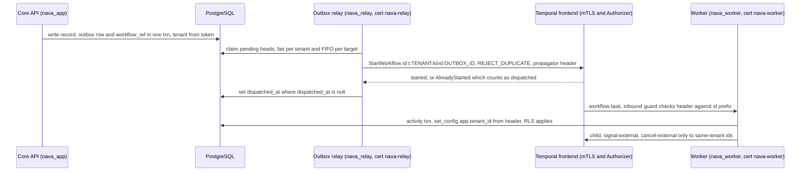

# RFC-001: Platform blueprint (revision 1)

> **Invariant source gap (unchanged).** The project has no description, so the eight invariants were never written down. §2 *proposes* I1–I8. Each is derived from a binding GOAL §3 principle and cites it. They become citable once nava accepts the ADR.
>
> **Numbering.** I assumed RFC-001 and ADR-001, because no earlier RFC or ADR exists.
>
> **Reviewer prefixes.** Items are cited as **S** (Security), **PG** (Postgres & Data Modeling) and **TA** (Technical Architect). Both PG and TA have a "B1".

## Changelog (round 0 → revision 1)

- **D22:**
  - Temporal frontend **mTLS plus a custom Authorizer** is now an **M1 requirement** (S1, TA D22-authz).
  - Outbound calls to other workflows are tenant-checked (S2).
  - Temporal Schedules are not used in M1 (S2).
  - Dedupe uses `REJECT_DUPLICATE` with error-on-started (TA-B2).
  - The workflow id is keyed per outbox row (TA-B2).
  - **Per-target FIFO** for signals is decided (PG Q3b).
- **D26:**
  - Keycloak floor is **≥ 26.1.3** (TA-B1).
  - Brokered logins can no longer link to an existing account by email, and the resolver checks the IdP (S3).
  - Mapper settings are recorded (TA A1).
  - The alias reasoning is corrected (TA).
- **D28:**
  - Purge and backup actors are added; there is no partitioning in M1 (S4).
  - The relay's column grants are fixed and the full `outbox` column set adopted (PG-B1).
  - `tenant_identity_binding` is under RLS with role-scoped policies, and CI-1 gains an allow-list (PG-B2).
  - `PUBLIC` grants are revoked and checked, and CI-4 checks against a grant manifest (PG-B3).
- **Unchanged decisions:** D6, and the I1–I8 list apart from wording in I3.

## 1. Summary

- **Invariants:** this RFC adopts I1–I8 (§2) as the citable invariants. Changing one needs a superseding ADR signed by nava.
- **D26 (identity):** one shared Keycloak realm per installation (**≥ 26.1.3**), with **Organizations**. The tenant is resolved from `(iss, organization id)` through `tenant_identity_binding`, and the token must name exactly one organization. A brokered login can never attach to an existing account by email.
- **D6 (API):** REST-first `/api/v1` with an OpenAPI 3.1 contract. RFC 9457 errors, opaque tenant-bound cursors, `Idempotency-Key` on writes, `If-Match` on updates. GraphQL comes later as a read surface. Unchanged from round 0.
- **D22 (Temporal tenancy):** one namespace `nava` per installation. The **Temporal frontend accepts only mTLS clients, and an Authorizer allow-lists each identity's API calls.** Only the relay starts and signals workflows, from outbox rows. Only the core cancels, updates or queries them. The tenant is carried by a `ContextPropagator` and checked on every inbound and outbound hop. Signals to one target are delivered in order.
- **D28 (system actors):** no runtime role has `BYPASSRLS`, owns a table, belongs to any role, or inherits anything from `PUBLIC`. Every cross-tenant path is a **named, allow-listed, role-scoped policy**. Backup is physical-only through a replication role that cannot run SQL.
- **What nava accepts:** R1 (Temporal histories are cross-tenant and not encrypted in M1), R2 (the migrator is all-powerful and the backup role reads everything), R3 (no tenant self-administration of Keycloak in M1). We also run a **custom Temporal server build**, because the Authorizer is compiled in (R7).

## 2. Invariants (proposed, citable as I1–I8)

| # | Invariant | GOAL source |
|---|---|---|
| **I1** | **Tenant wall in the database.** Every table holding tenant data has `tenant_id`, `ENABLE` and `FORCE ROW LEVEL SECURITY`, and a tenant policy on `NULLIF(current_setting('app.tenant_id', true), '')::uuid`. With no tenant context, a query returns nothing or errors; it never returns another tenant's rows. Unique keys and foreign keys include `tenant_id`. Any policy that does not test `app.tenant_id` is on a named allow-list. | P2, P19, §5 |
| **I2** | **The tenant comes only from a platform-verified source:** a validated token resolved through the identity binding (D26), or a row the platform wrote under RLS (the outbox, D22). Client values, payloads, script arguments, workflow inputs, signal bodies and search attributes are never a source of tenant. | P2 |
| **I3** | **Least-privilege database roles.** No runtime role is a superuser or has `BYPASSRLS`. None owns an object or is a member (direct or inherited) of any role, predefined `pg_*` roles included. No object grants anything to `PUBLIC`. Every grant is in one manifest. No `SECURITY DEFINER` function or RLS-bypassing view is reachable by a runtime role. | P2, P19; TICK-3 TA point; Epic 02 ACs |
| **I4** | **One write pipeline:** authorisation → defaults/computed → JSON Schema → declarative checks → commit with audit in the same transaction. This applies to every writer, onboarding seed data included. | P8, §2.4 |
| **I5** | **One authorization layer, enforced inside the query.** ACLs compile to SQL. The single-record Go check must agree. Field masks apply on write and on read. Unreadable, other-tenant and missing records give the same response. | P19, §2.12 |
| **I6** | **The durable path is deterministic and versioned.** I/O, clocks, randomness and tenant code run only in activities. In-flight executions keep their workflow version. | P7, P9 |
| **I7** | **Every side effect is idempotent,** keyed so that a retry, replay or redelivery never acts twice. | P10 |
| **I8** | **Contracts are the boundary, and AI is advisory.** Tenant code, plugins and AI reach data only through the versioned capability contract or the public API, with a scoped token. They never reach the database or Temporal directly. A tenant change never needs DDL. AI changes data only above an explicit confidence threshold, and the decision is recorded. | P1, P3, P14, P16, P20, P21 |

## 3. Decisions

| # | Decision | Why / what it prevents |
|---|---|---|
| **D26** | One shared Keycloak realm per installation, **Keycloak ≥ 26.1.3** (recommended 26.8.1), with **Organizations**, one per tenant. The tenant is resolved from `(iss, organization id)` through `tenant_identity_binding`, and a token must resolve to exactly one organization, otherwise 401. Tenant-linked IdPs have `trustEmail=OFF` and a first-broker-login flow **with no link to an existing account**. The resolver rejects a token whose `idp` claim is not linked to the resolved tenant. Only platform service accounts administer Keycloak. | It stops a tenant admin minting claims. It stops the org-picker tamper on 26.0.0–26.1.2 (TA-B1). It stops takeover of another tenant's account through a tenant-controlled IdP (S3). A future dedicated-realm tenant needs only a binding row. |
| **D6** | REST-first `/api/v1/` from an OpenAPI 3.1 contract, additive-only within a major version. RFC 9457 errors with a stable `code`. Opaque HMAC cursors bound to tenant, principal and query. `Idempotency-Key` on writes, ETag/`If-Match` on updates, rate limits per tenant. GraphQL comes later as a read surface over the same layer. | One authorization surface to secure in M1 (I5). Known HTTP idempotency semantics. One generated SDK contract (I8). TA confirmed: no library-level risk. |
| **D22** | One Temporal namespace `nava` per installation. **M1 requires frontend mTLS plus a custom `Authorizer` and `ClaimMapper`** with an API allow-list per certificate identity (§4.3). Only the relay starts workflows, from an outbox row, with id `t:<tenant>:<kind>:<outbox_id>`, `REJECT_DUPLICATE` and error-on-started. Signals also go through the outbox and the relay. Only the core cancels, updates or queries. The tenant travels in a `ContextPropagator` header, with inbound **and** outbound guards. Signals are FIFO per target. Payloads carry references only. Schedules are not used in M1. | A forged start or signal by any process that can reach port 7233 (S1). A cross-tenant cancel or signal issued from inside a workflow (S2). A duplicate run on redelivery (TA-B2). Approve and cancel arriving in the wrong order (PG Q3b). |
| **D28** | One database role per system actor (§4.4). None is a superuser, has `BYPASSRLS`, owns anything, belongs to any role, or inherits from `PUBLIC`. Every cross-tenant path is a role-scoped policy on a named allow-list, or a separate database. Grants are generated from one manifest. Backups are physical, through a replication-only role. The migrator owns everything, runs as a one-shot job and is granted to no one. | It stops the first cross-tenant job shipping with `BYPASSRLS` or as the migrator (S4). It closes the `SET ROLE` path (TICK-3 TA point) and `PUBLIC` grant leaks (PG-B3). |

## 4. Design detail

### 4.1 D26: identity and tenant resolution

**Validate the token.**
- Signature against cached JWKS. The key must belong to the realm named by `iss` (CI-5).
- `alg` allow-list.
- `aud`, and `exp`/`nbf` with ±60 s skew.
- `typ`/`azp` checks, so an ID token is rejected.

**Read the organization.**
- Read the `organization` claim, an object keyed by alias: `{"<alias>":{"id":"<uuid>"}}`.
- Count the keys. Zero or more than one means **401 `tenant_unresolved`**.
- Read `.id` from the single key.

**Check the IdP.** When a brokered login sets the `idp` claim (from the `identity_provider` session note), it must be one of the IdP aliases bound to the resolved tenant.

**Resolve.** Look up `tenant_identity_binding(issuer, org_id, idp_aliases[]) → tenant_id`. The table has `UNIQUE (issuer, org_id)`, and the lookup errors if it ever finds more than one row.

**Set the transaction context.** `set_config('app.tenant_id', $1, true)` is set per transaction, and only inside the database helper.

**Realm export (TA A1).** Set the organization membership mapper to:
- `addOrganizationId=true`
- `jsonType.label=JSON`
- `addOrganizationAttributes=false`, because org attributes are admin-editable

**Why bind on the id (corrected, TA).** The organization alias **cannot** be changed: Keycloak returns 400 on 26.0.7 and on 26.8.1. We still bind on the id, because a deleted and recreated organization could reuse the alias and inherit the old binding.

**Federation hardening (S3).** Every tenant-linked IdP has:
- `trustEmail=OFF`.
- A first-broker-login flow of `idp-create-user-if-unique` only. It has no `idp-confirm-link`, no `idp-email-verification` and no auto-link. If an account already exists, the login fails.
- Brokered users are accepted only into the organization that owns the IdP, and only for that organization's verified domains.

**Admin and groups.**
- Tenant admins hold no Keycloak admin roles.
- User and group changes go through the platform API. Every Keycloak user or group id comes from a `principals` or `groups` row read under RLS, never from the client.
- Tenant groups live under `/t/<tenant_id>/…`. Group sync also requires the user to be a member of that tenant's organization.

**Token lifetime.** Access tokens live 5 minutes or less.

### 4.2 D6: Records API v1 contract (unchanged)

| Concern | Contract |
|---|---|
| Resources | `GET/POST /api/v1/records/{entityType}` and `GET/PATCH/DELETE /api/v1/records/{entityType}/{id}`, plus `/comments`, `/history` |
| Versioning | The URL carries the major version. Within v1, changes are additive only. `Deprecation` and `Sunset` headers give at least one major release of notice. `schema_version` is independent of the API version. |
| Errors | RFC 9457 `problem+json` with a stable `code`, `detail` and `errors[]` (JSON pointer and keyword). Other-tenant, unreadable and missing records all return the same **404 `not_found`**. |
| Paging | `limit` ≤ 200. The opaque keyset cursor is HMAC-bound to tenant, principal and filter hash. No offset paging. |
| Filter and sort | Only on readable fields. A masked field returns **400 `field_not_readable`**. |
| Idempotency | `idempotency_keys(tenant_id, principal_id, key, request_hash, response, expires_at)` under RLS, kept for 24 h. The same key with a different body returns **409 `idempotency_conflict`**. |
| Concurrency | `version`. PATCH requires `If-Match`, otherwise **412**. |
| Limits | Token bucket per tenant and per principal. Over the limit returns **429** with `RateLimit-*`. |

### 4.3 D22: how a workflow's tenant is fixed and who may call Temporal

**Who may call the Temporal frontend (S1, M1 requirement).** The frontend (gRPC, port 7233) requires **mTLS**. A client certificate signed by the installation's internal CA is the only way in. A custom `ClaimMapper` maps the certificate subject to an identity. A custom `Authorizer` **denies by default** and allows:

| Identity | Allowed frontend APIs on namespace `nava` |
|---|---|
| `nava-relay` | `StartWorkflowExecution`, `SignalWorkflowExecution`, `SignalWithStartWorkflowExecution` (only the relay dispatches outbox rows, starts and signals alike) |
| `nava-core` | `RequestCancelWorkflowExecution`, `UpdateWorkflowExecution`, `QueryWorkflow`, `DescribeWorkflowExecution`, `GetWorkflowExecutionHistory` (status reads) |
| `nava-worker` | `PollWorkflowTaskQueue`, `PollActivityTaskQueue`, `RespondWorkflowTask*`, `RespondActivityTask*`, `RecordActivityTaskHeartbeat`, `RespondQueryTaskCompleted`. **No** start, signal or cancel calls. Child workflows, signal-external and cancel-external are workflow *commands*, guarded by the outbound interceptor below. |
| `nava-operator` | Admin and visibility (`tctl`/`temporal` CLI, UI), reachable only from the operator network |

**What has no route to Temporal:** sandbox runtime hosts, plugin processes, the AI service (Mastra) and anything tenant-supplied. That is enforced by network policy, and they hold no certificate. The Temporal UI runs behind operator authentication.

**Custom server build.** The Authorizer and ClaimMapper are Go plugins compiled into the server, so we ship a **custom Temporal server build**, pinned to the server version (R7).

**How the tenant moves through a workflow:**

**Start (I2, I7, TA-B2).**
- The producer inserts the outbox row and, in the same transaction, a `workflow_ref(tenant_id, record_id, kind, workflow_id)` row. The producer generates the UUIDv7 `outbox.id` up front, so it already knows `workflow_id = t:<tenant>:<kind>:<outbox_id>`.
- The relay starts with:
  - that `WorkflowID`
  - `WorkflowIDReusePolicy = REJECT_DUPLICATE`
  - `WorkflowExecutionErrorWhenAlreadyStarted = true`
- It treats `WorkflowExecutionAlreadyStarted` as "already dispatched" and marks the row dispatched.
- To start a failed workflow again, a new event writes a **new outbox row**. A redelivery never restarts anything.
- The relay never reads a tenant from anything other than `outbox.tenant_id`.

**Carrying the tenant (TA A3a).**
- `nava-tenant` is carried by a **`ContextPropagator`**. The spike showed it reaches activities, local activities, children, continue-as-new runs, retries and signals with no manual copying.
- `NavaTenantId` is a search attribute for **operator filtering only**. Workflow code can upsert it, so it is never read as a tenant (TA A3d).

**Inbound guards.** The workflow fails **non-retryably**, with a metric emitted, when:
- the header is missing on workflow start;
- the header does not match the id prefix;
- a signal or update header's tenant does not equal the workflow's tenant (the update validator rejects the update).

The activity guard fails the activity non-retryably if the header is missing, and the database helper refuses a transaction without a tenant.

**Outbound guard (S2).** The workflow outbound interceptor rejects any call whose target workflow id prefix is not the workflow's own tenant:
- `ExecuteChildWorkflow`
- `SignalExternalWorkflow`
- `RequestCancelExternalWorkflow`
- `NewContinueAsNewError` (it must keep the same id)

Tenant-shaped workflow definitions (Epic 09) can only name targets through platform step types that resolve ids from `workflow_ref` under RLS.

**Signals and cancels.**
- **Signals** are outbox rows, written by core endpoints that resolve the target from `workflow_ref` under RLS. The core never accepts a client-supplied workflow id.
- The signal payload carries `outbox.id`, and the handler ignores ids it has already applied (a bounded set in workflow state) (I7).
- **Cancels and updates** come from the core, through the same RLS resolution.

**Per-target ordering (PG Q3b), decided: FIFO per `(tenant_id, target_key)`.**
- Approve-then-cancel and cancel-then-approve have different outcomes, so delivery order is part of correctness, not a nicety.
- **Claim rule:** a pending row is a candidate only if no older pending row exists for the same `(tenant_id, target_key)`. Order is by `id`, UUIDv7.
- Candidates are then claimed with `FOR UPDATE SKIP LOCKED`. A later row only becomes a candidate after its predecessor commits as dispatched or dead. So two relay instances cannot reorder one target, and no advisory lock is needed.
- A backing-off head blocks only its own target. A dead head unblocks its target and raises an alert.
- **Assumption:** producers writing to one target are serialised by the record row lock and `If-Match`, so `id` order is commit order per target.
- **Index:** `(tenant_id, target_key, id) WHERE dispatched_at IS NULL AND dead_at IS NULL`, alongside PG's fair-claim index. Epic 08 measures it.

**Not used in M1:** Temporal **Schedules**, cron workflows and workflow reset by tenants (S2). Recurring work is platform-scheduled and goes through the outbox. Adopting Schedules later needs its own ADR and a header-propagation spike.

**Noisy neighbour.** Use PG's fair claim: walk the pending index per tenant, then take ≤ 2 heads per tenant with `LATERAL … FOR UPDATE SKIP LOCKED`. In PG's measurement this served 200 of 200 tenants in 5.0 ms. Workers also cap concurrency per tenant. Epic 08 runs the flood test.

### 4.4 D28: system actors and database roles

**Global settings** (first migration, then re-asserted by CI):
- `REVOKE ALL ON DATABASE nava FROM PUBLIC`
- `REVOKE ALL ON SCHEMA public FROM PUBLIC`
- `ALTER DEFAULT PRIVILEGES FOR ROLE nava_migrator REVOKE EXECUTE ON FUNCTIONS FROM PUBLIC`
- **no** `ALTER DEFAULT PRIVILEGES … GRANT`

Every grant comes from one manifest (`db/grants.yaml`: object → role → privileges, column-level where listed). All roles are `NOSUPERUSER NOCREATEDB NOCREATEROLE`, and none has `REPLICATION` unless the table says so.

| Actor | DB role | Owns | Member of | BYPASSRLS | How it reaches tenant data |
|---|---|---|---|---|---|
| **Migrations** (one-shot job, direct to PostgreSQL, not through PgBouncer) | `nava_migrator` | **All** objects in DB `nava`, and `datdba` | none. Granted to **no** role. | **No** | As owner, it is subject to `FORCE`. Backfills run per tenant with `SET LOCAL`, batched by key range. After every run, a catalogue check fails the job if any tenant table lost RLS or `FORCE`, or if any `PUBLIC` grant exists. |
| **Core API** | `nava_app` | nothing | none | **No** | Manifest DML on tenant tables, under the tenant policy. `INSERT` on `outbox` and `workflow_ref`. `SELECT` on `tenant_identity_binding` through policy `binding_lookup`. No DDL and no `CREATE`. |
| **Workflow workers** | `nava_worker` | nothing | none | **No** | The same tenant-table grants as `nava_app`, through the write pipeline. Tenant from the Temporal header. `INSERT` on `outbox` and `workflow_ref`. |
| **Outbox relay** | `nava_relay` | nothing | none | **No** | `SELECT` on `outbox` for every column except `dedupe_key` and `last_error`. `UPDATE (available_at, attempts, last_error, dispatched_at, dead_at)`. Separate policies `outbox_relay_select FOR SELECT TO nava_relay USING (true)` and `outbox_relay_update FOR UPDATE TO nava_relay USING (true)`. **No** `DELETE` (moved to purge). No grant on any other table. |
| **Purge jobs** (expired idempotency keys, old outbox rows) | `nava_purge` | nothing | none | **No** | `DELETE` plus column `SELECT` on key and predicate columns only, for example `idempotency_keys(tenant_id, id, expires_at)` and `outbox(tenant_id, id, dispatched_at, dead_at)`. Policies are `FOR DELETE TO nava_purge USING (expires_at < now())` and `USING (dispatched_at < now() - interval '7 days' OR dead_at < now() - interval '30 days')`. It cannot read data columns. **Audit is not purged in M1;** audit retention waits for D23 (TICK-38). |
| **Tenant onboarding** | `nava_onboard` | nothing | none | **No** | `INSERT` on `tenants` and `tenant_identity_binding` (policy `binding_onboard FOR INSERT TO nava_onboard WITH CHECK (true)`). `SELECT` on its own provisioning `tenants` row. It seeds through the write pipeline with `SET LOCAL` to the new tenant. Its tenant-table insert policies have `WITH CHECK (tenant_id IN (SELECT id FROM tenants WHERE state = 'provisioning'))`. It is idempotent on the onboarding request id. |
| **Group sync** | `nava_groupsync` | nothing | none | **No** | `SELECT` on `tenant_identity_binding` (`binding_lookup`). DML on `principals`, `groups`, `group_members` and `org_units`, one transaction per tenant with `SET LOCAL`. A user is synced into tenant B only if they are a member of B's organization. |
| **Backups** | `nava_backup` | nothing | none | **No**, `REPLICATION` instead | **Physical only** (`pg_basebackup` plus WAL archive). `pg_hba.conf` allows it **only** for the `replication` pseudo-database from the backup host, so it **cannot run SQL** against `nava`. Its credential lives only in the backup job. Logical, per-tenant export is D23 (TICK-38) and runs under RLS. |
| **Partition maintenance** | — | — | — | — | **No partitioned tenant tables in M1.** Partitioning arrives with D23. Its DDL then runs as a scheduled migrator-class job with the same post-run catalogue check (R2). |
| **Temporal persistence** | `temporal` | DBs `temporal` and `temporal_visibility` | none | No (RLS does not apply in its databases) | No access to `nava`. Histories are cross-tenant by construction (R1). Platform roles have no `CONNECT` on its databases. |
| *Keycloak (not a platform actor)* | `keycloak` | DB `keycloak` | none | No | No access to `nava` |
| *Bootstrap (not a runtime actor)* | image superuser | — | — | (superuser) | Init script only. In no service's environment. Rotated or disabled after init on-premise. |

**The `tenant_identity_binding` table (PG-B2).** It keeps `ENABLE` and `FORCE` RLS. Its only policies are `binding_lookup FOR SELECT TO nava_app, nava_groupsync USING (true)` and `binding_onboard FOR INSERT TO nava_onboard WITH CHECK (true)`. It holds ids and IdP aliases, no business data.

**Allow-list of policies that do not test `app.tenant_id`.** CI-1 enforces exactly these:
- `outbox_relay_select`
- `outbox_relay_update`
- `binding_lookup`
- `binding_onboard`
- `idempotency_purge`
- `outbox_purge`

Every one of them names a `FOR` command and a `TO` role. None is `FOR ALL` or `TO PUBLIC`.

**Answer to the TA's TICK-3 membership point.** This is unchanged, and Security confirmed it. No runtime role is a member of any role, and nobody is a member of `nava_migrator`. CI-3 now also asserts `pg_has_role(<runtime>, relowner, 'MEMBER') = false` for every tenant table, and `datdba = nava_migrator`.

**`outbox` table (PG Q3b column set adopted):**
- `id uuid` (UUIDv7) and `tenant_id`, with PK `(tenant_id, id)`
- `kind`, `kind_version`
- `dedupe_key` with `UNIQUE (tenant_id, dedupe_key)`, for producer `ON CONFLICT DO NOTHING`
- `target_key`
- `payload jsonb`, references only
- `trace_context`
- `created_at`, `available_at`
- `attempts`, `last_error`
- `dispatched_at`, `dead_at`

Indexes: PG's partial claim index, plus the FIFO index (§4.3). `id` is **not** a Temporal request id (TA-B2). For a start, it is the workflow-id key.

## 5. Options considered

| Decision | Option | Why it lost |
|---|---|---|
| D26 | Realm per tenant | Each tenant admin is a realm admin. Needs a JWKS and issuer per tenant. Config drift. Scale at many realms unverified. The binding table keeps it available as an escape hatch. |
| D26 | Tenant id as a user attribute or claim | Fails I2: an editable attribute becomes a forgery path. |
| D26 | Auto-link brokered users by verified email | Account takeover across tenants (S3). |
| D6 | GraphQL-first, or REST and GraphQL equal in M1 | Two authorization surfaces, plus GraphQL cost governance, before Epic 06 is proven. |
| D22 | Namespace per tenant | Pollers grow with tenant count, onboarding needs an admin operation, and persistence stays shared. Revisit with D23. |
| D22 | Tenant in workflow input or search attribute | Fails I2. Inputs are caller-shaped, and the spike showed the search attribute can be changed from workflow code. |
| D22 | Network isolation of 7233 without mTLS | A compromised pod on the platform network could still forge calls (S1). The Authorizer's per-identity API split is what stops a worker certificate starting workflows. |
| D22 | Default Temporal JWT authorizer with namespace roles | Its roles are per namespace, not per API. It cannot express "relay may start, worker may not". |
| D22 | Outbox `id` as Temporal request id | Not exposed by Go SDK v1.49.0 (TA-B2). |
| D22 | Unordered signals (accept reordering) | Approve and cancel race. Per-target FIFO is cheap because predecessors gate their successors. |
| D28 | One `nava_system` role with `BYPASSRLS` | One leaked credential reads every tenant. |
| D28 | NOLOGIN group roles | Legal, but harder to audit. PG agreed with direct grants from a manifest. |
| D28 | Backup role with `BYPASSRLS` and `pg_dump` (Security's proposal) | It can run arbitrary SQL across tenants. A replication-only role cannot run SQL at all. If an on-premise customer requires logical dumps, Security's ops-only `BYPASSRLS` role is the fallback, with its credential on no runtime host. |
| D28 | `SECURITY DEFINER` functions | They bypass RLS invisibly. Banned by Epic 02. |

## 6. Risks and accepted residuals

| # | Risk | Mitigation now | Owner | Revisit trigger |
|---|---|---|---|---|
| R1 | Temporal histories are cross-tenant and unencrypted | References-only payloads (CI-7), separate database, mTLS, operator-only UI | Solution Architect | The first regulated-data tenant, or TICK-41 decided. Then an encrypting codec with per-tenant keys. |
| R2 | The migrator is all-powerful. The backup role reads every byte. | One-shot job. Direct connection. Post-run catalogue check. Backup is replication-only, with its credential only in the backup job. | Technical Lead | Any request to run migrations from a runtime process, or a logical-dump requirement |
| R3 | No tenant self-administration of Keycloak in M1 | Platform API | CTO / founder | Epic 26 scoping |
| R4 | A user in two organizations must pick one | `scope=organization:<alias>` (confirmed by TA A2). A non-member alias returns no claim, so 401. Adding an existing user to another org is invitation-only. | Solution Architect | **Closed as a verification item.** Kept as a UX note. |
| R5 | Shared namespace has one retention and one rate limit | Fair claim, per-tenant worker caps | Solution Architect | D23 needs per-tenant retention, or the flood test fails |
| R6 | D1 is still open | The design holds in both modes | CTO | D1 |
| R7 | A custom Temporal server build to own | It only adds the Authorizer and ClaimMapper. Pinned with the server version. A CI test of the API allow-list. | Technical Lead | Each Temporal server upgrade |
| R8 | A compromised relay or core certificate can still start or signal for any tenant | The relay reads the tenant only from `outbox`. Separate credential and pool. The inbound guard still checks the id prefix. | Security reviewer | Any new process that needs a start or signal certificate |
| R9 | Head-of-line blocking per target while a signal backs off | It blocks only that target. A dead row unblocks it and raises an alert. | Technical Lead | Epic 08 latency measurements |

## 7. Verification status

| # | Item | Status |
|---|---|---|
| A1 | Organization id in the token | **Confirmed** with the mapper settings in §4.1 (TA) |
| A2 | `organization:<alias>` selection | **Confirmed** (TA) |
| A3 | Header propagation | **Confirmed** through a `ContextPropagator`, including signals and continue-as-new (TA). `SignalExternalWorkflow` and update are untested; covered by CI-6. |
| A4 | `NULLIF(current_setting…)` fails closed | **Confirmed** on PostgreSQL 15.19 and 16.15 (PG, TA) |
| A6 (new) | Keycloak 26.8.1: is a brokered email outside the organization's verified domains rejected? Does the `identity_provider` session note reach the token as `idp`? Does create-if-unique fail on an existing email? | **Verify by spike** (TA), before Epic 03 planning |
| A7 (new) | Temporal 1.28.x: a custom Authorizer allows only the listed APIs per certificate identity. An unlisted certificate fails the TLS handshake. A worker certificate cannot `StartWorkflowExecution`. | **Verify by spike** (TA), before Epic 08 planning. Becomes CI-6. |

## 8. Test and acceptance spec

| # | Test | What it catches |
|---|---|---|
| CI-1 | Every table with `tenant_id` has RLS and `FORCE`. Every policy either tests `app.tenant_id` or is on the §4.4 allow-list, and every policy names `FOR` and `TO`, never `ALL` or `PUBLIC`. No `SECURITY DEFINER` function. Views are `security_invoker`. | I1, I3, PG-B2, S-N3 |
| CI-2 | For each runtime role, run with no tenant set, with `''`, and after a prior `SET LOCAL` through PgBouncer: each gives 0 rows or an error | Fail-open RLS, pool bleed |
| CI-3 | Recursive `pg_auth_members` is empty for runtime roles, and no one is a member of `nava_migrator`. `pg_has_role(runtime, relowner, 'MEMBER') = false`. `datdba = nava_migrator`. **`aclexplode()` shows no grantee `0` (`PUBLIC`)** on any object in platform schemas. | The TICK-3 `SET ROLE` path, PG-B3 |
| CI-4 | For every runtime role and table, `has_table_privilege` and `has_column_privilege` **equal the manifest** exactly | Grant creep (PG-B3) |
| CI-5 | Tokens with zero or two organizations. An unknown issuer. A key from realm X with `iss=Y`. An ID token used as an access token. **The `kc.org` tamper to a non-member organization (TA-B1).** A brokered login asserting another tenant's user's email (S3). An `idp` not bound to the tenant. A duplicate binding insert. All rejected. | D26, I2 |
| CI-6 | An unlisted certificate cannot connect. A worker certificate cannot start, signal or cancel (S1). No header fails the workflow. A header that differs from the id prefix fails it. A signal or update from another tenant is rejected. A child, signal-external or cancel-external to another tenant's id is rejected (S2). Redelivering a start row after completion creates no second run (TA-B2). A redelivered signal is applied once. Two relays never reorder signals to one target. | D22, I2, I7 |
| CI-7 | The workflow input and activity payload schema rejects record-data fields | R1 creep |
| CI-8 | Byte-identical 404s. Cross-tenant cursor replay returns 400. Idempotency replay and 409 on conflict. A filter on a masked field returns 400. | D6, I5, I7 |
| CI-9 | `nava_relay` cannot select `records`. `nava_purge` cannot read data columns or delete unexpired rows. `nava_backup` cannot open a SQL session on `nava`. `nava_onboard` cannot insert into a non-provisioning tenant. | D28, S4, S-N2 |

## 9. Response — round 1

| Item | Resolution | Where |
|---|---|---|
| **S1** Forged start or signal (with TA D22-authz) | **Accepted.** mTLS plus a deny-by-default Authorizer with per-identity API allow-lists is an **M1 requirement in the ADR**. Workers cannot start or signal. Tenant-side processes have no route to Temporal. Residual R8 recorded. Spike A7. | §3 D22, §4.3, CI-6, R7, R8 |
| **S2** Outbound coverage | **Accepted.** The outbound guard covers child, signal-external, cancel-external and continue-as-new. Update validators check the tenant. Schedules, cron and reset are not used in M1. | §4.3, CI-6 |
| **S3** IdP account takeover | **Accepted.** `trustEmail=OFF`, create-if-unique only, membership restricted to the org's domains, an `idp` check in the resolver. Spike A6. | §3 D26, §4.1, CI-5 |
| **S4** Missing actors | **Accepted, one deviation.** Purge role with expiry-scoped `DELETE` policies. Backup is **replication-only, not `BYPASSRLS`**: narrower, because it cannot run SQL. Security's `BYPASSRLS` design is the recorded fallback. No partitioning in M1. | §4.4, R2, CI-9 |
| **PG-B1** Relay cannot see pending rows | **Accepted.** PG's column set and relay grants. `DELETE` moves to `nava_purge`. | §4.4 |
| **PG-B2** Binding lookup vs CI-1 | **Accepted.** `FORCE` RLS stays, with role-scoped policies and the CI-1 allow-list. | §4.4, CI-1 |
| **PG-B3** `PUBLIC` grants invisible to CI-3 | **Accepted.** Revoke from `PUBLIC`, the `aclexplode` check, and CI-4 against the manifest. | §4.4, CI-3, CI-4 |
| **TA-B1** Org-picker tamper | **Accepted.** Floor ≥ 26.1.3 (recommended 26.8.1). The TA's pin text goes into the ADR. The Technical Lead commits it at planning. TICK-4 is not reopened. Regression in CI-5. | §3 D26, ADR pins |
| **TA-B2** Request-id dedupe | **Accepted.** TA's reuse-policy text, verbatim. The workflow id is keyed on `outbox.id`, and `workflow_ref` holds the mapping. | §4.3, CI-6 |
| **PG Q3b** Per-target order | **Decided: FIFO per `(tenant_id, target_key)`.** Predecessor-gated claim, no advisory lock. | §4.3, R9 |

## 10. Carried to ADR (non-blocking, accepted as stated by the reviewers)

**Security**
- **S-N1:** `UNIQUE (issuer, org_id)`; the lookup errors on more than one row.
- **S-N2:** onboarding `WITH CHECK` to provisioning tenants only; group sync requires org membership.
- **S-N3:** the relay and purge policies are `FOR`/`TO`-scoped; CI-1 enforces it.
- **S-N4:** Keycloak ids come from RLS-read rows; adding an existing user to another org is invitation-only.
- **S-N5:** issuer and key binding test.

**Postgres**
- **PG-N1:** `set_config` only inside the database helper (lint rule); parameterised SQL only.
- **PG-N2:** fair per-tenant claim query shape.
- **PG-N3:** onboarding needs the pipeline's grants; `INSERT … RETURNING` needs `SELECT`, for `nava_worker` too.
- **PG-N4:** split `FOR` policies; tenant policies `TO` the runtime roles, not `PUBLIC`.
- **PG-N5:** backfills batched by key range per tenant.
- **PG Q3a:** direct grants from one manifest, and never `ALTER DEFAULT PRIVILEGES … GRANT`.

**Technical Architect**
- **TA-A1:** mapper settings (`addOrganizationId=true`, `jsonType.label=JSON`, `addOrganizationAttributes=false`).
- **TA alias:** the alias is immutable; the id binding is kept because of recreate-reuse.
- **TA-A3a:** use a `ContextPropagator`.
- **TA-A3d:** `NavaTenantId` is mutable, so visibility only.
- **TA D22-guard:** guards fail the workflow or activity non-retryably, with a metric, never by panicking.
- **TA pin:** `go.temporal.io/sdk` v1.49.0 needs Go ≥ 1.26. Pin both together. Temporal server 1.28.4 was tested.

## 11. Open questions

1. **nava:** adopt I1–I8? Accept R1, R2, R3 and R7?
2. **Technical Architect:** run A6 and A7 before Epic 03 and Epic 08 planning. If A7 fails (the Authorizer cannot split APIs per certificate), D22 falls back to a dedicated relay-only frontend endpoint plus network policy. That is weaker, and I would bring it back to this thread.

## Fixed inputs

PostgreSQL ≥ 15, PgBouncer ≥ 1.21 (`max_prepared_statements > 0`), Temporal on `default` until this ADR is accepted (Epic 08 then creates `nava`). For Keycloak, Epic 01's "26 or later" is narrowed to **≥ 26.1.3** by excluding a proven-broken range, per the CTO ruling. This is not a reopening of TICK-4.
