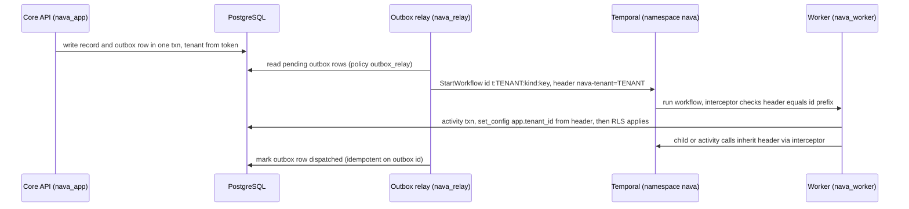

# RFC-001: Platform blueprint

> **Invariant source gap.** The project (Ticket Management System) has no description, so the "eight architectural invariants" my role cites were never written down. This RFC does **not** assume them. Section 2 *proposes* eight. Each one is derived from a binding GOAL §3 principle and cites its source. They become citable only when nava accepts the ADR. Until then, invariant checks in this RFC are made **against the proposed list** and are marked incomplete.
>
> **Numbering.** No earlier RFC or ADR exists on the board, so I assumed **RFC-001**. The ADR will be ADR-001.

## 1. Summary

- **Invariants:** this RFC adopts eight numbered invariants, I1–I8, taken from GOAL §3. Later ADRs cite them by number. Changing one needs a superseding ADR signed by nava.
- **D26 (identity):** use **one shared Keycloak realm with Organizations** (Keycloak 26 or later). The tenant is resolved from the token's **issuer plus its immutable organization id**, through a platform binding table. A token never names the tenant directly. A dedicated realm stays possible later without a contract change.
- **D6 (API):** the API is **REST-first, `/api/v1`**, with an OpenAPI 3.1 contract, RFC 9457 errors, opaque cursors, `Idempotency-Key` on every write and `If-Match` concurrency. GraphQL arrives later (Epic 23) as a read surface over the same authorization layer. Its mutations go through the write pipeline.
- **D22 (Temporal tenancy):** use **one shared namespace per installation**. Only the platform starts workflows, from an outbox row. The tenant is fixed at start in a Temporal **header**, the workflow id is prefixed with the tenant, and the tenant is re-checked on every activity, signal and child workflow. Each activity's database work runs under RLS.
- **D28 (system actors):** **no runtime role has `BYPASSRLS`, owns a table, or is a member of any role.** Cross-tenant actors get one of three narrow mechanisms: role-scoped RLS policies on a single table, per-tenant iteration under RLS, or a separate database. The migrator is the one trusted role, and it is never reachable from runtime.
- **What nava accepts:** Temporal histories are cross-tenant data that sits under one database role and is not encrypted in M1. This is mitigated by keeping only references in payloads, giving Temporal its own database, and making its UI operator-only (R1). Tenant administrators also cannot self-administer Keycloak in M1 (R3).

## 2. Invariants (proposed, citable as I1–I8)

| # | Invariant | GOAL source |
|---|---|---|
| **I1** | **Tenant wall in the database.** Every table holding tenant data has `tenant_id`, `ENABLE` and `FORCE ROW LEVEL SECURITY`, and a policy on `NULLIF(current_setting('app.tenant_id', true), '')::uuid`. A query with no tenant context returns nothing or errors. It never returns another tenant's rows. Unique keys and foreign keys include `tenant_id`. | P2, P19, §5 |
| **I2** | **The tenant comes only from a platform-verified source.** That means a validated token resolved through the identity binding (D26), or a row the platform wrote under RLS (the outbox, D22). Client values, payloads, script arguments, workflow inputs and signal bodies are never a source of tenant. | P2 |
| **I3** | **Least-privilege database roles.** No role used at runtime is a superuser, has `BYPASSRLS`, owns a table, or is a member (directly or inherited) of any role, predefined `pg_*` roles included. No `SECURITY DEFINER` function and no RLS-bypassing view is reachable by a runtime role. | P2, P19; TICK-3 TA point; Epic 02 ACs |
| **I4** | **One write pipeline.** Every writer goes authorisation → defaults/computed → JSON Schema → declarative checks → commit with audit in the same transaction. That includes the API, SDK, rules, workflow activities, AI, imports and onboarding seed data. | P8, §2.4 |
| **I5** | **One authorization layer, enforced inside the query.** ACLs compile to SQL for lists, counts, aggregates and exports. The Go single-record check must agree (tested). Field masks are applied in the pipeline and in response shaping. Unreadable, other-tenant and missing records give the same response. | P19, §2.12 |
| **I6** | **The durable path is deterministic and versioned.** All I/O, clocks, randomness and tenant code run in activities. Workflow definitions are versioned, and in-flight executions keep their version. | P7, P9 |
| **I7** | **Every side effect is idempotent,** keyed so that a retry, replay or duplicate delivery never acts twice. That covers API writes, activities, outbox dispatch, onboarding and sync. | P10 |
| **I8** | **Contracts are the boundary, and AI is advisory.** Tenant code, plugins and AI reach data only through the versioned capability contract or the public API, with a scoped token. A tenant change never needs DDL or a platform deploy. AI output changes data only above an explicit confidence threshold, and the decision is recorded. | P1, P3, P14, P16, P20, P21 |

## 3. Decisions

| # | Decision | Why / what it prevents |
|---|---|---|
| **D26** | Use one shared Keycloak realm per installation, with **Organizations**, one organization per tenant. The tenant is resolved from `(iss, organization id)` through `tenant_identity_binding`. A token must resolve to **exactly one** organization, otherwise 401. Only platform service accounts administer Keycloak. Tenant groups live under a per-tenant root group. On-premise means its own installation and realm. | It prevents a tenant admin minting claims for another tenant (Security, TICK-3). It avoids realm-count scaling and per-realm config drift. A binding table, not a claim, is the tenant source (I2), so a future dedicated-realm tenant needs only a new binding row. |
| **D6** | The API is **REST-first, `/api/v1/`**, from an OpenAPI 3.1 contract. Within a major version, changes are additive only. Errors are RFC 9457 `problem+json` with a stable `code`. Cursors are opaque and bound to tenant and query. `Idempotency-Key` is required on POST/PATCH/DELETE. ETag with `If-Match` is required on updates. Rate limits apply per tenant. GraphQL comes later as a read surface over the same layer. | It keeps one authorization surface to secure in M1 (I5). HTTP caching and idempotency semantics are well understood. It avoids GraphQL complexity governance before Epic 23. The SDK is generated from one contract (I8). |
| **D22** | Use **one Temporal namespace per installation** (`nava`, created in Epic 08). Workflows are started **only** by platform code from an outbox row. Tenant id goes in an immutable `nava-tenant` header and the `NavaTenantId` search attribute. The workflow id is `t:<tenant_id>:<kind>:<key>`. Interceptors refuse to run any workflow, activity, signal or child workflow without a matching tenant. Activities use `SET LOCAL app.tenant_id` under RLS. Payloads carry references, not record data. | The tenant cannot come from workflow input or signals (I2). Tenant A cannot address B's workflow, because ids come from rows read under RLS. A namespace per tenant would multiply worker pollers and onboarding admin operations for little isolation gain, since the persistence database is shared either way. |
| **D28** | System actors use **one database role each** (table in §4.4). None is a superuser, has `BYPASSRLS`, owns a table, or belongs to any role. Cross-tenant access uses **(a)** role-scoped RLS policies on one table (relay → `outbox`), **(b)** per-tenant iteration with `SET LOCAL` (group sync, onboarding seed, backfills), or **(c)** a separate database (Temporal, Keycloak). The migrator owns everything, runs only as a one-shot job, and is granted to no one. | Otherwise the first cross-tenant job ships with `BYPASSRLS`. The membership rule closes the `SET ROLE` path to the owner, which the TA raised on TICK-3 (I3). |

## 4. Design detail

### 4.1 D26: identity and tenant resolution

**How a request gets its tenant:**
1. Validate the JWT: signature against cached JWKS for an allow-listed `iss`, plus `alg` allow-list, `aud`, `exp`/`nbf` (±60 s skew) and `typ`/`azp` checks, so an ID token is rejected.
2. Read the organization claim. Zero or more than one organization means **401 `tenant_unresolved`**.
3. Look up `tenant_identity_binding(issuer, org_id) → tenant_id`, a platform catalog table holding ids only.
4. Open each transaction with `set_config('app.tenant_id', $1, true)`. The setting is transaction-local, so PgBouncer in transaction mode cannot carry it across.

**Binding on the immutable id.** The binding uses the organization **id** (a UUID), never the alias, name or domain, because those can be edited.

**Who administers Keycloak.** Tenant admins get **no** Keycloak admin roles. Users, membership and group changes go through the platform API (audited, I4), which calls Keycloak through the onboarding or admin service account.

**Groups.** Keycloak groups are realm-wide, so tenant groups live under `/t/<tenant_id>/…`. Group sync maps only the subtree under the tenant's root to that tenant's `groups` rows.

**Federation.** A tenant's own IdP is linked to its organization, using Organizations' identity-provider linking with domain-based redirect.

**Token lifetime.** Access tokens live for 5 minutes or less. The deprovisioning bound is token lifetime plus group-sync lag; the target is 5 + 5 minutes.

### 4.2 D6: Records API v1 contract (M1 surface)

| Concern | Contract |
|---|---|
| Resources | `GET/POST /api/v1/records/{entityType}` and `GET/PATCH/DELETE /api/v1/records/{entityType}/{id}`, plus related `/comments`, `/history` |
| Versioning | The URL carries the major version. Within v1, changes are additive only: no field removal and no meaning changes. Deprecation is announced with `Deprecation` and `Sunset` headers at least one major release ahead. The entity `schema_version` is independent of the API version. |
| Errors | RFC 9457 `application/problem+json` with `code` (a stable enum), `detail` and `errors[]` (JSON pointer and keyword). Unreadable, other-tenant and missing records all return the same **404 `not_found`** (I5). |
| Paging | `?limit=` (≤ 200) with opaque `cursor`. The cursor is a keyset over (sort key, `id`), HMAC-bound to tenant, principal and filter hash, so it cannot be replayed across tenants. There is no offset paging. |
| Filtering and sorting | Only on fields the caller can read. A masked field in a filter or sort is rejected with **400 `field_not_readable`** (Epic 06 AC). |
| Idempotency | `Idempotency-Key` is required on writes. It is stored in `idempotency_keys(tenant_id, principal_id, key, request_hash, response, expires_at)` under RLS for 24 h. The same key with a different body returns **409 `idempotency_conflict`** (I7). |
| Concurrency | The record has a `version`. PATCH requires `If-Match`; a mismatch returns **412**. |
| Limits | A token bucket per tenant and per principal. Over the limit returns **429** with `RateLimit-*` and `Retry-After`. |

### 4.3 D22: how a workflow's tenant is fixed

**Start.** Only the relay, and platform code inside activities, call `StartWorkflow`. `ctx.adapters.workflows.start` writes an outbox row and never calls Temporal directly. The start uses `WorkflowIDReusePolicy` and the outbox id as the request id, so a duplicate dispatch is a no-op (I7).

**Fix.** The tenant comes from `outbox.tenant_id`, which was written under RLS from the token (I2). It is set as header `nava-tenant` and search attribute `NavaTenantId`. Any `tenant` field in the input is ignored, or rejected if it differs from the header.

**Enforce.** Worker interceptors fail a workflow task on any of these conditions:
- the header is missing
- the header does not match the workflow id prefix
- an activity or child call would carry a different tenant

The activity interceptor puts the tenant into `context`. The database helper refuses to open a transaction without it.

**Signals and cancels.** These come only from core endpoints, which **resolve the target workflow id from a platform row read under RLS**, such as an approval request or a record. The core never accepts a client-supplied workflow id. A signal handler checks that the signal header's tenant equals the workflow's tenant (defence in depth).

**Visibility.** Temporal UI, CLI and visibility queries are operator-only, on an internal network. Tenant-facing workflow status is read from platform tables.

**Noisy neighbour.**
- The relay applies a token bucket per tenant on starts.
- Workers cap concurrent activities per tenant.
- Epic 08's test proves that one tenant flooding starts does not push another tenant's p95 start latency past its budget. The budget is set in Epic 08.

**Versioning.** Workflow definitions follow I6 (Epic 09). D22 does not change determinism.

### 4.4 D28: system actors and database roles

All roles are `LOGIN`, `NOSUPERUSER`, `NOCREATEDB`, `NOCREATEROLE` and `NOREPLICATION` unless stated otherwise. `CONNECT` on database `nava` is revoked from `PUBLIC`.

| Actor | DB role | Owns | Member of | BYPASSRLS | How it reaches tenant data |
|---|---|---|---|---|---|
| **Migrations** (one-shot job, direct to PostgreSQL, not through PgBouncer) | `nava_migrator` | **All** schemas, tables, sequences and functions in DB `nava` | **none**. Granted to **no** role. | **No** | As owner, it is subject to `FORCE` RLS. Data backfills iterate per tenant with `SET LOCAL app.tenant_id`. A post-migration catalogue check fails the job if any tenant table lost `relrowsecurity` or `relforcerowsecurity`. |
| **Core API** | `nava_app` | nothing | **none** | **No** | Direct grants of DML on tenant tables, under the RLS tenant policy. It has `SELECT` on `tenant_identity_binding` only among catalog tables. It has no DDL and no `CREATE`. |
| **Workflow workers** (activities) | `nava_worker` | nothing | **none** | **No** | The same tenant-table grants as `nava_app`, through the same write pipeline. Tenant comes from the Temporal header (§4.3). It has no access to `outbox` beyond `INSERT`. |
| **Outbox relay** | `nava_relay` | nothing | **none** | **No** | Only `SELECT (id, tenant_id, kind, ref, created_at)` and `UPDATE (dispatched_at, attempts, last_error)` on `outbox`, through policy `outbox_relay ... TO nava_relay USING (true)`. It has no grant on any other table. Outbox rows hold **references, not record data**. |
| **Tenant onboarding** | `nava_onboard` | nothing | **none** | **No** | `INSERT` on `tenants` and `tenant_identity_binding`. It seeds the new tenant's defaults under RLS with `SET LOCAL app.tenant_id = <new tenant>`, through the write pipeline (I4). It has no `SELECT` on other tenants' rows. It is idempotent on the onboarding request id (I7). |
| **Group sync** | `nava_groupsync` | nothing | **none** | **No** | `SELECT` on `tenant_identity_binding`. DML on `principals`, `groups`, `group_members` and `org_units` only, **one transaction per tenant** with `SET LOCAL`. It never touches two tenants in one transaction. |
| **Temporal persistence** | `temporal` | DBs `temporal` and `temporal_visibility` | **none** | No (RLS does not apply in its databases) | No access to DB `nava`. Its histories **are** cross-tenant by construction; residual risk R1. Platform roles have no `CONNECT` on Temporal DBs. |
| *Keycloak (not a platform actor, listed for completeness)* | `keycloak` | DB `keycloak` | none | No | No access to `nava` |
| *Bootstrap (not a runtime actor)* | image `POSTGRES_USER` superuser | — | — | (superuser) | Used only by the init script to create roles and databases. Its credentials are in no service's environment. On-premise rotates or disables it after init. |

**Answer to the TA's TICK-3 point.** Every runtime role is a member of **no** role, and `nava_migrator` is granted to **no** role. `pg_auth_members` therefore has no row where `member` is a runtime role, recursively. CI-3 asserts this, so `SET ROLE nava_migrator` followed by `ALTER TABLE … NO FORCE ROW LEVEL SECURITY` is impossible from any runtime connection. Privileges are granted directly by migrations, not through group roles. That costs a few more `GRANT` lines and removes a whole class of inheritance mistakes.

**Credentials.** Each role has its own credential and its own PgBouncer pool. A process only holds its own role's secret.

## 5. Options considered

| Decision | Option | Why it lost |
|---|---|---|
| D26 | **Realm per tenant** | Each tenant admin is a realm admin who could mint arbitrary claims. Safe only if the tenant is bound to the issuer, which works but costs a JWKS and issuer per tenant. Per-realm config drift at onboarding. Keycloak's performance with many realms is a known community concern (scale unverified for 26). Kept as an escape hatch: the binding table already supports a second issuer. |
| D26 | **Tenant id as a custom user attribute or claim** | Fails I2. An attribute editable by an admin or by self-service becomes a tenant forgery path. |
| D6 | **GraphQL-first** | Two hard problems land in M1: the authorization surface per field and resolver, and cost/complexity governance. HTTP caching and idempotency semantics are weaker. Epic 23 is the right place. |
| D6 | **REST and GraphQL equal in M1** | Two contracts to keep in sync and two to put through the isolation suite before the authorization layer (Epic 06) is proven. |
| D22 | **Namespace per tenant** | Workers poll per namespace and task queue, so pollers grow with tenant count. Every onboarding needs a Temporal admin operation. Persistence is still one database and one role, so the data-at-rest isolation gain is small. Revisit if per-tenant retention or rate limits become a hard requirement (D23). |
| D22 | **Tenant in workflow input** | Fails I2: input is caller-shaped and replayed. Security AC on Epic 08 forbids it. |
| D22 | **Temporal cluster per tenant** | It is the on-premise case already (D1), and too expensive for shared SaaS. |
| D28 | **One `nava_system` role with `BYPASSRLS` for all jobs** | It is exactly the failure the Security reviewer predicted. One leaked credential reads every tenant. |
| D28 | **NOLOGIN group roles (`nava_rw`) granted to runtime roles** | It is legal under I3 only if the group owns nothing, but it makes the membership test harder to reason about and invites a later "just grant owner to the group" change. Direct grants are simpler to audit. |
| D28 | **`SECURITY DEFINER` functions for cross-tenant reads** | They bypass RLS invisibly, and Epic 02 bans them. |

## 6. Risks and accepted residuals

| # | Risk | Mitigation now | Owner | Revisit trigger |
|---|---|---|---|---|
| R1 | Temporal histories hold cross-tenant data under one role, unencrypted | References-only payloads (CI-7). Separate database and role. Operator-only UI. | Solution Architect | First shared-SaaS tenant with regulated data, or TICK-41 (vault key) decided. Then add an encrypting payload codec with per-tenant keys. |
| R2 | The migrator is all-powerful over its own tables | One-shot job. Direct connection. Credential not in any runtime env. Post-migration RLS catalogue check. CI review of migrations. | Technical Lead | Any request to run migrations from the core process |
| R3 | Tenant admins cannot self-administer Keycloak in M1 | User and group management through the platform API | CTO / founder | Epic 26 console scoping |
| R4 | A user in two organizations gets a 401 until they pick one | Organization-scoped login (`scope=organization:<alias>`, needs verification) | Solution Architect | First multi-tenant user requirement |
| R5 | Shared namespace has one retention and one rate limit | Per-tenant start limits at the relay | Solution Architect | D23 needs per-tenant retention, or a noisy-neighbour test fails |
| R6 | D1 (deployment model) is still open | The design holds in both modes. On-premise is its own installation, realm and namespace. | CTO | D1 decision |

## 7. Unverified assumptions (for the Technical Architect; I would settle these by spike)

| # | Assumption | Verify by |
|---|---|---|
| A1 | Keycloak 26's organization mapper can put the organization **id**, not just the alias, into the access token. The claim shape when a user has several organizations is known. | A spike on Keycloak 26 (pinned) |
| A2 | Keycloak 26 supports `scope=organization:<alias>` to select one organization at login | The same spike |
| A3 | The Temporal Go SDK interceptors expose and propagate headers on **signals**, child workflows and activities. Custom Keyword search attributes work on SQL advanced visibility (PostgreSQL). | A spike on the pinned Temporal server and SDK |
| A4 | After `SET LOCAL app.tenant_id` ends, `current_setting('app.tenant_id', true)` returns `''`, not NULL, in the same pooled session. The `NULLIF(...)` form fails closed in both cases. | A pgTAP test, which becomes CI-2 |
| A5 | Poller cost of namespace-per-tenant at more than 100 tenants (I have no data, so this is the rejection reasoning only) | Only if D22 is challenged |

## 8. Test and acceptance spec

| # | Test | What it catches |
|---|---|---|
| CI-1 | Catalogue check: every table with `tenant_id` has `relrowsecurity` and `relforcerowsecurity`, plus at least one policy. No `SECURITY DEFINER` function in platform schemas. No view without `security_invoker`. | I1, I3 regressions from a migration |
| CI-2 | For each runtime role: a query with no `app.tenant_id`, with `''`, and after a previous transaction's `SET LOCAL` through PgBouncer, each returns 0 rows or an error | Fail-open RLS, pool bleed |
| CI-3 | `pg_roles` and `pg_auth_members` (recursive): every runtime role is non-superuser, non-`BYPASSRLS`, owns nothing and is a member of no role. Nobody is a member of `nava_migrator`. | The TA's `SET ROLE` path, I3 |
| CI-4 | Each runtime role is denied what its row in §4.4 does not grant. Examples: `nava_relay` cannot select `records`, `nava_groupsync` cannot touch `outbox`, `nava_app` cannot run DDL. | Grant creep |
| CI-5 | Token tests: tokens with zero or two organizations, an unknown issuer, an alias changed after binding, and an ID token used as an access token are all rejected. The tenant follows the binding, not any claim value. | D26 forgery, I2 |
| CI-6 | Temporal: a start without a header fails. A header that differs from the id prefix fails. A signal whose tenant differs from the workflow's is rejected. An API signal to another tenant's approval returns 404. A duplicate outbox dispatch starts no second workflow. | D22, I2, I7 |
| CI-7 | The workflow input and activity payload schema check rejects record-data fields (references only) | R1 creep |
| CI-8 | API: other-tenant, unreadable and missing records give byte-identical 404s. Cross-tenant cursor replay returns 400. Idempotency replay returns the same response, and a different body returns 409. A filter on a masked field returns 400. | D6, I5, I7 |

## 9. Open questions

1. **nava:** adopt I1–I8 as the platform's citable invariants, to fill the gap in the project description?
2. **nava:** accept R1, unencrypted references-only Temporal histories in M1, with the stated revisit trigger?
3. **nava:** accept R3, no tenant self-administration of Keycloak in M1?
4. **Technical Architect:** A1–A3 decide whether D26 and D22 hold as written. If A1 fails, the fallback is to bind on the alias, made immutable by an onboarding-only policy. That is weaker, and I would flag it.
5. **Postgres & Data Modeling Specialist:** do you agree with direct grants instead of group roles (§4.4)? Is the `outbox` column set sufficient for the relay?

## Fixed inputs, not reopened

PostgreSQL 15 or later, PgBouncer 1.21 or later (`max_prepared_statements > 0`), Keycloak 26 or later, and Temporal on `default` until this RFC is accepted. These come from Epic 01 (TICK-4). D22 names the namespace `nava` for Epic 08 to create. Epic 01 is unchanged.
