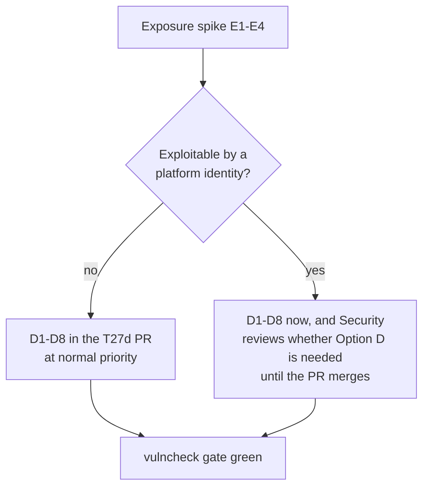

# RFC-002: Move the custom Temporal server off v1.28.4

> **Invariants source.** The project description is empty, so it defines no invariants. I loaded them from [[ADR-001-platform-blueprint]] §1, which defines **I1–I9** (nine, not eight). The invariant checks below run against I1–I9 and are complete for those nine. If the project is meant to carry a separate list of eight, that list is missing and these checks are incomplete against it.

## 1. Summary

- **Recommendation:** amend ADR-001 §3 to pin **`go.temporal.io/server` v1.29.7** and **`go.temporal.io/api` v1.53.0** in `temporal-server/`, and move the compose image to **`temporalio/auto-setup:1.29.7`**. Ship it in the T27d PR on top of `6c16dc0`.
- **Why not v1.29.5, the version the advisory names:** 1.29.5 is still affected by **GO-2026-5578** (streaming `AdminService/StreamWorkflowReplicationMessages` skips the authorizer). That one is fixed in 1.28.4 but only in **1.29.6+** on the 1.29 line. Going to 1.29.5 would trade one isolation advisory for another.
- **No vulncheck exception.** `vulncheck-temporal-server` becomes a required CI gate with zero findings, in the same PR.
- **The decision does not depend on the exposure answer.** We move off 1.28.4 whatever the spike finds: 1.28.x has no fix, the gate cannot go green otherwise, and this module is the one that enforces D22. The exposure spike decides only how urgent this is and whether we need an interim position (Option D) at all.
- **What the human accepts:** a second Temporal minor in M1 (schema 1.17 → 1.18 on the main store, visibility unchanged), and residual RS1: we don't know how long the 1.29 line will be supported.

## 2. Context

| Fact | Source | Verified |
|---|---|---|
| GO-2026-5766 (CVE-2026-5199, GHSA-xpg8-3hhp-p7w8): affected `< 1.29.5` and `>= 1.30.0-143.0, < 1.30.3`. No symbols listed. Go DB `review_status: UNREVIEWED`. GHSA severity **low**. | `vuln.go.dev/ID/GO-2026-5766.json`, GitHub advisory API | Fetched 2026-10-19 |
| The GHSA text says the bug was *"introduced in Temporal Server v1.29.0"*, in the batch activity. The published range still covers every version below 1.29.5. **Prose and range disagree.** | GHSA description | Fetched; not resolved (exposure question E1) |
| GHSA precondition: *"a server configuration where internal components have cross-namespace authorization, such as deployment of the internal-frontend service or equivalent TLS-based authorization for internal identities"*. The attacker needs a writer role in an attacker-controlled namespace, plus the victim's workflow ids. | GHSA description | Fetched; how it applies to us is exposure question E2 |
| GO-2026-5578 (CVE-2026-5724): affected `< 1.28.4`, `1.29.0-135.0 – < 1.29.6`, `1.30.0-143.0 – < 1.30.4`. | `vuln.go.dev` | Fetched |
| GO-2025-4272 / GO-2026-4273 (namespace policy bypass, incorrect authorization): fixed in 1.28.2 and 1.29.2. | `vuln.go.dev` | Fetched |
| Latest patch per line: 1.29.7, 1.30.8, 1.31.4. No server advisory in the Go DB affects any of them. | `proxy.golang.org`, Go DB module index | Fetched |
| `temporalio/auto-setup` stops at **1.29.7**. There is no 1.30.x or 1.31.x tag, while `temporalio/server` and `admin-tools` have them. | Docker Hub tags API | Fetched |
| T27d (`6c16dc0`) clears the other 37 advisories with transitive and toolchain bumps (Go 1.26.9). Only GO-2026-5766 remains. | TICK-111, Principal Software Engineer's BLOCKED comment | Reported, not re-run by me |

**Scope.** Only the §3 versions and what the upgrade touches: the Authorizer and ClaimMapper, schema migrations, the SDK matrix, and the `checkTLS` startup guard with its dynamic-config keys. The other 37 advisories are settled on T27d and are not reopened here.

## 3. Decisions

| # | Decision | Why / what it prevents |
|---|---|---|
| **D1** | `temporal-server/go.mod`: `go.temporal.io/server v1.29.7`, `go.temporal.io/api v1.53.0` (the version the 1.29.7 `go.mod` requires; if MVS raises it, pin what `go mod tidy` resolves and record it). Toolchain stays as T27d set it (`go 1.26.0`, `toolchain go1.26.9`, and 1.29.7 needs ≥ 1.25.11). `gomod_test.go` asserts the new pins. | Clears GO-2026-5766 **and** keeps GO-2026-5578 fixed. 1.29.5 would reopen 5578. |
| **D2** | `compose.yaml` `temporal` service: `temporalio/auto-setup:1.29.7`, the same version as the custom build. Persistence schema goes **1.17 → 1.18** on `postgres12` main. Visibility stays at **1.9**. auto-setup applies it in dev and CI. Any environment with Temporal data we must keep runs `temporal-sql-tool update-schema` to 1.18 **before** starting the 1.29.7 binary. | The stock compose server is the same vulnerable binary. One version in both places keeps the CI-6 results meaningful. |
| **D3** | **No vulncheck exception.** The T27d PR makes `make vulncheck-temporal-server` a required `ci.yml` step that must report zero findings. No allowlist wrapper is built. | Accepting an isolation advisory in the isolation module would weaken I2/D22 by delivery fiat. |
| **D4** | **Authorizer and ClaimMapper code is unchanged.** `authorization.Authorizer`, `ClaimMapper`, `CallTarget` and `Claims` are byte-identical between 1.28.4 and 1.29.7. The only API change is that `authorization.NewInterceptor` gains a parameter, `exposeAuthorizerErrors`, before `enableCrossNamespaceCommands`. That affects only `temporal-server/authz/adversarial_test.go` (`newTestInterceptor`), which passes `func() bool { return false }`. | Keeps R7's "minimal module" true. The test harness must keep matching how the real server wires the interceptor. |
| **D5** | **Allow-list drift is handled by classification, not by widening.** api v1.50.1 → v1.53.0 adds five `WorkflowService` methods: `DescribeWorker`, `FetchWorkerConfig`, `SetWorkerDeploymentManager`, `UpdateTaskQueueConfig`, `UpdateWorkerConfig`. All five go to `deniedByDefault`, and the golden table is regenerated. The command-type enum is unchanged (18 values), so the E1 command allow-list does not move. A method is added to the `nava-worker` list only if CI-6 shows SDK v1.49.0 cannot start a worker without it, and then by name, in the PR, with a Security reviewer sign-off. | Deny-by-default (D22) survives the upgrade. A new API is never reachable just because the server added it. |
| **D6** | **The startup guard covers the security-relevant dynamic config.** `checkTLS` (rename it `checkSecurityConfig`) also reads the dynamic-config file at startup and refuses to start if any of these holds: `system.disableStreamingAuthorizer` is `true`; `frontend.exposeAuthorizerErrors` is `true`; `system.enableCrossNamespaceCommands` is not `false`; `services.frontend.rpc.httpPort` is non-zero. `config/dynamicconfig/development.yaml` sets the first three explicitly (`false`, `false`, `false`). All four keys exist with the same names and types in 1.28.4, 1.29.7, 1.30.8 and 1.31.4. | 5578 is exactly a "streaming path skips the authorizer" bug, so the off switch for that authorizer must not be reachable. Cross-namespace commands are the GO-2026-5766 bug class. We run one tenant namespace and E1 already denies other namespaces, so turning them off loses nothing and adds a second wall. (The default is `true` in 1.28 and 1.29 and `false` from 1.30.) The HTTP API stays off until someone proves it goes through the same mTLS identity and interceptor. |
| **D7** | **The SDK matrix is unchanged on the platform side.** The root module stays on `go.temporal.io/sdk v1.49.0` + `api v1.63.5`. The server module's `api` pin is independent (R7). The supported pairing becomes *server 1.29.7 ↔ SDK v1.49.0*, and the proof is CI-6 passing in full against the 1.29.7 build. | Platform code doesn't change. Compatibility is proven by test, not assumed. |
| **D8** | **ADR-001 amendment A1**, not a new ADR: it replaces the `temporal server` and `temporal custom server module` lines in the §3 pin block. It adds to R7's revisit trigger: *"or any Go vulnerability DB advisory against the pinned `go.temporal.io/server` (the CI gate fails)"*. `docs/pins.md`, `docs/temporal-server.md` and the golden-table header move to match. nava signs A1. | No invariant or decision changes. Only a pin and a trigger move, which matches how erratum E1 was handled. |

## 4. Exposure under our topology (open; settled by the TA and Security spike in critique round 1)

This RFC doesn't answer these. They decide **urgency and the interim**, not D1.

| # | Fact question | Where to look |
|---|---|---|
| **E1** | Is the vulnerable code in 1.28.4 at all? The GHSA prose says it was introduced in 1.29.0 (batch activity). The range says everything below 1.29.5, and the Go DB entry is unreviewed. | `service/worker/batcher` at v1.28.4 against the fix in v1.29.5 / v1.30.3 |
| **E2** | Does our build meet the precondition, *"internal components have cross-namespace authorization"*? Our Authorizer allows `temporal-system` (the `systemWorker` certificate) every API. Does the per-namespace worker act under that identity, and does our namespace rule bound it to `nava`? | `authz/policy.go` (`temporal-system` row), `cmd/server/main.go`, the per-namespace worker's client config |
| **E3** | Can any platform identity control a namespace other than `nava`? Today the namespaces are `nava`, `temporal-system`, and in compose `default` (auto-setup `DEFAULT_NAMESPACE`). Only `temporal-system` may call `StartBatchOperation`. Relay, core and worker are bound to `nava`. | `allowlist.golden.md`, `compose.yaml:152` |
| **E4** | Is any 1.28.4 server holding data we must keep outside dev and CI (the stock auto-setup image has no custom Authorizer)? | Deployment inventory (Technical Lead) |

## 5. Options considered

| Option | Verdict | Why |
|---|---|---|
| **A. server v1.29.7 + api v1.53.0** | **Recommended** | Smallest move that clears 5766 and keeps 5578 fixed. Authorizer and ClaimMapper interfaces unchanged. Main schema +1 version, visibility unchanged. auto-setup image exists. 5 new APIs to classify. |
| B. server v1.30.8 + api v1.62.2 | Rejected for now, and the next step under RS1 | Visibility schema 1.9 → **1.13** plus main 1.18. **No auto-setup image**, so compose and CI need a separate `admin-tools` schema job plus `temporalio/server`. 16 new APIs to classify (standalone activities: `StartActivityExecution`, `PauseWorkflowExecution`…). Upside: `enableCrossNamespaceCommands` defaults to `false`. D6 gives us that on 1.29 anyway. |
| C. server v1.31.4 | Rejected | `CallTarget` gains `Principal`, `NewInterceptor` gains `enablePrincipalPropagation`, `authorization` adds an internal claim mapper, schema 1.19 / visibility 1.14, and it needs Go ≥ 1.26.8. That is the most Authorizer re-verification of the three, for no isolation gain we need today. |
| A'. server v1.29.5 or v1.29.6 (the advisory's floor) | Rejected | 1.29.5 reopens GO-2026-5578. 1.29.6 clears both, but 1.29.7 is the latest patch on the same schema and has no known regression. Choosing an older patch has no benefit. |
| **D. Time-boxed vulncheck exception for GO-2026-5766** | **Not recommended; only if the A spike fails** | The terms, if adopted: **owner** Technical Lead, with the Security & Multi-Tenancy Reviewer approving. **Time box**: until 2026-11-02 at the latest (10 working days). **Ends** when the earliest of these happens: the A (or B) upgrade PR merges; the time box expires (CI goes red again); the exposure spike answers E1–E3 "exploitable"; or a second namespace or an internal-frontend is added. It would be an allowlist wrapper around `govulncheck` that matches only `GO-2026-5766` and fails on anything else. Why I don't recommend it: A is a small, verified change, so the exception buys about a week while putting an isolation exception into the isolation module. |
| E. Patch 1.28.4 ourselves (backport) | Rejected | It creates a fork to own (R7 grows into "maintain Temporal"), and govulncheck still flags the module version, so the gate needs an exception anyway. |
| F. Rely on our Authorizer and namespace topology, without upgrading | Rejected | That turns an unanswered exposure question into a permanent assumption. The CI gate stays red or needs a permanent exception. |

## 6. Invariants touched

| Invariant | Effect |
|---|---|
| **I2** (tenant only from verified source; Temporal is a path like any other) | Upheld and strengthened: closes a known cross-namespace path; D6 adds a second wall. |
| **I6** (deterministic, versioned durable path) | Not weakened. In-flight executions survive a minor upgrade (Temporal supports rolling minor upgrades; *TA to confirm for 1.28 → 1.29*). M1 has no production histories (E4). |
| **I8** (tenant code never reaches Temporal) | Unchanged. |
| D22 / R7 / R8 | D22 unchanged. R7's trigger widened (D8). R8 unchanged. |
| I1, I3, I4, I5, I7, I9 | Not touched. |

## 7. Risks and accepted residuals

| # | Risk / residual | Mitigation | Owner | Revisit trigger |
|---|---|---|---|---|
| **RS1** | I don't have the data on how long Temporal supports the 1.29 line. | The vulncheck gate (D3) fails the day an unfixed advisory lands. Option B is pre-analysed. | Technical Lead | An advisory with no 1.29.x fix, Temporal announcing 1.29 end of support, or M2 planning, whichever comes first. Then move to 1.30+ with an `admin-tools` schema job. |
| **RS2** | Dynamic config is reloaded at runtime. D6 checks only at startup, so a file edited after start could flip a key. | The file ships in the image, mounted read-only. No runtime write path. | Security & Multi-Tenancy Reviewer | Any change that makes dynamic config writable at runtime (a mounted ConfigMap, an operator edit path). Then add a runtime check that refuses the value. |
| **RS3** | SDK v1.49.0 against server 1.29.7 is unverified. The worker may call one of the five new APIs. | CI-6 "every SDK client dials and its worker starts". D5 governs any addition. | Technical Architect | CI-6 failure in the T27d PR |
| **RS4** | Turning off `enableCrossNamespaceCommands` might break a server-internal system workflow. **Unverified.** | CI-G stack smoke plus CI-6 same-tenant child. | Technical Architect | Stack smoke failure. Then drop that one key from D6 and record why. Do not widen the Authorizer. |

## 8. Test / acceptance spec

| # | Test | Catches |
|---|---|---|
| **CI-A** | `make vulncheck-temporal-server` is a required `ci.yml` step with zero findings | D3, regressions to any server advisory |
| **CI-B** | `gomod_test.go` asserts server v1.29.7 and api v1.53.0 (or the tidy-resolved version), with no `replace` and no SDK dependency | D1, pin drift |
| **CI-C** | `authz/policy_test.go` drift checks pass at api v1.53.0. The five new methods are in `deniedByDefault`. The golden table is regenerated. `TestCommandNamesCoverPinnedEnum` passes. | D5 |
| **CI-D** | The full CI-6 suite (ADR-001 Annex B) against the 1.29.7 build, including "SDK v1.49.0 client dials and worker starts" and the same-tenant child | D4, D7, RS3 |
| **CI-E** | Startup-guard table test: each forbidden value in D6, and `httpPort` ≠ 0, refuses start with a named error. The shipped config starts. | D6 |
| **CI-F** | Adversarial: a cross-namespace child, signal or cancel command is denied with `enableCrossNamespaceCommands` both `true` and `false` | The Authorizer does not depend on the server flag |
| **CI-G** | Stack smoke on `auto-setup:1.29.7` (schema 1.18), including namespace `nava` registration by `temporal-system` | D2, RS4 |
| **CI-H** | From the exposure spike: a reproduction of the GO-2026-5766 scenario as far as our topology allows, denied on 1.29.7. It runs on 1.28.4 only if E1 says the code is present. | Closes E1–E3 with a test, not prose |

## 9. Sequencing

1. Critique round 1: the TA and Security run the E1–E4 spike, and the TA critiques D1–D8.
2. The T27d PR (Principal Software Engineer) is `6c16dc0` + D1, D2, D4, D5, D6 + `docs/pins.md` / `docs/temporal-server.md` + the CI-A gate. This is one PR, as TICK-111 planned.
3. ADR-001 amendment A1 (D8) goes to nava for sign-off. T27d merges after A1 is accepted.

## 10. Open questions

- **Technical Architect + Security & Multi-Tenancy Reviewer:** E1–E4 (spike, critique round 1). Also confirm that a rolling 1.28 → 1.29 upgrade keeps in-flight executions, and that the schema must be upgraded before the binary (I6 row).
- **Technical Lead:** E4. Is any Temporal data outside dev and CI that must survive the schema 1.18 migration?
- **nava:** accept D8 (a pin amendment to ADR-001, not a new ADR) and residual RS1.

## Verification notes (what I checked, 2026-10-19)

- Server `go.mod` per tag from `proxy.golang.org`: 1.28.4 → api v1.50.1, go 1.25.8. 1.29.7 → api v1.53.0, go 1.25.11. 1.30.8 → api v1.62.2, go 1.25.14. 1.31.4 → api v1.62.8, go 1.26.8.
- From `raw.githubusercontent.com/temporalio/temporal/<tag>`: `common/authorization/{authorizer,claim_mapper,interceptor}.go`, `common/dynamicconfig/constants.go`, `common/config/config.go` and `schema/postgresql/v12/version.go`, diffed 1.28.4 against each candidate.
- From `temporalio/api-go/<tag>`: `workflowservice` / `operatorservice` `service_grpc.pb.go` method names, and `enums/v1/command_type.pb.go`.
- I did not build or run anything against 1.29.7. CI-B through CI-H are the proof, and they run in the T27d PR.
