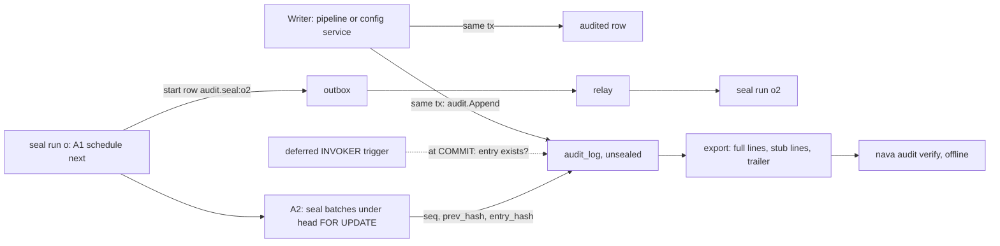
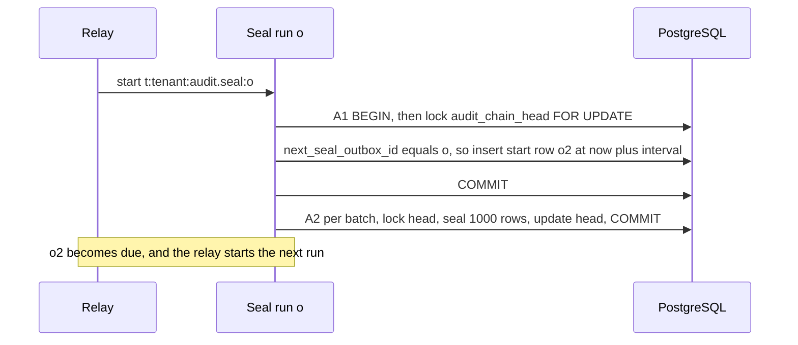

# RFC-008 rev 1: One audit log for records and configuration (CR-AUDIT-1)

> **Invariants.** The project description is empty, so this RFC checks against **ADR-001 §1, I1–I9**.
>
> **Numbering assumed:** RFC-008, ADR-004, and ADR-001-A6 (the highest amendment in the repo is A5; E3 is an erratum).

## Changelog from rev 0

| Round-1 item | Resolution in rev 1 | Where |
|---|---|---|
| **Sealer:** PG B3, B4, TA-B1, TA-B2, Sec N3 | Writers never touch the outbox. The sealer **reschedules itself** through ordinary D22 start rows (`target_key = audit.seal:<own outbox id>`). Onboarding and migration B seed its first run. An `audit_chain_head` row locked `FOR UPDATE` makes one sealer per tenant a database guarantee. Idle tenants are covered by an interval that backs off. | D10, D10a |
| **Writer roles can't run the check:** PG B1, TA-B3 | `db/audited-tables.yaml` lists the writer roles of each audited table. Every writer's `audit_log` grants and policies are generated from it. CI-A3 fails on any role that can write an audited table but cannot run the check. | D4, D8 |
| **Erasure:** Sec S4, TA-B4 | The `BEFORE UPDATE` trigger allows exactly two transitions: **seal** (`nava_worker`) and **erase** (the new role `nava_erasure`, ADR-001-A6.1). The verifier fails any erased entry that no chained `audit/erase` entry names. | D8, D11 |
| **Salt:** Sec S2, TA-B6 | `diff_salt` is returned only with an unredacted diff, in the list read and in the export. | D9, D12 |
| **INSERT-settable columns:** Sec S3, TA-N4b | Column-level INSERT grants exclude `occurred_at`, `txid`, `backfilled`, and the seal and erasure columns. A `BEFORE INSERT` trigger also **asserts** that these hold their defaults or NULL for every role except `nava_migrator`. | D8 |
| **Masks and secrets in patch values:** Sec S1, TA-N7 | One JSON Patch walker visits every op's `path`, `from` and `value` at any depth, `test` ops included. It is used for read-time mask redaction and for write-time secret rejection. | D7, D9 |
| **Filtered export:** TA-B5 | Stub lines. The chain becomes `entry_hash = SHA-256(prev_hash ‖ envelope_sha256)`, and every `seq` in the covered range that the filter excludes is exported as `{seq, prev_hash, entry_hash, envelope_sha256}`. CI-A6 now claims verification **for any filter**. | D10, D12 |
| **Backfill:** PG B2, and the choice between PG's proposal and Sec N4 | Two migrations, with dedupe on `(subject, version_after)`. **Choice:** per-tenant writes under temporary, canonical, tenant-scoped migrator policies. The only `USING (true)` read is of `tenants.id`, and every policy is dropped before commit. Reason in D13. | D13 |
| **CSV injection:** Sec S5 | Required in `audit-export-v1.md`, tested by CI-A15. | D12 |
| **Partitioning:** PG N1 (my call) | **Taken, key shape only.** `PARTITION BY RANGE (occurred_at)` with one default partition, and every key carries `occurred_at`. `UNIQUE (tenant_id, seq)` is dropped, because the head row lock and the verifier take its place. Partition management stays with Epic 30. | D14 |
| Non-blocking items | Each one is accepted as a cost, adopted, or rejected with a reason. | §Non-blocking ledger |

## Summary

- **One append-only, partitioned table, `audit_log`, holds record changes, configuration changes and audit-domain events** (exports and erasures). There is one writer (`audit.Append`), one reader and one export.
- **The database enforces the same-transaction rule.** A deferred INVOKER constraint trigger on each audited table requires **at least one** entry per (transaction, subject), and a unique key allows **at most one** per (transaction, subject, `version_after`). Writer grants are generated from one manifest, so every writer can run the check.
- **Integrity comes from a per-tenant hash chain.** A self-rescheduling sealer that fits D22 as it stands seals entries asynchronously, and a head row serialises it. Writers never wait on each other for sealing.
- **Every export verifies offline, for any filter.** Excluded entries in the covered range appear as hash-only stub lines.
- **Erasure is a second allowed transition on a sealed row, and only one role can make it.** Its proof is chained, so an erasure nobody recorded fails verification.
- **ADR-001-A6 is needed for three narrow A.3 items:**
  - the `nava_erasure` role;
  - `nava_onboard` INSERT on `outbox`, to seed the sealer;
  - a producer rule for start rows that are not tied to a record, such as `audit.seal`.

  The workflow-id scheme and the allow-list (10 entries) do not change.
- **What you accept (unchanged from rev 0):**
  - no external anchoring in M1, which the CTO accepted as R-A1;
  - a sealing lag bounded by the sealer interval: up to 300 s for a tenant that has been idle (R-A2).

## D0. New ADR, plus ADR-001-A6

**ADR-004** records the audit model. **ADR-001-A6** records only what changes ADR-001's text (§A6). The workflow-id scheme stays `t:<tenant>:<kind>:<own outbox id>`, so CTO's D22 constraint holds without a scheme change.

## Decisions

| # | Decision | Why / what it prevents |
|---|---|---|
| **D1** | **One table for three domains: `record`, `config` and `audit`.** The `audit` domain covers export and erasure. Per-record history is a filter on this table (see D9 for who may read it). | Split timelines, and a union reader. |
| **D2** | **Fixed columns** (Annex A). They hold the envelope, the content hashes and diff, the seal fields and the erasure fields. The rev 0 stored column `diff_redacted` is **removed**: redaction depends on the reader and is computed at read time (TA-N8). `diff_truncated` stays. It is set by the writer when the diff exceeds 64 KB. | Writer-specific shapes, and a stored flag that lies to a different reader. |
| **D3** | **Closed vocabularies, checked by the database.** `action` is one of `create, update, publish, enable, disable, delete, promote, rollback, state_change, export, erase`. `source` is one of `user, ai, change_set, onboarding, plugin, rule, workflow, function, system`. `subject_type` comes from the Go registry `internal/audit/subjects.go`, mirrored by a CHECK; it includes `audit_export` and `erasure_request`. | Unfilterable spellings. |
| **D4** | **Same transaction, with the real guarantee stated (TA-N1).** `audit.Append(ctx, pgx.Tx, Entry)` is the only writer API. Every table in `db/audited-tables.yaml` gets `CONSTRAINT TRIGGER … AFTER INSERT OR DELETE OR UPDATE OF <audited columns> DEFERRABLE INITIALLY DEFERRED` (TA-N3: the manifest lists the audited columns). At commit it requires **≥ 1** row in `audit_log` with the same `tenant_id`, `txid = pg_current_xact_id()`, `subject_type` and `subject_id`. `UNIQUE (tenant_id, occurred_at, txid, subject_type, subject_id, version_after) NULLS NOT DISTINCT` gives **≤ 1** per (transaction, subject, version). `occurred_at = now()` holds within the transaction, so the key works with partitioning and the probe prunes to one partition. The trigger is plain `SECURITY INVOKER` plpgsql. **Writer grants are generated (PG B1, TA-B3).** The manifest names each audited table's writer roles (`nava_app`, `nava_worker`, `nava_onboard`, `nava_groupsync`, …). The grants generator gives each writer: INSERT on the D8 insertable columns, SELECT on `(tenant_id, occurred_at, txid, subject_type, subject_id, version_after)`, a canonical SELECT and INSERT policy, and for `nava_onboard` the pinned provisioning-predicate SELECT and INSERT policies (the S8 and E3 pattern). | A writer that skips audit. A duplicate entry. A writer role that cannot pass its own check. |
| **D5** | Every audited configuration type keeps immutable versions with a content hash. The entry references `version_after` and its `content_sha256`. The JSON Patch diff is for human reading. | Audit as the only copy of configuration content. |
| **D6** | Actor, source, AI and change set (unchanged from rev 0). The actor is a principal **or** a named system actor. When `source = ai`, `source_ref` points to the AI decision. Every item written by a promotion carries `change_set_id`, plus one `promote` or `rollback` entry on the change set. | A user name hiding an AI change or a promotion. |
| **D7** | **Secrets never enter the log or a version row (Sec Q3, TA-N7).** One walker (`internal/audit/patchwalk`) visits every op's `path`, `from`, and `value` at any depth, including `add` at the root, `replace` of a parent object, `copy`/`move` from a secret path, and `test`. It runs against the configuration schema's `x-nava-secret` and `writeOnly` paths. The write is **rejected** with error `audit_secret_in_diff` (`config_secret_in_content` for version rows); the error and the log line name the path, never the value. **The same check runs on the `*_versions` writer**, because `content_sha256` would otherwise commit to the secret. Adopted from Security: (a) a CI lint requires every adapter or plugin configuration schema to be closed (`additionalProperties: false`), with no free-form `headers`, `env` or `params` maps unless their values are secrets, and with fields named like `*password*`, `*secret*`, `*token*`, `*apikey*` or `authorization` annotated; (b) URLs with userinfo are rejected; (c) a scanner for secret-shaped values (`AKIA…`, `ghp_`, `xox?-`, `-----BEGIN`, JWT) rejects matches in **config-domain** diffs only. | A credential leaking through a nested value, a version row or an export. |
| **D8** | **Isolation and immutability (I1, I3, I5).** `audit_log` has `ENABLE` + `FORCE` RLS, the canonical predicate, and `tenant_id` leading every key. **The policies are canonical, with nothing extra in `USING`.** The "unsealed only" rule lives in the trigger (PG N3), and the UPDATE policies carry `WITH CHECK` with the canonical predicate (Sec confirmed). **INSERT** (Sec S3, TA-N4b): column grants cover the envelope and content columns only, so they exclude `occurred_at`, `txid`, `backfilled`, `seq`, `prev_hash`, `entry_hash`, `sealed_at`, `erased_at` and `erasure_ref`. A `BEFORE INSERT` trigger then **asserts** (raises; it never rewrites, because a rewrite of the partition key in a BEFORE trigger is unsafe) that for any role other than `nava_migrator`: `occurred_at = now()`, `txid = pg_current_xact_id()`, `backfilled = false`, and all seal and erasure columns are NULL. **UPDATE:** `nava_worker` gets a column grant on `seq, prev_hash, entry_hash, sealed_at`, and `nava_erasure` on `diff, diff_salt, erased_at, erasure_ref`. A `BEFORE UPDATE` trigger allows **exactly two transitions** and rejects everything else for every role. **Seal:** the role is `nava_worker`, `OLD.sealed_at IS NULL`, the four seal columns go from NULL to non-NULL, and every other column is unchanged. **Erase:** the role is `nava_erasure`, `OLD.erased_at IS NULL`, `OLD.diff IS NOT NULL`, `diff` and `diff_salt` become NULL, `erased_at` and `erasure_ref` become non-NULL, and every other column is unchanged. Erase is allowed on sealed and unsealed rows. **No DELETE grant or policy for anyone.** | Forged or backdated history. A pre-sealed row that the sealer would skip. Runtime erasure of evidence. Any edit of content. |
| **D9** | **Read gates and masks (Sec S1, S2, N2).** `audit.read` and `audit.export` are standalone permissions. No record or admin permission implies them; only the seeded tenant-admin and `auditor` grants carry them. They are **not** filtered by per-record ACL. **Masks are applied at read time** for that reader, through the D7 walker. Any masked pointer reached through `path`, `from`, or a nested member of `value` (`test` included) is cut out of the value and replaced with `{"redacted":"mask"}`. If it cannot be cut out cleanly, for example a whole-array value or a `move` or `copy` whose source covers a masked path, **the whole op** becomes `{"op":…, "path":…, "redacted":"mask"}`. A response flag `diff_redacted` is computed per reader. **The salt rule:** `diff_salt` is returned only when the diff is returned **unredacted** to this reader. Otherwise it is omitted, and the verifier reports "diff not verifiable: redacted". This applies to the list read and to the export. **Per-record history (N2):** the Epic 05 history view for users without `audit.read` reads the same table. It is gated on that user's record ACL for that one subject, returns `domain = record` only, and applies the same masking. | A masked value leaking through a parent `value`, or being brute-forced via the salt. The auditor gate leaking into ordinary users' history. |
| **D10** | **Chain (TA-B5 shape).** `envelope_sha256 = SHA-256(JCS(envelope))`, where the envelope is every D2 envelope column plus `content_sha256` and `diff_sha256`, and excludes `diff`, `diff_salt`, `txid`, and the seal and erasure columns. `entry_hash = SHA-256(prev_hash ‖ envelope_sha256)`. Genesis `prev_hash` is 32 zero bytes. `diff_sha256 = SHA-256(diff_salt ‖ diff bytes)`, where `diff` is stored as `json`. **The chain order is `seq` only**, never `occurred_at` (PG N5). The JCS mapping is pinned in `docs/api/audit-export-v1.md` (TA-N6): `timestamptz` is RFC 3339 UTC with microseconds, `bytea` is lowercase hex, UUIDs are lowercase, and NULL is emitted, not omitted. Golden vectors are shared by `audit.Append`, the sealer and `nava audit verify`. | Undetectable gaps in filtered exports. Hash disagreement between implementations. |
| **D10a** | **Sealer: self-rescheduling and D22-conformant (PG B3, B4, TA-B1, TA-B2, Sec N3).** The per-tenant row `audit_chain_head(tenant_id PK, id, version, seq, entry_hash, next_seal_outbox_id, next_seal_at, seal_interval_s, export_lease_until)` is written only by the sealer, onboarding, the migrator and the D12 export lease (one column). **The run for outbox row *o*** is workflow `t:<tenant>:audit.seal:<o>`, an ordinary D22 start with `REJECT_DUPLICATE`. **Activity A1, "schedule next", is its own transaction and commits first.** It does `SELECT … FROM audit_chain_head … FOR UPDATE`. If `next_seal_outbox_id ≠ o`, the run is from a stale lineage and schedules nothing. Otherwise it bumps `version`, inserts start row *o′* (`kind = audit.seal`, `target_key = audit.seal:<o′>`, `target_seq = version`, `available_at = now() + seal_interval_s`), and sets `next_seal_outbox_id = o′`. A1 is idempotent on retry (I7), because a retry finds `next ≠ o`. **Activity A2, "seal".** It runs batches of 1,000, each in one transaction under the same `FOR UPDATE` lock. It reads unsealed rows in `(occurred_at, id)` order, assigns `seq = head.seq + 1…`, `prev_hash` and `entry_hash`, then updates the head. **Interval:** 10 s when the last run sealed anything, otherwise double the last interval up to 300 s. Because A1 runs before A2, a poison batch cannot stop the lineage. The next run retries the batch, and the failure is visible (`audit_seal_failures_total`). **Seeding:** onboarding inserts the head row and the first start row (ADR-001-A6.2). Migration B does the same for existing tenants. **Recovery:** if `next_seal_at < now() − 10 min`, the lineage is dead. Then `POST /api/v1/audit/chain:reseed` (operator or tenant admin, as `nava_app`, under the head lock) inserts a new start row and repoints `next_seal_outbox_id`, which retires any older lineage. Writers never touch the outbox or the head. | A sealer that runs once and never again. Writers in a tenant queuing on a shared key. Idle tenants left unsealed forever. Two live sealers forking the chain. |
| **D11** | **Erasure contract (Sec S4, TA-B4).** Epic 30 runs `nava_erasure` (ADR-001-A6.1) as a one-shot job per erasure request, with `app.tenant_id` set and canonical policies, so it needs no allow-list entry. In one transaction it applies the D8 erase transition to the affected entries and appends an `audit/erase` entry: `subject_type = erasure_request`, `subject_id = erasure_ref`, and a diff listing the erased entry ids, in chunks of at most 10,000 ids per entry. The diff holds ids only, never personal data. **Verifier rule (Security's):** an entry with `erased_at` set passes only if an `audit/erase` entry is present and chain-valid in the export, has `subject_id = erasure_ref`, and lists that entry id. Otherwise the result is **tampered**. The export always includes the matching erase entries for any erased entry in scope, whatever the filter. Erasure of a person tombstones the principal; it never touches audit actor ids. | Evidence wiped and passed off as "erased". |
| **D12** | **Export (TA-B5, Sec S5, N1, TA-N5, PG N5).** The endpoint is `GET /api/v1/audit/entries:export?from&to&subject_type&subject_id&change_set_id&domain&format=jsonl\|csv[&stubs=true]`, under `audit.export`. **One active export per tenant**, held by the `export_lease_until` lease on the head row. A second export gets 409 `export_in_progress`. The `audit/export` entry is committed first. Then: (1) in one short transaction, read `head_seq` and `head_hash`, and find the first matching sealed `seq`. (2) Stream `seq ∈ [first_match, head_seq]` in **short keyset transactions** of 5,000 rows each, with `statement_timeout = 30s` per page and a 15-minute overall cap (both unverified, measured in S1). Matching entries are emitted in full; excluded ones as **stub lines** `{seq, prev_hash, entry_hash, envelope_sha256}`. Sealed rows never change in any hashed column (D8), so page boundaries cannot tear the chain, and no long snapshot holds back vacuum. (3) Unsealed matching rows with `occurred_at ≤` the export start come last, flagged `sealed: false, in_verified_range: false`. (4) The trailer carries `{first_seq, last_seq = head_seq, head_hash, count, stub_count, unsealed_count}`. The verifier checks that the range is contiguous and every link holds, for **any** filter. `stubs=false` gives a smaller file whose trailer says `verifiable: false`. Incremental consumers use `after_seq` (TA-N4a). **CSV** carries the same lines. Any cell beginning with `=`, `+`, `-`, `@`, tab or CR is prefixed with `'` (OWASP), and `audit-export-v1.md` states this rule. JSONL is unaffected. | Filtered exports that cannot prove completeness. Formula injection in an auditor's spreadsheet. One tenant's export stalling vacuum for everyone. |
| **D13** | **S8 backfill (PG B2; the choice the CTO asked for).** **Order:** *Migration A* creates the tables and runs the backfill. *Deploy:* the S8 publish path calls `audit.Append`. *Migration B*, in **one transaction**, re-runs the backfill, attaches the D4 trigger to `entity_definitions` and `entity_definition_versions`, and seeds `audit_chain_head` and the first `audit.seal` row per tenant. **Dedupe** is `NOT EXISTS (tenant_id, subject_type = 'entity_definition', subject_id = definition_id, version_after = version)`, not the id. The id is UUIDv5(namespace, `tenant_id ‖ version_id`) (Sec N4). **Choice of access path: per-tenant writes, with tenant ids as the only cross-tenant read.** The migration creates `FOR SELECT TO nava_migrator USING (true)` on **`tenants` only** to list ids. For each tenant it runs `set_config('app.tenant_id', …, true)` and writes through temporary **canonical** migrator policies (SELECT on `entity_definition_versions`; INSERT on `audit_log`, `audit_chain_head` and `outbox`). It drops every temporary policy before commit, and the post-run catalogue gate proves none remain (PG T6). **Why not PG's `USING (true)` on `entity_definition_versions`:** with that policy, a join bug in the backfill could file tenant A's version in tenant B's log, and FORCE RLS would not stop it. With canonical write policies the database rejects any cross-tenant row. Reading `tenants.id` exposes no tenant data. **Cost:** `CREATE POLICY` takes ACCESS EXCLUSIVE on `tenants`, `entity_definition_versions`, `audit_log`, `audit_chain_head` and `outbox` for the length of migration B. That is milliseconds at today's seed volume, and it blocks tenant resolution and outbox inserts while it runs, so it runs in the deploy window. If S8 volume exceeds 100k versions before Epic 05 ships, migration B batches (unverified threshold). Security rules on this choice in the re-check. | A gap between migration and deploy. Duplicate entries for a version that was live-written. A cross-tenant backfill bug that RLS cannot catch. |
| **D14** | **Partitioned key shape (PG N1, N2).** `PARTITION BY RANGE (occurred_at)`, created with **one DEFAULT partition**. Epic 30 adds, detaches and retains partitions. The PK is `(tenant_id, occurred_at, id)`. The D4 key includes `occurred_at`. Indexes: `(tenant_id, occurred_at DESC, id DESC)`; `(tenant_id, subject_type, subject_id, occurred_at DESC)`; `(tenant_id, change_set_id) WHERE change_set_id IS NOT NULL`; `(tenant_id, seq) WHERE seq IS NOT NULL`, which is **not unique** because it cannot span partitions, so single-sealer correctness comes from the head lock and the verifier detects any duplicate or gap; and `(tenant_id, occurred_at, id) WHERE sealed_at IS NULL`. No GIN on `diff`. The foreign keys from `audit_log` to `principals` and `entity_definitions` are allowed on a partitioned table in PG 16; nothing references `audit_log`. | Re-keying a live, append-only table later (the expensive case). |

## How it fits together

## A6. What goes into ADR-001-A6

| Item | Change to ADR-001 | Why it cannot live in ADR-004 alone |
|---|---|---|
| **A6.1** | New role **`nava_erasure`**: LOGIN, one-shot job, `NOSUPERUSER`, no `BYPASSRLS`, a member of nothing. Grants: SELECT on `audit_log`, UPDATE on `(diff, diff_salt, erased_at, erasure_ref)`, and INSERT on the D8 insertable columns, all under canonical policies. Epic 30 adds its record-table grants. | It is a new row in the A.3 role table. |
| **A6.2** | `nava_onboard` gets INSERT on `outbox` (and `audit_chain_head`) under the pinned provisioning-predicate policies (E3 pattern), so onboarding can seed the first `audit.seal` start row. | A.3 lists `nava_onboard`'s access explicitly, and it has no outbox access. |
| **A6.3** | Producer rule for **start rows not tied to a record**, such as `audit.seal`. `target_seq` comes from a per-target head row bumped under its own row lock (`audit_chain_head.version`), and no `workflow_ref` is inserted, because `workflow_ref.record_id` references `records` and nothing ever signals a seal run. The workflow-id scheme and the relay are unchanged. | A.2 currently says that every start row inserts `workflow_ref` and takes `target_seq` from a record. |

The allow-list stays at 10 entries. The D13 temporary policies exist only inside the migration transaction, and the catalogue gate proves they are gone.

## Non-blocking ledger

| Item | Disposition |
|---|---|
| Sec N1, TA-N5: export starvation and the long snapshot | **Adopted** in D12: one export per tenant, short keyset pages, per-page timeout and an overall cap. The single `REPEATABLE READ` snapshot is **rejected**: sealed rows are immutable in every hashed column, so a fixed `head_seq` bound gives a consistent trailer without holding the xmin horizon. |
| Sec N2: per-record history gate | **Adopted** in D9. |
| Sec N3: idle tenants unsealed | **Resolved** by D10a's back-off interval. Worst case is 300 s plus one batch. |
| Sec N4: backfill per tenant, UUIDv5 with the tenant | **Adopted** in D13. |
| PG N1: partition from day one | **Taken, key shape only** (D14). |
| PG N2: chain-head row | **Adopted** (D10a). |
| PG N3: non-canonical sealer policy | **Adopted.** Policies stay canonical, and the trigger enforces the transitions (D8). |
| PG N4: write amplification, about 2× heap WAL from sealing | **Accepted cost**, to be measured in S1. If it matters, drop the D4 unique key and probe the subject index instead. |
| PG N5: `seq` order is not `occurred_at` order, and the export snapshot | **Adopted** in D10 (chain by `seq` only) and D12. |
| TA-N1: "at least one" wording | **Adopted** in D4 and CI-A1. |
| TA-N2: deferred trigger queue memory | **Accepted cost.** S1 measures a 10k-subject transaction. A change-set size cap follows if needed. |
| TA-N3: `UPDATE OF` audited columns | **Adopted** in D4. |
| TA-N4a: `after_seq` for incremental reads | **Adopted** in D12. |
| TA-N6: JCS mapping and golden vectors | **Adopted** in D10. |
| TA-N7: secrets inside values | **Adopted** in D7, with the shared walker. |
| TA-N8: stored `diff_redacted` | **Adopted.** The column is removed (D2) and the flag is computed per reader (D9). |

## Options considered (rev 1 additions; the rev 0 table stands)

| Option | Why it lost |
|---|---|
| Per-minute shared dedupe key in the writer's transaction (rev 0) | Writers queue on an uncommitted key: 3.9–4.0 s in both spikes, and a deadlock case. |
| `audit-seal:<txid>` per writer transaction (TA-B2 b) | One outbox row per audited transaction doubles outbox volume and still puts the outbox in the write path. |
| An eternal per-tenant workflow with a fixed id (PG B4) | It needs a fixed workflow id, which is an ADR-001 D22 scheme change (CTO constraint), and a continue-as-new lifecycle to operate. Self-rescheduling gets the same liveness with ordinary starts. |
| PG's temporary `USING (true)` on `entity_definition_versions` | A backfill join bug could cross tenants undetected. See D13. |
| Narrowing CI-A6 to unfiltered exports | Buyers test filtered exports (CTO). Stubs cost only hash bytes. |
| Single `REPEATABLE READ` export snapshot | It holds the vacuum horizon for every tenant, and immutability makes it unnecessary (ledger). |
| Rewriting `occurred_at` in a `BEFORE INSERT` trigger | It changes the partition key in a BEFORE trigger. Asserting is safe and equally strict. |

## Risks and accepted residuals

| # | Residual | Mitigation | Owner | Revisit trigger |
|---|---|---|---|---|
| **R-A1** | A consistent whole-chain rewrite by the owner is detected only against a checkpoint the tenant already holds. **Accepted by the CTO.** | Export trailers. The migrator is a one-shot job. | Solution Architect | A regulated buyer asks for external attestation. |
| **R-A2** | Sealing lag: about 10 s for active tenants, up to 300 s for a tenant waking from idle. | `audit_unsealed_oldest_seconds` alerts at 600 s. `audit_seal_failures_total`. `chain:reseed`. | Technical Lead | The alert fires in production. |
| **R-A3** | Export caps are **unverified**: 15 min, 30 s per page, 1M lines with stubs counted. | 422 `export_too_large`, `after_seq` resume. | Technical Lead | Epic 26 UI, or a tenant over the cap. |
| **R-A4** | The D4 trigger, sealing WAL and the deferred queue are unmeasured. | S1 (Postgres Specialist, one day): ≤ 10% p95, through PgBouncer 1.24.1, a 10k-subject transaction, peak memory, WAL per entry, export caps. If it fails, record tables fall back to the architecture test and configuration tables keep the trigger. | Postgres Specialist | S1 result. |
| **R-A5** | Idle-tenant seal starts: about 1 per 300 s per tenant, so 1,000 tenants means about 3.3 starts/s. | Back-off. Measured in the Epic 08 flood test. | Technical Lead | Temporal start rate above 10% of capacity. |
| **R-A6** | Migration B takes ACCESS EXCLUSIVE on five tables. | Deploy window. Batches if there are over 100k versions. | Postgres Specialist | S8 volume at Epic 05 planning. |

## Invariant check (ADR-001 I1–I9)

| Invariant | Effect |
|---|---|
| I1 | **Holds.** Canonical policies only. The allow-list is unchanged. The temporary migrator policies are dropped in the same transaction. |
| I2 | **Holds.** The export and the sealer take the tenant from the token or the outbox row. |
| I3 | **Holds, with A6.1 adding one least-privilege role.** No SECURITY DEFINER. The triggers are INVOKER. |
| I4 | **Strengthened.** The database checks at least one entry per (transaction, subject) and at most one per version. |
| I5 | **Holds.** Read-time masks walk every op (D9). Audit reads use a standalone permission instead of record ACL, and Security accepted this conditionally (conditions met in D9). |
| I6 | **Holds.** The seal runs are ordinary relay starts from committed outbox rows. A6.3 clarifies only the producer bookkeeping. |
| I7 | **Holds.** A1, A2, the backfill and reseed are each idempotent under their lock or dedupe. |
| I8 | **Holds.** AI entries carry the decision reference. New subject types are platform migrations. |
| I9 | **Holds.** Causation is on every entry. A rejected cascade is audited through `audit.Append`. |

## Test and acceptance spec

| Test | Proves |
|---|---|
| **CI-A1** | Killing the process mid-write or rolling back leaves no entry. A committed configuration change and a committed record change each have **at least one entry per (transaction, subject) and at most one per version**. |
| **CI-A2** | A raw write to an audited table without `audit.Append` fails at COMMIT, for every writer role in the manifest. |
| **CI-A3** | The catalogue: every manifest table has the D4 trigger with `UPDATE OF` its audited columns. Every tenant table is listed as audited or exempt with a reason. **Every role with INSERT, UPDATE or DELETE on an audited table has INSERT on `audit_log`, SELECT on the check columns, and matching SELECT and INSERT policies.** |
| **CI-A4** | Cross-tenant isolation for read, export, stubs and `chain:reseed`. With no tenant context, zero rows. |
| **CI-A5** | A canary secret written as a top-level value, a nested `add` value, a `replace` of the parent object, and a `copy` from a secret path is rejected, both in `audit_log` and in `*_versions`. Neither the canary nor any secret-shaped value appears in the table bytes or the export bytes. The error names the path only. |
| **CI-A6** | `nava audit verify` passes for an unfiltered export **and for subject, time and change-set filters** (stub lines). Editing one byte of a sealed row, deleting a row, or rewriting one row together with its own `entry_hash` fails at that `seq`, **under any filter**. |
| **CI-A7** | `nava_erasure` erases, and verification passes with the matching `audit/erase` entry. `nava_app` and `nava_worker` cannot erase. Nulling `diff` as the migrator without an erase entry fails verification as tampered. A second erase of the same row is rejected. |
| **CI-A8** | Each export commits one `audit/export` entry before streaming starts. A concurrent second export gets 409. |
| **CI-A9** | Backfill: each S8 version has exactly one entry after migration A, after the deploy, and after migration B, including a version published between A and B. No temporary policy survives. Writing a row for the wrong tenant under the migrator's canonical policies fails. |
| **CI-A10** | For `nava_app`, `nava_worker`, `nava_onboard` and `nava_groupsync`, INSERT that sets `occurred_at`, `txid`, `backfilled`, a seal column or an erasure column is denied, either by the grant or by the assert trigger. UPDATE is denied except through the two transitions. DELETE is denied. Changing a sealed row's content fails. |
| **CI-A11** | One timeline shows a configuration change and the record breach it caused. |
| **CI-A12** | Masks are applied to a root `add`, a nested `replace` of a parent, `copy`/`move` from a masked path, and `test`, in both the read and the export. |
| **CI-A13** | A promotion and its rollback each write per-item entries with `change_set_id`, plus the change-set entry. |
| **CI-A14** | A redacted entry carries no `diff_salt` in the read or the export. An unredacted one does, and its diff verifies. |
| **CI-A15** | Every CSV cell starting with `=`, `+`, `-`, `@`, tab or CR is prefixed with `'`. |
| **CI-A16** | Sealer: kill a run after A1 and before A2, and the next run seals the batch. A poison batch increments failures, and the lineage continues. Two lineages collapse to one after `chain:reseed`. An idle tenant is sealed within 300 s. Two concurrent seal transactions serialise on the head and never duplicate a `seq`. |

## Sequencing (for the Technical Lead; not a plan)

1. **Spike S1** runs at Epic 05 planning.
2. **Epic 05 core:** `audit_log` (partitioned) and `audit_chain_head`, `audit.Append`, the walker, the triggers and the generated grants, the read API, the export and `nava audit verify`.
3. **Epic 05, separate story:** migration A, then the deploy, then migration B (D13).
4. **Sealer (D10a):** after the Epic 08 relay is live. Until then entries are exported with `sealed: false`, which is honest and needs no retrofit.
5. **ADR-001-A6:** goes through the triad with ADR-004. A6.1 is exercised by Epic 30.
6. **Each configuration epic:** registers its subject types and adds its manifest rows. CI-A2 and CI-A3 are part of its acceptance.

## Open questions

1. **Security:** rule on the D13 access path (per-tenant canonical writes plus a temporary `USING (true)` read of `tenants.id` only).
2. **Postgres:** confirm that a `BEFORE INSERT` assert trigger on a partitioned table behaves as stated in PG 16.10. Add it to S1.

## Annex A: `audit_log` columns

| Column | Type | Settable on INSERT by runtime roles |
|---|---|---|
| `tenant_id` | uuid NOT NULL, FK `tenants` | yes (the canonical policy checks it) |
| `id` | uuid NOT NULL (UUIDv7; UUIDv5 for backfill) | yes |
| `occurred_at` | timestamptz NOT NULL DEFAULT now(), the partition key | **no** |
| `txid` | xid8 NOT NULL DEFAULT pg_current_xact_id(), neither exported nor hashed | **no** |
| `domain`, `action`, `subject_type` | text with CHECK | yes |
| `subject_id` | uuid NOT NULL | yes |
| `entity_definition_id` | uuid NULL, FK | yes |
| `version_before`, `version_after` | integer NULL | yes |
| `actor_principal_id` / `actor_system` | uuid FK / text; CHECK that exactly one is set | yes |
| `source` | text with CHECK | yes |
| `source_ref`, `change_set_id` | uuid NULL | yes |
| `causation_id`, `causation_depth` | uuid, smallint | yes |
| `request_id` | text NULL | yes |
| `backfilled` | boolean NOT NULL DEFAULT false | **no** (migrator only) |
| `content_sha256` | bytea NULL; required for `config` entries except delete | yes |
| `diff` | json NULL, ≤ 64 KB | yes |
| `diff_truncated` | boolean NOT NULL DEFAULT false | yes |
| `diff_salt`, `diff_sha256` | bytea NULL | yes |
| `seq`, `prev_hash`, `entry_hash`, `sealed_at` | NULL until sealed | **no** (seal transition only) |
| `erased_at`, `erasure_ref` | NULL until erased | **no** (erase transition only) |

**`audit_chain_head`:** `tenant_id` PK, `id`, `version` bigint, `seq` bigint, `entry_hash` bytea, `next_seal_outbox_id` uuid, `next_seal_at` timestamptz, `seal_interval_s` int, `export_lease_until` timestamptz. It has canonical policies. Writers: `nava_worker` (sealer), `nava_app` (`export_lease_until` and `chain:reseed`), `nava_onboard` (INSERT, A6.2), and `nava_migrator` (migration B).
