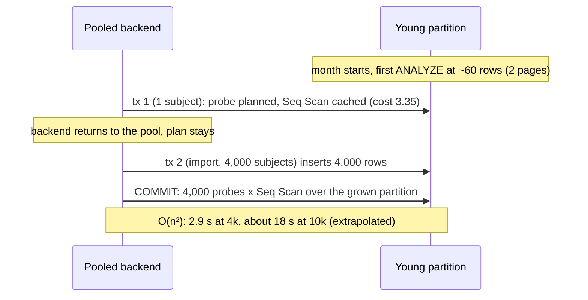

# RFC-010: stop the commit check from reusing a plan built on a tiny partition

> **Invariants source.** The project description of *Ticket Management System* is empty: it defines no invariants, and not the eight my role refers to. As in ADR-004, RFC-009 and E2, this RFC is checked against [[ADR-001-platform-blueprint]] §1 I1–I9. **If the project has its own list of eight, these checks are incomplete against it.**
>
> **Numbering.** The highest RFC in the repo or any branch is RFC-009, and ADR-004 has E1 and E2. This is **RFC-010**, targeting **ADR-004-E3**.

## 1. Recommendation

**Add one clause to the commit-check function: `SET plan_cache_mode = force_custom_plan`.** The probe is then planned at every call, with its real values and the partition's *current* size. No plan built while a partition held 2 pages can be reused after an import has grown it. The function already carries a `SET search_path` clause, so this is a second clause on the same line, not a new mechanism.

Pair it with **a revised Finding 5 pass condition** (section 6). Item 2 (b) stops testing the generic plan, which the trigger will never run, and tests the plan that *does* run. Item 3 gains the pooled-session case, with a negative control that must go red without the clause.

**Reject route 3 as a fix.** Pre-creating, pre-analysing or sizing partitions cannot make a young partition large, and the remaining variants (scheduled ANALYZE, a short PgBouncer `server_lifetime`) only shorten the window. **That moves the risk to operational discipline; it does not remove it.** Pre-analysing an empty partition probably makes it worse (section 4, Inferred).

**Cost, measured (S2, Technical Architect):** about 190–251 µs per call, flat across N, and about 120–142 µs per probe on a 10k import in a fresh session. That fails the old ≤ 100 µs row. Under RFC §7 the CTO ruled to **accept 1c and rebase the budget** to ≤ 300 µs per call and ≤ 175 µs per probe on imports, both measured at the production partition count stated in section 6. A probe that targets the leaf partition (S3) is a recorded follow-up, not an M1 condition (section 7).

## 2. The problem in one paragraph

On a partition of 60 rows (2 pages), a Seq Scan costs 3.35 and every index path costs more. The planner is right: scanning 2 pages *is* the cheapest way to answer one probe. The fault is reuse. Under `plan_cache_mode = auto` (the production default), PL/pgSQL plans its first five calls with the real values, then switches to a cached generic plan when that is no costlier. On a 2-page partition it is not costlier, so the backend caches the Seq Scan. Under PgBouncer transaction pooling, that backend lives on and serves other tenants' transactions. When one of them imports 4,000 subjects, each of the 4,000 deferred probes at COMMIT scans the whole partition, which now holds this import's rows: **172.8 ms → 2,923 ms for 1,000 → 4,000 subjects, ratio 16.9** (TICK-428, `scratch/audit-commit-check/out/cached-plan-reuse.txt`). The plan only goes away when the partition is analysed again, or the backend is recycled.

This recurs every month, on every pooled backend, for every audited table. Item 3 missed it because it opens a fresh session per import, so its plan is first built at COMMIT, after the partition has grown.

## 3. Why the fix has to be "no reuse", not "a better plan"

Any fix that still caches one plan per backend has to pick a plan that is good **both** at 2 pages and at 4,000+ rows. For a single probe on 2 pages, the planner will always prefer a Seq Scan, and it is right to. The candidates that try to force an index shape fail on measured costs:

- **Key order or probe-form changes (route 1 as listed).** Changing the R2 key order changes which index wins *among indexes*. It does not make any index cheaper than reading 2 pages. Rejected.
- **Forcing an index shape with `SET enable_seqscan = off` on the function** (the Technical Architect's first candidate). Measured: the planner then picks a **Bitmap Heap Scan on `(tenant_id, occurred_at)`**, cost 6.24, with `subject_id` in `Filter` (`out/young-partition-plans.txt`). Every entry of one transaction shares that prefix, so this is the O(n²) shape again. Also turning off bitmap scans leaves a plain index-scan tie, prefix against subject index, at 3.36 / 3.36 on the young partition (TICK-499 spike table). That is the S1 F1 tie, which broke the bad way in 9 to 10 of 10 trials. Rejected.
- **`pg_hint_plan` or a similar extension.** A new dependency to install, upgrade and secure in every environment, to force a plan that is wrong for small partitions anyway. Rejected (and would need a CTO decision as a new component).
- **A set-based check (one anti-join per transaction instead of one probe per row).** O(n) by construction, but constraint triggers are row-level only, and a statement-level trigger with transition tables cannot be deferred to COMMIT, so it cannot see audit entries written later in the transaction. This would replace ADR-004 decision 2's mechanism and is out of proportion for this fault. Rejected.

The only lever that removes the fault is the one the Technical Architect named second: **don't cache a generic plan in the trigger.** Two ways to do that:

| Way | How | Verdict |
|---|---|---|
| **`SET plan_cache_mode = force_custom_plan` on the function** | One clause; PL/pgSQL plans each call with the bound values and the partition's current page count. The setting is restored on function exit, so the caller's session (and the next pooled transaction) is untouched. | **Recommended** |
| `EXECUTE format(...) USING ...` (dynamic SQL) | Same effect (one-shot plan per call), plus a parse per call and SQL built from strings inside a `SECURITY INVOKER` trigger. | Rejected: same determinism, more cost, worse to review |

## 4. Decision table

"Determinism under pooled sessions" asks: can the plan a probe executes in transaction *k* depend on what an *earlier, unrelated* transaction on the same backend did? That is what failed.

| Route | What it changes | Determinism under pooled sessions | Worst case at COMMIT | Who carries the risk | Verdict |
|---|---|---|---|---|---|
| **1a. Erratum: R2 key order / probe text** | Index choice among indexes | **None gained.** Seq Scan still beats every index at 2 pages, and is still cached | O(n²), unchanged (2.9 s at 4k) | Code, silently | Reject |
| **1b. Erratum: function `SET enable_seqscan = off` (+ bitmap off)** ("Index Only Scan forced by plan shape") | Cost penalties on scan types | **Worse.** The cached plan becomes the `(tenant_id, occurred_at)` prefix, or a 3.36 / 3.36 cost tie decided by ANALYZE samples | O(n²) by the prefix path, in every session, not only young partitions | Code, silently | Reject (measured) |
| **1c. Erratum: function `SET plan_cache_mode = force_custom_plan`** | No plan survives a call; each probe is planned with real values and current relation size | **Full, by construction.** No plan crosses transactions or backends' histories. A session-level `force_generic_plan` cannot override it (function SET wins), which the test exercises | Linear: n probes, each against the partition as it is at COMMIT. Small partition → cheap Seq Scan; grown partition → subject index (measured on a freshly built plan after growth, cost 8.30) | Code, tested | **Recommend.** Cost measured by S2 (190–251 µs per call), accepted under the rebased budget (CTO ruling) |
| 1d. Erratum: dynamic `EXECUTE` | Same as 1c | Same as 1c | Same as 1c, plus a parse per call | Code | Reject (1c is the same with less) |
| **2. Revised pass condition only** (accept the residual, add the pooled case as a known-red or skipped test) | Nothing in production | **None.** The fault ships; the test only documents it | O(n²), measured 2.9 s at 4k; a 100k import would run for minutes inside one COMMIT holding locks | Tenants who import | Reject alone. **Adopt as the companion of 1c** (section 6) |
| **3a. Pre-create and ANALYZE partitions before they go live** | Stats on an empty partition | **Worse, probably.** An analysed empty partition has `reltuples = 0`, so PG 16 no longer applies the "assume 10 pages" rule for never-analysed relations, and the very first plans are Seq Scans (Inferred from `estimate_rel_size`; TICK-460 (b) passed *because* the partition was never analysed) | O(n²) from the first day instead of the first ANALYZE | Ops | Reject |
| **3b. Minimum size before a partition goes live** | Pad partitions with rows | Would work only with filler entries in an append-only, hash-chained, exported audit log. Not acceptable data | n/a | Auditors | Reject |
| **3c. Scheduled ANALYZE of the current partition, or PgBouncer `server_lifetime`** | How long a stale plan can live | **Partial.** Shrinks the window from "until autovacuum" to "until the next job / recycle". A plan cached at 09:00:00 still serves an import at 09:00:05 | O(n²) inside the window; depends on a cron job and a pooler setting staying right in every environment | **Operational discipline** | **Reject as a fix: it moves the risk to operational discipline.** Keep as nothing; not needed with 1c |

**Determinism in one line:** 1c makes the executed plan a function of *this* probe's values and *this* relation's size only. Every other route leaves it a function of the backend's history.

## 5. What ADR-004-E3 would say

> **Decision 2, added sentence.** The commit-check function carries `SET plan_cache_mode = force_custom_plan`, so no probe plan is reused across calls. The probe keeps the pinned predicate, and all five probe inputs stay plpgsql locals (`now()` and `pg_current_xact_id()` read into locals, S1 F1; never `NEW.<col>`). P5-10b's `n_distinct = 1` on `occurred_at` stays. CI-A3 rejects an `audit_commit_check` whose `proconfig` lacks the setting. The cost budget is the two rows in RFC-010 §6, measured at 38 partitions.

Notes the ADR also carries (non-blocking, from round 1):
- **Rollout:** the `ALTER FUNCTION` takes effect in a pooled session that already holds the cached Seq Scan, at its next transaction. It needs no reconnect, no ANALYZE and no PgBouncer recycle. A `SET LOCAL plan_cache_mode = force_generic_plan` in the writing transaction does not override it (PG specialist, confirmed).
- **3a and 3c stay rejected**, for the reasons in Q2a. Any ANALYZE or VACUUM of an empty leaf writes `reltuples = 0`, and that turns off the 10-page floor (`tableam.c:705`). Autoanalyze takes every leaf through the "analysed, 60 rows" state. Nothing can analyse during an import, because its rows stay uncommitted until the COMMIT that runs the probes.
- **Plan-shape routes are dead** (TA Q1). `random_page_cost = 1.0` beats a 2-page Seq Scan, but an analysed empty leaf that gains rows during the transaction goes back to a Seq Scan, and the cost margins are as small as a tie.
- **S3** is a recorded follow-up with a named trigger (section 7).

- **Why an erratum and not a code comment:** the setting is what makes the commit check's cost linear, which is part of the decision-2 contract that P5-13b and P5-32 rely on. Removing it in a later refactor must fail CI, not pass review by accident.
- **F1 stays.** A custom plan uses the same estimator, so the S1 tie on dense partitions (prefix vs R2 key, 8.46 / 8.46 without the override) would reappear without `n_distinct = 1`. S2 re-runs the TICK-460 checks to confirm.
- **Scope.** One function, one migration (`ALTER FUNCTION audit_commit_check() SET plan_cache_mode = force_custom_plan` in TICK-428's migration, before anything attaches it), one CI-A3 check. No schema, grant, policy or partition change. No role-level or database-level GUC change: nothing outside this function plans differently.

### Invariant check (against ADR-001 I1–I9; incomplete against an eight-item list, see the note at the top)

| Invariant | Effect |
|---|---|
| I1 tenant wall | None. The probe keeps `tenant_id = v_tenant` under the writer's RLS; a custom plan is planned under the same policies |
| I3 least privilege | None. Still `SECURITY INVOKER`, owned by `nava_migrator`, no new grant. A function `SET` clause needs no privilege at call time |
| I4 one write pipeline, audit in the same transaction | **Strengthened.** The database-side guarantee no longer degrades into a multi-second COMMIT that a caller might time out and retry |
| I6 / I7 | None (no workflow or side-effect path touched) |
| I2, I5, I8, I9 | Not touched |

## 6. Revised Finding 5 pass condition (replaces item 2 (b), adds item 3 (c))

Unchanged: TICK-460 (a) and (b), the dense ≥ 10× cost ratio and its `RESET` negative control, item 2 (a), item 3 (a) and (b). All of them run with the function as shipped (clause on).

**Item 2 (b′), young partition, 60 rows, analysed, 10 fresh ANALYZE samples.** Test the plan the trigger executes, captured with `auto_explain` (`log_nested_statements = on`, `log_min_duration = 0`) on probes fired at COMMIT, not a `PREPARE`/`EXPLAIN` generic plan:
- after a 1-subject write: any plan passes (a Seq Scan of 2 pages is the right answer);
- after an in-transaction import of 1,000 subjects into the same partition: **every sampled probe plan has `subject_id` and `occurred_at` in `Index Cond`, in 10 of 10 samples.** Subject index or R2 key both count; don't pin the name;
- every captured plan shows the bound values as constants, not `$n` (proves the plan was custom). This holds only while the probe reads plpgsql **locals**, not `NEW.<col>` (PG specialist Q2b point 5).

**Item 3 (c), pooled session, new (rev 1: two modes, medians).** It runs under two session-level `plan_cache_mode` settings:
- **`auto`**, the production default. The plancache switches to the cached generic Seq Scan after five custom plans, which is the real failure (PG specialist Q2b).
- **`force_generic_plan`**, the adversarial setting: the function's clause must win.

Each mode uses one session. Make **10 warm-up** 1-subject writes while the partition is 2 pages, which goes past the five custom-plan calls. Then, in that same session, import N = 1,000 and then 4,000 subjects into a tenant absent from the statistics. **Run at least 3 times, each on a fresh fixture, and take the median of t(4N)/t(N). Pass: the clause arm's median is < 8 in both modes.** This is `reuse.sql` from TICK-428 with a longer warm-up. Measured: 3.1–5.4 with the clause, 12.3–20.0 without it, in both modes.

**Item 3 (c) negative control.** The same script runs in both modes against a copy of the function without the clause, and **its median must be ≥ 8** (measured 12.3–20.0). **Both arms run in the same CI job**, so machine noise affects them equally. If the control's median is below 8, the test cannot see the fault, and the gate is not met.

**Catalog check (CI-A3).** `pg_proc.proconfig` of `audit_commit_check` contains `plan_cache_mode=force_custom_plan`. Negative control: a test function without it is reported.

**Production partition count for the budget (rev 1).** ADR-004 R28 gives `audit_log` one DEFAULT partition and leaves partition management to Epic 30. ADR-001 has no audit purge in M1 (D23). So partitions only accumulate, one per month, and none is detached. **The budget shape is 38 partitions: DEFAULT, the current month and 36 retained months** (three years with no purge). That is the S2 "38 partitions" shape, and M1 stays below it. Cost grows with partition count (S2 F3), so 38 is the conservative shape. If Epic 30 picks a retention that keeps more than 38 partitions attached, its design re-runs both budget rows at that count. That re-run is the S3 trigger (section 7).

**Budget (rev 1, replaces the ≤ 100 µs / 42.2 µs row in `docs/budgets.md`).** Two rows: the Technical Architect's S2 proposal with the CTO's ceilings. The Postgres specialist commits them after E3 is accepted.

| Row | Method | Ceiling | Measured (S2, PG 16.10, 2026-11-03) |
|---|---|---|---|
| Commit-check trigger, single subject | `pg_stat_user_functions` self_time / calls, `track_functions = pl`. **One** connection (pooled-backend state), 5,000 single-subject transactions as `nava_worker`. Young partition analysed at 60 rows, autovacuum off on it. **38 partitions.** Reported at N = 200, 1,000 and 5,000 | **≤ 300 µs per call, and flat: max/min < 1.5 across the three N** | Clause: 248–251 µs at 38 partitions (190–225 µs at 2), flat. Shipped: 50 → 234 µs, not flat |
| Commit-check trigger, import | COMMIT time / N for one 10,000-subject import, **fresh session**, **38 partitions**, median of 3 | **≤ 175 µs per probe** | Clause: 120–142 µs at **2** partitions. Shipped: 10.5–12.0 µs |

- The "flat" condition is what the old row lacked. It catches plan decay, which a single N cannot show (S2 F4).
- **Not yet measured: the import row at 38 partitions.** S2 measured it at 2. Adding F3's planning growth from 2 to 38 partitions (125 → 154 µs, about +30 µs) gives about 150–172 µs. That is Inferred: inside 175 µs, but with little margin. The first TICK-428 run at 38 partitions settles it. A result over 175 µs fires the S3 trigger and comes back to the triad with the number. The ceiling is not raised quietly.

**Rule unchanged:** if any of these is red or flaky, the TICK-460 rule applies: stop and tell the Technical Lead.

The two skipped tests TICK-428 lands with (item 2 (b) and the pooled-session case) are replaced by 2 (b′) and 3 (c) above, still skipped with TICK-502's id until E3 is accepted and the clause is in.

## 7. Spike S2 (done) and follow-up S3

**S2 ran in critique round 1.** The Technical Architect measured cost; the Postgres specialist covered linearity and Q2. Two independent measurements confirm determinism. Per-call cost was 190–251 µs, which fails the old budget. As this section required, the number went back to the triad, and the CTO ruled under §7 (see the Response section). The original S2 brief is kept below for the record.

**S3 is a recorded follow-up, not an M1 condition.** It means a custom plan on the leaf partition instead of the parent. Planning the leaf takes 21–22 µs; planning through the parent takes 90–154 µs (S2 F3).
- **Trigger:** either budget row in section 6 fails at the production partition count. That includes a later Epic 30 retention above 38.
- **It must solve these first:** a deterministic leaf name (an Epic 30 naming rule derived from `occurred_at`, or a `tableoid` handoff from the write path), and a leaf grant the I3 model allows. It must also avoid `EXECUTE format()` dynamic SQL, because 1d stays rejected.
- **Pass and fail:** as the Technical Architect wrote them in round 1.

The trigger goes in the CTO's risk register.

### Original S2 brief (rev 0)

- **Question.** Does `force_custom_plan` on the function keep the commit check linear in a pooled session, and what does per-call planning cost?
- **Setup.** postgres:16.10, the TICK-428 harness on `7b5e388` (`internal/db/dbtest/audit_commit_check_test.go` and `scratch/audit-commit-check/`), with `ALTER FUNCTION audit_commit_check() SET plan_cache_mode = force_custom_plan`.
- **Pass.** Everything in section 6 green, negative control red, **and** per-call self time ≤ 100 µs. Report also: 10k-subject commit time (S1 item 2 shape; today 172–198 ms), and the planning share of the call (`EXPLAIN (ANALYZE, SUMMARY)` planning time on the probe).
- **Also confirm (version-specific, I am not taking it from memory):** that PL/pgSQL's SPI plans honour a function-level `plan_cache_mode` in PG 16 (the "constants, not `$n`" check above shows it), and section 4's 3a claim about an analysed empty partition (one `EXPLAIN` on a pre-analysed empty partition).
- **Owner.** Postgres & Data Modeling Specialist, or the TICK-428 implementer through the Technical Lead. Timebox: half a day.
- **If the budget fails** (planning dominates), the RFC returns to the triad with the number. Candidates then are a per-call cost trade (accepting > 100 µs for single-subject writes against linear imports), which is a CTO tradeoff, not a silent downgrade to route 2 or 3.

## 8. Tradeoffs, plainly

- **Cost, measured.** Rev 0 guessed "tens of µs"; that was about 10× too low. Every audited write now plans one probe per audited row at COMMIT. That adds about **0.15–0.2 ms to each audited single-subject write**. A 10k import COMMIT goes from about 0.11 s to about **1.3 s**. The cost is linear. In a pooled backend, today's path already pays 234 µs per call after 5,000 writes (S2 F4), and 2.9 s at 4k on the reuse path. Most of the cost is planning through the partitioned parent (S2 F3), so it grows with partition count. That is why the budget is pinned to 38 partitions and why S3 exists.
- **Gain.** The commit check becomes linear in every session state, not only in the states a test happened to construct. No cron job, pooler setting or partition procedure has to stay right for it to hold.
- **Lock-in or migration pain.** None: one reversible `ALTER FUNCTION`, before any table attaches the trigger.
- **Where it could still break.** A future PG version that changes how `plan_cache_mode` applies inside PL/pgSQL. The catalog check cannot see that; item 3 (c) can, and runs on every Postgres bump through the pinned-version CI.

## 9. Open questions for the critique

*All three were answered in round 1 (TA Q1 and Q3, PG Q2). Kept for the record.*

1. **Technical Architect:** do you accept the measured rejection of the "forced Index Only Scan" candidate (bitmap prefix under `enable_seqscan = off`, then the 3.36 / 3.36 tie)? Is there a plan shape I missed that beats a 2-page Seq Scan on cost without disabling scan types?
2. **Postgres specialist:** is the 3a claim right in PG 16.10 (analysed empty partition → no 10-page assumption → Seq Scan from the first plan)? And is there any PL/pgSQL or plancache path where a function-level `plan_cache_mode` is ignored for the probe?
3. **Both:** is ≤ 100 µs per call still the right budget once planning is per call, or should S2 report against p95 overhead as S1 item 1 did?

## Response — round 1

On the §7 tradeoff, the CTO ruled: **1c with a rebased budget, and S3 as a follow-up, not an M1 condition.** The ruling sets the ceilings. This revision applies them and does not reopen anything a spike settled.

| Item | Label | Resolution | Where |
|---|---|---|---|
| **F1:** per-call cost 190–251 µs against ≤ 100 µs | blocking | **Accepted under the CTO ruling.** The budget is rebased to **≤ 300 µs per call, flat across N = 200 / 1,000 / 5,000 (max/min < 1.5)**, measured at **38 partitions**, where S2 measured 248–251 µs. It replaces the misleading 42.2 µs row. The Postgres specialist commits it after acceptance | §6 Budget, §1 |
| **F2:** 10k import COMMIT 0.11 s → 1.3 s | blocking | **Accepted under the CTO ruling.** New import row: **≤ 175 µs per probe** on a 10k import, fresh session, median of 3, at **38 partitions**. S2 measured 120–142 µs at 2 partitions. **The 38-partition value is not measured yet;** I infer about 150–172 µs (Inferred, with little margin). The first TICK-428 run at 38 partitions settles it. A result over 175 µs fires the S3 trigger and comes back to the triad. The ceiling is not raised | §6 Budget, §7 |
| Partition count not stated | non-blocking (TA); the ruling requires it | **Stated: 38.** That is DEFAULT, the current month and 36 retained months, because M1 has no audit purge (D23); M1 stays below it. Epic 30 re-runs both rows if it keeps more | §6 |
| Item 3 (c): run under `auto` and `force_generic_plan` | non-blocking (PG); adopted by the ruling | **Accepted.** Both modes, 10 warm-up calls, median of ≥ 3 runs on fresh fixtures, both arms in the same CI job. Passes when the clause arm's median is < 8 and the control's median is ≥ 8 | §6 item 3 (c) |
| The probe keeps its locals, not `NEW.<col>` | non-blocking (PG Q2b point 5) | **Carried into the E3 text and item 2 (b′)** | §5, §6 |
| 3a / 3c rejected | confirmed (PG Q2a, TA F6) | **Carried into the ADR** with the Q2a reasons | §5 notes |
| S3, a probe on the leaf partition | verify-by-spike (TA); deferred by the CTO | **Deferred with a named trigger:** either budget row fails at the production partition count, including an Epic 30 retention above 38. The CTO owns the risk-register entry | §7 |
| F3, F4, F5, Q1 | non-blocking / confirmed | Folded into the §8 cost and the §5 notes. F4 is the reason the budget has the flat condition | §5, §6, §8 |

**The Technical Architect re-checks blocking items only: F1 and F2.** That is, the two §6 rows match the ruling's ceilings, the flat condition and the 38-partition shape. The mechanism does not change.

## Final re-check (Technical Architect, TICK-502 comment 01a1a00e-cb7b) and CTO approval (comment 01a1a00f-1cdf)

- **F1 and F2: ACCEPT.** Both §6 rows match the ruling. At 38 partitions the flat condition separates the two arms: max/min was 1.06–1.30 with the clause and 2.05 as shipped.
- **The inferred 150–172 µs is rejected and replaced by a measurement.** In the same host state, the 38-partition import costs the same as the 2-partition one (median COMMIT 2,939 ms against 2,943 ms; per-rep ratio 0.80–1.08). Scaled to the round-1 host state, that is about 96–153 µs per probe, centred near 130 µs.
- **Non-blocking text change, accepted by the CTO as written and carried into ADR-004-E3:** the rows are measured in CI only, and an over-ceiling result fires S3 only when the same-run clause/shipped ratio is also out of range. The reason: on one laptop, the same fixture varied 1.8–2.3× within an hour.

Evidence: `docs/adr/ADR-004/spikes/technical-architect/rfc-010/` and `docs/adr/ADR-004/spikes/postgres/rfc-010/`.
