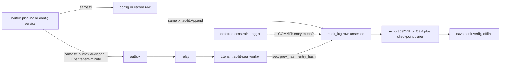
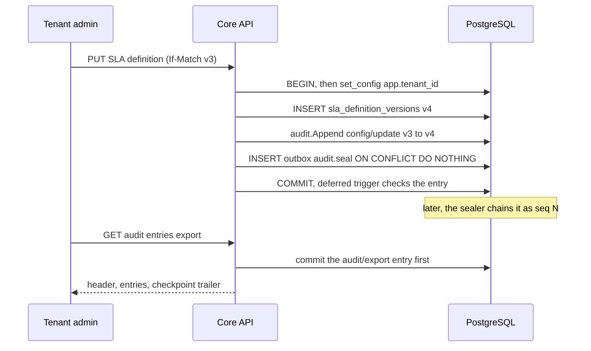

# RFC-008: One audit log for records and configuration (CR-AUDIT-1)

> **Invariants note.** The project description is empty, so it defines no invariants. This RFC checks against **I1–I9 in ADR-001 §1** (nine, not the eight the role brief mentions). Those checks are complete against ADR-001. If the project is meant to carry its own list, the checks below have to be re-run.
>
> **Numbering assumed.** RFC-008 (the highest in the repo is RFC-007, under `docs/adr/ADR-003/`). ADR-004 (the highest is ADR-003).

## Summary

- **One append-only table, `audit_log`, holds record changes, configuration changes and audit exports.** There is one Go writer (`audit.Append`), one reader and one export. Record audit (Epic 05) and configuration audit (Epics 04–28) are the same rows, so "the SLA changed at 10:02, then the case breached at 10:40" is a single query.
- **The database itself checks "exactly one entry per committed change".** Every audited table gets a deferred constraint trigger. The trigger fails the commit if the transaction changed a subject and wrote no audit row for it. A unique key stops a second entry for the same subject and version. A rollback removes both the change and its entry, because they are one transaction (I4).
- **Tamper-evidence: yes, through a per-tenant hash chain that is sealed asynchronously.** Writers never contend on a chain head. A per-tenant sealer (outbox → relay → worker, the existing I6 path) gives sealed entries a sequence number and a chained hash a few seconds after commit. Every export ends with the chain checkpoint, so an export kept by the customer can later prove the log was not rewritten.
- **Erasure (Epic 30) does not break the chain.** The chain covers a salted hash of the diff, not the diff. Erasing personal data nulls the diff and its salt, the chain still verifies, and the entry shows as "redacted under erasure request X".
- **S8's published versions are backfilled once into `audit_log`, not exposed through a view.** A view would mean two readers, two export paths and entries the chain does not cover.
- **What you accept:** a sealing lag of seconds during which new entries are not yet chained, and **no external anchoring in M1**. Someone with database owner access who rewrites the whole chain consistently is caught only against a checkpoint the tenant already exported (R-A1).

## D0. New ADR or ADR-001 amendment?

**A new ADR, ADR-004 "Audit log".** ADR-001 amendments (A1, A2, A5, E3) each changed a contract inside ADR-001. This RFC adds a subsystem that twelve epics will cite. It builds on I1, I4, I6 and I9, and it changes none of them:

- It uses **no new database role**.
- It adds **no non-tenant policy**, so the A.3 allow-list stays at 10 entries.
- It **adds no purge**: ADR-001 A.3 says "no audit purge in M1", and that still holds.

The grants it adds are per-table manifest entries in `db/grants.yaml`, the same way S8 added `entity_definition_versions` without amending ADR-001. **Rule:** if the critique forces a new role or an allow-list entry (the only likely candidate is a dedicated sealer role, see Options), that part ships as **ADR-001-A6**. The rest stays in ADR-004.

## Decisions

| # | Decision | Why / what it prevents |
|---|---|---|
| **D1** | **One table, `audit_log`, for three domains:** `record`, `config` and `audit` (the export itself). Same columns, same reader. The per-record history read (Epic 05) is a filter on this table. | Two logs, or a union view that the export and the chain cannot cover. A record timeline that cannot show the configuration change that caused it. |
| **D2** | **The entry is fixed columns, not a JSONB blob** (columns in Annex A). Envelope: tenant, id (UUIDv7), `occurred_at`, domain, action, `subject_type`, `subject_id`, `entity_definition_id` (records only), `version_before`/`version_after`, actor (`principal` id **or** a named system actor, never both), `source`, `source_ref`, `change_set_id`, causation id and depth (I9), request id. Content: `content_sha256`, `diff` (`json`, RFC 6902 JSON Patch), `diff_salt`, `diff_sha256`. Seal: `seq`, `prev_hash`, `entry_hash`, `sealed_at`. | Filter and index columns that drift by writer. A "who" that is free text. |
| **D3** | **Vocabularies are closed and checked by the database.** `action` is one of `create, update, publish, enable, disable, delete, promote, rollback, state_change, export`. `source` is one of `user, ai, change_set, onboarding, plugin, rule, workflow, function, system`. That is the union of Epic 05's list and CR-AUDIT-1's list. `subject_type` comes from a Go registry (`internal/audit/subjects.go`) mirrored by a CHECK. Adding a configuration type is a platform migration, never a tenant change (I8). | Writers inventing spellings, which leaves the export unfilterable. |
| **D4** | **Same transaction, enforced twice.** (a) `audit.Append(ctx, tx, Entry)` takes the caller's `pgx.Tx`, so there is no other signature. (b) Every audited table, configuration and record alike, gets a `DEFERRABLE INITIALLY DEFERRED` constraint trigger. At commit the trigger requires an `audit_log` row with the same `tenant_id`, `txid = pg_current_xact_id()`, `subject_type` and `subject_id`. A unique key on `(tenant_id, txid, subject_type, subject_id, version_after) NULLS NOT DISTINCT` stops duplicates. The trigger is plain `SECURITY INVOKER` plpgsql (I3 holds). | A writer that skips audit (caught at commit, not in code review). Two entries for one change. A rolled-back change that leaves an entry (impossible, since it is one transaction). |
| **D5** | **Every audited configuration type keeps immutable versions** (the S8 pattern: a `*_versions` row with a content hash). The audit entry references the subject and `version_after` and carries that version's `content_sha256`. The JSON Patch `diff` is for human reading; the version row is the content of record. Deletes and disables carry `version_before` and no `version_after`. Epic 28's "restore the exact prior versions" needs the same thing anyway. | Audit as the only copy of configuration content. Large snapshots in the log. A diff that cannot be checked against what was actually running. |
| **D6** | **Who, and through which channel.** The actor is the authenticated principal, or a named system actor (`onboarding`, `groupsync`, `relay`, `sealer`, `migration:<name>`). The source is the channel. For AI, `source = ai` and `source_ref` = the AI decision record (I8). The actor is the human who accepted it, or system actor `ai-autoapply` when an above-threshold rule applied it. For promotion, `source = change_set` and `change_set_id` is set on **every** item entry the promotion wrote, plus one `promote` or `rollback` entry on the change set itself. | "Who changed it" that hides an AI or a promotion behind a user name. Promotion history held outside the log (Epic 28's AC). |
| **D7** | **Secrets never enter the log.** Configuration schemas mark secret fields `writeOnly: true` plus `x-nava-secret: true`. The configuration writer stores the value in the secret store and keeps only a reference. `audit.Append` rejects a diff that has a value at a secret-annotated path and fails the write (it does not silently strip it). A secret change is logged as `{"op":"replace","path":"/…/secret_ref","value":"<ref-id>"}` plus `"secret_changed": true`. | Credential leakage through audit or export, the classic place it happens. |
| **D8** | **Isolation (I1, I5).** `audit_log` is a tenant table: `ENABLE` + `FORCE` RLS, canonical predicate, every key led by `tenant_id`. Policies: `SELECT TO nava_app, nava_worker`. `INSERT TO nava_app, nava_worker`. `INSERT TO nava_onboard` with the provisioning predicate (the pinned S8 pattern). `UPDATE TO nava_worker` only on the seal columns (column grant) and `USING (… AND sealed_at IS NULL)`. **No DELETE policy or grant for anyone.** A `BEFORE UPDATE` trigger also rejects any change to a row whose `sealed_at` is set and any change to a non-seal column. | Cross-tenant reads. Runtime edits or deletes of history. A sealer rewriting a sealed row. |
| **D9** | **Reading and export are tenant permissions, and field masks apply to diffs.** New permissions `audit.read` and `audit.export` go to the tenant-admin group and a seeded `auditor` role. Audit reads are **not** filtered by per-record ACL, because an auditor must see changes to records they cannot open. Field masks (I5) still apply: a masked path in a `record` diff is returned as `{"path":…, "redacted":"mask"}`, and the entry is flagged `diff_redacted`. A tenant can unmask fields for the auditor role through ordinary configuration. | Auditors blind to restricted records. Masked personal data exported to everyone who can export. |
| **D10** | **Integrity: a per-tenant hash chain, sealed asynchronously.** Each `audit.Append` also inserts an outbox row with `kind = audit.seal` and `dedupe_key = audit-seal:<unix-minute>`, with `ON CONFLICT DO NOTHING`, so a tenant gets at most one per minute. The relay starts or signals `t:<tenant>:audit-seal` (D22, REJECT_DUPLICATE gives one sealer per tenant). Its activity runs as `nava_worker` under the tenant context. It reads the head (max `seq`), takes unsealed rows in `(occurred_at, id)` order in batches of 1,000, and sets `seq = head+1…`, `prev_hash` and `entry_hash = SHA-256(prev_hash ‖ JCS(envelope))`. The envelope is every D2 envelope column plus `content_sha256` and `diff_sha256`, but not `diff` and not `txid`. `diff_sha256 = SHA-256(diff_salt ‖ diff bytes)`, with a 16-byte random salt per entry. `diff` is `json`, not `jsonb`, so the hashed bytes are the stored bytes (the S8 precedent, TICK-360). | Silent edits, deletions and reordering after sealing. A tenant-wide lock on every write, which an in-transaction chain would need. Brute-forcing the personal data in a small diff from its hash (hence the salt). |
| **D11** | **How erasure fits (the contract for Epic 30, not its mechanism).** Erasure sets `diff = NULL` and `diff_salt = NULL` and records `erased_at` and `erasure_ref` (two columns outside the chain). The chain covers `diff_sha256`, so it still verifies. The verifier reports the entry as erased, not tampered. The erasure is itself an `audit` entry. Actor ids are UUIDs; erasing a person tombstones the principal (migration 00010) and never touches audit rows. Configuration entries hold no personal data by design (D5: content lives in version rows). Epic 30 owns which role does the erase and its policy. | Erasure versus integrity as an either/or. "Audit still verifies" (TICK-33's AC) is met by construction. |
| **D12** | **Export: one documented format, streamed, and audited first.** `GET /api/v1/audit/entries:export?from=&to=&subject_type=&subject_id=&change_set_id=&domain=&format=jsonl\|csv`, under `audit.export`. **Before** the first byte, it commits an `audit`-domain `export` entry with the filter, format and requester. The body is JSON Lines (`application/x-ndjson`, format id `nava.audit.export/v1`): a header line (format, tenant id, filter, `generated_at`), one line per entry (envelope, diff or redaction marker, seal fields, `sealed: true/false`), and a trailer line with `{first_seq, last_seq, first_prev_hash, last_entry_hash, count, tenant_head_seq, tenant_head_hash}`. CSV carries the same columns flattened, with `diff` as a JSON string, and the trailer as the last row. The format spec goes in `docs/api/audit-export-v1.md`. The verifier ships as `nava audit verify <file>`, offline. The list read `GET /api/v1/audit/entries` uses the same filters with the D6 HMAC cursor. | An unaudited export path. Formats that drift between the API and the file. An export that cannot be verified without access to our database. |
| **D13** | **S8 backfill: a one-time, idempotent migration job, not a view.** For each existing `entity_definition_versions` row, insert one `config` entry: action `create` for version 1, `publish` after that, `subject_type = entity_definition`, `version_before`/`version_after`, `content_sha256 = schema_sha256`, `occurred_at = published_at`, actor `published_by` or system actor `onboarding` when NULL, source `user` or `onboarding` to match, `backfilled = true`, no diff. The id is UUIDv5 of the version id, inserted with `ON CONFLICT DO NOTHING`, so a re-run is a no-op. It runs **before** the D4 trigger is attached to `entity_definition_versions`. From then on the S8 publish path calls `audit.Append` like every other writer. | Two reading paths, and S8 history the chain does not cover. Duplicate backfill on a re-run. |
| **D14** | **Indexes:** `PK (tenant_id, id)`. `(tenant_id, occurred_at DESC, id DESC)` for the timeline and export. `(tenant_id, subject_type, subject_id, occurred_at DESC)` for subject history. `(tenant_id, change_set_id) WHERE change_set_id IS NOT NULL`. `UNIQUE (tenant_id, seq) WHERE seq IS NOT NULL`. `(tenant_id, occurred_at, id) WHERE sealed_at IS NULL` for the sealer. The D4 unique key. **No GIN on `diff`:** we do not search inside diffs in M1. | Unindexed timelines. Write amplification we do not need. |

## How it fits together

## Options considered

| Option | Why it lost |
|---|---|
| **Separate tables for record audit and configuration audit** | Fails CR-AUDIT-1 item 4 (one timeline). We would need two exports and two chains, and a union reader in the hot path. |
| **A union view over `entity_definition_versions` and later `*_versions` tables (instead of the D13 backfill)** | Every new configuration type adds a view arm. The view cannot carry actor source, change set or seal. The export would read N tables. Deletes and disables have no version row to show. |
| **Hash chain inside the writing transaction** (read the head under a per-tenant lock) | It serialises every write in a tenant on one row until commit. That puts a ceiling on record throughput, and one slow transaction stalls the whole tenant. Unmeasured, but the lock is structural. |
| **A chain per subject** (each record chains its own entries, with no lock beyond the row lock) | Cheap, but it cannot detect deletion of a subject's whole history or of its newest entry without a tenant-level checkpoint, and that brings the sealer back anyway. |
| **No integrity beyond RLS and grants** | Simplest. But regulated buyers ask "how do you know nobody edited it?" and the honest answer would be "trust our DBA". The market research named audit as the gate, so the sealer is worth its cost. |
| **External anchoring in M1** (WORM object storage with object lock, or RFC 3161 timestamps) | Adds a new vendor or infrastructure dependency and recurring cost, which is a CTO and business decision. Deferred as R-A1 with a trigger. The D12 checkpoint trailer already gives tenant-held anchoring. |
| **A dedicated `nava_auditseal` role instead of `nava_worker` for sealing** | Cleaner least privilege, but it needs an ADR-001 A.3 role change. A compromised worker can already write any tenant under RLS (R8), and the D8 column grant plus the sealed-row trigger stop it from changing content or sealed rows. **This is the option I most expect the critique to reopen**; if it wins, it ships as ADR-001-A6. |
| **Database triggers write the audit rows themselves** | A trigger cannot know the actor, the source, the AI decision or the change set without session variables, and those become a forgery surface (I2 spirit). The D4 trigger only **checks**; Go writes. |
| **`jsonb` diff** | jsonb rewrites bytes, so the stored diff would not hash to `diff_sha256` (the TICK-360 finding). |
| **Asynchronous export job with a download link** | Needs an object store and a retention story. Streaming covers M1 sizes. Revisit with Epic 26 or 30 (R-A3). |

## Risks and accepted residuals

| # | Residual | Mitigation | Owner | Revisit trigger |
|---|---|---|---|---|
| **R-A1** | The owner or migrator can rewrite a tenant's whole chain consistently. Only a checkpoint the tenant already holds detects it. | Checkpoint trailer on every export. The migrator is a one-shot job (ADR-001 R2). | Solution Architect | The first customer contract that requires independent anchoring, or a SOC 2 / 21 CFR Part 11 audit. Then a periodic checkpoint to object-locked storage. |
| **R-A2** | Entries are unchained until the sealer runs (target under 60 s). A sealer outage widens that window. | `audit_unsealed_oldest_seconds` gauge with an alert at 300 s. Exports mark `sealed: false`. Sealing is idempotent and catches up in batches. | Technical Lead | The alert firing in production. |
| **R-A3** | Streaming export is capped (proposed 1,000,000 rows per request, which is **unverified**; set at Epic 05 planning by measurement). Larger ranges must be split. | A typed 422 `export_too_large` with the row count. | Technical Lead | Epic 26 export UI, or a tenant above the cap. |
| **R-A4** | The D4 constraint trigger costs one index probe per audited row at commit. On the record hot path this is **unmeasured**. | Spike S1 at Epic 05 planning: p95 write latency with and without the trigger at 1M audit rows. If the overhead is over 10%, record tables fall back to the architecture test alone (Epic 05 AC), and configuration tables keep the trigger. | Postgres Specialist | S1 result. |
| **R-A5** | When Epic 30 partitions by time, `UNIQUE (tenant_id, seq)` and the D4 unique key need the partition key in them. | Epic 30 decides. The sealer is the single writer of `seq` per tenant (one workflow id), and the verifier detects gaps and duplicates regardless. | Epic 30 owner | Epic 30 RFC. |

## Invariant check (ADR-001 I1–I9)

| Invariant | Effect |
|---|---|
| I1 | Holds: tenant table, FORCE RLS, canonical predicate, keys led by `tenant_id`, no allow-list entry (D8). |
| I2 | Holds: the export and the sealer take the tenant from the token or the outbox row, never from a filter parameter. |
| I3 | Holds: no new role, no SECURITY DEFINER, and the trigger is INVOKER (D4, D8). |
| I4 | Strengthened: audit in the same transaction is now checked by the database (D4). |
| I5 | Holds: field masks apply to diffs (D9). The permission gates replace per-record ACL for audit reads only, and that is a stated choice. |
| I6 | Holds: the sealer starts only from an outbox row through the relay (D10). |
| I7 | Holds: sealing is idempotent (it only touches `sealed_at IS NULL`), and the backfill re-runs as a no-op (D13). |
| I8 | Holds: AI entries carry the decision reference (D6). New subject types are platform migrations (D3). |
| I9 | Holds: entries carry causation id and depth. A rejected cascade writes its audit entry (CI-10) through the same `audit.Append`. |

## Test and acceptance spec

| Test | Proves | Catches |
|---|---|---|
| **CI-A1** | Kill mid-write and rollback leave no entry. A committed configuration change and a committed record change each have exactly one entry. | Audit outside the transaction. |
| **CI-A2** | A raw write to an audited table without `audit.Append` fails at COMMIT with the trigger's error. | A writer that bypasses the pipeline. |
| **CI-A3** | Catalogue test: every table in `db/audited-tables.yaml` has the D4 trigger, and every tenant table is listed as audited or exempt with a reason. | A new configuration table shipped without audit. |
| **CI-A4** | Cross-tenant: tenant B's read and export, with any filter including A's subject ids, return zero A rows. With no tenant context, zero rows. | Isolation leak (I1). |
| **CI-A5** | A canary secret is written through every adapter and plugin configuration endpoint, then grepped across `audit_log` bytes and export bytes. It must be absent. A diff carrying a secret path is rejected. | Secret leakage (D7). |
| **CI-A6** | `nava audit verify` passes on a fresh export. Changing one byte of a sealed row (as the migrator) fails at that `seq`. Deleting a row is reported as a gap. Two exports are consistent with each other's checkpoints. | Tampering (D10). |
| **CI-A7** | After erasure nulls `diff` and `diff_salt`, verification passes and the entry is reported erased. | Erasure breaking integrity (D11). |
| **CI-A8** | An export writes exactly one `audit/export` entry, committed before the stream starts, and it appears in the next export. | Unaudited export (D12). |
| **CI-A9** | Backfill: every S8 version has exactly one entry, and a re-run inserts nothing. | Missing or duplicated history (D13). |
| **CI-A10** | `nava_app` or `nava_worker` updating a content column is denied. DELETE is denied. Updating a sealed row changes 0 rows. | Mutable history (D8). |
| **CI-A11** | An SLA definition change and a later record breach appear in one `GET /audit/entries` page, in time order. | Split timelines (D1). |
| **CI-A12** | A field masked for the reader appears as `redacted: mask` in the diff, in both read and export. | Mask bypass through audit (D9). |
| **CI-A13** | A promotion writes one entry per item with `change_set_id`, plus the change-set `promote` entry. Rollback writes the same set. | Promotion history outside the log (D6). |

## Sequencing (for the Technical Lead; not a plan)

1. **Epic 05:** `audit_log`, `audit.Append`, the D4 trigger on record tables (after spike S1), the read API, the export and the verifier.
2. **The same epic, a separate story:** the D13 backfill, then the D4 trigger on the S8 tables, and the S8 publish path calling `audit.Append`.
3. **The sealer (D10):** depends on the Epic 08 relay and worker. Until it lands, entries are written with the seal columns NULL and export marks them `sealed: false`. Nothing gets retrofitted.
4. **Each configuration epic** (06, 10, 11, 12, 16, 17, 20, 28) registers its subject types, lists its tables in `db/audited-tables.yaml` and passes CI-A2/A3 as part of its own acceptance.

## Open questions

1. **Postgres Specialist:**
   - How should the D13 backfill run under FORCE RLS? Options: a migrator job that sets `app.tenant_id` per tenant (does it need a migrator-scoped tenant policy?), or a Go one-shot job as `nava_app`, which cannot list tenants.
   - Will you own spike S1 (R-A4)?
   - Is `pg_current_xact_id()` in a deferred trigger sound behind PgBouncer in transaction mode? I believe it is, because the trigger runs in the same server transaction. Please verify it in S1.
2. **Security & Multi-Tenancy Reviewer:**
   - Is D9 acceptable: audit reads are gated by tenant permission instead of per-record ACL, with masks applied to diffs?
   - Is `nava_worker` acceptable as the sealer role, versus a dedicated role (which would be ADR-001-A6)?
   - Is the D7 rejection rule enough, or do you want a secret-shaped-value scanner as well?
3. **CTO:** do you confirm that external anchoring (R-A1) stays deferred? Doing it in M1 is a new infrastructure dependency with recurring cost, so it would go to the founder as a business tradeoff.

## Annex A: `audit_log` columns (for the Postgres review)

| Column | Type | Notes |
|---|---|---|
| `tenant_id` | uuid NOT NULL | FK `tenants`, leads every key |
| `id` | uuid NOT NULL | UUIDv7. UUIDv5 for backfill. |
| `occurred_at` | timestamptz NOT NULL DEFAULT now() | The transaction time |
| `txid` | xid8 NOT NULL DEFAULT pg_current_xact_id() | D4 only. Not exported, not hashed. |
| `domain` | text | `record`, `config`, `audit` |
| `action` | text | D3 list |
| `subject_type` | text | D3 registry, CHECK |
| `subject_id` | uuid NOT NULL | |
| `entity_definition_id` | uuid NULL | Records only. FK `(tenant_id, …)` |
| `version_before`, `version_after` | integer NULL | |
| `actor_principal_id` | uuid NULL | FK `(tenant_id, …) principals` |
| `actor_system` | text NULL | CHECK: exactly one of the principal id and the system actor is set |
| `source` | text | D3 list |
| `source_ref` | uuid NULL | AI decision, plugin installation, rule, workflow |
| `change_set_id` | uuid NULL | |
| `causation_id`, `causation_depth` | uuid, smallint | I9 |
| `request_id` | text NULL | Trace correlation |
| `backfilled` | boolean NOT NULL DEFAULT false | D13 |
| `content_sha256` | bytea NULL | Required for `config` entries except delete |
| `diff` | json NULL | RFC 6902. Capped at 64 KB; above the cap, NULL with `diff_truncated`. |
| `diff_truncated`, `diff_redacted` | boolean | |
| `diff_salt` | bytea NULL | 16 bytes. NULL after erasure. |
| `diff_sha256` | bytea NULL | NULL only when there was never a diff |
| `erased_at`, `erasure_ref` | timestamptz, uuid NULL | D11. Outside the chain. |
| `seq` | bigint NULL | Seal |
| `prev_hash`, `entry_hash` | bytea NULL | Seal |
| `sealed_at` | timestamptz NULL | Seal |
