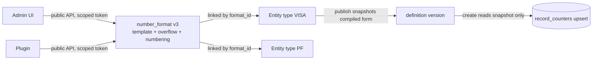

# RFC-014: Record numbering (rev 1)

> **Invariants source.** The project description on Multica has no invariants. I loaded them from `docs/adr/ADR-001-platform-blueprint.md` §Invariants (I1–I9, `main` at `89e0f84d`). The checks below are made against that text.
> **Numbering assumption.** The highest RFC in the repo is RFC-013, so this one is RFC-014. The outcome is a new ADR (ADR-005 assumed) that amends PLAN-003 D-3-9.

## Changelog rev 0 → rev 1

| # | Source | Change | Where |
|---|---|---|---|
| 1 | Postgres **blocking 1** | The `record_counters` key change is now an explicit **expand/contract** sequence (M1, M2, deploy, M3) with a publish gate until M3 has run and a no-rollback rule after M3 | §4.2.1, §8 |
| 2 | Postgres **blocking 2** | The legacy template `{prefix}{seq:7}` compiles to `scope_key = ''` exactly (epoch 0). The epoch changes only when the **compiled** template changes, never per definition version. A pinned test is required | §4.2, §4.6 |
| 3 | vknavaladi, 17:21 ("plugin created dynamically and linked") | New **number formats as linked metadata**: a tenant-owned, versioned `number_format` object created at runtime (by an admin or by a plugin through the API) and linked to entity types. In scope now. A code-executing plugin (P-b) stays deferred with a sharper trigger | §5 |
| 4 | Postgres non-blocking 3, 4, 5 | `period_end` column with a partial index and `nava_purge` policies. Purge is **mandatory** for period scopes. A publish cap of 1,000 on the **product** of field cardinalities. The 2-day grace is justified (26 h UTC offset span) | §4.2 |
| 5 | Postgres verify-by-spike 6 | L2 allocator with `SET LOCAL synchronous_commit = off` added to spike S1 as variant L2s | §2, §7 |
| 6 | Security C1–C3 | Allocator goes through a new `tenancy.AllocTx`; its tenant is `tenancy.TenantOf(createTx)`; its pool must log in as `nava_app` | §2 L2 details |
| 7 | Security C4 | Isolation registry rows rewritten on the new key in the deploy PR, plus new Denied cases and purge rows | §4.2.1, §8 |
| 8 | Security mask decision, C5, C6, C7 | Coupled publish for masks, re-check on every mask-set change, AR-TICK-653-01. M1 field tokens are enum-only and depend on S10 field masks. `x-nava-immutable` enforced on every write path with a test each | §4.4 |
| 9 | Security plugin items (a)(b)(c) | Added to the P-b revival contract. P-a conditions (same validator, scoped token, plugin named as actor) added | §5 |

No design choice from rev 0 is reversed. The lead table, the gapless-vs-gaps question for the human, and the plugin verdicts stand.

## 0. Recommendation

1. **Latency first. Allocate the number outside the create transaction (L2)** if the human accepts gaps. The counter row is locked only while the server runs one upsert and commits it; with `synchronous_commit = off` on that tiny transaction (L2s, to be proven by S1) the hold may fall to the upsert alone (0.37 ms measured). **If the human keeps gapless,** ship L1 and **record a waiver** (L5). Section 3 sets out this choice; the RFC does not make it.
2. **Format: a declarative template**, compiled at publish into `(scope parts, head, seq width, tail, overflow)`. The statement inside the lock is unchanged in shape: one upsert keyed by `(tenant_id, entity_definition_id, scope_key)`. **The format adds zero statements and zero round trips to the lock window.** The legacy template `{prefix}{seq:7}` compiles to `scope_key = ''`, so every existing type continues its existing counter with no data migration.
3. **Plugins, including the human's "create dynamically and link" idea:** a tenant can create a **number format at runtime** and **link** it to one or more entity types, with no deploy. That format can be written by an admin or by a plugin through the public API (P-a). This is configuration, it fits I8, and it is in scope now (§5). A plugin that **runs code per create** (P-b) is deferred with a named trigger. A plugin that owns the counter or runs inside the lock (P-c) is dropped: it violates I8 and the chair's hard line.
4. Sharding or partitioning `records` (ADR-001 D23) is out of scope. This RFC covers counter throughput only.

## 1. Context, measured

| Fact | Source |
|---|---|
| Counter: `record_counters(tenant_id, entity_definition_id, next)`, PK (tenant, type), RLS forced | `db/migrations/20261101190000_records_pipeline.sql:139` |
| The number is taken in the create's write batch (the upsert comes first) and built in SQL. The lock is held until the commit batch | `internal/records/store/batch.go:193-198`, `internal/records/pipeline/pipeline.go:610` at `4fc57183` |
| `ON CONFLICT (tenant_id, entity_definition_id)` in the running code | `internal/records/store/numbering.go:21` |
| Format: `<prefix><7 digits>`, growing past 7 digits. Prefix `^[A-Z]{2,6}$`, set once | `internal/records/store/numbering.go`, `db/migrations/20261031150000_entity_definitions.sql:45` |
| TICK-621 re-run (`4fc57183`, **contended host**, transport floor p50 4.79 / p95 16.88 ms) | TICK-621 comment 01a1c12f |
| — counter hold p50 / p95 | 11.5 / 25.4 (agent), 11.0 / 18.4 (admin), 13.0 / 75.9 ms (small tenant) |
| — counter **wait** p95 at 8 same-type clients | 310 ms (agent), 237 ms (admin) |
| — create p95 at 8 clients | 408 / 301 / 264 ms against a 50 ms target |
| — create p95 at **1 client** | 173.8 ms (p50 54.5). Not a counter queue: 8 round trips plus two commit fsyncs on a slow floor |
| Counter upsert at 1.43M scoped rows: 9 shared hits, 0.37 ms; new scope 10 hits + FK check | Postgres specialist, `rfc014-counter-scope-results.md` (this thread) |
| No plugin runtime (no plugin host, no Goja) and no tenant time zone column | `git grep` on `main` |

Two consequences shape every option:
- **The queue is about 7 holds deep.** With 8 clients on one row the p95 wait is about 7 × hold. A wait under 20 ms needs a hold of about 3 ms or less.
- **No numbering option fixes the 1-client miss.** The clean 1-client repeat on a quiet host is still owed on TICK-621. It is a precondition for every option.

## 2. Options for the D-3-9 latency problem (lead table)

"Inside the lock" means the time from the counter upsert to the release of its row lock.

| | Option | Inside the lock | Same-scope wait p95 at 8 clients (estimate unless measured) | Create p95 at 8 clients | Gaps | Verdict |
|---|---|---|---|---|---|---|
| **L0** | Today: gapless, lock until the create commits | 1 client round trip + commit fsync (hold p50 10–13 ms) | **237–310 ms measured** | **264–408 ms measured** | none | misses |
| **L1** | Gapless; write batch, idempotency completion and `COMMIT` in **one pipelined send** | server-side work + commit fsync | ~40–55 ms contended. **S1** | ~80–100 ms contended, ~50–70 ms quiet (est.) | none | probably misses; needs a waiver |
| **L2** | **Gaps allowed. Allocate in its own tiny transaction** (`BEGIN; set_config(local); upsert; COMMIT` in one send) on a dedicated allocator pool, after the checks pass; the create then inserts with that number | one upsert + commit fsync | ~10–20 ms. **S1** | 1-client create + 1 round trip + ≤ 20 ms | when a create fails after allocation | **recommended if gaps are accepted** |
| **L2s** | L2 with `SET LOCAL synchronous_commit = off` on the allocator transaction (Postgres item 6) | the upsert only (0.37 ms measured in isolation) | ~1–3 ms if S1 confirms | 1-client create + 1 round trip | as L2 | **preferred form of L2 if S1 confirms** |
| L2′ | L2 but allocate before the database checks (no second pool) | as L2 | as L2 | as L2 | also every create refused by checks | fallback if the allocator pool is rejected |
| L3 | Blocks of numbers cached per server | none | ~0 | 1-client create | large gaps on restart; not time-ordered across servers | rejected for M1. Trigger: one scope needs > ~500 creates/s sustained |
| L4 | Number after commit | none | 0 | 1-client create | none, but the response carries no number | rejected: a create returns its number |
| L5 | Keep L0/L1 and **replace the target** | as L1 | as L1 | as L1 | none | the honest form of gapless |

**Why L2s cannot duplicate a number (to be confirmed by S1).** The allocator commit only advances a counter. Any record that uses the number commits later with a synchronous fsync, and WAL is flushed in LSN order, so that flush also makes the earlier counter advance durable. A crash can lose only a counter advance whose number never reached a committed record: a gap, never a duplicate. L1 cannot do this, because its transaction is the record. *What changes my mind:* S1 shows a duplicate after a forced crash, or no gain in hold time.

**L2 details that matter for correctness**
- **I7 / idempotency (TICK-482, TICK-498):** the replay check runs before allocation. A replay returns the stored record and number and allocates nothing. A retry of a *failed* create allocates a new number: a gap, not a duplicate.
- **I1, tenant setting (Security C1):** the allocator runs through a new pipelined `tenancy.AllocTx`, beside `InTenantTx`, so the navalint setconfig analyzer (PG-N1) still covers it. No hand-written `set_config`; never session-level (`false`). If the setting is missing, RLS makes the upsert fail; nothing leaks (Security, confirmed).
- **I1, which tenant (Security C2):** the allocator's tenant is `tenancy.TenantOf(createTx)`, never a separate parameter. The allocation result carries `(tenant, definition, scope_key, epoch)` and the insert checks it against its own transaction before use.
- **I1, which role (Security C3):** the allocator pool logs in as `nava_app`. Startup refuses any other role on that pool, including the owner, the migrator or any `BYPASSRLS` role.
- **Pool exhaustion:** separate pool (size 4, configurable), so a full main pool cannot deadlock on allocation. 200 ms allocation timeout; on timeout the create fails with `ErrRetryable`.
- **Instant:** the allocator returns `now()` from its own transaction and the create stores it as `created_at`, so the date in the number and `created_at` always agree, including at midnight (§4.3).

**Format-agnostic by construction.** In L0, L1 and L2 the statement inside the lock is the same upsert with a third key column, computed before the lock. Postgres measured the same plan and buffer count (9 hits) on default and scoped rows at 1.43M rows. No template choice adds a statement, a lookup or a round trip to the lock.

**Scoped counters spread contention only when the scope varies.** A monthly reset does not help: everyone shares this month's row. A field scope (`{field:branch}`) does.

## 3. Gapless vs gaps allowed: the human's product call

The RFC presents this choice and does not decide it.

| | **Gapless** (L0 → L1) | **Gaps allowed** (L2 / L2s) |
|---|---|---|
| What users see | Every number is used: INC41, INC42, INC43 | A failed create can skip one: INC41, INC43 |
| Create p95, 8 same-type clients | measured 264–408 ms (L0); est. 50–100 ms after L1. **Needs a waiver of the 50 ms target** (L5) | est. ≤ 50 ms if the 1-client create meets. S1 confirms |
| Ceiling per tenant, type and scope (≈ 1 / hold) | ~80–100 creates/s at today's hold; ~150/s after L1 (est.) | ~300–1,000 creates/s (L2, est.); higher for L2s |
| At the 2-trillion-record scale (≈ 6,300 creates/s across all tenants) | fine when spread out; one national-portal type in one tenant would not keep up | one scope can take ~5–10× more |
| Who needs it | Legal sequences, e.g. invoice numbers in some jurisdictions | Application or case references (visa, PF) usually do not |
| Build cost | L1 only (small) | allocator pool, `tenancy.AllocTx`, passing the instant into the create (moderate) |

**Per type?** Possible: the format carries `numbering: gapless | gaps_allowed` and the pipeline takes L1 or L2. Cost: two create paths and a doubled create test matrix, including cross-tenant tests.

**Question for the human (asked on TICK-648):** gapless, gaps allowed, or per type? If gapless, what same-scope create target replaces 50 ms?

## 4. Format model (declarative template)

### 4.1 Grammar (validated at publish: JSON Schema plus a Go compiler)
`template := (literal | token)+`, with exactly **one** `{seq:N}`.

| Token | Meaning |
|---|---|
| `{prefix}` | the type's existing `number_prefix` |
| `{yyyy}` `{yy}` `{MM}` `{dd}` | date parts of the creation instant in the numbering time zone (§4.3) |
| `{seq:N}` | the counter, zero-padded to N digits (1 ≤ N ≤ 12) |
| `{field:<key>}` | the mapped code of an enum property (§4.4) |
| literal | `[A-Z0-9_\-/.]`, at most 16 characters per run |

Rendered length ≤ 64. Unknown tokens are refused, so a later token type stays an additive change. Examples: `yyyymm____` → `{yyyy}{MM}{seq:4}`; `yyyymmdd__` → `{yyyy}{MM}{dd}{seq:2}`; `BRANCHNAME_yy__MM_` → `{field:branch}_{yy}_{seq:2}_{MM}`.

**Compiled form**, snapshotted on the published definition version: `scope_parts`, `head`, `width`, `tail`, `overflow`, `numbering`, `epoch`, `compiled_sha256`. Per create, the platform renders `head`, `tail` and `scope_key` before the lock; inside the lock it only fills in `seq`. The create path never reads the format object (§5); it reads only the snapshot already loaded with the definition version.

### 4.2 Reset scope and counter rows
- **`scope_key` canonical form (fixes Postgres blocking 2):**
  - The legacy template `{prefix}{seq:7}` with `overflow: grow` is **epoch 0** and its `scope_key` is exactly **`''`**. Every existing type and every new type that keeps the default uses `''`, so the first create after rollout continues the existing counter (INC0000042 → INC0000043), never restarts at 1.
  - Any other compiled template has epoch ≥ 1 and `scope_key = 'e<epoch>|' || <parts>`, e.g. `e1|d:202611|f:BLR`. An epoch ≥ 1 template with no scope parts is `e1|`.
  - **Pinned test** (`internal/records/numbering/compile_test.go`): `Compile("{prefix}{seq:7}", grow).ScopeKey(any record) == ""` and `.Epoch == 0`. A second integration test seeds a counter at 42 under the old binary's key, runs the new create path, and asserts `INC0000043`.
- **Reset scope = the tokens shown.** An optional `reset` may be *coarser* (yearly reset with `{MM}` shown stays unique). A *finer* reset than shown is refused at publish, because it would collide.
- **Table change:** `record_counters` gets `scope_key text NOT NULL DEFAULT ''` with `CHECK (length(scope_key) <= 128)`, and `period_end timestamptz NULL`. The PK becomes `(tenant_id, entity_definition_id, scope_key)`. `tenant_id` still leads (I1); it is still a counter table, not a sequence (I8). The migration order is §4.2.1.
- **Who creates scope rows:** the same upsert, on the first create in a scope. Its INSERT arm also sets `period_end` (end of the period in the numbering time zone, computed before the lock); the UPDATE arm never touches it. Nothing is created in advance.
- **Growth bound (Postgres item 4):** at publish, the **product** of the cardinalities of all `{field:…}` tokens in a template must be ≤ 1,000. Live rows per type and epoch are then ≤ 1,000 field-only rows, or ≤ 1,000 × (open periods + 2 days of grace) for a period scope. Example: `{field:branch}` × `{dd}` with 1,000 branches stays near 3,000 live rows per type instead of 366,000 a year. Lookup cost does not change with growth (9 hits at both measured volumes); this bound is about storage.
- **Purge, mandatory for any scope with a period part (Postgres items 3 and 5):**
  - `nava_purge` deletes rows `WHERE period_end < now() - interval '2 days'` in batches of 1,000, through a partial index `(period_end) WHERE period_end IS NOT NULL` built `CONCURRENTLY` (measured: 11.6 ms per 1,000-row batch, 0.63 ms for the empty last batch, 6.5 MB at 912k rows, 99.1 % of counter upserts stay HOT).
  - Paired `nava_purge` SELECT and DELETE policies on that predicate, the same pattern as `outbox`. `nava_app` gets no DELETE. Field-only rows (`period_end IS NULL`) are never purged. This policy is an ADR-001 A.3 allow-list entry with its own isolation-registry rows (Security C4).
  - **Why 2 days:** the grace must exceed the widest UTC-offset span, 26 h (UTC−12 to UTC+14), which is how far a tenant time-zone change can reopen a local date after its `period_end`. If a row is ever purged early, the `records` unique index turns the result into a 500, not a silent duplicate.

#### 4.2.1 Migration order: expand / contract (fixes Postgres blocking 1)

Swapping the PK in one step breaks every create still running `numbering.go:21` (`ERROR: there is no unique or exclusion constraint matching the ON CONFLICT specification`) until the rollout ends. The order is fixed:

| Step | What | Lock / cost (measured) | Running code still works? |
|---|---|---|---|
| **M1** | `ADD COLUMN scope_key text NOT NULL DEFAULT ''`, `ADD COLUMN period_end timestamptz NULL`, `CHECK (length(scope_key) <= 128) NOT VALID`, then `VALIDATE` | catalog only, 12 ms + 7 ms | yes (old 2-col `ON CONFLICT`) |
| **M2** | `CREATE UNIQUE INDEX CONCURRENTLY record_counters_scope_uq ON record_counters (tenant_id, entity_definition_id, scope_key)`, plus the `period_end` partial index. Each in its own `NO TRANSACTION` migration, drop-if-exists then create, as in `00005` | 50 ms at 20k rows, no write block | yes: old 2-col and new 3-col `ON CONFLICT` both succeed on the same row |
| **Deploy** | New binary: 3-col `ON CONFLICT`, still only `scope_key = ''` written. Same PR rewrites `internal/tenancy/isolation/registry.go:454-462` onto the new key (Security C4) | rolling | yes, old and new binaries coexist |
| **M3** | After the deploy is fully rolled out and verified: `SET LOCAL lock_timeout = '2s'`; `ALTER TABLE … DROP CONSTRAINT record_counters_pkey, ADD CONSTRAINT record_counters_pkey PRIMARY KEY USING INDEX record_counters_scope_uq`; retry on lock timeout (max 5, backoff) | 1.6 ms; ACCESS EXCLUSIVE waits behind in-flight creates and queues new ones for that time | new binary only |

Rules that come with it:
- **Publish gate.** Until M3 has run, a non-default template is refused at publish with `numbering_templates_unavailable` (422). The gate is a boot-time catalog check that `record_counters_pkey` covers `(tenant_id, entity_definition_id, scope_key)`, cached per process. Reason: between M2 and M3 the old 2-col PK still applies, so an insert with a non-empty `scope_key` fails on `record_counters_pkey` (measured).
- **No rollback past M3.** Once M3 has run, the old binary cannot be redeployed (its `ON CONFLICT` no longer matches). Rollback before M3 is free. The runbook states this; the M3 migration is the point of no return.
- **Tests:** a migration test runs the old 2-col upsert between M2 and M3 and the 3-col upsert after M3, and asserts the interim non-empty-scope failure, so the gate's reason is pinned.

### 4.3 Dates
- **Instant:** the database `now()` of the transaction that takes the number: the create transaction in L0/L1, the allocator transaction in L2. In L2 that instant also becomes `created_at`. The application clock is never used.
- **Time zone:** a tenant setting `time_zone` (IANA name, default `UTC`), with an optional per-format override. Changing it changes future scope keys only. Numbers stay unique because the date text is in both the scope key and the number; the 2-day purge grace covers the reopened-date case (§4.2).

### 4.4 Field tokens (Security: APPROVE with conditions)
A property may appear in a number only if **all** of these hold, each checked at publish:
1. It is required at create.
2. It is **immutable after create**: new schema keyword `x-nava-immutable`, enforced in the one write pipeline (I4) on **every** write path: PATCH, bulk, import, `nava_worker` workflow writes and schema-version upgrades. One test per path (Security C7).
3. It is an **enum** property in M1, and its value maps to `^[A-Z0-9]{1,10}$` through a declared mapping. Reference-code tokens are **deferred** (Security C6): rendering a referenced record's code could print a record the creator cannot read. If added later, they render only after the existing reference-read check, with the same 404 for unreadable and missing.
4. It is **not field-masked for any role that can read the record** (I5).

**A mask added after a field is already in a template (Security decision):**
- **Coupled publish.** A mask change on a field that the *current* format references is accepted only together with a new definition version whose format drops that field (a new epoch). A mask-only publish gets a 422 that names the format and states the fix. The security action is never blocked; it carries the format change with it.
- **Re-check on every change to the mask set**, not only on format publish: ACL or mask publish, a new role with read on the type, and a role's mask edits. Without it the number becomes a proxy for the masked field (filtering on the number prefix bypasses CI-8; audit and notification subjects carry the number unmasked).
- **Numbers already issued stay as they are.** They are in audit rows, outbox events, sent emails and external references. Recorded as **AR-TICK-653-01 (Low)** in `docs/security/accepted-risks.md`, in the ADR PR.
- **Per-scope volume disclosure (Low, accepted):** a per-scope sequence shows records-per-scope to anyone who can read one record in it. It stays within the tenant; the per-type counter already does the same today.

**Dependency (Security C5):** per-field masks do not exist yet (`internal/audit/read/mask.go`). Field tokens **depend on S10 field masks** and cannot ship before them.

### 4.5 Overflow
Per format, `overflow: grow | refuse`.
- **`grow`** is allowed only when the template parses unambiguously: every variable-width token is followed by a literal separator outside its character set, or ends the number. `{field:br}{seq:3}` is refused (`A1`+`1100` and `A11`+`100` both give `A11100`).
- **`refuse`**: the create fails with a typed `number_space_exhausted` (409) naming the type and scope; audited, alerted at 90 % of the width.
- The records unique index `(tenant_id, entity_definition_id, number)` stays the backstop. A violation there is a 500-class bug, never silent.

### 4.6 Template changes across versions
- Existing numbers are never rewritten.
- **Epoch = identity of the compiled template, not of the definition version** (fixes Postgres blocking 2). Publishing a new definition version with the same `compiled_sha256` keeps the same epoch and continues the same counter. A changed compiled template gets the next epoch. Re-adopting a template used before reuses its old epoch and continues that counter, which cannot collide with itself. `{prefix}{seq:7}`/`grow` is always epoch 0.
- **Disjointness rule at publish:** a new epoch must have a different literal or `{prefix}` head from every earlier epoch of the type, otherwise the publish is refused. The unique index is the backstop.
- A create uses the snapshot on the definition version it is written under.

## 5. Plugins, including "created dynamically and linked"

vknavaladi (17:21): *"if needed we can make this also as a plugin, so plugin can be created dynamically and linked."*

I read two needs in that: (1) a tenant defines a new numbering format **at runtime**, with no platform release; (2) one format is **linked** to the entity types that use it, so it is defined once and reused. Both are met **without running plugin code**, and that is what I recommend building now.

### 5.1 In scope now: number formats as linked metadata (P-a, extended)

- **`number_formats`**: a tenant-owned, versioned metadata object (`tenant_id`, `id`, `key`, `version`, template, `overflow`, `numbering`, `time_zone` override, compiled form). RLS forced, `tenant_id` leading (I1). Created and versioned through the same publish API as other configuration, with the same JSON Schema + Go compiler (§4.1), audited (`subject_type` gets `number_format`).
- **Link:** an entity definition references `number_format_id`. No link means the legacy default (epoch 0, `''`).
- **When a linked format changes:** publishing format v4 does **not** silently renumber anything. Each linked type picks it up on its next definition publish, where the compiled form is snapshotted and the epoch and disjointness rules (§4.6) are checked **per type**. The admin view lists linked types still on an older format version. Reason: the epoch and disjointness are per (tenant, type) counter, so a format change must be validated against each type's history; an automatic fan-out would let one edit refuse or alter many types at once.
- **Field tokens in a shared format** are validated per linked type at that type's publish (the field must exist, be enum, immutable and unmasked on that type).
- **Plugin-authored formats (P-a conditions, Security):** the same validator and compiler as a human publish, no plugin-only path; definition and format publish require an explicit scope on the plugin token, with the tenant taken only from the token binding; the audit entry names the plugin as actor (`source = plugin`).
- **Cost:** one table, one publish endpoint, one link column. Nothing on the create path: the create reads only the snapshot on the definition version, so the lock window is unchanged.
- **Why not just a template string on the type (rev 0):** it works, but a tenant with 30 application types sharing one format would edit 30 types. The linked object is the "create dynamically and link" the human asked for, at configuration cost.

### 5.2 Assessed against I8 as written

I8: *"Tenant code, plugins and AI reach data only through the capability contract or the public API, with a scoped token, and never reach the database or Temporal directly … Configuration, not code."* Chair's hard line: **no plugin call inside the counter lock.**

| | Shape | Inside the lock? | I8 | Verdict |
|---|---|---|---|---|
| **P-a** | A format (§5.1) authored by an admin or a plugin through the public API, linked to types | no | **fits**: configuration produced by a public API client | **in scope now** |
| **P-b** | A plugin **runs per create**, before the lock, and returns the rendered parts; the platform keeps the counter | no | fits the letter if input and output are constrained | **defer** (trigger below) |
| **P-c** | A plugin owns or increments the counter, or is called inside the lock | yes | **violates I8** and the hard line | **drop** |

**Why P-b waits.** +1 network hop and timeout on every create, against a 50 ms budget we already miss; no plugin runtime, sandbox or Goja host exists; uniqueness of arbitrary rendered output cannot be proven at publish. On error the create must be **refused**: a fallback to the default format would mix number families in one type.

**P-b trigger** (all three): (1) a plugin-runtime ADR exists with sandbox, timeout and determinism guarantees; (2) a tenant needs a format §4.1 cannot express, recorded on an issue with the example; (3) S1/P3-36 show create p95 headroom of at least 20 ms at 8 clients.

**P-b revival contract (minimum, its own RFC):** a pure function of `(definition version, candidate record fields, instant)`, no I/O, 20 ms timeout, deterministic output, refuse-on-error; plus Security's items: **(a)** the input is the candidate record **after the plugin principal's field masks** are applied; **(b)** the runtime is isolated per tenant, with no state or cache shared across tenants; **(c)** the plugin returns only parts drawn from a declared value set, and the platform builds `scope_key` (never raw plugin output). A P-b plugin would plug in as a new token type in a §5.1 format, so the link model does not change.

## 6. Invariants touched

| Invariant | Effect | Status |
|---|---|---|
| I1 tenant wall | `record_counters` and `number_formats` lead with `tenant_id`, FORCE RLS. Allocator via `tenancy.AllocTx`, tenant from `TenantOf(createTx)`, pool role `nava_app` | holds; Security APPROVE (C1–C4 conditions folded in) |
| I4 one write pipeline | Allocation is a pipeline step; `x-nava-immutable` enforced on every write path | holds |
| I5 masks | §4.4 rule 4, coupled publish, re-check on mask-set change, AR-TICK-653-01 | holds with the accepted Low risk |
| I7 idempotency | Replay returns the stored number; a failed create's retry takes a new one | holds |
| I8 no DDL / no sequences / plugins | Counter table with a new key column, no per-tenant DDL. Formats are configuration. P-a in, P-b deferred, P-c dropped | holds |
| D23 | Out of scope | — |

## 7. Unverified assumptions and the spike

| # | Assumption | How to settle |
|---|---|---|
| A1 | pgx v5 pipelining (`batch + COMMIT` for L1, `BEGIN…COMMIT` for L2) keeps the network round trip out of the row-lock hold | **Spike S1** (Technical Architect, 2 h, **quiet** host): bench-acl-perf create scenario, 8 clients, same type and scope: L0 vs L1 vs L2 vs **L2s**. Report hold and wait p50/p95 and create p95 |
| A2 | The hold and wait estimates in §2 and §3 | S1 |
| A3 | The 1-client create meets 50 ms on a quiet host | the clean TICK-621 repeat; fold into S1 if it fits |
| A4 | L2s cannot produce a duplicate after a crash | S1: kill -9 the Postgres container mid-run under L2s, restart, assert no duplicate number and that every record number ≤ counter |
| A5 | Enum detection and `x-nava-immutable` are feasible in the metadata engine | JSON Schema review during planning |

## 8. Sequencing (for the plan, not decided here)

1. **Latency:** L1, or L2/L2s per the human's call. Independent of formats; unblocks the P3-36 trigger.
2. **Counter key, expand/contract:** M1 → M2 → deploy (3-col `ON CONFLICT`, registry rows rewritten, new Denied cases) → M3. Publish gate refuses non-default templates until M3.
3. **Templates and number formats:** dates, seq width, overflow, epoch, `number_formats` + link, `period_end` and mandatory purge with `nava_purge` policies and registry rows. Default stays `{prefix}{seq:7}` at `''`. *Depends on:* step 2 (M3 done).
4. **Field tokens (enum only):** *Depends on:* step 3 and **S10 field masks**. Includes the coupled-publish rule, mask-set re-check and AR-TICK-653-01.

P-b is not planned.

## 9. Questions for reviewers

- **Human (via the CTO, already asked on TICK-648):** gapless, gaps allowed, or per type? If gapless, what same-scope target? Does §5.1 (formats created at runtime and linked to types) meet your "plugin created dynamically and linked" ask, or do you need tenant code that runs per create (P-b)?
- **Technical Architect:** full critique, and S1 (L0, L1, L2, L2s, plus the A4 crash check). Is the dedicated allocator pool right, or L2′? Is §5.1's "linked types pick up a new format version on their next publish" the right trade against automatic fan-out?
- **Postgres & Data Modeling Specialist:** confirm §4.2.1 and the `''` / epoch rule close both blocking items. Shape of `number_formats`.
- **Security & Multi-Tenancy Reviewer:** `number_formats` RLS and the plugin-token scope for format publish (§5.1) are new since your APPROVE.
