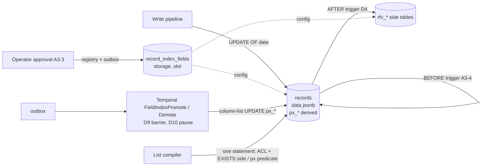

# ADR-006 amendment A3: promoted slots and the D13 band lines

> **Status: DRAFT, rev 2** (2026-11-28). This is RFC-025 rev 1 as the Technical Architect cleared it (B-1 resolved), with the re-check's three step-4 text fixes applied. It adds the write-cost scoring of RFC-025 §7 against TICK-1205, and scopes the promoted-field budget to what TICK-1205 scored. **Two things stand between this text and ACCEPTED:** (1) two §7 cells are open, a provisional insert line at one field and an unmeasured delete; (2) one TICK-1205 miss on promoted fields (R-e) has a candidate fix, P-1, that is not yet decided. Both go to SP-4.
>
> **Reconciliation.** PR #993 rev 1 (`0312daa5`) carried a separate draft lineage (`fx_*`, 8 slots), which grew out of the TICK-1039 rev 0 text. Rev 2 replaces it with RFC-025's critiqued design (`px_*`, 5 slots, `storage`/`state`). Rev 1's read-path additions are kept only as **proposals P-1 to P-3**. They are not decisions, and the Technical Architect must check them before they become decisions.
>
> **Invariants.** The project description defines no invariants, so the invariant check is **incomplete**. As in ADR-006 and A1, this was checked against ADR-001 §1, I1–I9.

## In plain words

Custom fields are filtered through small side tables (ADR-006). On a 400,000-record ticket type, two cases stay slow: a value held mostly by old or invisible tickets (up to **2.2 s**), and a 10–20% filter for a user with a row ACL (**209–422 ms** against 150). A real column on `records`, indexed with the assignment group and the update time, passed all 11 adversarial cases (27–131 ms). A column per field would break ADR-001 I8, so A3 adds a small fixed set of typed **slots** once, in a normal migration. An operator assigns a heavy field to a slot as configuration, and a background job copies the values in. Every other field stays on side tables.

TICK-1205 measured the cost. Saving a ticket costs about what the side tables already cost, and copying a field's values in slows live saves by 18.7%, under the 25% limit. It also found one case that a promoted field does not fix: a common value that the newest tickets lack. There the database ignores the slot index. A fix exists on paper (P-1) and needs one scored run.

## 1. Decisions

| # | Decision |
|---|---|
| **A3-1** | **Promoted slots.** One platform migration adds nullable typed columns to `records`: `px_num_1`, `px_num_2` (`double precision`), `px_text_1`, `px_text_2` (`text COLLATE "C"`) and `px_ts_1` (`timestamptz`). Five in all; no `bool` (§6 Q2). Each column gets one partial index, built `CONCURRENTLY` in that migration: `(tenant_id, entity_definition_id, px_<s>, assignment_group_id, updated_at) WHERE px_<s> IS NOT NULL`. This is TICK-1039's winning arm (b)+group shape, made partial. **Rev 1:** whether a second, plain partial index `(tenant_id, entity_definition_id, px_<s>, updated_at)` is also needed for no-ACL broad pages is **open**: TICK-1205's conclusion 1 ("group index only") is not yet sound per the Technical Architect's evidence review (findings 2–3), and A3 does not rely on it. The answer changes only the index list in the T1 migration, not the columns or the registry. The column set is platform DDL, like any migration. It is **not tenant-motivated** and never runs per field or per tenant (I8). |
| **A3-2** | **Assignment is configuration.** `record_index_fields` gains `storage ∈ {side, slot}` (default `side`) and `slot smallint NULL CHECK (slot BETWEEN 1 AND 5)`. Slots are numbered 1–5 against the five columns (1 = `px_num_1`, 2 = `px_num_2`, 3 = `px_text_1`, 4 = `px_text_2`, 5 = `px_ts_1`), with a CHECK that the field's `value_type` matches the slot's column type and a unique key `(tenant_id, entity_definition_id, slot) WHERE slot IS NOT NULL`, so that two fields of one type never share a slot (rev 1, N-1). `slot` stays set from `promoting` until the demote sweep finishes. A slot is local to its type: type A's `px_num_1` and type B's `px_num_1` are different fields. The index key leads with `(tenant_id, entity_definition_id)`, so values of different types or tenants never mix in one key range. Only scalar `num`, `text` and `ts` fields can be promoted. Array fields (`ord > 0`) stay on side tables. |
| **A3-3** | **Who promotes.** An operator approves each promotion as an audited `tenant_limits`-class change under D25 governance (no DDL), after a measured need: the A1-4 slow-list log shows that (tenant, type) above 350 ms, or the type passes 100k records with a filter in the band of A3-7 (iii). Quota: per entity type, at most the slots of each value type (2 `num`, 2 `text`, 1 `ts`; 5 in all), and at most 10 promoted fields per tenant (rev 1, N-4). Over quota → 422 `index_quota_exceeded`. A promoted field still counts against D12's flag quota. |
| **A3-4** | **Write path (rev 1: keyed on state, B-1).** `storage` routes **reads**; `state` routes **writes**. A new `BEFORE INSERT OR UPDATE OF data ON records` trigger sets `NEW.px_<s> := record_field_coerce(NEW.data -> key, value_type)` for each field of the type where **`storage = 'slot' OR state IN ('promoting','demoting')`**, with D4's `SET` list. D4's `AFTER` trigger (S22, `20261127100200_field_index_trigger.sql`) writes side rows where **`(storage = 'side' AND state IN ('backfilling','ready')) OR state IN ('promoting','demoting')`**. So during both transitions every write lands in **both** storages. Both triggers raise unless the transaction is READ COMMITTED, as their first statement (E1-5). `D5` coercion is unchanged: a value that does not coerce stores `NULL` and increments the D5 counter. |
| **A3-5** | **Transitions** reuse D9 and D10. **Promote** `FieldIndexPromote(tenant_id, field_id)`, started from an outbox row: (1) assign `slot`, set state `promoting` (dual-write on); filters keep reading the side table; (2) D9 barrier, so every writer sees the dual-write before the sweep; (3) batches of 1,000 run `UPDATE records SET px_<s> = record_field_coerce(data -> key, …)` by keyset, with D10's adaptive pause. This is a column-list `UPDATE` that does not name `data`, so neither trigger fires, and `version`, `updated_at`, `data` and audit are untouched. Under READ COMMITTED a row updated concurrently is re-read before the `SET` is computed, so the sweep never writes a value older than `data`; (4) flip `storage = slot` (reads move), barrier; (5) state `ready` (dual-write off), barrier; (6) purge the field's side rows (D11 steps 3–4). **Demote** mirrors it: (1) state `demoting` (dual-write on), barrier; (2) rebuild side rows (D10); (3) flip `storage = side`, barrier; (4) state `ready`, barrier; (5) `UPDATE … SET px_<s> = NULL` in batches; (6) clear `slot` (the slot is free only now). **Unflag** of a promoted field (S22) is demote then remove, or a direct `NULL` sweep followed by the registry delete. The direct sweep is safe only if it first sets `storage = side` and runs the barrier (in effect demote steps 3–4); otherwise the BEFORE trigger keeps filling `px` during and after the sweep, and the next field given the slot matches the stale values through the partial index. The Technical Lead picks one in the plan; either way T6 tests that `px_<s>` is `NULL` for every row of the type before `slot` is cleared (TA re-check, fix 3). |
| **A3-6** | **Read path (D7 widened, not replaced).** A promoted field compiles to a plain column predicate (`r.px_<s> = $v`, `= ANY`, `<` …) inside the same single list statement that carries the compiled row ACL. Side-table fields keep D7's `EXISTS`. Still one statement, still the capped count of that statement (A2's budget unchanged), still no separate query. The D7 static test widens to "side tables via `EXISTS` only, slots via column predicate only, nothing else reads `px_*`", and also fails any `r.*`, `SELECT *`, `to_jsonb(r)` or `row_to_json(r)` over `records` whose result reaches Go or a payload (rev 1, N-2). **Open, not decided here (rev 1):** whether the compiler may emit TICK-1205's per-group `UNION ALL` merge for broad or anti-correlated cases, and how it keeps the arms on the slot index without plan hints. If it does, the merge is built inside `authz.ReadBranches`/the store with cross-tenant tests, never through the integration-only `listQuery` hook (Security review of PR #995). |
| **A3-7** | **D13 reads, from A3 on** (new lines; A1-1 is replaced). List p95 ≤ 150 ms for every band, except: **(i)** 0.5–2%, with or without a narrowing ACL; ACL breadth **measured at 2% for 6/26/50% visible** (S2: 186.5–215.5 ms). 0.5% at a26/a50 is unmeasured and added to T9 (rev 1, N-5). The 6% condition is **removed**. **(i′)** 2–5% **with** a narrowing ACL at ≤ 6% visible (S1: 187.4 / 188.8 ms). Broader ACLs at 5% are unmeasured (task T9). **(i″)** 2–5% **without** an ACL: **provisional at 350 ms** (`text eq` 343.5 provisional pass, `num lt` 358.3 provisional miss, A1-8), settled by one idle rerun (T9). A miss on the rerun puts this range under (iii), not under a higher line. **(ii)** ≥ 40% with a narrowing ACL: unchanged from A1. **(iii) new: 5–40% with a narrowing ACL. No relaxed line.** Target 150 ms, recorded as a **measured miss on side tables** (208.7–421.5 ms at 6% visible: the page walks the 24,118-row visible set to sort the matches). The remedy is promotion (A3-3), not a budget. A promoted field is held to **150 ms in every band**, the A1-6 exit criterion it met in TICK-1039. **Rev 2 (TICK-1205):** it is accepted at 150 ms only where a scored cell with its plan exists (A1-2). TICK-1205 scored selective operators for a6, 10%/20% with an ACL (7 of 8 pass), and a 2.6M type with the per-group merge. It also scored a **measured miss on promoted fields**: a broad value (17–50% of the type) that the newest rows do not carry, 290–559 ms (S-b1, S-b2), because the planner walks `records_list_updated` / `records_list_group` instead of the slot index. That miss is residual **R-e**, not band (iii); its candidate fix is the steered order key (proposal P-1, SP-4). 10% and 20% without an ACL pass (89.9–127.2 ms) and stay at 150. |
| **A3-8** | **A1-6 is closed.** Arm (a), the adaptive shape, is rejected on evidence (2 of 11; the walk is unbounded under anti-correlation). The "falls back to (b)" clause of A1-6 is executed by A3-1 to A3-6. R-a's remedy becomes "promote the field" instead of "build the adaptive shape". |

**Not changed:** D1 (`records.data` is the only source of truth; slots are derived and rebuildable and are never read into a payload), D2's states, D5, D6's error order, D8, D9, D10, D11, D14 for side tables, A2 (the count budget and `total_state`), RLS and the row-ACL compiler.

## 2. Write-cost gate: RFC-025 §7 scored against TICK-1205

RFC-025 §7 set these lines before any number existed. TICK-1205 (PR #995) ran on an idle host: 8 clients, 30 s per write cell, partial slot indexes in the A3 form, group index only. The Technical Architect confirmed items 1–4 and D10 as sound. Ratios are slot vs D7 with the same number of flagged fields (`tick1205/tick1205-slots-raw.md`, Item 1).

| §7 line | Measured | Result |
| --- | --- | --- |
| 1a. Insert tps, 1 promoted field ≥ 90% of D7 | 156.9 vs 177.5 ops/s = **88.4%**; p95 78.9 vs 78.9 ms | **provisional miss** (within 10% of the line, A1-8). D7's own runs vary more than this (3 fields 136.8 ops/s against 5 fields 152.8 ops/s) |
| 1b. Insert tps, 3 promoted fields ≥ 90% of D7 | 140.7 vs 136.8 ops/s = **102.9%** | pass |
| 1c. R-b floor with 3 fields (≥ 40% of unindexed) | 140.7 vs 233.1 ops/s = **60.4%** | pass |
| 2a. Update of a promoted field, p95 ≤ 1.15 × D7 | 1 field 132.8 vs 123.5 ms = **1.08×**; 3 fields 136.2 vs 134.4 ms = **1.01×** | pass |
| 2b. Update of an unrelated field, p95 ≤ 1.15 × D7 | 1 field 123.0 vs 121.1 ms = **1.02×**; 3 fields 107.6 vs 120.7 ms = **0.89×** | pass (group index only; the plain index's cost is confounded by run order, see P-2) |
| 3. Delete, p95 ≤ 1.15 × D7 | not measured | **open**. By mechanism a `DELETE` does not touch any B-tree (VACUUM removes the entries later), so the slot adds no work at delete time. Not claimed without a cell |
| 4. Sweep: lock ≤ `ROW EXCLUSIVE`; live p95 within +25% under D10; WAL and duration reported | `UPDATE` takes `RowExclusiveLock` (PostgreSQL behaviour). Live p95 +18.7% (101.7 → 120.8 ms). 2m41s–3m17s per 400–451k rows alone, 11m11s under the live mix with D10's pause; 1.5–3.9 GB WAL; 59k–328k dead tuples per pass | pass. The demote direction is not measured (R-c) |

**Result: B is kept, not yet accepted.** No line fails outright. Line 1a is provisional and line 3 is unmeasured, and §7 says "keep B if **all** of these hold", so both get a cell in SP-4 (d). TICK-1203 is not needed: its per-field `ADD COLUMN` cells measure option C, which is rejected, and TICK-1205 plus SP-4 (d) cover what §7 asks.

## 3. Proposals P-1 to P-3 (not decided; TA check and SP-4)

TICK-1205 S-b1 and S-b2 found the miss R-e. The planner costs a `LIMIT 51` walk of an index ordered by `updated_at` as if the value were spread evenly over time. When the newest rows lack the value, it filters out 100k+ rows (Technical Architect's TICK-1205 findings 1, 2, 5). PostgreSQL 16 has no plan hints.

| # | Proposal | Evidence so far |
| --- | --- | --- |
| **P-1** | **A slot-only order key.** Add one column, `px_list_at timestamptz`. The A3-4 BEFORE trigger sets it to `NEW.updated_at` when any `px_*` of the row is non-NULL, and the A3-5 sweep sets it too. Each slot index ends in `px_list_at DESC, id DESC` instead of `updated_at`. Promoted lists order by `(px_list_at, id)` and page with a keyset cursor on the same pair. No other index carries the key, so `records_list_updated` and `records_list_group` cannot return the page in order. A column, not an expression: `timezone(updated_at)` leaves the cursor as a Filter (it is not leakproof), and a custom `LEAKPROOF` function needs a superuser (I3; TICK-339). | Prototype (`sa-steer-prototype.md`, a toy seed, not scored): the no-ACL broad page went from a 191 ms walk reading 202,773 buffers to 0.2 ms and 4 buffers. All 25 merge arms used the slot index, and the cursor stayed in the Index Cond with a leakproof key |
| **P-2** | **A second, plain partial index per slot**, `(tenant_id, entity_definition_id, px_<s>, px_list_at DESC, id DESC) WHERE px_<s> IS NOT NULL`. RFC-025 A3-1 left this open. A group index cannot bound a no-ACL page (TA finding 2) | TICK-1205's write cost for it is confounded by run order (SP-3) |
| **P-3** | **A shape rule.** No row ACL: one scan of the plain index. ≤ G visible groups: a per-group merge, built inside `authz.ReadBranches` / the store, with group IDs de-duplicated. More than G: the compiled shape. G is provisionally 8 | S-b3: the merge passes at 2.6M (105 ms) and the compiled shape takes 6,762 ms. The merge loses on a50 with a selective value (114 → 313 ms) |

All three change only the T1 migration's index list and one column, plus the compiler (T5). They do not touch the registry, the triggers' `storage`/`state` predicates or the transitions.

**SP-4 (Design spike, TICK-1205 harness and churned heap, host gate):**
- (a) the DDL with `px_list_at` and both indexes;
- (b) S-b1, S-b2 (broad and `in` 17%), S-b3 and the a50 cells of S-c2/S-c3 on the P-1/P-3 shapes. *Pass:* every S1/S2 arm uses a slot index, reads ≤ 51 + ε rows, and has p95 ≤ 150 ms;
- (c) G, from the crossover at a6/a25/a50;
- (d) an ABAB write run (group only vs group + plain, 3 reps each, `px_list_at` maintained) for an insert with **1 and 3** promoted fields, a promoted-field update, an unrelated update and a **delete**. This settles §7 lines 1a and 3;
- (e) the promotion sweep followed by `REINDEX CONCURRENTLY`, against D10.

If P-1 fails, R-e stays a residual with promotion's other gains intact, and the fallback for that shape is A1-7 S2's visible-set cap.

## 4. Context (PR #920)

| Evidence (PR #920, fully idle host, 800k seed, 400k type, 8 clients, 20 s/cell) | Result |
|---|---|
| TICK-1039: D7 side tables, 11 adversarial `pk` fixtures | 2 / 11 pass; worst 2,223 ms (a50 agent, value none of its records carry: walk of 200,113 `records_list_updated` rows) |
| TICK-1039: arm (a) adaptive | 2 / 11; 1,178–4,377 ms (probes `rfv_num_pkey` for every visible record, 24k–392k loops) |
| TICK-1039: arm (b) promoted column | 10 / 11; one provisional miss 163.6 ms (a50, broad 50%) |
| **TICK-1039: arm (b) + `assignment_group_id`** | **11 / 11, 27.2–131.3 ms**; index 66 MB / 800k rows |
| TICK-1009 S1 5% | ACL 187.4 / 188.8; no ACL 343.5 (prov. pass) / **358.3 (prov. miss)** |
| TICK-1009 S1 10%, 20% | ACL **208.7–421.5 (miss of 150)**; no ACL 89.9–127.2 pass |
| TICK-1009 S2, 2% at 6 / 26 / 50% visible | 186.5–215.5, every breadth passes |
| Not measured | arm (b) write cost (TICK-1203); arm (b) at 10/20% with ACL; the partial-index variant |

Why the side table cannot do it: its index is `(tenant_id, field_id, value, record_id)`. It knows neither `updated_at` (the list order) nor the ACL key. A selective-but-invisible or anti-correlated value forces a walk proportional to the visible set or to the type. A column on `records` lets one index give value, ACL key and order together. That is the whole of arm (b)'s win, and A3 keeps exactly that shape.

## 5. Domain model and boundaries

Everything stays in the Go core and its existing Temporal workers. No new service and no new vendor. The owner is the Postgres & Data Modeling Specialist, as for ADR-006. The failure story: a stuck promotion leaves the field in `promoting`, and filters keep using the side table, so the cost is latency plus a dual write per record write until it is resumed or rolled back. If it is stuck after the flip, reads are already on the slot (TA re-check, fix 2). `field_index_barrier_slow` (R11) covers the barrier.

## 6. Options considered

| Option | Latency (measured) | Write cost | I8 / schema-less | Verdict |
|---|---|---|---|---|
| **A. Stay on side tables, re-budget** | 2 / 11 adversarial; 2.2 s worst; 10–20%+ACL 422 ms and growing with the visible set | known (ADR-006, budgets: 83% of unindexed) | holds | **Rejected.** No line covers a 2.2 s, unbounded walk. A1-2 forbids a line without a bounded plan. |
| **B. Promoted slots (A3-1 to A3-6)** | arm (b)+group 11 / 11 (full index; partial index unverified, U1) | TICK-1203 | holds: one platform migration, assignment is configuration | **Recommended**, gated on TICK-1203 |
| C. Arm (b) literally: `ALTER TABLE records ADD COLUMN` per promoted field, via a D25 migrator job | same as B | TICK-1203 | **breaks I8**: D25 allows only `CREATE INDEX CONCURRENTLY … WHERE tenant_id = …`, never a column. The catalog grows per tenant field, and PostgreSQL's 1,600-column limit (dropped columns included) caps the platform | Rejected |
| D. Denormalize `updated_at` and `assignment_group_id` into the side rows, index `(tenant_id, field_id, value, assignment_group_id, updated_at)` | **unmeasured** | every record update rewrites the side row of every flagged field (heap + 2 index entries each), not only when the value changes | holds | **Fallback** if B fails §7 |
| E. Arm (a), adaptive shape | 2 / 11 | — | holds | Rejected on evidence (A3-8) |
| F. Expression index on `(data ->> 'k')::float8` under D25 | — | — | holds under D25 | Rejected: `->>` and the cast are not leakproof, so under forced RLS the qual is not pushed to the index (ADR-006 context, RFC-015 §1) |

Why B over D: the list query on `records` already does a non-HOT update on every write (`updated_at` is in `records_list_updated`). So B adds one index entry per promoted slot per write, for the promoted types only. D adds a heap row delete and insert plus two index entries per flagged field per write, for every flagged type. B is expected to be cheaper, but that is a guess; TICK-1203 settles it.

## 7. Invariants touched (ADR-001; check incomplete)

| Inv. | Effect |
|---|---|
| I1 | Slots live in `records`, which already has `ENABLE`/`FORCE` RLS. Each index leads with `tenant_id`. No new table, no new policy. |
| I3 | Column-level grants: `SELECT (px_*)` only for `nava_app` and `nava_worker`. `UPDATE (px_*)` only for `nava_worker` (the transition workflows); the trigger runs as the invoker. Any other role that reads `records` (e.g. audit or export roles) gets column lists without `px_*`. All of it goes in the grant manifest. **Security review requested.** |
| I4 | The A3-5 sweep writes `records` outside the write pipeline. That is allowed only because `px_*` is derived (D1). It must not change `data`, `version`, `updated_at` or audit bytes (CI-8 extended, CI-A3-3). **Flagged for the Technical Architect and Security.** |
| I5 | The slot predicate is in the same statement as the compiled ACL. Masked fields still answer 400 before compilation (D6). The `float8`, `text "C"` and `timestamptz` comparisons are leakproof (CI-2 unchanged). |
| I6, I7 | Transitions start only from outbox rows. The sweep is idempotent (it recomputes from `data`). |
| I8 | **Holds:** no tenant-motivated DDL. Assignment is a registry row approved like the D12 quota raise. Adding more slots later is a platform migration, never a tenant request. |
| I2, I9 | Not touched. |

### Assumptions not verified

| # | Assumption / question | How it is settled |
|---|---|---|
| U1 | The **partial** `WHERE px_<s> IS NOT NULL` index is chosen as `nava_app` under forced RLS with `force_custom_plan`, and gives the same plans as TICK-1039's full index. A strict comparison implies `IS NOT NULL`, which is how PostgreSQL matches partial-index predicates; **worth verifying by spike**. | T9 cell: the 11 `pk` fixtures on the slot shape |
| U2 | Arm (b)+group holds 150 ms at 10% and 20% with an ACL (unmeasured; it lies between the measured 2% and 50% fixtures). | T9 |
| U3 | The A3-5 sweep (400k-row column-list `UPDATE`) keeps live-write p95 within D10's +25%. Its WAL is roughly a full row image per record, much more than D10's 1.24 MB per 1,000 side rows. | TICK-1203 scope addition (§7) |
| U4 | **Checked in code, with one conflict.** `records_audit_commit_check` (`db/migrations/20261121000200_records_org_unit_id.sql:40`) fires on `UPDATE OF version, …, data, …` and does not list `px_*`, so the sweep does not trip it. `version` and `updated_at` are set by the pipeline, not by a trigger. **But** CI-A3 requires every updatable column to be audited (`db/audited-tables.yaml`). Granting `UPDATE (px_*)` to `nava_worker` fails CI-A3 as written. A3 proposes a `derived` class in `audited-tables.yaml` for `px_*` ("derived from `records.data`, rebuildable", like the D3 side tables' `exempt`), with CI-A3 checking that a `derived` column never appears in an audit diff or a payload. **This is the point most worth the Security reviewer's attention.** | Security & Multi-Tenancy Reviewer; CI-A3-3 |
| U5 | With `assignment_group_id` in the key, the index also serves ACLs that ADR-010 composes beyond groups. Measured only for group ACLs. Other rule shapes fall back to the 10 / 11 "(b) without group" behaviour. | Recorded residual; T9 adds one non-group ACL cell if ADR-010 shapes exist in the fixture |
| Q1 | Is 2 slots per value type, at most 10 promoted per tenant, the right starting quota? It is a platform setting. **Technical Lead / CTO.** | Plan |
| Q2 | No `bool` slot: bool filters fall in the broad bands, where (ii) holds. Add one if telemetry shows a rare-bool miss (R12). | Revisit trigger |

## 8. Effect on S22 (TICK-740) and S29 (TICK-915), tests and residuals

| Task | Story it lands with | What |
|---|---|---|
| T1 | new story | Migration: 5 `px_*` columns, 5 partial indexes `CONCURRENTLY`, column grants in the manifest |
| T2 | new story | Registry: `storage`, `slot`, states `promoting`/`demoting`, unique slot key; operator promotion endpoint (audited, quota A3-3) |
| T3 | new story | `BEFORE` trigger (A3-4); D4 `AFTER` trigger predicate becomes `(storage = 'side' AND state IN ('backfilling','ready')) OR state IN ('promoting','demoting')` (A3-4, TA re-check fix 1); CI-4 (trigger vs recompute) for slots |
| T4 | new story | `FieldIndexPromote` / `FieldIndexDemote` workflows (A3-5), with D9/D10 reuse and CI-5 races across both flips |
| T5 | new story | Compiler slot predicate (A3-6); widened D7 static test; CI-1 pushdown `EXPLAIN` per operator on slots as `nava_app` |
| **T6** | **S22 rework** | Unflagging a promoted field (A3-5 last row); the quota counts promoted fields; the JSONB-scan retirement is unchanged |
| **T7** | **S29 rework** | ADR-009 D12 effective-value shapes for slot fields: `<stored>` becomes the slot predicate, `<f absent>` is unchanged; a test that S29's per-record rewrite updates the slot through the A3-4 trigger |
| T8 | telemetry | The A1-4 slow-list log line gains `storage` (`side`/`slot`), still with no field name or value |
| T9 | Design spike | Idle rerun of S1 5% no-ACL (`num lt`, `text eq`), 5% at a25 / a50, arm (b)+group at 10% / 20% with ACL, and the 11 `pk` fixtures on the partial-index slot shape (U1, U2) |

Sequencing: T9 and SP-4 come first (Design spikes; they can change the shape; SP-4 replaces TICK-1203). Then T1 → T2 → T3 → T4 → T5. T6 and T7 depend on T2/T3 and on their own stories being merged. No story waits on T8.

### Tests

- CI-A3-1: cross-tenant. Tenant A's `px_num_1` values never match tenant B's filter, including when both use slot 1 for different fields.
- CI-A3-2: a slot value of a **masked** field is never in a payload, an export or a log. A static test: `px_*` appears only in the compiler, the triggers and the transition workflows.
- CI-A3-3: the sweep and the demote leave `data`, `version`, `updated_at` and audit bytes unchanged (CI-8 extended).
- CI-A3-4: grants. `px_*` is not readable by any role other than `nava_app` and `nava_worker` (CI-5b extended).
- CI-A3-5 (rev 1): in **both** directions, a write landing (a) between a sweep/rebuild batch and the `storage` flip, and (b) between the flip and `state = ready`, gives no missing match and no stale match after the transition (CI-5 pattern). Plus: either trigger raises under REPEATABLE READ / SERIALIZABLE.
- CI-A3-6 (rev 1): unique slot per (tenant, type); the `value_type`/slot-column CHECK rejects a mismatch.

### Residuals

| # | Residual | Owner | Trigger |
|---|---|---|---|
| R-a (rewritten) | On side tables, band (iii) misses 150 ms (209–422 ms at 6% visible, and more with broader ACLs). Adversarial values can walk to 2.2 s. The remedy is promotion, per (tenant, type, field) | Technical Lead | the A1-4 alert plus a per-tenant slow-list log line → operator promotion (A3-3); no new shape is built |
| R-c (new) | A promotion or demote sweep is a **non-HOT** update of every record of the type: a new heap tuple plus a new entry in **every** `records` index (not only the slot index), so ~400k dead tuples per sweep on the 400k type. TICK-1205 measured the D10 budget as a pass (+18.7% vs +25%) and slot-index bloat of 1.5–2.1× after backfill; WAL bytes, dead tuples and autovacuum catch-up for both directions still to be reported (rev 1, N-3). Recovery: `REINDEX CONCURRENTLY` of the slot index at `ready` | Postgres specialist | A sweep pushes live-write p95 past +25%, or replica lag alert |
| R-d (new) | Slots are scarce: 2 per value type per entity type | Technical Lead | A third promotion request on one type → platform migration adding a slot (not tenant DDL) |
| R-e (new, rev 2) | A promoted field misses 150 ms for a broad value (17–50% of the type) that the newest rows do not carry: 290–559 ms on TICK-1205 S-b1/S-b2. The planner walks `records_list_updated` / `records_list_group` instead of the slot index | Solution Architect | P-1 scored by SP-4; until then, the A1-4 slow-list log line with `storage = slot` |
| R-f (new, rev 2) | Shared-slot tail estimates: a tenant outside the MCV list is estimated at 1 (13× off on S-c1). No plan changed (36.7 ms) | Postgres specialist | A promoted filter plans a type-wide walk (> 1 s) in telemetry |

## 9. Open before ACCEPTED

1. SP-4 (d): §7 line 1a (insert, 1 field) and line 3 (delete).
2. P-1 to P-3: a Technical Architect check scoped to them, and SP-4 (a)–(c), (e). If the check or SP-4 rejects them, A3 is accepted without them and R-e stays.
3. Security & Multi-Tenancy Reviewer: the `derived` class in `db/audited-tables.yaml` (U4) and the column grants (I3).

## 10. Evidence

- RFC-025 rev 1 and the critique outcome: `docs/adr/ADR-006/A3/RFC-025-adr-006-a3-promoted-slots-d13-bands-rev1.md`.
- TICK-1009/TICK-1039 arms and plans: `docs/adr/ADR-006/spikes/a3-promoted-slots/tick1039-arms.md`, `tick1039-arms-explain.md`.
- TICK-1205: `docs/adr/ADR-006/spikes/a3-promoted-slots/tick1205/` (results section at `0b733511`, raw report, host). One plan per cell is in `docs/data/field-index-measured/tick1205-slots-explain.md` on PR #995.
- P-1 prototype: `docs/adr/ADR-006/spikes/a3-promoted-slots/sa-steer-prototype.md`.
