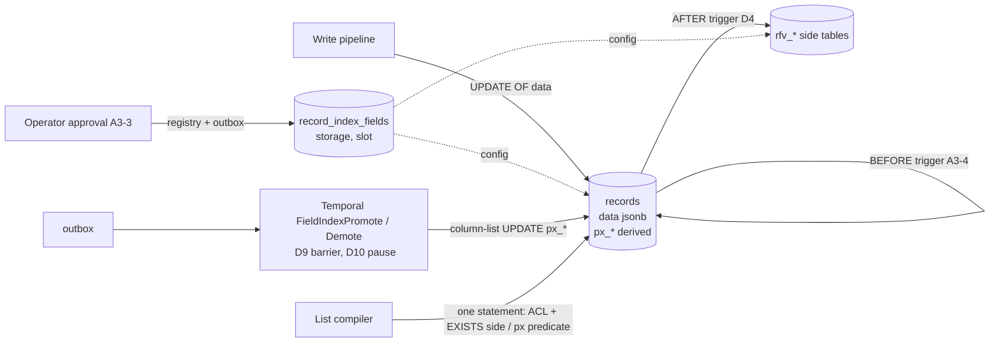

# RFC-025: promoted slots and the D13 band lines

> **Numbering.** I assumed RFC-025: the highest RFC in `docs/adr/` and in open PRs is RFC-024. I assumed amendment **A3** because ADR-006-A2 (count time budget) is taken.
>
> **Invariants.** The project description defines no invariants, so the invariant check is **incomplete**. As in ADR-006 and A1, I checked against ADR-001 §1, I1–I9.
>
> **Gate.** This RFC must not be accepted before TICK-1203 is scored. §7 says, before any number exists, what result keeps this design and what result sends it to the fallback.

## In plain words

Custom fields are filtered through small side tables (ADR-006). These tables are fast for most filters. On a 400,000-record ticket type, two cases stay slow:

- a value held mostly by **old** tickets, or by tickets the user **cannot see**. The database walks hundreds of thousands of index entries before it finds the 51 newest visible matches. The worst case is **2.2 seconds**;
- a filter matching **10–20%** of tickets for a user with a row ACL: **209–422 ms**, against a 150 ms target.

The spike tried two fixes. A smarter query shape on the side tables, arm (a), failed 9 of 11 adversarial cases. A real column on the `records` table, arm (b), indexed with the ticket's assignment group and its last-update time, passed **all 11** (27–131 ms). The catch is that a column per field means changing the database structure every time a tenant flags a field. Our rules forbid that (ADR-001 I8). PostgreSQL also stops at 1,600 columns per table.

**This RFC proposes the same column, without per-field structure changes.** We add a small, fixed set of empty typed columns to `records` once, as a normal platform migration. These are the **slots**. Each slot has one index that holds only the rows that use it. An operator then **assigns** a heavy field to a slot as configuration, the same way the filterable-field quota is raised to 10 today. A background job copies the values in. Every other field stays on the side tables. The ticket's JSON data stays the only source of truth, and the slot is a derived copy, like the side tables.

It also rewrites the D13 latency lines to match what was measured. A 5% filter with an ACL gets the 350 ms line. The 6% ACL-breadth condition goes. The 10–20%-with-ACL case gets **no** higher line: it is a measured miss, and promotion is the fix.

## 1. Recommendation

| # | Proposed decision |
|---|---|
| **A3-1** | **Promoted slots.** One platform migration adds nullable typed columns to `records`: `px_num_1`, `px_num_2` (`double precision`), `px_text_1`, `px_text_2` (`text COLLATE "C"`) and `px_ts_1` (`timestamptz`). Five in all; no `bool` (§6 Q2). Each column gets one partial index, built `CONCURRENTLY` in that migration: `(tenant_id, entity_definition_id, px_<s>, assignment_group_id, updated_at) WHERE px_<s> IS NOT NULL`. This is TICK-1039's winning arm (b)+group shape, made partial. **Rev 1:** whether a second, plain partial index `(tenant_id, entity_definition_id, px_<s>, updated_at)` is also needed for no-ACL broad pages is **open**: TICK-1205's conclusion 1 ("group index only") is not yet sound per the Technical Architect's evidence review (findings 2–3), and A3 does not rely on it. The answer changes only the index list in the T1 migration, not the columns or the registry. The column set is platform DDL, like any migration. It is **not tenant-motivated** and never runs per field or per tenant (I8). |
| **A3-2** | **Assignment is configuration.** `record_index_fields` gains `storage ∈ {side, slot}` (default `side`) and `slot smallint NULL CHECK (slot BETWEEN 1 AND 5)`. Slots are numbered 1–5 against the five columns (1 = `px_num_1`, 2 = `px_num_2`, 3 = `px_text_1`, 4 = `px_text_2`, 5 = `px_ts_1`), with a CHECK that the field's `value_type` matches the slot's column type and a unique key `(tenant_id, entity_definition_id, slot) WHERE slot IS NOT NULL`, so that two fields of one type never share a slot (rev 1, N-1). `slot` stays set from `promoting` until the demote sweep finishes. A slot is local to its type: type A's `px_num_1` and type B's `px_num_1` are different fields. The index key leads with `(tenant_id, entity_definition_id)`, so values of different types or tenants never mix in one key range. Only scalar `num`, `text` and `ts` fields can be promoted. Array fields (`ord > 0`) stay on side tables. |
| **A3-3** | **Who promotes.** An operator approves each promotion as an audited `tenant_limits`-class change under D25 governance (no DDL), after a measured need: the A1-4 slow-list log shows that (tenant, type) above 350 ms, or the type passes 100k records with a filter in the band of A3-7 (iii). Quota: per entity type, at most the slots of each value type (2 `num`, 2 `text`, 1 `ts`; 5 in all), and at most 10 promoted fields per tenant (rev 1, N-4). Over quota → 422 `index_quota_exceeded`. A promoted field still counts against D12's flag quota. |
| **A3-4** | **Write path (rev 1: keyed on state, B-1).** `storage` routes **reads**; `state` routes **writes**. A new `BEFORE INSERT OR UPDATE OF data ON records` trigger sets `NEW.px_<s> := record_field_coerce(NEW.data -> key, value_type)` for each field of the type where **`storage = 'slot' OR state IN ('promoting','demoting')`**, with D4's `SET` list. D4's `AFTER` trigger (S22, `20261127100200_field_index_trigger.sql`) writes side rows where **`(storage = 'side' AND state IN ('backfilling','ready')) OR state IN ('promoting','demoting')`**. So during both transitions every write lands in **both** storages. Both triggers raise unless the transaction is READ COMMITTED, as their first statement (E1-5). `D5` coercion is unchanged: a value that does not coerce stores `NULL` and increments the D5 counter. |
| **A3-5** | **Transitions** reuse D9 and D10. **Promote** `FieldIndexPromote(tenant_id, field_id)`, started from an outbox row: (1) assign `slot`, set state `promoting` (dual-write on); filters keep reading the side table; (2) D9 barrier, so every writer sees the dual-write before the sweep; (3) batches of 1,000 run `UPDATE records SET px_<s> = record_field_coerce(data -> key, …)` by keyset, with D10's adaptive pause. This is a column-list `UPDATE` that does not name `data`, so neither trigger fires, and `version`, `updated_at`, `data` and audit are untouched. Under READ COMMITTED a row updated concurrently is re-read before the `SET` is computed, so the sweep never writes a value older than `data`; (4) flip `storage = slot` (reads move), barrier; (5) state `ready` (dual-write off), barrier; (6) purge the field's side rows (D11 steps 3–4). **Demote** mirrors it: (1) state `demoting` (dual-write on), barrier; (2) rebuild side rows (D10); (3) flip `storage = side`, barrier; (4) state `ready`, barrier; (5) `UPDATE … SET px_<s> = NULL` in batches; (6) clear `slot` (the slot is free only now). **Unflag** of a promoted field (S22) is demote then remove, or a direct `NULL` sweep followed by the registry delete. The Technical Lead picks one in the plan. |
| **A3-6** | **Read path (D7 widened, not replaced).** A promoted field compiles to a plain column predicate (`r.px_<s> = $v`, `= ANY`, `<` …) inside the same single list statement that carries the compiled row ACL. Side-table fields keep D7's `EXISTS`. Still one statement, still the capped count of that statement (A2's budget unchanged), still no separate query. The D7 static test widens to "side tables via `EXISTS` only, slots via column predicate only, nothing else reads `px_*`", and also fails any `r.*`, `SELECT *`, `to_jsonb(r)` or `row_to_json(r)` over `records` whose result reaches Go or a payload (rev 1, N-2). **Open, not decided here (rev 1):** whether the compiler may emit TICK-1205's per-group `UNION ALL` merge for broad or anti-correlated cases, and how it keeps the arms on the slot index without plan hints. If it does, the merge is built inside `authz.ReadBranches`/the store with cross-tenant tests, never through the integration-only `listQuery` hook (Security review of PR #995). |
| **A3-7** | **D13 reads, from A3 on** (new lines; A1-1 is replaced). List p95 ≤ 150 ms for every band, except: **(i)** 0.5–2%, with or without a narrowing ACL; ACL breadth **measured at 2% for 6/26/50% visible** (S2: 186.5–215.5 ms). 0.5% at a26/a50 is unmeasured and added to T9 (rev 1, N-5). The 6% condition is **removed**. **(i′)** 2–5% **with** a narrowing ACL at ≤ 6% visible (S1: 187.4 / 188.8 ms). Broader ACLs at 5% are unmeasured (task T9). **(i″)** 2–5% **without** an ACL: **provisional at 350 ms** (`text eq` 343.5 provisional pass, `num lt` 358.3 provisional miss, A1-8), settled by one idle rerun (T9). A miss on the rerun puts this range under (iii), not under a higher line. **(ii)** ≥ 40% with a narrowing ACL: unchanged from A1. **(iii) new: 5–40% with a narrowing ACL. No relaxed line.** Target 150 ms, recorded as a **measured miss on side tables** (208.7–421.5 ms at 6% visible: the page walks the 24,118-row visible set to sort the matches). The remedy is promotion (A3-3), not a budget. A promoted field is held to **150 ms in every band**, the A1-6 exit criterion it met in TICK-1039. 10% and 20% without an ACL pass (89.9–127.2 ms) and stay at 150. |
| **A3-8** | **A1-6 is closed.** Arm (a), the adaptive shape, is rejected on evidence (2 of 11; the walk is unbounded under anti-correlation). The "falls back to (b)" clause of A1-6 is executed by A3-1 to A3-6. R-a's remedy becomes "promote the field" instead of "build the adaptive shape". |

**Not changed:** D1 (`records.data` is the only source of truth; slots are derived and rebuildable and are never read into a payload), D2's states, D5, D6's error order, D8, D9, D10, D11, D14 for side tables, A2 (the count budget and `total_state`), RLS and the row-ACL compiler.

## 2. Context

| Evidence (PR #920, fully idle host, 800k seed, 400k type, 8 clients, 20 s/cell) | Result |
|---|---|
| TICK-1039: D7 side tables, 11 adversarial `pk` fixtures | 2 / 11 pass; worst 2,223 ms (a50 agent, value none of its records carry: walk of 200,113 `records_list_updated` rows) |
| TICK-1039: arm (a) adaptive | 2 / 11; 1,178–4,377 ms (probes `rfv_num_pkey` for every visible record, 24k–392k loops) |
| TICK-1039: arm (b) promoted column | 10 / 11; one provisional miss 163.6 ms (a50, broad 50%) |
| **TICK-1039: arm (b) + `assignment_group_id`** | **11 / 11, 27.2–131.3 ms**; index 66 MB / 800k rows |
| TICK-1009 S1 5% | ACL 187.4 / 188.8; no ACL 343.5 (prov. pass) / **358.3 (prov. miss)** |
| TICK-1009 S1 10%, 20% | ACL **208.7–421.5 (miss of 150)**; no ACL 89.9–127.2 pass |
| TICK-1009 S2, 2% at 6 / 26 / 50% visible | 186.5–215.5, every breadth passes |
| Not measured | arm (b) write cost (TICK-1203); arm (b) at 10/20% with ACL; the partial-index variant |

Why the side table cannot do it: its index is `(tenant_id, field_id, value, record_id)`. It knows neither `updated_at` (the list order) nor the ACL key. A selective-but-invisible or anti-correlated value forces a walk proportional to the visible set or to the type. A column on `records` lets one index give value, ACL key and order together. That is the whole of arm (b)'s win, and A3 keeps exactly that shape.

## 3. Domain model and boundaries

Everything stays in the Go core and its existing Temporal workers. No new service and no new vendor. The owner is the Postgres & Data Modeling Specialist, as for ADR-006. The failure story: a stuck promotion leaves the field in `promoting`, and filters keep using the side table, so the cost is latency only. `field_index_barrier_slow` (R11) covers the barrier.

## 4. Candidates

| Option | Latency (measured) | Write cost | I8 / schema-less | Verdict |
|---|---|---|---|---|
| **A. Stay on side tables, re-budget** | 2 / 11 adversarial; 2.2 s worst; 10–20%+ACL 422 ms and growing with the visible set | known (ADR-006, budgets: 83% of unindexed) | holds | **Rejected.** No line covers a 2.2 s, unbounded walk. A1-2 forbids a line without a bounded plan. |
| **B. Promoted slots (A3-1 to A3-6)** | arm (b)+group 11 / 11 (full index; partial index unverified, U1) | TICK-1203 | holds: one platform migration, assignment is configuration | **Recommended**, gated on TICK-1203 |
| C. Arm (b) literally: `ALTER TABLE records ADD COLUMN` per promoted field, via a D25 migrator job | same as B | TICK-1203 | **breaks I8**: D25 allows only `CREATE INDEX CONCURRENTLY … WHERE tenant_id = …`, never a column. The catalog grows per tenant field, and PostgreSQL's 1,600-column limit (dropped columns included) caps the platform | Rejected |
| D. Denormalize `updated_at` and `assignment_group_id` into the side rows, index `(tenant_id, field_id, value, assignment_group_id, updated_at)` | **unmeasured** | every record update rewrites the side row of every flagged field (heap + 2 index entries each), not only when the value changes | holds | **Fallback** if B fails §7 |
| E. Arm (a), adaptive shape | 2 / 11 | — | holds | Rejected on evidence (A3-8) |
| F. Expression index on `(data ->> 'k')::float8` under D25 | — | — | holds under D25 | Rejected: `->>` and the cast are not leakproof, so under forced RLS the qual is not pushed to the index (ADR-006 context, RFC-015 §1) |

Why B over D: the list query on `records` already does a non-HOT update on every write (`updated_at` is in `records_list_updated`). So B adds one index entry per promoted slot per write, for the promoted types only. D adds a heap row delete and insert plus two index entries per flagged field per write, for every flagged type. B is expected to be cheaper, but that is a guess; TICK-1203 settles it.

## 5. Invariants touched (ADR-001; check incomplete, see header)

| Inv. | Effect |
|---|---|
| I1 | Slots live in `records`, which already has `ENABLE`/`FORCE` RLS. Each index leads with `tenant_id`. No new table, no new policy. |
| I3 | Column-level grants: `SELECT (px_*)` only for `nava_app` and `nava_worker`. `UPDATE (px_*)` only for `nava_worker` (the transition workflows); the trigger runs as the invoker. Any other role that reads `records` (e.g. audit or export roles) gets column lists without `px_*`. All of it goes in the grant manifest. **Security review requested.** |
| I4 | The A3-5 sweep writes `records` outside the write pipeline. That is allowed only because `px_*` is derived (D1). It must not change `data`, `version`, `updated_at` or audit bytes (CI-8 extended, CI-A3-3). **Flagged for the Technical Architect and Security.** |
| I5 | The slot predicate is in the same statement as the compiled ACL. Masked fields still answer 400 before compilation (D6). The `float8`, `text "C"` and `timestamptz` comparisons are leakproof (CI-2 unchanged). |
| I6, I7 | Transitions start only from outbox rows. The sweep is idempotent (it recomputes from `data`). |
| I8 | **Holds:** no tenant-motivated DDL. Assignment is a registry row approved like the D12 quota raise. Adding more slots later is a platform migration, never a tenant request. |
| I2, I9 | Not touched. |

## 6. Assumptions not verified, and open questions

| # | Assumption / question | How it is settled |
|---|---|---|
| U1 | The **partial** `WHERE px_<s> IS NOT NULL` index is chosen as `nava_app` under forced RLS with `force_custom_plan`, and gives the same plans as TICK-1039's full index. A strict comparison implies `IS NOT NULL`, which is how PostgreSQL matches partial-index predicates; **worth verifying by spike**. | T9 cell: the 11 `pk` fixtures on the slot shape |
| U2 | Arm (b)+group holds 150 ms at 10% and 20% with an ACL (unmeasured; it lies between the measured 2% and 50% fixtures). | T9 |
| U3 | The A3-5 sweep (400k-row column-list `UPDATE`) keeps live-write p95 within D10's +25%. Its WAL is roughly a full row image per record, much more than D10's 1.24 MB per 1,000 side rows. | TICK-1203 scope addition (§7) |
| U4 | **Checked in code, with one conflict.** `records_audit_commit_check` (`db/migrations/20261121000200_records_org_unit_id.sql:40`) fires on `UPDATE OF version, …, data, …` and does not list `px_*`, so the sweep does not trip it. `version` and `updated_at` are set by the pipeline, not by a trigger. **But** CI-A3 requires every updatable column to be audited (`db/audited-tables.yaml`). Granting `UPDATE (px_*)` to `nava_worker` fails CI-A3 as written. A3 proposes a `derived` class in `audited-tables.yaml` for `px_*` ("derived from `records.data`, rebuildable", like the D3 side tables' `exempt`), with CI-A3 checking that a `derived` column never appears in an audit diff or a payload. **This is the point most worth the Security reviewer's attention.** | Security & Multi-Tenancy Reviewer; CI-A3-3 |
| U5 | With `assignment_group_id` in the key, the index also serves ACLs that ADR-010 composes beyond groups. Measured only for group ACLs. Other rule shapes fall back to the 10 / 11 "(b) without group" behaviour. | Recorded residual; T9 adds one non-group ACL cell if ADR-010 shapes exist in the fixture |
| Q1 | Is 2 slots per value type, at most 10 promoted per tenant, the right starting quota? It is a platform setting. **Technical Lead / CTO.** | Plan |
| Q2 | No `bool` slot: bool filters fall in the broad bands, where (ii) holds. Add one if telemetry shows a rare-bool miss (R12). | Revisit trigger |

## 7. Acceptance gate: TICK-1203, scored against pre-set lines

I set these lines before any number exists. **Keep B** if all of these hold. Otherwise switch to D, with a spike, or accept band (iii) as a residual. That choice is then a new decision.

1. **Insert** tps on the 400k type with 1 and with 3 promoted fields: ≥ 90% of the same fields on D7 side tables, and R-b's floor (≥ 40% of unindexed) holds with 3.
2. **Update that changes a promoted field** and **update that does not**: p95 ≤ 1.15 × the D7 equivalent.
3. **Delete**: p95 ≤ 1.15 × D7.
4. **Promotion sweep** of one field on 400k rows: no lock stronger than `ROW EXCLUSIVE` on `records`; live-write p95 within +25% under D10; WAL bytes and duration reported (no line: a cost to record).

**Scope request for TICK-1203** (it is the Technical Lead's to change). Its cells measure `ADD COLUMN` + `CREATE INDEX CONCURRENTLY` per field, which is option C. For B, the cost to measure is the **partial** index and the **A3-5 batched sweep**. The column and the index are a one-time migration. I ask that the arms use the partial-index shape, and that the "backfill" cell measures the sweep instead of, or as well as, the DDL.

## 8. Effect on S22 (TICK-740) and S29 (TICK-915)

Nothing they built is removed: side tables stay the default storage. The work they gain is additive, one task each, under Plan ADR-006-A3.

| Task | Story it lands with | What |
|---|---|---|
| T1 | new story | Migration: 5 `px_*` columns, 5 partial indexes `CONCURRENTLY`, column grants in the manifest |
| T2 | new story | Registry: `storage`, `slot`, states `promoting`/`demoting`, unique slot key; operator promotion endpoint (audited, quota A3-3) |
| T3 | new story | `BEFORE` trigger (A3-4); D4 `AFTER` trigger skips `storage = slot`; CI-4 (trigger vs recompute) for slots |
| T4 | new story | `FieldIndexPromote` / `FieldIndexDemote` workflows (A3-5), with D9/D10 reuse and CI-5 races across both flips |
| T5 | new story | Compiler slot predicate (A3-6); widened D7 static test; CI-1 pushdown `EXPLAIN` per operator on slots as `nava_app` |
| **T6** | **S22 rework** | Unflagging a promoted field (A3-5 last row); the quota counts promoted fields; the JSONB-scan retirement is unchanged |
| **T7** | **S29 rework** | ADR-009 D12 effective-value shapes for slot fields: `<stored>` becomes the slot predicate, `<f absent>` is unchanged; a test that S29's per-record rewrite updates the slot through the A3-4 trigger |
| T8 | telemetry | The A1-4 slow-list log line gains `storage` (`side`/`slot`), still with no field name or value |
| T9 | Design spike | Idle rerun of S1 5% no-ACL (`num lt`, `text eq`), 5% at a25 / a50, arm (b)+group at 10% / 20% with ACL, and the 11 `pk` fixtures on the partial-index slot shape (U1, U2) |

Sequencing: T9 and TICK-1203 come first (Design spikes; they can change the shape). Then T1 → T2 → T3 → T4 → T5. T6 and T7 depend on T2/T3 and on their own stories being merged. No story waits on T8.

## 9. Tests this adds

- CI-A3-1: cross-tenant. Tenant A's `px_num_1` values never match tenant B's filter, including when both use slot 1 for different fields.
- CI-A3-2: a slot value of a **masked** field is never in a payload, an export or a log. A static test: `px_*` appears only in the compiler, the triggers and the transition workflows.
- CI-A3-3: the sweep and the demote leave `data`, `version`, `updated_at` and audit bytes unchanged (CI-8 extended).
- CI-A3-4: grants. `px_*` is not readable by any role other than `nava_app` and `nava_worker` (CI-5b extended).
- CI-A3-5 (rev 1): in **both** directions, a write landing (a) between a sweep/rebuild batch and the `storage` flip, and (b) between the flip and `state = ready`, gives no missing match and no stale match after the transition (CI-5 pattern). Plus: either trigger raises under REPEATABLE READ / SERIALIZABLE.
- CI-A3-6 (rev 1): unique slot per (tenant, type); the `value_type`/slot-column CHECK rejects a mismatch.

## 10. Residuals proposed for the ADR

| # | Residual | Owner | Trigger |
|---|---|---|---|
| R-a (rewritten) | On side tables, band (iii) misses 150 ms (209–422 ms at 6% visible, and more with broader ACLs). Adversarial values can walk to 2.2 s. The remedy is promotion, per (tenant, type, field) | Technical Lead | the A1-4 alert plus a per-tenant slow-list log line → operator promotion (A3-3); no new shape is built |
| R-c (new) | A promotion or demote sweep is a **non-HOT** update of every record of the type: a new heap tuple plus a new entry in **every** `records` index (not only the slot index), so ~400k dead tuples per sweep on the 400k type. TICK-1205 measured the D10 budget as a pass (+18.7% vs +25%) and slot-index bloat of 1.5–2.1× after backfill; WAL bytes, dead tuples and autovacuum catch-up for both directions still to be reported (rev 1, N-3). Recovery: `REINDEX CONCURRENTLY` of the slot index at `ready` | Postgres specialist | A sweep pushes live-write p95 past +25%, or replica lag alert |
| R-d (new) | Slots are scarce: 2 per value type per entity type | Technical Lead | A third promotion request on one type → platform migration adding a slot (not tenant DDL) |

## Response — round 1 (rev 1, 2026-11-28)

Reply to the Technical Architect's critique round 1 (01:35Z, VERDICT: CHANGES). C-1 to C-6 were settled by spike or code reading and are not reopened.

| # | Label | Resolution | Where |
|---|---|---|---|
| **B-1** | blocking | **Accepted as proposed.** Writes are keyed on `state`, reads on `storage`. BEFORE writes `px` when `storage = 'slot' OR state IN ('promoting','demoting')`; the D4/S22 AFTER trigger writes side rows when `(storage = 'side' AND state IN ('backfilling','ready')) OR state IN ('promoting','demoting')`. The D9 barrier after `promoting`/`demoting` is set guarantees every writer dual-writes before the sweep or rebuild starts. Each transition gains an explicit `state = ready` step plus barrier **after** the flip and **before** the purge/`NULL` sweep, so no dual-write is still running when the old storage is cleared. Both triggers keep the E1-5 READ COMMITTED guard. CI-A3-5 covers a write between a batch and the flip, and between the flip and `ready`, in both directions. | A3-4, A3-5, §9 |
| N-1 | non-blocking | Accepted: slots numbered 1–5 against the columns, CHECK on `value_type`, unique `(tenant_id, entity_definition_id, slot)`. | A3-2, CI-A3-6 |
| N-2 | non-blocking | Accepted: static test also fails `r.*`, `*`, `to_jsonb(r)`, `row_to_json(r)` over `records` reaching Go or a payload. | A3-6 |
| N-3 | non-blocking | Accepted as a recorded cost: R-c names the non-HOT index fan-out; WAL, dead tuples and autovacuum catch-up for both sweep directions requested from the write-cost spike. | R-c, §7 |
| N-4 | non-blocking | Accepted: "per value type per entity type (2/2/1, 5 slots), at most 10 per tenant". | A3-3 |
| N-5 | non-blocking | Accepted: (i) worded as measured at 2% for 6/26/50% visible; 0.5% at a26/a50 added to T9. | A3-7 |

**Input taken from TICK-1205 (PR #995) since rev 0.** The Technical Architect's evidence review (08:02Z) found conclusions 1 (group index only) and 2 (broad miss caused by churn) not yet sound; findings 1–3, and spikes SP-1/SP-2. A3 rev 1 relies on neither: the second plain index is left open (A3-1), and the broad-value miss is treated as the anti-correlation shape the TA describes (recency of the value), which band (iii)/R-a already covers. Items 1–4, the D10 backfill (+18.7%) and S-c1 were confirmed sound and are cited. The per-group merge (conclusion 3, confirmed with a plan-steering condition) is an open read-path question in A3-6, not a decision.

**Re-check scope for the Technical Architect:** B-1 only.
