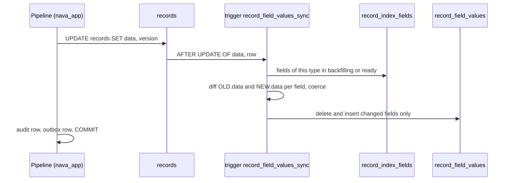
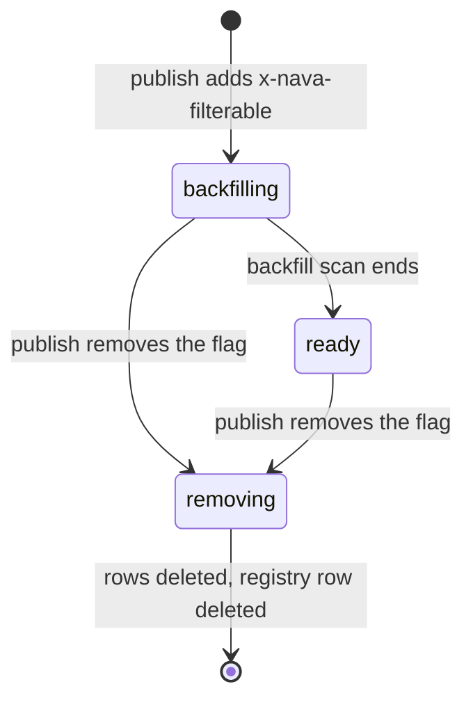
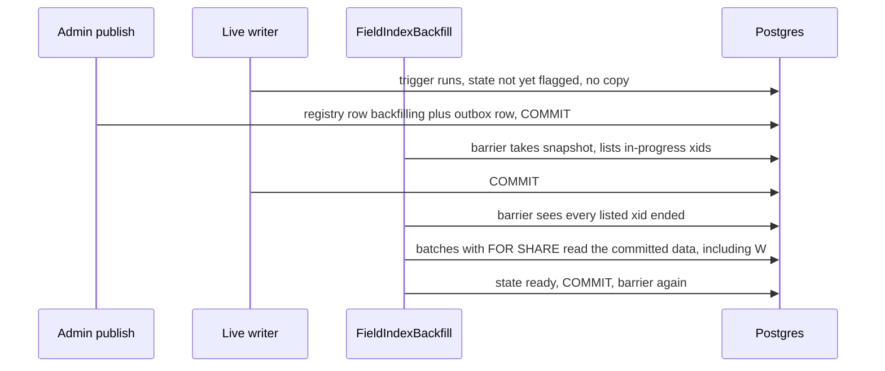

# RFC-015: Filterable and searchable tenant fields (rev 1)

> **Invariants source.** The Multica project description is empty, so it holds no invariants. I loaded them from `docs/adr/ADR-001-platform-blueprint.md` §1 (I1–I9) on `main`, plus the S10 field-mask rules (`api/paths/records.yaml`, PLAN-003 P3-33/P3-37) and the ADR-004 audit manifest. The checks in §9 are made against that text.
> **Numbering.** The highest RFC in the repo is RFC-014 and the highest ADR is ADR-005. This is RFC-015, and its ADR is assumed to be **ADR-006**.
> **Evidence status.** §1 rows marked *SA shape check* come from a single-client plan-shape check I ran (`docs/adr/ADR-006/spikes/solution-architect/rls-shape/`). They prove plan **shape**, not the 150 ms target. Spike S1, owned by the Postgres & Data Modeling Specialist, gives the P3-01 numbers. Any decision below that depends on S1 says so.

## Changelog rev 0 → rev 1

Round 1 closed with CHANGES (CTO, TICK-714). Sources: Technical Architect critique (F1–F10, Fix-1, Fix-2), Security & Multi-Tenancy review (SR1–SR5, at-scale notes, Q2), CTO ruling on the composite FK.

| # | Source | Change | Where |
|---|---|---|---|
| 1 | TA **F1, F2 (blocking)** | **Snapshot barrier (Fix-1) after every state flip**, as the first activity of `FieldIndexBackfill` and `FieldIndexRemove`. Rev 0's "the in-statement read closes the race" and the UUIDv7 argument were wrong; spikes R1 and R3 reproduced a missed row and an orphan | D17 (new), D10, D11, §5 |
| 2 | TA F1 | Each backfill batch first takes `SELECT state … FOR SHARE` on its registry row and stops unless `backfilling` | D10 |
| 3 | TA F2 | Removal deletes the registry row only after the barrier, the batched delete and a final `NOT EXISTS` check | D11 |
| 4 | **CTO ruling** (Security at-scale note, overrides TA "optional") | **Required** composite FK `(tenant_id, field_id) → record_index_fields (tenant_id, id)` on both side tables | D3, D12 |
| 5 | Security **SR1 (blocking)** | An empty readable-searchable set returns an empty page and `total = 0` without a query; the compiler always emits `field_id = ANY($ids)` and has no "no filter" shortcut | D12 |
| 6 | Security **SR2 (blocking)** | Every side-table predicate is a correlated `EXISTS` inside the single compiled list query. No side table is ever queried alone for a count, a facet or progress | D6, D12, D18 (new) |
| 7 | TA F5, F6, Fix-2; Security at-scale note | Coercion independent of the session: function-level `SET search_path`, `TimeZone`, `DateStyle`; RFC 3339 with explicit offset only; JSON type must match (`number`, `boolean`, `string`); no NaN or Infinity. One SQL function shared by trigger and backfill | D5, D19 (new) |
| 8 | TA F7 | §3 restated: the trigger is chosen because it covers every write path. The barrier, not the trigger, closes the race | §3 |
| 9 | TA F8 | Backfill writes per (record, field) DELETE + INSERT, like the trigger. No `ON CONFLICT` upsert | D10 |
| 10 | Security SR3 | `field_not_ready` progress is a percentage only; masks are checked before readiness | D6 |
| 11 | Security SR4 | D12 depends on row-independent masks (contract amendment A2, `internal/authz/mask.go:19`). Filterable and searchable keys are top-level properties only | D8, D12, R9 (new) |
| 12 | Security SR5 | Backfill and removal activities return only cursor and progress; workflow input is `(tenant_id, field_id)` from the outbox row | D10 |
| 13 | Security Q2 / CTO | `SECURITY INVOKER` kept; runtime grants narrowed to `SELECT, INSERT, DELETE` (no `UPDATE`); R8 recorded as **Low, accepted** | D20 (new), R8, Q2 closed |
| 14 | Security at-scale notes | One policy per command for `nava_app` and `nava_worker` on all three tables; every role that writes `records` must be in the registry's SELECT policy; isolation registry rows | D20 |
| 15 | TA spike changes | S1 adds estimated vs. actual rows on the `EXISTS` (and `CREATE STATISTICS` if ≥ 10× off). S3 adds deterministic cases R1 and R3 and WAL bytes per batch | §10 |
| 16 | Solution Architect (follows from #4) | The required FK makes every side-row insert take `FOR KEY SHARE` on one hot registry row. S1 measures the MultiXact cost under 8 writers | R10 (new), §10 |
| 17 | TA F10, Security option-D notes | H2 constraints for any future OpenSearch amendment recorded | §6.5, §7 |

No rev 0 decision on the choice of option is reversed. Option A, the trigger, the term table, `field_not_ready` and the rejection of B and D all stand.

## 0. Summary

1. **Adopt option A, the human's proposal, with four changes.** `records.data` stays the source of truth. A typed side table `record_field_values` holds one row per (record, filterable field, value), with B-tree indexes led by `tenant_id`. **An `AFTER` row trigger on `records` keeps it in step in the same transaction.** The changes: numbers are `double precision`, not `numeric`, because `numeric` comparisons are **not leakproof** in PG 16.10 (catalog checked); the field is named by a registry id, not by text; a type change of a filterable field is refused at publish; and the trigger writes only the fields whose value changed.
2. **The pushdown holds at plan level.** As `nava_app` under forced RLS, `text =`, `= ANY`, `float8 <`, `timestamptz <` and `bool =` on the side table are all **Index Cond** below the RLS One-Time Filter. The same `data ->> 'site'` predicate on `records` is a sequential scan (SA shape check). The p95 at 400k with 8 clients is still owed by S1, and it gates the ADR.
3. **Free-text search: a term side table in Postgres, not `tsvector @@`.** `@@` is not leakproof either, so a GIN index on `tsvector` is unusable for `nava_app` in the same way the JSONB GIN was. `record_search_terms` stores the lexemes of each `searchable` field as B-tree rows (`text =` and prefix range are leakproof). Masked fields are excluded per caller by `field_id`, so S10 holds by construction. There is no relevance ranking and no fuzzy matching. OpenSearch is the upgrade path, and it is a **business decision for the human** (§7).
4. **Late flag:** the field moves `backfilling → ready`, and `removing` when cleared. A Temporal workflow, started through the outbox, first waits out every transaction that was in flight at the flip (a snapshot barrier, the wait phase of `CREATE INDEX CONCURRENTLY`), then backfills in keyset batches of 1,000 under `FOR SHARE`. Together these mean no write is missed and none is overwritten by a stale value (rev 1; the TA reproduced the gap rev 0 had without the barrier). Until the field is `ready`, `filter[field]` answers **422 `field_not_ready`** with progress. **No DDL per tenant or per field. I8 holds, and D25's indexed-attribute path is no longer needed for data filters.**
5. **Rejected:** B (slot columns: about 20 indexes on `records`, and a backfill that rewrites audited rows), C alone (only helps the named fields, and a stopgap we will not need if S1 passes; it is the fallback if S1 fails), D for filtering (moves isolation and authorization out of the database, against I1 and I5). Cassandra does not fit at all. MongoDB buys nothing over A, and its licence is SSPL.
6. **What the human must accept:** a filterable field costs about 320 bytes per record in Postgres (about 2.6 GB at 800k records with 10 fields each), plus write cost that S1 measures against the 560 inserts/s baseline. Search has no relevance ranking or fuzzy matching until an OpenSearch decision is made.

## 1. Context, measured

| Fact | Source |
| --- | --- |
| `records.data jsonb NOT NULL`, no index on it | `db/migrations/20261101190000_records_pipeline.sql:52` |
| `->>` and `@>` not leakproof. GIN control: 9.4 ms as superuser, 292 ms seq scan as `nava_app` | `docs/data/records-list-bench.md` "JSONB indexes under RLS" |
| `filter[priority]=1` p95 841 ms, `filter[site]=s7` p95 1,287 ms (target 150) | TICK-621, P3-36 re-run |
| Today: `total` capped at 1,000, data filter under a 2 s timeout → 422 `filter_too_expensive` | `docs/delivery/decisions/2026-11-09-d25-list-total-cap-and-data-filter-timeout.md`, `internal/records/store/list.go:180` |
| Insert baseline with the P3-01 index set: 560 tps (−18% against PK only, about 4.5% per B-tree) | `records-list-bench.md` "Write throughput" |
| PG 16.10 leakproof: `text`, `int8`, `float8`, `timestamptz`, `date`, `bool`, `uuid` comparisons. **Not** leakproof: `numeric` comparisons, `@@`, `LIKE`, `ILIKE`, every JSONB operator | SA shape check §1 (`pg_proc.proleakproof`) |
| Side table predicates are Index Cond as `nava_app`: text `=` 3.0 ms, `= ANY` 5.9 ms, float8 `<` 44.7 ms (40k rows), timestamptz `<` 2.8 ms, bool `=` 17.5 ms (counts, 200k tenant) | SA shape check §2 |
| Page of 50 via `EXISTS`: 2% filter 55–60 ms, 40% filter 5–10 ms (single client, 200k tenant, warm) | SA shape check §3 |
| Size: about 320 bytes per (record, field) including PK and one typed index | SA shape check §4 |
| Masks are per field, per caller (`acl_versions.masks: [{field, read, write}]`); a masked field in `filter` or `sort` is already 400 `masked_field` | `db/migrations/20261109100000_acl_versions_shape_check.sql:205`, `api/paths/records.yaml` |
| PLAN-003 cut sort and range on `data` fields: "need expression indexes: D25 work" | `docs/delivery/plan-records-path.md:52` |
| Every tenant table must be in `db/audited-tables.yaml`, as audited or exempt with a reason (CI-A3) | `db/audited-tables.yaml` header |
| A type change is already `Breaking` in the classifier; an unknown keyword change is `Breaking` too | `docs/architecture/metadata-engine.md:66` |
| `x-nava-unique` checks scan the JSONB under an advisory lock (no index, D25) | `docs/architecture/record-write-pipeline.md:145-155` |

## 2. Decisions

| # | Decision | Why / what it prevents |
| --- | --- | --- |
| **D1** | **Option A.** `records.data` stays the only source of truth. `record_field_values` is a derived copy, rebuildable from `records.data` at any time, and is never read to build a record payload. | One truth: a side-table bug can mis-filter, but it can never corrupt or reveal a record's content. |
| **D2** | **Field registry.** New tenant table `record_index_fields (tenant_id, id, entity_definition_id, field_key, value_type, kind, state, progress, requested_version, updated_at)`. `kind ∈ {filter, search}`, `value_type ∈ {text, num, ts, bool}`, `state ∈ {backfilling, ready, removing}`. Unique `(tenant_id, entity_definition_id, field_key, kind)`. Side rows carry its `id` as `field_id`. | A 16-byte id instead of a text key in every row and index entry. The state lives in a row the trigger reads in-statement, not in a cache. |
| **D3** | **Side table** `record_field_values (tenant_id, field_id, record_id, ord smallint, value_text text COLLATE "C", value_num double precision, value_ts timestamptz, value_bool boolean)`. PK `(tenant_id, record_id, field_id, ord)`. One partial index per type: `(tenant_id, field_id, value_<t>, record_id) WHERE value_<t> IS NOT NULL`. FK `(tenant_id, record_id) → records` with NO ACTION. **Required FK `(tenant_id, field_id) → record_index_fields (tenant_id, id)` with NO ACTION** (rev 1, CTO ruling), so a side row can never be filed under another tenant's field id, and an orphan makes the registry delete fail loudly. `ENABLE` + `FORCE` RLS with the canonical policy (D20). Listed under `exempt` in `db/audited-tables.yaml`: "derived from records.data, rebuildable, never a payload source". Exact layout: Postgres specialist. | Every predicate is a leakproof B-tree comparison, so it is pushed below RLS (§1). `ord` makes multi-valued fields (multi-select arrays) one row per element. `COLLATE "C"` makes prefix ranges correct and cheap. |
| **D4** | **Numbers are `double precision`.** Not `numeric` (not leakproof in PG 16.10). Integers are exact to 2^53. Decimals compare as the float8 of both sides, parsed the same way, so `=` is stable. | `numeric` would silently turn every number filter back into a scan for `nava_app`. CI-2 pins it. |
| **D5** | **Maintenance by trigger**, not by the store layer: `record_field_values_sync()`, `AFTER INSERT OR UPDATE OF data ON records FOR EACH ROW`, plus a `BEFORE DELETE` row trigger that removes the record's side rows (an `AFTER DELETE` would run after the NO ACTION FK check, which fires first by trigger-name order, and fail). Both `SECURITY INVOKER`, plpgsql, with function-level `SET search_path = pg_catalog, public`, `SET TimeZone = 'UTC'`, `SET DateStyle = 'ISO, YMD'`. It reads the type's `record_index_fields` rows in `{backfilling, ready}` in-statement. On update it compares `OLD.data -> key` with `NEW.data -> key` per field, and for each changed field runs DELETE of that (record, field) then INSERT. Values go through the shared coercion function (D19). A value that does not coerce writes no row and increments a counter; it never fails the record write. | §3: the trigger covers every write path, including ones that bypass the pipeline. It is **not** what closes the backfill race; the D17 barrier does. |
| **D6** | **Filter contract.** `filter[f]` on a `data` field, checked in this order: masked → 400 `masked_field` (unchanged, always first); not flagged → **400 `field_not_filterable`**; `backfilling` → **422 `field_not_ready`** with `index_progress` as a **whole percentage only, never a row count** (SR3; progress is read from the registry row, never counted from a side table); `ready` → a correlated `EXISTS` on the side table inside the single compiled list query (D18). Operators: `eq`, `in` (≤ 100 values), and **range `lt`, `lte`, `gt`, `gte` for `num` and `ts`**. Range on `text` is out. The legacy JSONB scan and `store.DataFilterTimeout` are deleted once every type is migrated (§6.4). | The answer is fast or a clear error, never a 2 s gamble that depends on tenant size. Range is cheap once the pushdown holds (§1), so the PLAN-003 cut is reversed for range. |
| **D7** | **Sort on a data field stays out** in this ADR. It returns in an amendment if S1 variant A2 (sort key copied into the side table) meets the target at acceptable write cost. | Sorting by a side-table value needs the record's `updated_at` copied into the side table. Then every record update rewrites every side row. That cost is unmeasured. |
| **D8** | **Configuration.** Two schema keywords per property: `"x-nava-filterable": true` and `"x-nava-searchable": true`. Adding or removing either is classified **`Compatible`**. Publishing a version that adds one inserts the registry row as `backfilling` and an outbox row in the same transaction; removing one sets `removing` and writes an outbox row. **Only top-level properties** may carry either keyword (the same unit as `authz.Mask.Field`); publish refuses a nested one with 422 `filterable_field_not_top_level` (SR4). | Configuration, not code (I8). The flag lives where the admin already edits the field. The index lifecycle is asynchronous and never blocks publish. |
| **D9** | **A type change of a flagged field is refused at publish** with 422 `filterable_field_type_change`. The admin clears the flag, publishes, waits for removal, changes the type, then flags again. | No mixed-type side rows, no in-place reindex race. It is already a `Breaking` change, so this adds one rule, not a new path. |
| **D10** | **Backfill** is the Temporal workflow `FieldIndexBackfill(tenant_id, field_id)`. The relay starts it from the D8 outbox row (I6). Its input is only those two ids, taken from the outbox row and never from a request body. **Step 1 is the D17 barrier.** Then there is one activity per batch, each in one `InTenantTx`: (a) `SELECT state FROM record_index_fields WHERE tenant_id = $1 AND id = $f FOR SHARE`, and stop if it is not `backfilling`; (b) `SELECT id, data FROM records WHERE tenant_id = $1 AND entity_definition_id = $2 AND id > $cursor ORDER BY id LIMIT 1000 FOR SHARE`; (c) for each record, `DELETE` its rows for the field, then `INSERT` the D19-coerced values; (d) update `progress` (a percentage) on the registry row. **The activity returns only `cursor` and `progress` to the workflow, never record values** (SR5). The workflow keeps the cursor and waits between batches on a workflow timer (starting at 200 ms, adjusted to keep live-write p95 within budget). One backfill runs per tenant at a time. When the scan ends, it sets `ready`, then runs the D17 barrier. | Resumable (cursor), idempotent (DELETE + INSERT of the latest committed value; a replayed batch rewrites the same rows, and a shrunken array leaves nothing behind, TA F8), throttled (timer), deterministic (all I/O in activities). The `FOR SHARE` on `records` serializes with a concurrent `UPDATE` (TA R2). The `FOR SHARE` on the registry row makes the flip to `removing`, which is an `UPDATE`, wait for the batch in flight. No tenant content in Temporal history. |
| **D11** | **Removal:** publish sets `removing`, so the trigger stops copying the field for every statement that starts after that commit, and `filter[f]` answers 400 at once. `FieldIndexRemove(tenant_id, field_id)`: (1) the **D17 barrier**; (2) delete side rows in batches of 5,000 (activities return only counts of batches done); (3) `NOT EXISTS (SELECT 1 FROM record_field_values WHERE tenant_id = $1 AND field_id = $f)`, and the same for `record_search_terms`; if a row is found, go back to (2); (4) `DELETE FROM record_index_fields`, which the D3 FK also refuses while any side row remains. Flagging a field in `removing` answers 409 `field_index_busy`. | The barrier waits out a writer whose trigger saw `ready` before the flip (TA R3). The `NOT EXISTS` check and the FK together make an orphan impossible to leave silently. Clearing is instant for users. |
| **D12** | **Search** (§4): `record_search_terms (tenant_id, field_id, term text COLLATE "C", record_id)`, PK `(tenant_id, field_id, term, record_id)`, with the same required FK to `record_index_fields` as D3, RLS as D3 and exempt from audit as D3. Same trigger, same backfill workflow. Terms are `to_tsvector('simple', value)` lexemes, at most 256 distinct terms per field per record. Query `q` is split the same way. **Each term is a correlated `EXISTS` inside the single compiled list query (D18)**, with `t.tenant_id = r.tenant_id AND t.record_id = r.id AND t.field_id = ANY($readable_searchable) AND t.term = $term` (or `t.term >= $p AND t.term < $p_next` for a trailing `*` prefix, minimum 3 characters). Terms are ANDed, at most 8. Results come in the list's normal order. **If `readable_searchable` is empty, the handler returns an empty page with `total = 0` and runs no query. The compiler always emits the `field_id = ANY(…)` predicate and has no "no restriction" shortcut** (SR1). **D12 depends on masks being row-independent** (contract amendment A2, `internal/authz/mask.go:19`). Any change that makes a mask depend on the row reopens D12 (SR4). | Leakproof B-tree only. The caller's mask set is a plain id list in the query, so a masked field cannot affect a match, a count or a highlight, even when it is the only searchable field. |
| **D13** | **Highlights** are computed in Go from the record payload **after** the S10 shaping layer has removed masked fields. | A highlight can only quote what the caller can already read. |
| **D14** | **Quotas (D25 governance, no DDL):** per entity type at most **10 filterable** and **5 searchable** fields; per tenant at most **50 filterable** and **20 searchable**. Publish over quota → 422 `index_quota_exceeded`. Above quota: operator approval recorded as an audited configuration change (`tenant_limits`), the D25 approval path. The numbers are provisional until S1 gives the cost per field. | Write cost and storage grow linearly with flagged fields. A quota is the only bound that a tenant admin cannot route around. |
| **D15** | **Option C is the fallback, not part of the plan.** If S1 misses the target, the ADR revisits promoting named fields to fixed columns (platform DDL, D-3-2 mapping). | It does not need doing if A passes, and it does not generalise to tenant fields. |
| **D16** | **No external store for filtering.** OpenSearch for search only is a deferred option with a named trigger (§7), decided by the human. | Filtering and ACL stay in one database under RLS (I1, I5). |
| **D17** | **Snapshot barrier after every state flip** (TA Fix-1): after the flips to `backfilling`, `ready` and `removing`. The first activity after the flip commits takes `pg_current_snapshot()` once and keeps its `pg_snapshot_xip` list in the activity's heartbeat details (transaction ids only, no tenant content). It then polls `pg_xact_status(x)` for each id, **once per activity attempt**, and returns "still waiting" or "clear". The workflow waits on a timer (1 s, backing off to 10 s) between polls. It sleeps on the workflow timer, never inside SQL. Both functions are callable by `nava_app` and `nava_worker` with no extra grant (TA checked), so I3 holds. A wait longer than 15 minutes raises the `field_index_barrier_slow` alert, names the oldest xid's age, and keeps waiting. Correctness never times out. After `ready`, the barrier changes no writer's behaviour today. It runs anyway, so that a future state that does change the trigger cannot forget it. | **This is what closes the race (TA F1, F2), not the trigger.** Without it, a write whose trigger ran before the flip and whose transaction committed after the batch passed its record is never copied (R1). A write whose trigger saw `ready` and that commits after the removal delete leaves an orphan (R3). With it, both give 0 (TA spike). It is the wait phase of `CREATE INDEX CONCURRENTLY`. |
| **D18** | **One compiled query (SR2).** A side table is only ever read as a correlated `EXISTS (… WHERE v.tenant_id = r.tenant_id AND v.record_id = r.id …)` inside the single list statement, which also carries the compiled row-ACL predicate. `total` is the existing capped count of **that same** statement shape. There is no separate count, facet, aggregate or progress query against `record_field_values` or `record_search_terms`. A code-level guard enforces this: only the list compiler may name these tables, and a `go vet`-style test fails on any other reference outside the trigger, the backfill and the removal packages. | A count or facet run on the side table outside the row ACL would reveal values held only in records the caller cannot read (I5). |
| **D19** | **Coercion is independent of the session** (TA Fix-2, F5, F6). One SQL function `record_field_coerce(v jsonb, value_type text)` is `STABLE` (casting text to `timestamptz` is not immutable, even with the offset pinned) and has the same function-level `SET` list as D5. The trigger and the backfill both call it. Rules: `text` needs `jsonb_typeof = 'string'`. `num` needs `jsonb_typeof = 'number'` and a finite float8; `NaN`, `±Infinity` and overflow are refused, and a numeric string is refused too. `bool` needs `jsonb_typeof = 'boolean'`; `"yes"` and `"t"` are refused. `ts` needs a string matching RFC 3339 `date-time` **with an explicit offset** (`Z` or `±hh:mm`); for a `format: date` field, `YYYY-MM-DD`, stored as 00:00 UTC. Anything else does not coerce: no side row, R5 counter +1. | The same record always gives the same side rows, whichever role, session `TimeZone` or `DateStyle` writes it. Without this, the trigger (a `nava_app` session) and the backfill (a `nava_worker` session) could disagree (TA F5). |
| **D20** | **Grants and policies** (Q2 closed, Security, CTO). The trigger stays `SECURITY INVOKER`, with no `SECURITY DEFINER` (I3). `nava_app` and `nava_worker` get `SELECT, INSERT, DELETE` on `record_field_values` and `record_search_terms` and nothing else: **no `UPDATE`**, which D5 and D10 no longer need. `record_index_fields`: both roles get `SELECT`; `nava_app` gets `INSERT` and `UPDATE (state, progress, requested_version, updated_at)` for publish; `nava_worker` gets `UPDATE (state, progress, updated_at)` and `DELETE` for the workflows. There is one policy per command and per role on all three tables, never `FOR ALL`, and all of them are in the isolation registry (CI-A3). **Every role that has `INSERT` or `UPDATE` on `records` is in the registry's SELECT policy.** Otherwise its trigger would see no fields and silently copy nothing. CI-4 covers a write by each such role. | Narrowest grants that still work. RLS `WITH CHECK` limits a direct write to the caller's own tenant, and D1 means a side row is never used as a payload source, so the worst case is a mis-filter inside the tenant (R8, Low, accepted). |

## 3. Option A in detail: trigger vs. store-layer write (D5)

| Criterion | Trigger (chosen) | Store layer, in the pipeline batch |
| --- | --- | --- |
| Covers every write path | Yes, including `nava_worker` writes, bulk import and repair scripts | Only paths that remember. I4 says there is one pipeline, but a migration that rewrites `data` would bypass it |
| Backfill race (§5) | **Not closed by the trigger alone** (TA F1: a statement that ran before the flip and commits after the batch is missed). The D17 snapshot barrier closes it | Same race, plus a stale definition cache on any node. The barrier closes the first; the cache would also need a "wait out every cache" step |
| Round trips | None added | None added if appended to the batch |
| Type coercion | One SQL function, `record_field_coerce` (D19), shared with the backfill and pinned to the session settings | Go with the compiled schema. The backfill would then need the same Go code, or a second implementation |
| Testability | Integration tests against real PG (`testing-ci`); hidden from Go unit tests | Go unit tests plus integration |
| Determinism and replays | No Temporal involvement; an idempotent replay writes nothing, so the trigger does not fire | Same |
| Audit chain | Writes only an exempt table. `records.data` bytes and `audit_log` rows are unchanged (CI-9) | Same |
| Write amplification | Same rows either way; the per-field diff skips unchanged fields | Same |

**The first row decides it (rev 1, TA F7):** the trigger copies on every write path, whoever writes `records`. **The race is closed by the D17 barrier, which works for either writer.** The PLAN must not treat the trigger as the race fix. The trigger costs opacity, so it must stay plain and short, be pinned by CI-4 and CI-5, and do nothing but the copy.

### Write cost (unmeasured, S1 measures)

Each filterable field adds one heap row, two index entries (the PK and a typed index) and an FK check on insert, and the same again on an update that changes it. The required D3 FK takes `FOR KEY SHARE` on the field's registry row. With 8 concurrent writers to one type, that becomes a MultiXact on one hot row (R10). P3-01 measured about 4.5% insert throughput per B-tree. A rough extrapolation for 5 filterable fields (5 heap rows, 10 index entries, one registry read) is a 25–40% insert loss against 560 tps. **This is an estimate, not a number.** S1 measures 0, 5 and 10 fields. The acceptance budget I propose: **insert tps with 5 filterable fields ≥ 70% of the S1 baseline**, and the update path no worse than that. If S1 misses it, the quota in D14 drops before anything else changes.

## 4. Free-text search

| Way | Under RLS for `nava_app` | Verdict |
| --- | --- | --- |
| `tsvector` column + GIN on `records` | `@@` (`ts_match_vq`) is **not leakproof**, so the GIN is never used: the same failure as the JSONB GIN | Rejected (catalog fact) |
| Mark a wrapper of `ts_match_vq` `LEAKPROOF` | Needs a superuser and changes what RLS guarantees, the same call the Security reviewer refused for `jsonb_contains` | Rejected |
| **Term side table** `record_search_terms` (D12) | `text =` and `text <`/`>=` are leakproof: Index Cond below RLS | **Chosen.** S2 must prove latency and write cost |
| OpenSearch | No RLS at all: isolation and masks move into adapter code | Deferred, human decision (§7) |

What the term table gives: whole-word and prefix match, AND of up to 8 terms, per-field scoping, mask-safe counts and highlights. What it does not give: relevance ranking, fuzzy or typo tolerance, stemming (the `simple` configuration is language-neutral; a per-tenant language configuration is an amendment), phrase search.

**Masked fields (S10).** The handler computes `readable_searchable = searchable fields of the type − fields masked for this caller` from the compiled ACL, before the query. A masked field's terms are never in the predicate, so it cannot affect which records match, the count or the highlight. **If the set is empty, the answer is an empty page with `total = 0`, and no query runs.** The compiler has no code path that omits `field_id = ANY(…)` (SR1). This relies on masks being row-independent (amendment A2, SR4). Row-level ACL is the same compiled predicate as the list (I5), so one authorization layer still decides visibility.

**Volume.** A short text field yields about 3–20 terms; a description up to the 256 cap. At 400k records with 3 searchable fields averaging 40 terms, that is about 48M rows: several GB. That is why D14's search quota is half the filter quota and why S2 measures it. Long text fields may be flagged, but the cap truncates their terms (documented as a residual).

## 5. The late flag at 100k+ records

**Ordering that makes it race-free (rev 1):**

1. **Flip.** Publish commits the registry row as `backfilling` and the outbox row in one transaction. From then on, every statement that **starts** after the commit runs the trigger, which reads `backfilling` and copies the field. A statement that ran **before** the commit, inside a transaction that is still open, copied nothing (TA R1). Steps 2 and 3 exist for that statement.
2. **Barrier (D17).** The first activity of `FieldIndexBackfill` takes a snapshot after the flip has committed. It waits until every transaction in that snapshot's in-progress list has ended. After this, every record write that will ever commit has either (a) already committed, so the backfill scan reads it, or (b) runs its trigger after the flip, so the trigger copies it. Nothing falls between the two.
3. **Batches (D10).** Each batch checks the registry state `FOR SHARE`, then locks its 1,000 records `FOR SHARE` and reads the latest committed `data`. A live update still holding a row lock makes the batch wait, then the batch reads the committed value (TA R2). A live update that comes later has its trigger copy the new value. A live update during the batch waits for the batch's commit, and then its trigger replaces the rows.
4. **Write.** For each (record, field) the batch runs DELETE then INSERT of the coerced value (D19). If a trigger already wrote the row, the batch writes the same value. A replayed batch rewrites the same rows. A shrunken array leaves nothing behind (TA F8).
5. **Inserts.** A record inserted in a transaction that committed before the barrier ended is in the keyset scan, whatever its id. A record inserted by a statement that started after the flip is copied by its own trigger. Rev 0's UUIDv7 argument is withdrawn: id order says nothing about commit order, and the barrier is what covers the gap (TA F1).
6. **Ready.** The scan ends, the state flips to `ready`, and the barrier runs again (D17). `filter[f]` uses the side table from that commit on.

**Removal ordering (D11):** flip to `removing` (it waits for any batch holding the registry row `FOR SHARE`), then the barrier, then batched deletes, then the `NOT EXISTS` check, then the registry delete, which the D3 FK also guards. A writer whose trigger saw `ready` before the flip has committed or aborted before the first delete, so it leaves no orphan (TA R3).

**Duration (unverified).** At 1,000 rows per batch, about 20–40 ms per batch and a 200 ms pause, 400k records take about 1.5–2 minutes per field, plus the barrier wait. The barrier waits as long as the longest transaction that was open at the flip: normally milliseconds, longer if a long report or a stuck session is open (alert after 15 minutes, D17). S3 measures the duration with live writes running. It also measures the WAL cost: `FOR SHARE` writes a lock into every `records` tuple header it scans, so a full backfill dirties every heap page of the type. The bytes in `data` do not change (CI-8), but checkpoints and replicas pay for it (TA).

**Why 422 `field_not_ready` and not a fallback scan.** A fallback makes latency depend on an invisible index state and on tenant size, keeps the non-leakproof JSONB scan in production, and keeps `DataFilterTimeout` alive. A 422 with `index_progress` lets the UI say "Indexing, 43%". The window is minutes, and only after an admin action.

**DDL.** None per field or per tenant. One platform migration creates `record_index_fields`, `record_field_values`, `record_search_terms`, their indexes, policies and the trigger. **I8 holds**, and D25's per-tenant `CREATE INDEX CONCURRENTLY` path is not needed for data filters.

## 6. Options considered

### 6.1 Option A — typed side table + trigger (chosen, see D1–D20)

Lost nothing to the others on isolation (RLS on every table), and it is the only option that needs no per-field DDL **and** no external system. Its costs: storage (about 320 bytes per record per field) and write throughput (S1).

### 6.2 Option B — pre-allocated slot columns (`str_1..N`, `num_1..N`, `ts_1..N`)

Lost because:
- Each slot needs an index to help. Pre-creating them for, say, 10 + 5 + 5 slots puts about 20 B-trees on `records`. At about 4.5% insert throughput per B-tree (P3-01) that roughly halves write throughput for every tenant, whether it flags anything or not. Indexing per tenant on demand is D25 DDL per flag, against the spirit of I8.
- A late flag must write the slot column on existing rows: an `UPDATE` of an **audited** table. Either it goes through the pipeline (100k audit rows, `version` bumps and outbox events for a configuration change) or it bypasses the audit chain. Both are wrong.
- It gives sort for free, which A does not. That alone does not outweigh the above.

### 6.3 Option C — promote common fields to fixed columns

Lost as the plan: it only helps named fields (`priority`, `category`, `site`), which are tenant vocabulary, not platform vocabulary; moving existing values out of `data` rewrites audited rows; and A covers the same filters. Kept as **the fallback if S1 fails** (D15).

### 6.4 Migration from today

There is no tenant data in production that depends on `filter[<data field>]` beyond the bench and acceptance kits (to confirm, open question Q3). The PLAN ships the schema and trigger first, then flags the fields the seed templates (`incident`, `request`, `change`) filter on today, then switches the list handler to D6 and deletes the JSONB filter path.

### 6.5 Option D — an external store fed from the outbox

| Store | Fits ad-hoc tenant filters? | Isolation without RLS | Licence | Verdict |
| --- | --- | --- | --- | --- |
| **Cassandra** | **No.** Queries must follow the partition key; secondary indexes and `ALLOW FILTERING` scan. Each new filter would need a new query table, which is DDL per field | Keyspace or partition key per tenant | Apache 2.0 | **Does not fit.** |
| **MongoDB** | Yes, with one index per field per collection (`createIndex` is per-field DDL by another name, 64-index limit per collection) | Forced `tenant_id` in every query, in code | **SSPL** | Buys nothing over A, adds a second source of truth and a licence question. Rejected |
| **Elasticsearch** | Yes, plus relevance search | Forced tenant filter or alias per tenant, in code | Elastic License 2.0 / SSPL / AGPLv3 (to verify with legal) | Search only, deferred |
| **OpenSearch** | Yes, plus relevance search | As above; document-level security plugin is optional | Apache 2.0 | **The search upgrade path**, deferred, human decision |

Why D loses for filtering:
- **Isolation moves out of the database (I1).** Every query must carry a forced tenant filter added by our adapter. One bug in that adapter leaks across tenants; under RLS the same bug returns nothing.
- **Authorization is implemented twice (I5).** The compiled ACL and field masks would have to be translated into the store's query language and kept in agreement with the SQL compiler. A re-check of candidate ids in Postgres fixes leakage but breaks paging and counts (a page of 50 shrinks to 31 after the re-check; `total` is wrong).
- **Read-your-writes lag.** The outbox relay plus the index refresh is seconds. A user who saves a ticket and returns to a filtered list does not see it. The UI would need a "just saved" overlay or a per-record re-check, which is more code in the core path.
- **A second system to run:** cluster, snapshots, upgrades, reindex on mapping change, on-prem packaging.

For **search only**, the trade is different: relevance and fuzzy matching are things Postgres B-trees cannot do. Search results could still be re-checked in Postgres (ids from OpenSearch, page built under RLS and the compiled ACL), and short pages are more tolerable in search than in filters. That is why §7 asks the human about it, rather than rejecting it.

**If H2 is ever chosen, the amendment must carry these constraints** (TA F10, Security option-D notes):
- **One index per tenant, or scoring turned off.** A shared index computes BM25 IDF across all tenants, so the result order would leak information about other tenants' term frequencies.
- **The query names only the readable fields.** No `multi_match` over `*`, no `copy_to` or `_all`-style fields. Highlights, aggregations, suggesters, `explain` and `_source` are off in responses. Highlights come from the shaped payload (D13).
- **The tenant filter comes from validated context only.** Document ids include `tenant_id`.
- **Postgres re-checks the result.** It re-runs the full compiled ACL under RLS, and `total` comes from Postgres.
- **Erasure reaches the index.** Snapshots hold every tenant's data and are treated that way.
- **Its own security amendment**, reviewed before any code.

## 7. Business tradeoffs for the human (listed separately)

| # | Question | Recommendation | What it costs |
| --- | --- | --- | --- |
| H1 | Accept Postgres-only search (word and prefix match, no relevance ranking, no fuzzy, no stemming) for now? | **Yes.** Revisit when a story needs relevance or typo tolerance, or when S2 shows term-table cost above budget | Users get "contains these words", ordered by last update |
| H2 | If and when relevance search is needed: OpenSearch (Apache 2.0) or Elasticsearch (licence to check with legal)? | **OpenSearch**, search only, results re-checked in Postgres | A new component to run: at least 3 nodes for HA, JVM sizing, snapshots, on-prem packaging. **I don't have cost data**; the ops estimate would come with the amendment |
| H3 | Accept the storage cost of option A? | Yes, bounded by the D14 quotas | About 320 bytes per record per filterable field (about 2.6 GB at 800k records × 10 fields), more for search terms (S2 gives the number) |
| H4 | Accept that isolation for filtering stays in Postgres RLS, i.e. no external store for filters? | Yes | None beyond A |

None of A–C weakens tenant isolation. Option D does, and is not recommended for filtering; H2 would bring it back for search only, which is why it is a human decision.

## 8. Risks and accepted residuals

| # | Risk | Owner | Revisit trigger |
| --- | --- | --- | --- |
| R1 | Mid-selectivity filters (about 0.5–5% of a 400k tenant) walk thousands of rows; may miss 150 ms at 8 clients | Postgres specialist (S1) | S1 p95 > 150 ms on that band → test variant A2 (copied sort key) or tighten D14 |
| R2 | Write throughput loss per filterable field | Postgres specialist (S1) | Insert tps with 5 fields < 70% of baseline → lower D14 quotas |
| R3 | float8 equality on decimals beyond 15 significant digits | Solution Architect | A tenant field with `multipleOf` finer than 1e-9 or values beyond 2^53 → `bigint` scaled column |
| R4 | Term table size for long text fields; truncation at 256 terms per field per record | Postgres specialist (S2) | S2 size > 3× records heap at the quota → lower the cap or the quota |
| R5 | A value that fails coercion (older schema version) is not filterable; counted, not raised | Technical Lead (metric and alert) | Counter > 0 for a tenant → admin report |
| R6 | Search has no ranking or fuzzy matching | Human (H1) | A story asks for relevance |
| R7 | Trigger logic hidden from Go unit tests | Technical Lead | Any trigger change must come with CI-4 and CI-5 changes |
| R8 | **Low, accepted** (Security Q2, CTO). `nava_app` and `nava_worker` hold `SELECT, INSERT, DELETE` on the side tables (D20) and could write a wrong side row, but only inside their own tenant (RLS `WITH CHECK`). Side rows are never a payload source (D1), so the worst case is a mis-filter inside the tenant. CI-4 is the guard | Security & Multi-Tenancy Reviewer | A side row becomes a payload or count source, or a cross-tenant path appears → reopen; any `SECURITY DEFINER` proposal needs I3 review |
| R9 | D12's per-caller id list is sound only while masks are row-independent (amendment A2) | Security & Multi-Tenancy Reviewer | `authz.Mask` gains a row-dependent subject → reopen D12 (CI-2b fails first) |
| R10 | The required FK makes every side-row insert take `FOR KEY SHARE` on one hot registry row. With many concurrent writers to one type, that becomes MultiXact churn (SLRU contention) | Postgres specialist (S1) | S1 shows insert p95 or tps worse with the FK than without it by more than 10% → escalate to the Security reviewer and the CTO with the number. The FK stays required (CTO ruling); a different guard shape is a new decision, not a silent drop |
| R11 | The barrier waits on any long transaction open at the flip, so a stuck session delays `ready` | Technical Lead (alert) | `field_index_barrier_slow` fires → the operator finds and ends the session |

## 9. Invariant check (ADR-001 §1)

| Invariant | A (chosen) | B | C | D |
| --- | --- | --- | --- | --- |
| I1 tenant wall | Holds: RLS forced on 3 new tables, keys led by `tenant_id` | Holds | Holds | **Weakened**: no RLS in the store |
| I3 roles | Holds: trigger `SECURITY INVOKER`, no new role, side-table grants `SELECT, INSERT, DELETE` only; barrier functions need no grant | Holds | Holds | New service credential |
| I4 one pipeline | Holds: the trigger is inside the pipeline's transaction | Backfill bypasses it or floods it | Backfill bypasses it or floods it | Holds |
| I5 one authz layer | Holds: every side-table predicate is a correlated `EXISTS` in the one compiled query (D18); masks as an id list, never omitted (D12) | Holds | Holds | **Weakened**: second ACL implementation |
| I6 outbox and determinism | Holds: backfill and removal start from outbox rows; I/O and barrier polls in activities; no tenant content in history (SR5) | — | — | Holds (fed from the outbox) |
| I7 idempotency | Holds: per-(record, field) DELETE + INSERT batches, cursor resume, barrier re-entrant | — | — | Indexing must be idempotent per event |
| I8 no tenant DDL | **Holds: zero DDL per field** | Per-tenant indexes or 20 global ones | Platform DDL per promoted field | Mapping changes per field |
| Audit chain (ADR-004) | Holds: side tables exempt with reason; audited bytes unchanged (CI-9) | **Broken or flooded** by backfill | Rewrite of audited rows | Holds |
| S10 masks | Holds: filter 400 `masked_field` first; search excludes masked ids; highlights from shaped payload | Holds | Holds | Must be re-implemented in the store |

## 10. Spikes that gate the ADR

| Spike | Owner | Question | Pass |
| --- | --- | --- | --- |
| **S1** | Postgres & Data Modeling Specialist | P3-01 setup (800k records, one 400k tenant, custom plans, 8 clients, 60 s, PgBouncer): list p95 for `eq` text, `in`, num `lt`, ts range, bool `eq` at 0.01%, 0.25%, 2% and 40% selectivity; single read p95; variant A2 (sort key copied). Insert and update tps with 0, 5 and 10 filterable fields, **with and without the D3 registry FK** (R10). **Estimated vs. actual rows for the `EXISTS` on the 2% filter** (TA) | List p95 ≤ 150 ms, single read ≤ 50 ms, insert tps with 5 fields ≥ 70% of baseline. If the estimate is off by 10× or more, the ADR adds `CREATE STATISTICS (mcv) ON tenant_id, field_id, value_text` (platform DDL, I8 holds) and S1 re-runs |
| **S2** | Postgres & Data Modeling Specialist | Term table at 400k with 3 searchable fields: 1-, 2- and 3-term query p95, prefix query p95, size, insert tps | p95 ≤ 300 ms (proposed search target), size and tps reported |
| **S3** | Postgres & Data Modeling Specialist | Backfill of one field at 400k with 8 clients writing: duration, live write p95 during it, and a diff of the side table against a recomputation from `records.data` at the end. **WAL bytes per batch** (TA). **Deterministic cases on top of the load run:** TA R1 (live insert across the flip) and R3 (live update across the removal), both with the D17 barrier | Diff = 0 rows; live write p95 within +25%; R1 0 missing, R3 0 orphans; WAL reported |

## 11. Test and acceptance spec

| # | Test | Catches |
| --- | --- | --- |
| CI-1 | `EXPLAIN` as `nava_app` for every operator the filter compiler emits: the value predicate is in Index Cond of a `record_field_values` index, not in Filter | A change that drops the pushdown (a cast, `numeric`, a function on the column) |
| CI-2 | Every operator the filter and search compilers emit has `proleakproof = true` in `pg_proc` | A non-leakproof operator added later |
| CI-2b | A unit test fails if `authz.Mask` gains a row-dependent subject while search is enabled. Publish refuses `x-nava-filterable` or `x-nava-searchable` below the top level (422 `filterable_field_not_top_level`) | SR4: masks becoming row-dependent under D12 |
| CI-3 | Cross-tenant: tenant A's filter and search never match B's rows; `record_index_fields`, `record_field_values`, `record_search_terms` have FORCE RLS, `tenant_id`-led keys, one policy per command and role (never `FOR ALL`), and the required `(tenant_id, field_id)` FK (CI-A3, isolation registry rows). A side row whose `field_id` belongs to another tenant is refused | Tenant leakage |
| CI-4 | Property test: random inserts, updates and deletes **by every role that writes `records`**. Afterwards the side tables equal a recomputation from `records.data` for every `ready` field | Trigger drift; a writer role missing from the registry SELECT policy |
| CI-5 | Backfill race: concurrent updates during backfill, a batch replayed twice, a worker killed mid-batch; **TA R1 (insert across the flip) and R3 (update across the removal), with fixed timing**; a multi-valued field shrinking during backfill. Final diff = 0, orphans = 0 | Missed, duplicate, stale and orphan rows |
| CI-5b | Grants: `nava_app` and `nava_worker` have no `UPDATE` on `record_field_values` or `record_search_terms`; no function reachable from them is `SECURITY DEFINER` | D20, I3 |
| CI-5c | Temporal history of `FieldIndexBackfill` and `FieldIndexRemove` holds no record values (extends `docs/security/temporal-ci6.md`) | SR5 |
| CI-6 | Masks: a term only in a masked field gives no hit, the same `total`, no highlight; filter on it gives 400 `masked_field` | S10 leak through search |
| CI-6b | `internal/tenancy/isolation/acl_attack_paths.go`: the only searchable field is masked and a term exists only there. The response is 0 hits and the same `total` as a nonsense term, and no query runs | SR1 |
| CI-6c | A record denied by the row ACL holds a unique term and a unique filter value. Hits, `total` and the 400/422 bodies are identical to those for a value that does not exist. A static test fails if code outside the list compiler, the trigger and the workflows names a side table | SR2, D18 |
| CI-7 | API: `filter` on `ready` → 200, on `backfilling` → 422 `field_not_ready` whose body has a whole percentage and **no counts**, masked and `backfilling` → 400 `masked_field` (masks before readiness, SR3), unflagged → 400 `field_not_filterable`; publish over quota → 422 `index_quota_exceeded`; type change of a flagged field → 422 `filterable_field_type_change`; flag during `removing` → 409 `field_index_busy`; invalid publish writes nothing; idempotent publish replay writes once; cross-tenant definition → 404 | Contract |
| CI-8 | A record write with flagged fields produces byte-identical `records.data` and `audit_log` rows to the same write with no flags; side tables are in the `exempt` list | Audit chain contamination |
| CI-9 | A row whose value does not coerce: the write succeeds, no side row is written, and the counter goes up by 1. Cases: a string in a `num` field, `"yes"` in a `bool` field, a timestamp with no offset, `"01/02/2026"`. **The same record written from two sessions with different `TimeZone` and `DateStyle`, one by the trigger and one by the backfill, gives identical side rows** (TA Fix-2) | A coercion error failing a record write; session-dependent values |

## 12. Open questions

| # | Question | Who |
| --- | --- | --- |
| Q1 | Is p95 ≤ 300 ms the right target for search, given it is a new feature and not the list? | Technical Lead |
| ~~Q2~~ | **Closed in rev 1.** Keep `SECURITY INVOKER`; grants narrowed to `SELECT, INSERT, DELETE` (D20); R8 Low, accepted | Security reviewer, CTO |
| Q3 | Does any client or acceptance kit depend on filtering by an unflagged data field (the D6 breaking change)? | Technical Lead |
| Q4 | Can the `x-nava-unique` check (today a JSONB scan) use the side table when the field is also filterable? Out of scope here; proposed as a follow-up | Postgres specialist |
