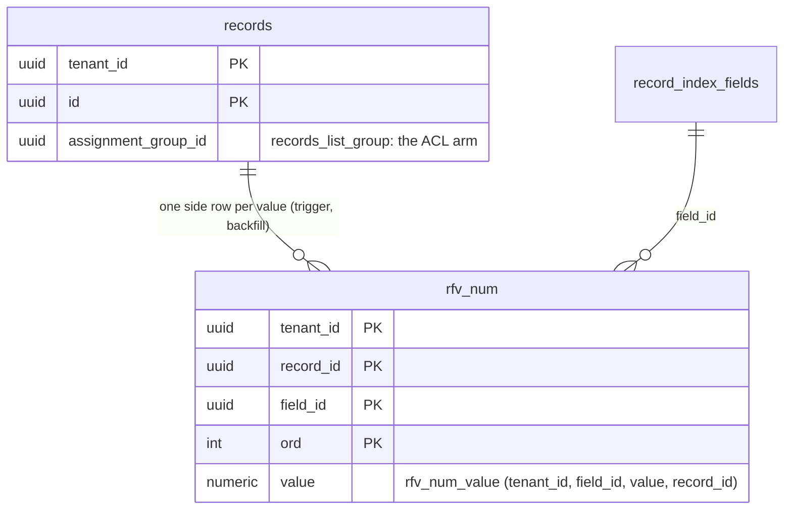

# TICK-1022: the ≥ 40% ACL list depends on the side table's visibility map

**Finding.** The S21 kit's slow ≥ 40% ACL list (217 ms single-client on one
fresh stack, 34 ms on the next) is a plan flip in the list's **capped count**.
The visibility map of `rfv_num` decides it. Its statistics do not. Analyzing
the side table at the flip to ready, the suggested direction, does not fix
it: 255 ms after `ANALYZE`, 64 ms after `VACUUM (ANALYZE)`. The slow plan is
also the steady state. Re-writing 5% of the side rows through edits leaves
1% of the pages all-visible, and the count takes the slow plan again until
autovacuum runs.

**`random_page_cost = 1.1` for `nava_app` is rejected (run 3).** It held the
fast plan in the single-field repro (42 ms). On D13's own setup (8 flagged
fields on 400 types, side tables vacuumed) it does not. The ≥ 40% ACL counts
of `in`, `lt` and the ts range still take the spilling Hash Semi Join:
80–98 ms of count server time against 99–114 ms at 4. A planner setting
only moves the threshold, so the fix has to change the count's statement
shape (options at the end).

**An unbounded per-record probe is rejected too (run 4).** It fixes the
40% band (count 19–27 ms) but costs the selective bands up to 8.3 s.

**The bounded probe (A′) holds in every band (run 5).** The ≥ 40% ACL
count takes 17.5–26.3 ms in every visibility-map state, plus a 10.9–17.8 ms
capped pre-count. The selective bands keep today's plans. It waits on the
Solution Architect's ADR-006 D7 ruling.

## What the list runs

With a narrowing ACL, the list sends two statements: the page and a count
capped at 1,001 (`internal/records/store/list.go`, `CountStatement`). The
page always walks `records_list_updated` and probes the side table, 4–13 ms
in every state below. The count's first ACL arm joins the agent's
group-visible records (`records_list_group`, 2–4k rows here, 20k for the
kit's Alice) to the filter's `EXISTS` on `rfv_num`. The planner chooses one
of two plans for it:

| Plan | When | Count execution, pk=3 |
| --- | --- | --- |
| Nested Loop Semi Join: one index-only probe of `rfv_num_value` per visible record | `rfv_num` mostly all-visible | 9–15 ms |
| Hash Semi Join: seq scan of `rfv_num`, a hash of the value's 192k side rows, spilled to disk (`Batches: 2`, `work_mem` 4 MB) | under roughly 50–70% all-visible | 100–490 ms |

The planner costs an index-only probe by the share of pages that are not
all-visible (`pg_class.relallvisible / relpages`), because each such page
needs a heap fetch at `random_page_cost` 4. Every page is in shared buffers
here, so the heap fetches it costs never happen, and the Hash Semi Join is the
slower plan in practice.

## Measurements

Harness: `TestFieldIndexPostBackfillStats`
(`internal/server/records_fieldindex_stats_perf_integration_test.go`), run by
`scratch/tick-1022-post-backfill-stats/run.sh`. It reuses P7-07's 800k seed:
400 tenants, one with 400,000 tickets, and P3-36's agent (the agents group
plus 3 assignment groups). It adds a num field `pk` with the kit's
distribution: 1 and 2 at 1% each, 3 at 48%, 4 at 50%. The lists go through
the real handler as `nava_app` under forced RLS. The side rows are copied in
the backfill's order (record id), with autovacuum off on `rfv_num` so each
state stays as set up.

Host: Windows 11, i7-1260P, Docker 29.9.2 on WSL2, VM with 16 CPUs and 24.5
GiB, `postgres:16.10`, `shared_buffers` 2.5 GB, `work_mem` 4 MB,
`random_page_cost` 4, `default_statistics_target` 100. The host was shared:
the kit's compose stack was idle, and other agents' integration-test
Postgres containers were running. The 8-client p95 is reported only. Read the
single-client p50 and the per-statement execution times.

### Run 1: the states a backfill can end in (pk=3, single-client p50 / 8-client p95, ms)

| State of `rfv_num` at the first list | all-visible | pk=3 (48%) | pk=4 (50%) | pk=1 (1%) |
| --- | --- | --- | --- | --- |
| never analyzed | 0% | **4,536 / 15,451** | **9,376 / 15,343** | 449 / 695 |
| analyzed at 50% of the rows | 0% | **259 / 425** | 180 / 1,639 | 109 / 385 |
| analyzed at 91% (S21 stack 2's last autoanalyze) | 0% | **202 / 902** | 185 / 569 | 179 / 762 |
| `ANALYZE` after the last row (the suggested fix) | 0% | **255 / 527** | 315 / 787 | 203 / 468 |
| `VACUUM (ANALYZE)` after the last row (as D13 was measured) | 100% | **64 / 215** | 67 / 189 | 129 / 322 |

Statistics taken at 50%, 91% or 100% of the rows give the same MCV
frequencies within 1 point (3 at 0.477–0.482, 4 at 0.497–0.501), and the
same slow plan. Only the vacuum, which sets the visibility map, changes it.
A table never analyzed at all is worse again: the planner estimates 1 side
row and builds a different plan, 4.5 s. A real backfill avoids that state,
because autoanalyze fires after the first ~50 rows of an empty table. The
kit's stack 2 shows 10 autoanalyzes on `rfv_num`.

### Run 2: where the plan flips, and the steady state (single-client p50 ms; count statement execution ms)

| State | all-visible | pk=3 p50 | pk=4 p50 | Count plan | Count exec pk=3 / pk=4 |
| --- | --- | --- | --- | --- | --- |
| vacuum | 100% | 48.3 | 43.3 | Nested Loop | 13.3 / 10.1 |
| planner told 90% | 90% | 41.7 | 41.5 | Nested Loop | 9.4 / 9.3 |
| planner told 80% | 80% | 102.9 | 91.7 | Nested Loop | 8.6 / 15.4 |
| planner told 70% | 70% | 43.1 | 42.4 | Nested Loop | 10.4 / 8.9 |
| planner told 50% | 50% | **193.8** | **219.0** | **Hash Semi Join, spills** | 151.1 / 108.1 |
| planner told 25% | 25% | 130.1 | 112.4 | Hash Semi Join, spills | 124.7 / 103.9 |
| 5% of side rows re-written, then `ANALYZE` | **1%** | 116.4 | 131.8 | Hash Semi Join, spills | 101.7 / 151.7 |
| 10% re-written | 0% | 147.2 | 167.1 | Hash Semi Join, spills | **493.1** / 160.3 |
| 20% re-written | 0% | 125.4 | 131.8 | Hash Semi Join, spills | 114.7 / 166.4 |
| `ANALYZE` only, `random_page_cost = 1.1` for `nava_app` | 0% | **42.4** | **42.6** | Nested Loop | 13.6 / 10.2 |

"Planner told n%" vacuums the table and then sets `pg_class.relallvisible`
to n% of `relpages`, so only the planner's input changes. The 80% row's
HTTP p50 is host noise: its count ran in 8.6 / 15.4 ms on the fast plan. The
"re-written" rows delete and insert n% of the side rows, spread over the
heap as record edits are. The trigger's delete and insert does the same.
Autovacuum vacuums a table for dead rows only after 50 + 20% of its rows
change. So between two autovacuums, a type with ordinary edit traffic is in
the slow region most of the time. `rfv_num` is shared by every tenant's num
fields, so one tenant's edits move every tenant's plan.

Plans: `docs/data/tick-1022-post-backfill-plan/count-plans.md` (the count
statement for pk=3 after `ANALYZE`, after `VACUUM`, at 5% re-written, with
`random_page_cost` 1.1, and never analyzed). Raw tables: `states-raw.md`,
`sweep-raw.md`, host lines in `host.txt`.

### Run 3: D13's matrix, `random_page_cost` 4 against 1.1 for `nava_app`

`TestFieldIndexPerf800k`, lists phase only, two fresh containers one after
the other on the same host (`NAVA_PERF_APP_RPC`). The side tables were
vacuumed as D13 measures them. The host was busy: the transport floor read
p50 7.8 ms against the 3 ms gate, and the no-filter control's p95 read
89–562 ms against 73 ms idle. So the 8-client p95 is invalid, and this
compares server time only: planning plus execution of one `EXPLAIN
(ANALYZE)` of each statement, as `nava_app`.

| Cell (count / page, ms) | `random_page_cost` 4 | 1.1 |
| --- | --- | --- |
| text eq 40%, ACL | 31.9 / 9.1 | 30.8 / 14.4 |
| text in 40%, ACL | **108.0** / 8.5, hash spills | **91.3** / 8.2, hash spills |
| num lt 40%, ACL | **98.7** / 7.1, hash spills | **79.8** / 12.0, hash spills |
| ts range 40%, ACL | **114.4** / 10.9, hash spills | **97.5** / 11.3, hash spills |
| bool eq 40%, ACL | 40.8 / 18.8 | 40.0 / 23.2 |

The other 35 cells move both ways by up to 2× between the two runs, inside
the host's noise. No cell changed plan family. All 40 cells:
`tick-1022-post-backfill-plan/rpc-ab-server-time.md`. Raw reports:
`rpc4-lists-raw.md` and `rpc1.1-lists-raw.md`. The two arms with 5% of the
side rows re-written were stopped: run 3 had already rejected the setting.

## Why not the other fixes

| Option | Result |
| --- | --- |
| `ANALYZE` the side table when the backfill flips a field to ready | Measured: no effect (255 ms against 202 ms without it). It would also need a `SECURITY DEFINER` wrapper, because `nava_worker` does not own the table and PG 16 has no `MAINTAIN` privilege. That breaks CI-1. |
| `VACUUM` at the flip | Cannot run in a function or a transaction block, and needs ownership. Not reachable from the worker. It would not hold either: 5% re-written leaves 1% all-visible. |
| Tighter autovacuum on `rfv_*` | Narrows the window but cannot close it, for the same reason. |
| `random_page_cost = 1.1` for `nava_app` | Run 3: the D13 ≥ 40% ACL counts keep the spilling hash (80–98 ms). Rejected. |

### Run 4: spike (A) unbounded, every ACL arm of the count probes per record

Branch `TICK-1022/spike-probe` (not for merge): `existsTerm` ends each
`EXISTS` in a marker, and `CountStatement` turns it into `OFFSET 0` in the
branched (ACL) arms only. Same host and harnesses as runs 1–3. The host was
busy again (transport floor p50 6.4 ms), so the comparison is by server
time.

Kit-shaped repro, count execution, ms:

| State | pk=3 (48%) before → spike | pk=1 (1%) before → spike |
| --- | --- | --- |
| `ANALYZE`, 0% all-visible | 167 → **14.0** | 27.0 → **74.4** |
| 5% re-written, 1% all-visible | 102 → **10.4** | – → 82.7 |
| 20% re-written | 115 → **16.5** | – → 78.8 |
| `VACUUM`, 100% all-visible | 13 → 18.1 | 20.4 → **92.5** |

D13's matrix, ACL cells, count server time (planning + execution), ms:

| Band | before (run 3, cost 4) | spike |
| --- | --- | --- |
| 40%, 5 operators | 31.9–114.4 | **18.8–27.3** |
| 2% | 23.6–33.8 | 98.1–225.3; **num `lt` 7,669, ts range 8,342** |
| 0.25% | 16.3–23.8 | 138.8–178.4; **num `lt` 940, ts range 1,070** |
| 0.01% | 4.0–16.8 | 90.9–179.3 |

All 40 cells: `tick-1022-post-backfill-plan/spike-probe-d13-server-time.md`.

What it shows:

- The probe removes the dependency for broad values: 10–27 ms in every
  state, against 100–490 ms.
- Unbounded, it is far worse for selective values. A selective filter
  matches few rows, so the count probes every record the arm can see (24,118
  for this agent's group arm) without reaching 1,001.
- A range probe goes through `rfv_*_value`, because the `value` bound makes
  it the planner's index. It then walks the whole value range for each
  record: 0.31 ms a probe, so 7.7 s at 2%. An equality probe seeks
  `(value, record_id)` at about 3 µs.

**(A) as spiked is rejected.**

### Run 5: spike (A′), the bounded probe

Branch `TICK-1022/spike-probe` at `5b37843f` (not for merge). What it does:

- **Pre-count.** On a narrowing list, before the page, the handler runs one
  capped count per ready filtered field on the value index:
  `SELECT count(*) FROM (SELECT 1 FROM rfv_* v WHERE v.tenant_id = $1 AND
  v.field_id = $2 AND <cmp> LIMIT 20000) c`.
- **Broad filter, count only.** When that count reaches 20,000, only the
  count statement (`ListQuery.CountWhere`) renders the field's `EXISTS` with
  `OFFSET 0`. The value side is made opaque (`v.value + 0`,
  `v.value || ''`, `v.value + interval '0'`, `v.value OR false`), so the
  probe seeks `rfv_*_pkey (tenant_id, record_id, field_id)` and filters the
  value.
- **Page and selective filters.** The page keeps the plain `EXISTS`, and so
  do selective filters.

A first cut put the opaque term in the page too. It hid the filter's
selectivity from the page planner and read 4.25 s, so the page is excluded.

The host was quiet for D13's matrix this time (transport floor p50 0.54 ms),
but the no-filter control's p95 still read 136–193 ms against 73 ms idle. So
the p95 below is indicative, and the server time is the score.

Kit-shaped repro, server time (planning + execution), ms:

| State | pk=3 (48%) pre + count / page | pk=1 (1%) pre + count / page |
| --- | --- | --- |
| `ANALYZE`, 0% all-visible | 18.0 + 19.0 / 7.2 (count was 168) | 7.4 + 22.6 / 66.1 |
| 5% re-written, 1% all-visible | 14.3 + 17.0 / 12.6 (was 102) | 6.4 + 24.7 / 59.8 |
| `VACUUM`, 100% all-visible | 22.2 + 26.8 / 11.8 (was 13–22) | 2.0 + 15.1 / 48.9 |

D13's matrix, ACL cells, server time in ms. Base is run 3 at cost 4.
Unbounded is run 4. All 40 cells:
`tick-1022-post-backfill-plan/spike-bounded-d13-server-time.md`.

| Band | base count | unbounded count | bounded pre + count | bounded 8-client p95 |
| --- | --- | --- | --- | --- |
| 40% (5 operators) | 31.9–114.4, 3 spill | 18.8–27.3 | 10.9–17.8 + 17.5–26.3, no spill | **145–233** (limit 350) |
| 2% | 23.6–33.8 | 98–8,342 | 4.6–7.8 + 19.2–41.4 | 223–842 (limit 350; see below) |
| 0.25% | 16.3–23.8 | 139–1,070 | 1.0–1.8 + 14.4–34.4 | 138–341 |
| 0.01% | 4.0–16.8 | 91–179 | 0.3–1.6 + 5.2–17.8 | 75–246 |

What it shows:

- **≥ 40% with an ACL.** The count is 17.5–26.3 ms in every visibility-map
  state, against 32–114 ms with spills. The cell's whole server time
  (pre-count + count + page) is 37–64 ms, and its p95 is 145–233 ms, inside
  350.
- **Selective bands.** Their counts keep today's Hash plans and server time.
  The pre-count adds 0.3–8 ms: it stops at the value's own rows below the
  cap.
- **2% p95.** `num lt` and `bool eq` at 2% read 739 / 842 ms p95, but their
  server time is 7.4 + 41.4 / 75.7 and 7.8 + 27.0 / 67.2 ms. The same order
  as base, so that is host noise, not this change. The 2% band's page
  (60–95 ms) is TICK-992's open item, untouched here.
- **Admin lists.** They ran the pre-count too, because the admin's read
  predicate names `r.` columns. Its 40% counts took the probe at 14.6–25.3
  ms against 13.5–30.9 base. A real change would gate on the ACL branches
  only.

**(A′) holds in every band.**

## Options (each changes the count's statement shape, ADR-006 D7)

| Option | What it does | Measured |
| --- | --- | --- |
| **(A′) Bounded probe (recommended)** | The pre-count above, then the per-record pkey probe in the count only, for broad filters only | Run 5: 40% ACL counts 17.5–26.3 ms in every state. Selective bands unchanged. One extra statement per filtered narrowing list, 0.3–18 ms. |
| (A) Unbounded probe | `OFFSET 0` in every ACL arm | Run 4: rejected, up to 8.3 s at 2% |
| (B) Shape chosen from a planning-only `EXPLAIN` | The planner's own estimate | Not spiked. Inherits the estimate that misleads it today. |
| (C) A D13 variance for the ≥ 40% ACL band | No code | Accepts 100–500 ms single-client server time at steady state |

Next: the Solution Architect rules on (A′)'s statement shape (ADR-006 D7).
Then (A′) lands as a compiler PR into `TICK-739/filterable-fields`: the
pre-count gated on ACL branches, the cap as a named constant with a test,
and `CountWhere` in `ListQuery` replacing the spike's marker.
