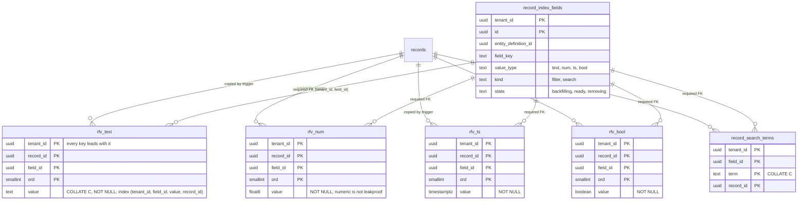

# Filterable fields: S1–S3 for RFC-015 rev 1 (TICK-714)

Scope: the spikes RFC-015 rev 1 (`d471c036`, §10) gates ADR-006 on. The
setup is P3-01's (`docs/data/records-list-bench.md`), with the rev 1 data
layer built as written, except where a finding below changed it. The code
is under `scratch/field-index-rls/` and is throwaway. The raw output is in
`docs/data/field-index-spike/`.

## Verdict

| Spike | Pass criterion (§10) | Result |
| --- | --- | --- |
| Pushdown below RLS | typed predicates are an Index Cond for `nava_app` | **Confirmed** for `text =`, `= ANY`, `float8 <`, `timestamptz >= … <`, `bool =`. `numeric =` stays a Filter (control). |
| S1 estimate vs. actual on the `EXISTS` (2%) | within 10×, else `CREATE STATISTICS` | **Missed as written: 17× low** (469 against 8,024). With **one table per value type** plus MCV statistics: 8,000 against 8,024. **Design change 1.** |
| S1 list p95 ≤ 150 ms | every band, 8 clients | **Passes at 40%, 0.25% and 0.01%, with or without row ACL. Misses at 2% with row ACL: p95 221–327 ms.** The UNION-ACL form fixes 2% (82–142 ms) but then misses 40% (341–392 ms). **No single statement shape passes every band. This needs a decision (below).** |
| S1 insert tps, 5 fields | ≥ 70% of baseline | **Missed: 43% to 63%** (338 tps against 779 or 533). |
| S1 R10, FK cost ≤ 10% | with/without the registry FK | **Passes: no measurable cost** (alternating A/B, mean 331 tps with the FK, 318 without). |
| S2 search p95 ≤ 300 ms | 1-, 2-, 3-term, prefix | **Passes for 1 term at ≤ 0.5%. Misses** for 1 term at 5% with ACL (713 ms), 2 terms (1,161 / 528 ms), 3 terms without ACL (418 ms) and prefix (1,371 / 1,290 ms). |
| S3 | diff = 0, R1 0 missing, R3 0 orphans, live p95 ≤ +25%, WAL reported | **Diff 0** (alone and under load). **R1 and R3 pass with the barrier**, and both controls fail without it. **Live write p95 +31% (misses +25%)** at a 200 ms pause. WAL **1.24 MB per 1,000-row batch**. |

## Setup

- Host: Windows 11, 12th Gen Intel Core i7-1260P. Docker 29.9.2 on WSL2
  (kernel 5.15.167.4), VM with 16 CPUs and 24.5 GiB. PostgreSQL, PgBouncer
  and pgbench share the VM. Other agents' test containers ran on the same
  host during some runs, so every load batch has a P3-01 (d) control run
  next to it.
- `postgres:16.10` and `edoburu/pgbouncer:v1.24.1-p1`, with P3-01's
  settings: `shared_buffers = 2GB`, `plan_cache_mode = force_custom_plan`
  for `nava_app`, `fsync = on`. Load is `pgbench -M prepared -c 8 -j 8`
  through PgBouncer in transaction mode, as `nava_app` with forced RLS and
  an explicit `tenant_id = $1`. Lists run 60 s, capped counts 30 s, and S2
  30 s.
- Data: P3-01's seed (`setseed(0.339)`), 800,000 records. One tenant has
  400,000, all of **one entity type**; 399 tenants have 1,002–1,003 each,
  over 5 types. Ten filterable fields per type (the D14 quota). For each
  operator there is a field at 40%, 2%, 0.25% and 0.01% selectivity: `tier`
  (text `eq`), `zone` (text `in`), `score` (num `lt`), `opened` (ts range),
  `b40`/`b2`/`b025`/`b001` (bool `eq`), plus `site` and `category`.
  Selectivity comes from a hash of the record id, so it does not depend on
  `updated_at` or on the ACL. Three searchable fields on the 400k type:
  `title`, `summary` (12 words) and `notes` (40 words), drawn
  log-uniformly from 20,000 words. `data` averages 1,522 bytes.
- The list is P3-01's: `SELECT r.* … ORDER BY updated_at DESC, id DESC
  LIMIT 50`, keyset page 1. "ACL" means P3-01 query (d), a non-admin actor
  (owner, assignee, 3 groups or shares, open rows only). "No ACL" means an
  actor without a row predicate. Each data filter is the D18 correlated
  `EXISTS`.
- Rev 1 schema (`21_s1_schema.sql`): `record_index_fields` (D2); the side
  table with PK `(tenant_id, record_id, field_id, ord)`, `value_text COLLATE
  "C"`, one partial typed index per type, the record FK and the **required
  registry FK** (D3); the term table (D12); the D5 trigger with the
  per-field diff and DELETE + INSERT, `AFTER INSERT OR UPDATE OF data`, and
  the `BEFORE DELETE` purge; D19 coercion with function-level `SET`; D20
  policies, one per command. After finding 1, `23_split.sql` replaces the
  side table with four per-type tables.

## Finding 1: one side table per value type, plus MCV statistics (changes D3)

The TA's criterion fired. On the single rev 1 table with default
statistics, the `EXISTS` row estimate on the 2% text filter is **469 against
8,024 actual (17×)**, and on the 40% filter **7,815 against 160,343
(20×)**. With 40% + ACL, the planner then drives from the side table and
fetches 160k records: **1,314 ms** single-client.

`CREATE STATISTICS (mcv) ON tenant_id, field_id, value_<t>` fixes equality
(2%: 7,200 against 8,024; 40% + ACL: 1,314 → 16 ms). It **does not fix
ranges**: `score < 4000` estimates 16,428 against 159,743. Each `value_<t>`
column of the shared table is about 90% NULL, and the planner multiplies
that null fraction into every range selectivity. The plan stays
side-first, at 1,754 ms.

Four tables, `rfv_text`, `rfv_num`, `rfv_ts` and `rfv_bool`, each with
`value … NOT NULL` and the same PK, typed index, FKs and RLS, fix it. Each
table gets `CREATE STATISTICS (mcv) ON tenant_id, field_id`. Text and bool
also get `(tenant_id, field_id, value)`. The estimates then match:

| 2% filter, ACL | estimated | actual |
| --- | --- | --- |
| text `eq` | 8,000 | 8,024 |
| text `in` | 5,635 | 8,093 |
| num `lt` | 7,976 | 7,872 |
| ts range | 7,569 | 7,963 |
| bool `eq` (statistics target 1,000) | 8,085 | 8,042 |

The 40% range + ACL drops from 1,754 to 4.7 ms. Size is smaller too:
**1,700 MB for 8.0M record-field rows, 212 bytes each** (the single table
was 1,835 MB, 229 bytes each).

**Residual (new risk R12): rare values of low-cardinality fields depend on
the MCV list.** A bool that is true for 0.01% of the type (46 rows) is
estimated at 20,704 with statistics target 100, and the planner walks the
whole type: **1,313 ms**. Target 1,000 fixes 0.25% but not 0.01%. Target
10,000 fixes both (48 against 46), at a cost of **5–11 ms planning** per
bool query and an 11.8 s `ANALYZE`. With thousands of tenants, rare
combinations fall out of any fixed-size MCV list again. All of this is
platform DDL, so I8 holds.

## S1: list p95 (ms), the D18 `EXISTS` form, per-type tables

400k type, 8 clients, 60 s. Each cell is ACL / no ACL. Control (d) without
a data filter: p95 17.5 ms before the batch and 30.8 ms after it (P3-01
measured 31–36 ms).

| Operator | 40% | 2% | 0.25% | 0.01% |
| --- | --- | --- | --- | --- |
| text `eq` | 40.3 / 30.9 | **221.3** / 99.0 | 41.8 / 59.7 | 18.5 / 23.8 |
| text `in` (2 values) | 50.1 / 31.5 | **309.6 / 223.7** | 36.0 / 59.6 | 29.0 / 29.6 |
| num `lt` | 57.9 / 45.6 | **325.8** / 128.8 | 63.6 / 93.8 | 24.5 / 32.9 |
| ts range | 33.3 / 31.2 | **267.8** / 115.4 | 42.7 / 54.8 | 19.4 / 21.0 |
| bool `eq` (target 10,000) | 83.2 / 103.1 | **327.4** / 142.1 | 85.8 / 95.9 | 47.5 / 50.6 |

No data filter: 22.2 / 21.8. Small tenant, 2% text `eq` with ACL: 16.2.
Bool queries carry the 5–11 ms planning cost of the large MCV list.

**Why 2% + ACL misses.** At 2% the planner drives from the side index
(8,000 record ids), fetches each record (about 1.6 KB) by PK, applies the
ACL (about 1% of the type passes), and sorts. That is 8,000 heap fetches
for 50–90 visible rows. At 40% it walks `records_tenant_updated` instead,
with a PK probe per row into the side table, and stops after 50. At 0.25%
the id set is small. The 2% band sits between the two plans. This is the
RFC's R1.

**Capped count** (`LIMIT 1001`, ACL, 30 s): 40% **538–1,255**, 2% 215–280,
0.25% 45–66, 0.01% 11–37, no filter 90. The 40% count has to find 1,001
visible matches. It is the same count-only shape as P3-01's 278–352 ms,
and it is worse.

### The UNION-ACL form

The same statement, but with the (d) ACL compiled as `r.id IN (requester
branch UNION assignee branch UNION group branch UNION shares)`. Each branch
is index-backed, and the side table is still a correlated `EXISTS`, so D18
holds. List p95 with ACL:

| | 40% | 2% | 0.25% |
| --- | --- | --- | --- |
| text `eq` | **340.9** | 81.9 | 53.8 |
| text `in` | | 94.9 | |
| num `lt` | **391.7** | 88.9 | |
| ts range | | 88.6 | |
| bool `eq` | | 141.6 | |

Capped count with ACL: 40% `eq` 180.5, 40% `lt` 207.8, 2% `eq` 87.1.
Control 41.6.

The UNION form drives from the actor's visible set: 6,030 open rows for
actor 1, each fetched by PK and then probed. That is fast when the filter
is selective and slow when it is not. **Neither shape passes every band.**
PostgreSQL does not choose between them itself, so the compiler would
have to.

### Single read

Not re-measured. A point read is `records_pkey` and touches no side table,
so P3-01's figure stands (inferred, not measured here).

## S1: write throughput

Insert and update tps, 8 clients, 60 s, into the 400k type. The update
changes `score`, a flagged field, plus `updated_at` and `state`.

| Set | Insert tps | Insert p95 ms | Update tps | Update p95 ms |
| --- | --- | --- | --- | --- |
| No trigger (first run) | 779 | 15.1 | 880 | 13.6 |
| Trigger, 0 fields flagged | 683 | 18.1 | 604 | 26.2 |
| 5 filterable, FK | **338** | 41.4 | 394 | 37.7 |
| 10 filterable, FK | **318** | 40.1 | 377 | 34.8 |
| 10 filterable, update of an unflagged key | | | 585 | 21.9 |
| 10 filterable + 3 searchable, FK | **90** | 147.5 | 387 | 30.7 |
| 5 filterable, no FK | 229 | 54.3 | 334 | 35.6 |
| 10 filterable, no FK | 282 | 45.1 | 458 | 33.6 |
| No trigger (repeat, last run) | 533 | 30.3 | 763 | 18.0 |

The two no-trigger runs differ by 32%. The table grew by about 200k rows
between them, and the host was shared. **5 filterable fields reach 43%
(against the first baseline) to 63% (against the repeat). The ≥ 70% budget
is missed either way.** Search is the expensive part: about 50 term rows
per record make an insert cost 3.5× the 10-field filter insert. The
per-field diff works: an update of an unflagged key runs at 585 tps,
against 377 for a flagged one.

### R10: the registry FK

The FK and no-FK rows above ran minutes apart, and the no-FK runs came
later on a larger table. That difference (338 against 229) is noise in the
wrong direction, not a measurement. The alternating A/B is below.

Rebuilt bench (same seed and scripts; `rebuild-ab-s3.txt`), 10 filterable
fields, insert, 8 clients, 30 s per run, alternating so that table growth
and host noise hit both arms:

| Round | With FK | Without FK |
| --- | --- | --- |
| 1 | 401 | 385 |
| 2 | 313 | 236 |
| 3 | 279 | 334 |
| Mean | **331** | **318** |

**R10: no measurable cost from the required registry FK.** The FK arm is
4% faster on the mean, inside the ±25% spread between rounds. That is far
from the 10% escalation line, so the FK stays as ruled. No MultiXact
stall showed (FK-arm max 2.9 s in one round, against 0.35 s without, a
single outlier). No-trigger baseline in the same session: 727 tps, so 10
fields cost about 54%.

D19's function-level `SET` on the coerce function is not the cost either.
An inlined SQL version without `SET` gave 280 / 226 tps, against 280 / 382 /
319 with `SET`. The write cost is the per-field rows themselves: one heap
row, two index entries and two FK checks per field.

## S2: search, the D12 term table

400k type, 3 searchable fields, **19,851,854 term rows (about 50 per
record)**. The table is 1,616 MB and its PK 1,933 MB: **3,549 MB, 2.1× the
whole `records` heap (1,673 MB)**, or about 4.2× the 400k type's share of
it. That is past the R4 trigger of 3× at a quota of 3, not 5. p95 ms, 8
clients, 30 s, ACL / no ACL:

| Query | ACL | No ACL |
| --- | --- | --- |
| 1 term in about 98% of records | 17.5 | 16.5 |
| 1 term, about 5% | **712.8** | 221.1 |
| 1 term, about 0.5% | 94.6 | 107.6 |
| 1 term, about 0.05% | 23.3 | 30.7 |
| 2 terms (`w10` AND `w100`) | **1,160.7** | **528.1** |
| 3 terms | 194.0 | **417.6** |
| Prefix `w123*` (51k term rows) | **1,370.8** | **1,290.5** |

The estimates are close (5% term: 17,270 against 20,664). The cost has the
same shape as S1's 2% band: 20k–51k record fetches before the top-N sort.
Here `records` was also partly evicted from the 2 GB `shared_buffers` by
the 3.5 GB term table, so these numbers include buffer misses.

## S3: late flag, barrier and backfill

### Deterministic cases (TA R1 and R3) on the rev 1 schema

Small tenant 1, 200 records of one type. Timing is fixed with
`pg_sleep(4)` (`races.sh`).

| Case | Without D17 barrier (control) | With D17 barrier |
| --- | --- | --- |
| R1: live INSERT, trigger before the flip, commit after the batch | expected 203, actual 202, **missing 1** | barrier waited 3,454 ms on 1 xid; expected 204, actual 204, **missing 0** |
| R3: live UPDATE that **adds** a value, trigger saw `ready`, commit after the removal delete | registry delete **fails** on `rfv_text_field_fk`; 1 side row left, registry `removing` | barrier waited 3,634 ms on 1 xid; **0 side rows**, registry deleted |

R3 has a variant that needs neither guard. If the live UPDATE changes an
**existing** value, the removal's DELETE blocks on the writer's row lock and
serialises behind it, so there is no orphan even without the barrier. The
orphan only happens when the writer **inserts** a new side row. The
required FK then turns it into a loud failure, which is what the CTO ruling
intended.

### Backfill under live writes

One text field (`priority`, 5 values) flagged late on the 400k type.
Batches of 1,000, `FOR SHARE`, DELETE + INSERT, 200 ms pause (D10), run as
`nava_app` direct to PostgreSQL (`s3_run.sh`, per-batch logs
`s3-backfill-*-batches.txt`).

| | Backfill alone | Backfill under the live mix |
| --- | --- | --- |
| Rows / batches | 400,034 / 401 | 453,072 / 454 (live inserts kept adding rows) |
| Batch time avg / p95 / max | 252 / 479 / 4,085 ms | 407 / 942 / 1,546 ms |
| Duration (batch time plus pauses) | about 3.0 min | about 4.6 min |
| Barrier at the flip | 0 xids, 1 ms | 2 xids, 138 ms |
| **WAL per batch** | **1.24 MB** (472 MB for 400k records) | 2.29 MB including live writes |
| **Diff at the end** | **0** (400,034 = 400,034) | **0** (459,124 = 459,124) |
| Removal (D11), 400k side rows | 48 s | not run |

The live mix is 50% inserts in the S1 shape and 50% updates of a flagged
key, 8 clients through PgBouncer, 180 s:

| | tps | p50 ms | **p95 ms** | p99 ms |
| --- | --- | --- | --- | --- |
| Alone | 359 | 19.4 | **40.9** | 58.8 |
| With the backfill running | 298 (−17%) | 22.7 | **53.4 (+31%)** | 81.7 |

**Diff = 0 passes. Live write p95 within +25% misses at +31%**, with a
200 ms pause. Pauses are a D10 tuning knob ("adjusted to keep live-write
p95 within budget"); a longer pause trades duration for p95. That trade
is inferred, not measured.

**WAL:** about 1.2 KB per record scanned. The batch writes a `FOR SHARE`
lock into every `records` tuple and, after each checkpoint, a full-page
image of every heap page it touches. That is about 470 MB for a 400k type
whose heap share is about 840 MB. The bytes of `data` do not change (diff
and CI-8), but replicas and checkpoints pay for them. That is the TA's
point, now with a number.

## Recommendations for ADR-006

1. **D3: four per-type side tables** (`rfv_text`, `rfv_num`, `rfv_ts`,
   `rfv_bool`, `value NOT NULL`). Add `CREATE STATISTICS (mcv) ON
   tenant_id, field_id` on each, plus `(tenant_id, field_id, value)` on
   text and bool. Raise the statistics target on bool. Platform DDL, so I8
   holds. Without this the planner misestimates by 10–20× and picks plans
   of 1.3–1.8 s.
2. **R1 has materialised. 2% + row ACL misses 150 ms** under the D18
   `EXISTS` shape (221–327 ms). The decision belongs to the CTO, as the
   Technical Lead's routing said. The data offers these options:
   - (a) The compiler emits the UNION-ACL shape when the filter is
     selective and the walk shape otherwise. It needs a selectivity signal
     that is not a separate side-table query (D18): for example the
     planner's estimate from `EXPLAIN` of the same statement (no ANALYZE;
     planning only, measured at 1–11 ms here), or a per-field histogram
     kept in the registry by the backfill.
   - (b) Option C for the fields that matter: a promoted fixed column has
     the same ordered walk as P3-01's (d).
   - (c) Accept about 220–330 ms at 8 clients for that band.
   - Variant A2, the sort key copied into the side table, was measured
     only before the outage, on the old schema. It made lists without an
     ACL about 1 ms, but lists with the ACL stayed bound by the ACL pass
     rate, and its write cost was not measured. It is not a fix for this
     band.
3. **Write budget missed** (43–63% at 5 fields, about 46% at 10). The
   registry FK (R10) and D19's `SET` are not the cause; the side rows are.
   Either the budget moves, or D14 drops to about 3 filterable fields per
   type (inferred from the per-field slope, not measured).
6. **S3:** diff = 0 holds and the barrier closes R1 and R3. Live p95 +31%
   at a 200 ms pause means D10's pause has to start higher, or the budget
   moves. WAL is about 1.2 KB per record scanned.
4. **Search (D12)** misses 300 ms on multi-term, prefix and 5% terms, and
   costs 2.1× the records heap at 3 fields. The trigger also cuts insert tps
   from 318 to 90. The cap, the quota or the search design need another
   look before D12 is accepted as written.
5. Capped counts with ACL at 40% are 538–1,255 ms (UNION form 180–208 ms).
   Like P3-01, that is a count-only miss, but it is larger.

## Data model (rev 1 with finding 1)



## Reproduce

```sh
BENCH_KEEP=1 BENCH_ID=x sh bench/records-list/run.sh setup custom
# then, inside nava-rlb-pg-x with scratch/field-index-rls copied to /bench/fi:
psql -f 20_s1_data.sql; psql -f 21_s1_schema.sql; psql -f 22_s1_populate.sql; psql -f 23_split.sql
sh s1_load.sh; sh s1u_load.sh; sh s2_load.sh; sh s1_writes.sh; sh s1_ab.sh; sh s3_run.sh
sh races.sh r1 barrier; sh races.sh r1 nobarrier; sh races.sh r3 barrier; sh races.sh r3 nobarrier
```

`scratch/field-index-rls/rebuild_and_run.sh` does the setup, the A/B and S3
in one run. Before the outage, the pre-rev-1 exploration also used
`10_leakproof.sql`, the catalogue check.
