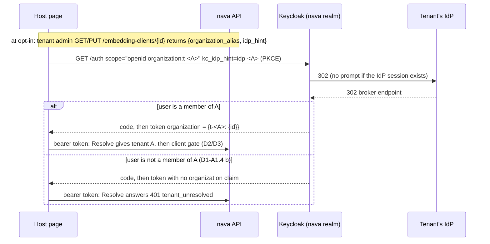

# ADR-007 amendment A1: embedding clients always name the organization

> **Status: PROPOSED** on 2026-11-14. Round 1 closed: Security approved its blocking item F1 on re-check; the Technical Architect had no blocking items; the CTO adopted S1b as measured (no new round). The verdict follows the merge policy: the Solution Architect decides after this PR is reviewed, then updates the status here and in `ADR-007-A1-explained.html`.
>
> **Invariants source.** The project description defines no invariants. As in ADR-007, this amendment is checked against [[ADR-001-platform-blueprint]] §1, I1–I9.

## Context

ADR-007 D1 let a host request bare scope `organization` and expected Keycloak's picker for a user in several orgs. Spike S1 (TICK-806) failed: on a user's **first** sign-in through the broker (`kc_idp_hint`), Keycloak 26.8.1 brokers before the `Organization` authenticator runs, and the picker needs a known user (`OrganizationAuthenticator.java:280`). The token has no `organization` claim and the unchanged `Resolve` answers 401 `tenant_unresolved` (3/3, Chromium without third-party cookies and WebKit). No token resolved to a wrong tenant: a correctness and UX gap, not an isolation gap. S1 also recorded two deviations from the ADR's expectations (a wrong alias does not give a claimless 401 without a hint; no hint gives a username prompt), which this amendment restates as expected behaviour.

## Decision

**Every authorization request from an embedding client carries `organization:<alias>` for the tenant the host acts for, and should carry `kc_idp_hint` of the same tenant. The platform gives the host both values, derived from the tenant id alone.** `keycloak.Adapter.Resolve` stays byte-identical, `realm-nava.json` does not change, and `nava-web` is untouched.

| # | Rule |
|---|---|
| **D1-A1.1** | An embedding client's (any client in `embedding_client_registry`) authorization request MUST carry `organization:<alias>`, the Keycloak organization alias of the tenant the host acts for. Bare `organization` is not supported for embedding clients. The alias is a **hint, not a trust input**: Keycloak keeps only orgs the user belongs to (`OrganizationScope.java:102`), and the tenant still comes only from the signed `organization.id` through `tenant_identity_binding` (I2). |
| **D1-A1.2** | The host SHOULD also send `kc_idp_hint=<idp alias>` of the **same** tenant. With it, a brokered user with a live IdP session signs in with no prompt. |
| **D1-A1.3** | **Where the values come from.** `GET` and `PUT /api/v1/embedding-clients/{client_id}` return two read-only members: `organization_alias = onboard.Alias(p.TenantID)` (`t-<uuid>`) and `idp_hint = keycloak.TenantIdPAlias(p.TenantID)` (`idp-<uuid>`), where `p` is the request's `identity.Principal`, whose `TenantID` only `Resolve` sets (`internal/identity/keycloak/keycloak.go:252`). **No table is read** to produce them. Onboarding creates exactly these names (`internal/onboard/onboard.go:215-220`). The two are one pair: SDK and kit helpers take the response object, not two independent strings, because a mismatched pair costs the host a 401 (D1-A1.4 b). |
| **D1-A1.4** | **Expected behaviour, alias the user cannot use.** (a) The org exists, the user is not a member, no `kc_idp_hint`: Keycloak shows the realm's sign-in form, even with an SSO session (`CookieAuthenticator.java:90-92`; S1 with SSO, S1b without). No code is issued. (b) Same, **with** `kc_idp_hint`: Keycloak brokers, issues a code and a token with **no `organization` claim**, and `Resolve` answers 401 `tenant_unresolved`. A first brokered sign-in still adds the user to the orgs linked to their IdP. *Verified by S1b, 3/3, for both client shapes.* (c) The alias names no enabled org, with or without the hint: `error=invalid_scope` to `redirect_uri`, no code (`AuthorizationEndpoint.java:194-200`; S1b). In every case no token resolves to a tenant the user is not in. |
| **D1-A1.5** | **Expected behaviour, no `kc_idp_hint`.** When only the upstream IdP session survives, Keycloak shows its identity-first username form once. This is a prompt, accepted as FAIL-UX under ADR-007's S1 rule; it is not a tenant-resolution failure. |
| **D1-A1.6** | A claimless token (bare `organization` from a multi-org user, or D1-A1.4 b) gets 401 `tenant_unresolved` from the unchanged `Resolve`, which requires exactly one org. This is the fail-closed backstop, not a supported path. The SDK documentation and any sign-in helper type make the D1-A1.3 pair required. |
| **D1-A1.7** | **D13 gains `GET /api/v1/embedding-clients/{client_id}`.** (1) Tenant admin only, the same gate as `PUT`. The **role gate runs before any `embedding_client` lookup**, so a non-admin gets the same 403 for a known and an unknown `client_id` and the response is no existence check. (2) A `client_id` the caller's tenant has no `embedding_client` row for returns the **same 404** as an unknown `client_id`, byte-identical, with no tenant fields. (3) Audited like `PUT`. **`PUT`** rejects a body carrying `organization_alias` or `idp_hint` with **400 `unknown_field`** (RFC 9457, `errors.yaml`) and writes nothing. |

All other D1 text holds: Keycloak client in the installation realm, public + PKCE or confidential, `nava-api` audience, top-level redirect, no `check-sso` iframe.

### Fixtures: seeded vs onboarded tenants (CTO ruling, final)

The dev seed tenants in `realm-nava.json` use hand-picked names (`tenant-a`, `idp-tenant-a`); D1-A1.3 would return `t-<uuid>`, which names no org there (D1-A1.4 c, fails closed). The seeds are **not renamed**.
- CI-E14a–d and CI-E15 test Keycloak's behaviour, not the derivation, so they use the seed fixtures (`idp-tenant-b`, `organization:tenant-a`).
- CI-E16 and the S23/S26 kits use the derived values, so they use **tenants created through onboarding**, prepared by a `qa` kit-fixture script (added to PLAN-008): it onboards two tenants, creates their IdP realms and users, points each `idp-<uuid>` at its realm, and prints user, password, `organization_alias` and `idp_hint` per tenant. S26 reuses it.

## Tests

RFC-017 §7's S1 row becomes: *a token from `organization:<alias>` passes unchanged `Resolve` for single-org and two-org users, on a first brokered sign-in and with SSO; an alias the user cannot use never yields a token that resolves to a tenant (D1-A1.4); with `kc_idp_hint` and a live IdP session, no prompt; without it, the prompt is FAIL-UX.* On S1 + S1b evidence: **PASS**.

| Id | Test | Fails if |
|---|---|---|
| **CI-E2 (restated)** | `kit-host` enabled only for A. (a) B's user with B's pair → token for B → every `/api/v1` call 403 `client_not_enabled`. (b) Same user with A's alias **and B's IdP hint** → token with no `organization` claim → every call 401 `tenant_unresolved`. | A tenant that never opted in can use the host; a token resolves for a non-member alias. |
| **CI-E14a** | No hint, existing alias the user is not in, with and without SSO: the realm sign-in form, no `code`. | A `code` is issued. |
| **CI-E14b** | `kc_idp_hint=idp-tenant-b`, `organization:tenant-a`, existing tenant-B user, for **both client shapes** (an embedding client with optional `organization`, and `nava-web` with default bare `organization`): a `code` is issued, the token has no `organization` claim, `Resolve` returns 401 `tenant_unresolved`. *Verified by S1b.* | The token's `organization` claim names an org the user is not in. |
| **CI-E14c** | `organization:no-such-org`, with and without the hint: 302 to `redirect_uri` with `error=invalid_scope`, no `code`. | A `code` is issued. |
| **CI-E14d** | Fresh user, first sign-in via `idp-tenant-b` with `organization:tenant-a`: the token has no `organization` claim, and afterwards the user is a member of **tenant-b only**. *Verified by S1b.* | The user is a member of tenant-a (isolation break), or of no org (Keycloak behaviour changed: re-open the withdrawn RR-A1-5). |
| **E14 invariant** | Every E14 case, with and without hint and SSO, also asserts that **no issued token's `organization` claim names an org the user is not a member of**. Forms and errors are UX checks, asserted separately. | Any token names a non-member org. |
| **CI-E15** | User in two orgs (seeded with `ci5User`/`addOrgMember`), first brokered sign-in with the hint and `organization:tenant-b` → exactly `tenant-b` → tenant B. Same user with bare `organization` → claimless → 401 (D1-A1.6). | The chosen path fails, or the backstop stops failing closed. |
| **CI-E16** | Under `internal/tenancy/isolation/`, onboarded tenants A and B, lands with TICK-815: (a) A's admin `GET`/`PUT` → `t-<A>`, `idp-<A>`; (b) B's admin → B's values only; (c) B's admin `GET kit-host` when only A opted in → 404 byte-identical to an unknown `client_id`; (d) B's `PUT` body with A's values → 400 `unknown_field`, nothing written; (e) B's token with forged `X-Tenant-Id: <A>` → B's values; (f) B's binding also lists `idp-<A>` → `idp_hint` is `idp-<B>`; (g) a non-admin in A sends `GET` → 403, neither member returned, **run for a known and an unknown `client_id`, identical responses**. | Another tenant's alias or IdP leaks, or g reveals existence. |

The existing `Resolve` unit tests for a claimless token stay.

### Story criteria (Technical Lead rewrites them in the PLAN-008 update)

- **S23 AC3 (TICK-802):** "Tenant B's agent signing in through `kit-host` with B's D1-A1.3 pair gets a token, and every call with it answers 403 `client_not_enabled`. With A's alias and B's IdP hint, a token is issued with no `organization` claim and every call answers 401 `tenant_unresolved`. Tenant B's PUT cannot change tenant A's row."
- **S26 AC5 (TICK-803):** "Signed in as tenant B's agent through the sample host configured with B's pair, the widget shows the server's `client_not_enabled` error and no data. The sample host always sends the pair; a run without `kc_idp_hint` shows Keycloak's username form once (expected, FAIL-UX) and then continues."
- `examples/host-app/` and the kit's PKCE helper take the D1-A1.3 response object.
- **Placement:** D1-A1.3 and D1-A1.7 go into TICK-815 (same handler, response type and audit path). The kit-fixture script is a new `qa` task in S23.

## Invariant check (ADR-001 §1)

| Invariant | Effect |
|---|---|
| I1 | D1-A1.3 reads no table. The GET 404 rule reads `embedding_client`, a tenant table under forced RLS (D2). Holds. |
| I2 | The pair comes from `Principal.TenantID`, set only by `Resolve`; headers and bodies are never read (CI-E16 d, e). The alias stays a hint. Holds. |
| I3 | No new role, grant or table read. Holds. |
| I4, I5, I6, I9 | Not touched. |
| I7 | `PUT` replay unchanged; `GET` writes only its audit entry. Holds. |
| I8 | No realm or trust-path change. Holds. |

## Consequences

- Hosts must know the tenant before redirecting. They get the pair once, at opt-in, from D13.
- `PUT /embedding-clients/{client_id}` refuses the two read-only members (400). `GET` is a new audited operation.
- `nava-web` keeps bare `organization`; its multi-org first sign-in has the S1 defect (RR-A1-2).
- S23 (TICK-802) and S26 (TICK-803) stay in `backlog` until this amendment is ACCEPTED and PLAN-008 is updated.

## Residuals

Indexed as `AR-TICK-843-01` to `-05` in `docs/security/accepted-risks.md`.

| # | Residual | Owner | Revisit trigger |
|---|---|---|---|
| RR-A1-1 | **No-hint path only** (D1-A1.4 a): a brokered user is stranded on Keycloak's sign-in form, with no token and no way back to the host. With the hint the host gets a 401 it can handle. | Technical Lead (host-app docs) | First host support case; then a login-theme "back to app" link. |
| RR-A1-2 | `nava-web` keeps bare `organization`; a multi-org user's first brokered sign-in to the first-party app gets 401 (fail-closed). No known user is multi-org today. | Solution Architect | The first user who is a member of two orgs. |
| RR-A1-3 | A brokered user resolves in a second org only if that org's binding also lists the brokering IdP (ADR-001 A.1 step 3). Not new. | Solution Architect | A tenant asks to share users across orgs with different IdPs. |
| RR-A1-4 | Without `kc_idp_hint`, a prompt (D1-A1.5). | Technical Lead | A host that cannot send the hint; then option 4 below with its own spike. |
| RR-A1-6 | The dev seed tenants do not follow the derived names, so D1-A1.3 returns aliases that do not exist for them (`invalid_scope`, fails closed). CI-E16 and the kits use onboarded tenants. | Technical Lead | A kit or test that needs a seeded tenant as a host; then rename the seeds. |

**Withdrawn: RR-A1-5** (rev 1: "a new user whose first sign-in carries a wrong alias is created with no org membership"). S1b disproved it 3/3: the user joins the org linked to their IdP and the next sign-in with the right alias resolves. CI-E14d pins the measured behaviour so an upgrade that changes it re-opens the risk.

## Rejected options

| Option | Why |
|---|---|
| 2. SDK makes a second top-level redirect on `tenant_unresolved`, once a Keycloak session exists | Contradicts D7 (the widget never runs a login flow); puts sign-in logic in the SDK; needs loop guards; shows the picker on every first sign-in. S1 only showed the picker with an SSO session. |
| 3. Custom browser flow with the `Organization` sub-flow before the IdP redirector | Cannot show a picker for a user who does not exist yet (`OrganizationAuthenticator.java:280`). Realm-wide, it changes sign-in for `nava-web` and every browser client (`browserFlow` is unset in `realm-nava.json`) and risks a username prompt on the platform's hinted sign-in (`stack_test.go`). |
| 4. Realm option `kc.org.broker.redirect.mode.email-matches` | Untested, and it targets the no-hint prompt (D1-A1.5), not the missing picker. Not chosen, so no spike is planned. Revisit under RR-A1-4. |
| Read `idp_aliases` from `tenant_identity_binding` for D1-A1.3 | Its `binding_lookup` policy is `USING (true)` for `nava_app` (`db/migrations/00002_platform_tables.sql:67`, A.3 allow-list), so RLS does not scope it; a missing predicate leaks another tenant's IdP alias and tenant id (Security F1). |
| Silently ignore read-only members on `PUT` | A failure is visible; an ignored field is not (CTO). |
| Rename the seed tenants to the derived names | Fixture churn off the critical path (`TestRealmFile`, `stack_test.go`, broker endpoints). |
| Refuse bare-`organization` embedding tokens in the client gate | Implementable: S1b shows the granted scope is the literal `organization:<alias>` (control run `scope=openid organization:tenant-b`). Not needed: `Resolve` already fails closed on zero or several orgs. Revisit if a single-org host ships with bare scope. |

**Dissent: none recorded.** The Technical Architect retracted round-1 F3 after S1b. Security's F1 is resolved by derivation.
