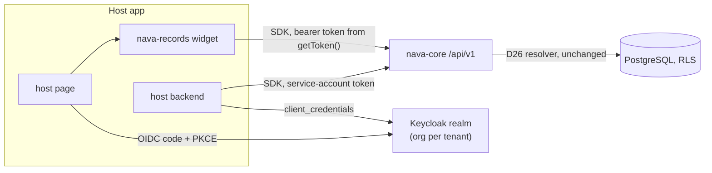
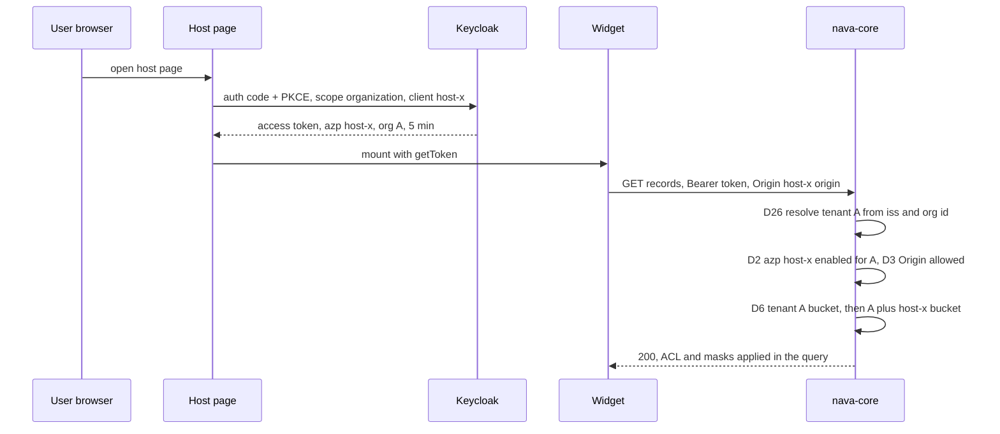

# RFC-017: Embedding the platform in other applications

> **Invariants source.** The project description is empty, so it defines no invariants. This RFC is checked against [[ADR-001-platform-blueprint]] §1, **I1–I9** (accepted 2026-10-15), as ADR-004 to ADR-006 were. My role brief says "eight invariants"; ADR-001 has nine. I use the nine.
>
> **Numbering.** Highest RFC found in the repo is RFC-016 (reserved by ADR-006 for free-text search). I assumed **RFC-017**; the ADR that follows will be **ADR-007**.
>
> **Dependency.** `docs/product/vision.md` is not on `main` yet. The "why" below comes from TICK-786: a generic, embeddable ticket and case platform for ITSM, loan applications, visa applications and similar. Nothing here depends on vision details beyond that.

## 1. Summary

- **Identity: no new trust path.** A host application ("host app") is registered as an OIDC client in the installation's Keycloak realm. Its users sign in to Keycloak (silently, through the tenant's already-bound IdP), and the access token goes through the **unchanged** D26 resolver. The tenant still comes only from `(iss, organization.id)` (I2). Token exchange and "on behalf of" headers are rejected.
- **Host app identity is the token's `azp`.** A new tenant-scoped table `embedding_client` says which host apps a tenant has enabled and from which browser origins. A token whose `azp` is not enabled for the resolved tenant is refused. Audit records "user Y via host app X" in a new audit column (needs ADR-004-A2).
- **Machine-to-machine:** a host backend with no user present uses a Keycloak **service account that is a member of exactly one organization** and has a `principals` row. It acts as itself, never as a user it names. Unverified in Keycloak 26.8.1 → spike S2.
- **UI widget v1 = a web component** (`<nava-records>`) that takes a `getToken()` callback from the host. It lists, views and creates records of one entity type. No iframe in v1.
- **Headless SDK v1 = TypeScript only**, generated from `api/openapi.bundled.yaml` with a thin hand-written layer (token provider, `Idempotency-Key`, `If-Match`, cursors, RFC 9457 errors). The widget is built on it. SDK major = API major.
- **What the human must accept:** a host app's JavaScript can read the user's 5-minute token (it already holds the user's session), and a second SDK language waits for the first real host that needs it.

## 2. Context

| Fact on `main` | Where |
|---|---|
| Tenant = `tenant_identity_binding(iss, organization.id)`; exactly one org in the token, else 401; fail-closed IdP and federated-link checks | ADR-001 A.1, `docs/architecture/tenant-resolution.md` |
| Token checks: `aud = nava-api`, `typ = Bearer`, `azp` present, lifetime ≤ 5 min | `internal/identity/keycloak/keycloak.go` |
| Only platform service accounts administer Keycloak; tenants cannot create clients | ADR-001 D26, residual R3 |
| REST `/api/v1` from OpenAPI 3.1, additive within a major, RFC 9457, `Idempotency-Key`, ETag/`If-Match`, HMAC cursors | ADR-001 D6, `api/openapi.yaml` |
| Per-tenant token bucket, keyed only on the resolved tenant, per replica | `internal/platform/ratelimit` |
| Audit actor = `actor_principal_id` xor `actor_system`, plus `source`, `source_ref` | ADR-004 R1 |
| No browser UI and no CORS handling exist today | repo survey |
| GraphQL is Epic 23, read-only, later | ADR-001 D6 |

### Domain model (new terms)

| Term | Meaning |
|---|---|
| **Host app** | Another product (an ITSM portal, a loan origination system) that shows our records inside its own pages or calls our API from its backend. |
| **Embedding client** | A Keycloak client representing one host app, created by the operator, plus one `embedding_client` row per tenant that has enabled it. |
| **Integration principal** | A principal backed by a Keycloak service account, member of one organization, used by a host backend with no user present. |
| **Widget** | The web component the host drops into a page. |
| **SDK** | The client library the widget and host backends use. |

## 3. Decisions

| # | Decision | Why / what it prevents |
|---|---|---|
| **D1** | **User-present access uses an ordinary realm token.** The host app is a Keycloak client (public + PKCE for a browser-only host, confidential for a host with a backend). It requests scope `organization` and the `nava-api` audience. The user authenticates in Keycloak, brokered to the tenant's bound IdP, so a user already signed in to that IdP sees no prompt. nava-core validates and resolves the token exactly as today (A.1 steps 1–5). | I2 holds with zero new code in the trust path. Rejected alternatives (§4) all add a second way to become a user. |
| **D2** | **`embedding_client` table** (tenant-scoped, RLS per I1): `tenant_id`, `client_id` (Keycloak client id = token `azp`), `allowed_origins text[]` (exact `scheme://host[:port]`, no wildcards), `state` (`enabled`/`disabled`), `rate_limit_share` (see D6), `created_by`, `created_at`. `UNIQUE (tenant_id, client_id)`. After the tenant is resolved, the resolver checks `azp`: it must be a **first-party client** (platform config `NAVA_FIRST_PARTY_CLIENTS`) or an `enabled` row for this tenant. Otherwise **403 `client_not_enabled`**. | A host app registered by the operator for tenant A cannot be used by tenant B's users until B's admin enables it. The check reads `azp` from the verified token, never a header, and **never selects the tenant** (it only refuses). |
| **D3** | **Origin check.** When a request carries `Origin` and `azp` is an embedding client, `Origin` must be in that row's `allowed_origins`, else **403 `origin_not_allowed`**. CORS preflight (no token) answers with the request's `Origin` echoed, `Access-Control-Allow-Headers: Authorization, Content-Type, Idempotency-Key, If-Match`, `Access-Control-Expose-Headers: ETag, Retry-After`, **no** `Allow-Credentials`. | Auth is by bearer header, not cookie, so there is no CSRF surface; the real gate is D2 + D3 after authentication. Preflight cannot know the tenant, and a cross-tenant "union of origins" lookup would need a new RLS exception (I1, I3). `Origin` is used only to refuse, never to choose. |
| **D4** | **Machine-to-machine.** A host backend uses `client_credentials` on a confidential client whose **service-account user is a member of exactly one organization** and has a `principals` row (`kind = integration`) and groups. ACLs and field masks apply to it like any principal. There is no header or parameter that makes it act as another user. | "Done by host app X" is attributable and least-privilege. Impersonation by header would let a leaked secret act as every user of the tenant. **Unverified:** that Keycloak 26.8.1 emits the `organization` claim for a service account → spike S2. If S2 fails, D4 falls back to one first-party "integration" user per tenant with a password-less client assertion — decided in the revision, not now. |
| **D5** | **Audit attribution.** Add `via_client_id text NULL` to the audit envelope: the token's `azp` when it is an embedding client, `NULL` for first-party clients and system actors. "User Y via host app X" = `actor_principal_id = Y`, `via_client_id = X`. For D4, `actor_principal_id` is the integration principal. New entries include it in `content_sha256`'s canonical form; old entries hash as before. **Needs ADR-004-A2** (envelope change), drafted with the ADR. | Without it we cannot answer "what did host app X do". `source_ref` is reserved for AI decisions and change sets (ADR-004 R4); overloading it would break that contract. |
| **D6** | **Rate limits.** Keep the per-tenant bucket. Add a per-`(tenant, azp)` sub-bucket for embedding clients, sized `rate_limit_share` (default 50 %) of the tenant's rate. A request spends from both. Keys come only from the resolved identity. No tenant attribute on metrics (unchanged). | One busy host app cannot starve the tenant's own users. A host app that serves many tenants draws from each tenant's own bucket, so it has no cross-tenant effect. Per-replica caveat of today's limiter still applies. |
| **D7** | **Widget v1 = web component, no iframe.** `<nava-records entity="loan_application" view="list|record|create">`, distributed as an npm package and as a versioned ES module bundle served by the platform with an SRI hash. The host passes `getToken: () => Promise<string>`; the widget calls it before each request and once more on 401. The widget never runs a login flow and never stores the token. Theming: CSS custom properties and `::part()`; no host CSS reaches inside the shadow root otherwise. | Third-party-cookie blocking breaks silent login inside an iframe, and an iframe needs a postMessage token channel anyway. The web component reuses the host's session and is simpler to theme. The token is visible to host JS — accepted residual RR1. |
| **D8** | **Widget renders server truth only.** Forms come from the entity type's published JSON Schema; the widget does **no** client-side schema compilation (no `eval`/`new Function`), so it runs under a host CSP without `unsafe-eval` or `unsafe-inline`. Validation is the server's (I4); the widget shows RFC 9457 errors against fields. Masked fields are absent or masked as the API returns them (I5); the widget never decides visibility. | A client-side validator that disagrees with the server is a second write rule. **Unverified:** that our form renderer (JSONForms is the candidate) works with validation off and without `unsafe-eval` → spike S3. |
| **D9** | **Widget v1 scope:** list records of one entity type (filters only on `x-nava-filterable` fields, ADR-006), view one record, create one record. Every create sends an `Idempotency-Key` generated per form submission (I7). | The smallest slice that proves embedding end to end for ITSM, loan and visa intake. |
| **D10** | **SDK v1 = TypeScript** (browser and Node 20+), generated from `api/openapi.bundled.yaml` by a pinned generator, with a hand-written layer of under ~500 lines for: token provider, `Idempotency-Key`, ETag/`If-Match` with typed `VersionConflict`, cursor iteration, RFC 9457 errors as typed exceptions keyed on `code`, `Retry-After` on 429. CI regenerates and fails on drift. | One language covers the widget and Node backends. Generation keeps it honest to the contract; the hand-written layer holds the semantics a generator gets wrong. |
| **D11** | **SDK versioning:** SDK major = API major (`v1`). Minor = additive contract change. Patch = SDK-only fix. The SDK sends `Nava-SDK: ts/<version>` for diagnostics only (never trusted). Breaking API change ⇒ `/api/v2` and SDK 2.x, both supported for one deprecation window set in the API v2 RFC. | Matches D6's additive-only rule; hosts upgrade on their own schedule. |
| **D12** | **Second SDK language** is chosen when the first host app that cannot use TypeScript or plain REST signs up. Candidates in order: Java, C#, Python, Go. Same generator pipeline. | No data on host stacks yet. REST plus OpenAPI already lets any language integrate. |
| **D13** | **Registration flow.** Operator creates the Keycloak client (D26: only platform service accounts administer Keycloak) via a new operator API `POST /api/v1/operator/embedding-clients`. A tenant admin enables it for their tenant via `PUT /api/v1/embedding-clients/{client_id}` (origins, state, share). Both writes are audited. | Keeps R3 (no tenant self-administration of Keycloak) while giving the tenant the opt-in. |

### Request path (user present)

## 4. Options considered

| Option | Verdict | Reason |
|---|---|---|
| **A. Host app as a realm OIDC client, token through D26 (D1)** | **Chosen** | No new trust path; reuses every fail-closed check already tested (CI-5). |
| B. RFC 8693 token exchange: host's own IdP token → our token | Rejected for v1 | External-to-internal exchange in Keycloak is, to my knowledge, still the legacy preview feature (unverified for 26.8.1; check in S1). It creates a second way to mint a user token outside the first-broker-login flow that D26 hardened, so the federated-link checks would need re-proving. **Revisit trigger:** a host whose users are not in any IdP the tenant has bound. |
| C. Trusted host backend + `X-On-Behalf-Of: <user>` header | Rejected | A client value chooses the actor (breaks I2's spirit and I5's "the check agrees with the query"). One leaked client secret acts as every user. |
| D. Host signs its own JWT for the user (RFC 7523 assertion), we verify against host JWKS | Rejected | Makes every host app an identity provider for our tenants; tenant and user would come from a host-signed token, not a platform-verified source (I2). |
| E. Widget as iframe only | Rejected for v1 | Silent login inside a third-party iframe fails under Safari ITP and Chrome third-party-cookie limits; needs a postMessage token handshake and `frame-ancestors` per tenant (which, like CORS preflight, is served before we know the tenant). **Revisit trigger:** a host that requires DOM isolation from our code, or cannot load third-party script. |
| F. Both web component and iframe in v1 | Rejected | Double the surface for no v1 requirement. |
| G. Hand-written SDKs | Rejected | Drift from the contract; the generator plus a thin layer gives the same ergonomics. |
| H. CORS allow-list checked on preflight | Rejected | Preflight carries no token, so the tenant is unknown; checking would need a cross-tenant read of `embedding_client` under a new RLS exception (I1/I3). D3 enforces after authentication instead. |
| I. GraphQL for the widget | Out of scope | Epic 23; D6 keeps one authorization surface. |

## 5. Invariants touched

| Inv. | Effect | Holds because |
|---|---|---|
| I1 | New table `embedding_client` | `tenant_id`, FORCE RLS, tenant policy, `tenant_id` in the unique key. Operator write path uses the existing operator pattern (no allow-list change expected; Postgres specialist to confirm). |
| I2 | New callers, same resolver | Tenant only from `(iss, organization.id)`. `azp` and `Origin` only refuse. No header names a tenant or a user. |
| I3 | No new role | D2 and D3 run as `nava_app` inside `InTenantTx`. |
| I4 | Widget writes | Same pipeline; no client-side validation authority (D8). |
| I5 | Widget reads | Masks and ACLs from the server; integration principal is an ordinary principal. |
| I6 | none | |
| I7 | Widget and SDK creates | `Idempotency-Key` per submission, retried with the same key. |
| I8 | Host apps reach data | Only through the public API with a scoped token. AI not involved. |
| I9 | none | Embedded writes carry causation like any API write. |

**Tenant-isolation gap found: none.** The Security & Multi-Tenancy Reviewer should confirm D2–D4 in parallel (identity is touched).

## 6. Risks and accepted residuals

| # | Residual | Mitigation | Owner | Revisit trigger |
|---|---|---|---|---|
| RR1 | Host page JavaScript can read the user's access token (web component runs in the host origin). | Token ≤ 5 min, `aud = nava-api` only, D2/D3 bind it to enabled host and origins; the host already holds the user's session. | Security reviewer | A host with untrusted third-party scripts on the embedding page → iframe option E. |
| RR2 | A compromised confidential client secret (D4) acts as that integration principal in its one tenant. | Least-privilege groups; secret rotation via operator API; disable via `state`; audit `via_client_id`. | Technical Lead | Any request for an integration principal spanning tenants (refuse; one per tenant). |
| RR3 | Origin check is skipped when there is no `Origin` header (server-to-server). | A server caller holding a browser-issued token is still bound by D2 and token lifetime. | Solution Architect | Evidence of token replay from servers. |
| RR4 | Sub-bucket limits are per replica (as today). | Same as T24. | Technical Lead | Shared limiter store lands. |
| RR5 | `via_client_id` changes the audit envelope (ADR-004-A2) and the hashed form for new entries. | Version the canonical form; verifier accepts both. | Solution Architect | — |

## 7. Spikes (verify-by-spike, before the ADR)

| # | Question | Pass condition |
|---|---|---|
| S1 | Keycloak 26.8.1: a public client with PKCE and scope `organization` gets a token with exactly one `organization` key, `azp = <client>`, `aud` containing `nava-api` (audience mapper), and silent SSO through a brokered tenant IdP. Also: status of external-to-internal token exchange in 26.8.1. | Token passes the existing `keycloak.Adapter.Resolve` unchanged. |
| S2 | Can a service-account user be an organization member, and does `client_credentials` emit the `organization` claim? | Token resolves to one tenant through D26; a service account in two orgs is refused (401). |
| S3 | Form renderer (JSONForms candidate) renders a published schema with validation off under CSP `script-src 'self'; style-src 'self'` (no `unsafe-eval`, no `unsafe-inline`). | Playwright run with zero CSP violations. |
| S4 | Browser preflight with `Authorization` header passes with echoed origin and no credentials; request with a non-listed `Origin` gets 403. | Playwright in Chromium, Firefox, WebKit. |

## 8. Test and acceptance spec

| ID | Test | Catches |
|---|---|---|
| CI-E1 | Host client token for tenant A, `azp` enabled for A → 200; same token after A disables the client → 403 `client_not_enabled`. | D2 not enforced. |
| CI-E2 | Host client registered and enabled only for A; a tenant-B user signs in via it → 403 `client_not_enabled`. | Host app usable by a tenant that never opted in. |
| CI-E3 | Allowed `Origin` → 200; other `Origin` → 403 `origin_not_allowed`; no `Origin` → 200. | D3. |
| CI-E4 | Forged `X-Tenant-Id`, `X-On-Behalf-Of`, `Nava-SDK` headers change nothing (added to the CI-2 isolation registry). | Header-chosen tenant or actor. |
| CI-E5 | Integration principal of A reads/writes only A; every CI-2 cross-tenant path refused. | D4 leak. |
| CI-E6 | Create via widget → audit entry `actor_principal_id = Y`, `via_client_id = X`; first-party create → `via_client_id` NULL; chain verifies across old and new entries. | D5, RR5. |
| CI-E7 | Host X exhausts its sub-bucket → 429 for X only; first-party client in the same tenant unaffected; tenant B unaffected. | D6. |
| CI-E8 | Widget create retried with the same `Idempotency-Key` → one record, one audit entry. | I7. |
| CI-E9 | Widget bundle runs under strict host CSP with zero violations (S3 as a regression test). | D8. |
| CI-E10 | Generated SDK matches `openapi.bundled.yaml` (regenerate, `git diff --exit-code`). | D10 drift. |
| CI-E11 | API test scenarios for the two new operations (D13): every documented status, invalid input writes nothing, idempotent replay writes once, cross-tenant refused. | testing-ci rule. |

## 9. Out of scope for v1

Iframe delivery; token exchange; on-behalf-of headers; widget update, delete, workflow actions, comments, attachments, audit view; GraphQL; SDK languages other than TypeScript; tenant self-service Keycloak client creation (R3); offline use; per-user rate limits; white-label beyond CSS custom properties and `::part()`; real-time push to the widget.

## 10. Open questions

| # | Question | Who answers |
|---|---|---|
| Q1 | Is a 5-minute token readable by host JavaScript (RR1) acceptable for loan and visa tenants, or must v1 ship the iframe? | Security & Multi-Tenancy Reviewer; escalates to the human only if it is an isolation gap. |
| Q2 | `embedding_client` operator write path: existing operator pattern sufficient, or a new allow-listed policy (A.3)? | Postgres & Data Modeling Specialist |
| Q3 | Default `rate_limit_share` 50 %: right default? | Technical Lead |
| Q4 | Form renderer choice if S3 fails for JSONForms. | Technical Architect (spike) |
