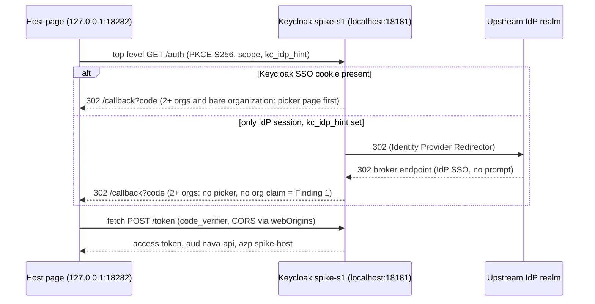

# ADR-007 spike S1: host-client token and top-level sign-in

TICK-806 (PLAN-008 P8-01). It answers RFC-017 §7 S1 for ADR-007 D1. Run on 2026-11-14.

## Verdict: **FAIL**

`Resolve` refuses one of the pass paths. A user in two orgs who requests bare `organization` on a **first** sign-in through `kc_idp_hint` gets **no picker**. Keycloak issues a token with **no `organization` claim**, and the unchanged `Resolve` returns 401 `tenant_unresolved: no organization`. This happens in both engines. Under the fixed pass conditions, any 401 from `Resolve` is a FAIL, and an ADR amendment is needed.

Every other pass condition holds:

| Pass condition (RFC-017 §7 S1, TICK-806) | Chromium, 3P cookies blocked | WebKit |
|---|---|---|
| Single-org token (`organization`, `organization:org-a`) resolves to tenant A with `Resolve` unchanged | PASS | PASS |
| Two-org user, `organization`, picker shown, picked org resolves: **with a Keycloak SSO session** | PASS | PASS |
| Two-org user, `organization`, picker shown, picked org resolves: **first sign-in via `kc_idp_hint`** | **FAIL**: no picker, no org claim, 401 | **FAIL**: same |
| Two-org user, `organization:org-b`, first sign-in and SSO | PASS (tenant B) | PASS (tenant B) |
| `organization:<alias>` of an org the user is not in: no org claim, 401 | Stricter than expected: **no token is issued**. Keycloak shows a sign-in form instead (see Finding 2) | Same |
| No prompt on a top-level redirect with an existing Keycloak session | PASS | PASS |
| No prompt on a top-level redirect with only the brokered IdP session, with `kc_idp_hint` | PASS | PASS |
| Same, without `kc_idp_hint` | FAIL-UX: username form (Finding 3) | FAIL-UX: same |

## Findings

1. **FAIL: bare `organization` on a brokered first sign-in.** The realm's browser flow is the built-in one, and `realm-nava.json` defines no `browserFlow` either. In that flow, `Identity Provider Redirector` (the step `kc_idp_hint` triggers) is an ALTERNATIVE that runs before the `Organization` sub-flow, and the picker lives in that sub-flow. So a brokered first sign-in never reaches the picker. The organization mapper then finds several orgs and no selection, and it emits no claim. Without `kc_idp_hint`, the same first sign-in stops at the username form (Finding 3), so no prompt-free path exists. Two ways around it were seen working:
   - the host sends `organization:<alias>`, which D1 already prescribes for multi-tenant hosts;
   - the host makes a second top-level redirect with `organization` after the first sign-in. The Keycloak session then exists and the picker appears.

   Single-org users are unaffected: the mapper emits their only org.
2. **Wrong alias: Keycloak prompts instead of issuing a claimless token.** `organization:org-b` for a user only in org-a, or `organization:org-c` for the two-org user, ends at the realm's own username/password form ("Sign in to your account"). This happens even with a live SSO session. No token is issued, so nothing reaches `Resolve`. Tenant isolation holds, and holds more tightly than the condition assumed. The cost is UX: a brokered user has no local password, and the org-linked IdP button is hidden, so the form is a dead end.
3. **Without `kc_idp_hint`, an IdP-only session still prompts.** When only the upstream IdP session survives, Keycloak shows its identity-first username form. Nothing redirects to the IdP by email domain, because the org's IdP link sets only `kc.org.domain`, in the scratch realm and in `realm-nava.json`. With `kc_idp_hint=upstream` there is no prompt. The ADR accepts a prompt as a UX cost (FAIL-UX), recorded here. The platform's own sign-in sends `kc_idp_hint` too (`internal/identitystack/stack_test.go`).
4. **Third-party cookie blocking needs DevTools in Chromium 159.** `--test-third-party-cookie-phaseout` and profile preferences did not block third-party cookies under Playwright. The probe saw a `SameSite=None; Secure` cookie sent to a cross-site iframe. `Network.setCookieControls({enableThirdPartyCookieRestriction: true})` does block them. Every run repeats the probe: Chromium `thirdPartyCookieSentToIframe: false`, WebKit `false` (ITP default).

## What the next sign-in looks like



A prompt means a document committed on a Keycloak origin. A prompt-free sign-in commits only `/start` and `/callback` on the host; `s1.mjs` records every commit.

## Environment

| Item | Value |
|---|---|
| Keycloak image | `quay.io/keycloak/keycloak:26.8.1@sha256:3f3c5f8e03c614774b4bd9173b88391fefa4153bfc010d8012d59ad825377332`, `start-dev`, H2, scratch container `nava-spike-s1` |
| Realms | `spike-s1` (organizations on, built-in browser flow) and `spike-upstream` (the brokered IdP): `scratch/adr-007-s1/realm/` |
| Browsers | Playwright 1.65.1; Chromium 159.0.8154.6 (third-party cookies blocked by DevTools cookie controls); WebKit 27.2 |
| Sites | Host `http://127.0.0.1:18282` and Keycloak `http://localhost:18181` are different sites, so Keycloak's cookies are third-party to the host page |
| `Resolve` | `internal/identity/keycloak` at `main` `ed069dd5`, unchanged. The in-memory store binds org-a to tenant A and org-b to tenant B |

### Fixture choices

- Users are pre-linked to `upstream` (`federatedIdentities`), so first-broker-login adds no page of its own.
- Both bindings list the alias `upstream`, so the two-org user resolves in either tenant. Under the unchanged `Resolve` (A.1 step 3), a brokered user resolves in a second org only if that org's binding also lists the brokering IdP. This is ADR-001 behaviour, not new in ADR-007, but it limits which two-org users a multi-tenant host can serve.
- `organization` is an **optional** scope of `spike-host`, so the host has to request it.
- `accessTokenLifespan` is 300 s, the same as `nava`.

## Client JSON (`spike-host`, as Keycloak returns it)

Internal `id`, `access` and the empty `protocolMappers` are left out. The client is public and has no secret; `clientAuthenticatorType` is Keycloak's default field.

```json
{
  "clientId": "spike-host",
  "name": "S1 scratch: browser-only host app (ADR-007 D1)",
  "surrogateAuthRequired": false,
  "enabled": true,
  "alwaysDisplayInConsole": false,
  "clientAuthenticatorType": "client-secret",
  "redirectUris": ["http://127.0.0.1:18282/callback"],
  "webOrigins": ["http://127.0.0.1:18282"],
  "notBefore": 0,
  "bearerOnly": false,
  "consentRequired": false,
  "standardFlowEnabled": true,
  "implicitFlowEnabled": false,
  "directAccessGrantsEnabled": false,
  "serviceAccountsEnabled": false,
  "publicClient": true,
  "frontchannelLogout": false,
  "protocol": "openid-connect",
  "attributes": {
    "realm_client": "false",
    "post.logout.redirect.uris": "http://127.0.0.1:18282/",
    "pkce.code.challenge.method": "S256"
  },
  "authenticationFlowBindingOverrides": {},
  "fullScopeAllowed": false,
  "nodeReRegistrationTimeout": -1,
  "defaultClientScopes": ["nava-idp", "nava-api-audience", "basic"],
  "optionalClientScopes": ["organization"]
}
```

The `organization` scope uses `oidc-organization-membership-mapper` with `addOrganizationId: true`, as in `realm-nava.json`. `nava-api-audience` and `nava-idp` are copied from `realm-nava.json`.

## Token claims

Single-org user, top-level redirect with SSO, scope `openid organization`. Both engines give the same shape. The tokens have expired; `sid` and `jti` are session ids, not credentials.

```json
{
  "exp": 1794633199, "iat": 1794632899, "auth_time": 1794632899,
  "jti": "onrtac:9cd2a1af-793e-2e09-fad1-b1f3210e104c",
  "iss": "http://localhost:18181/realms/spike-s1",
  "aud": "nava-api",
  "sub": "0f000000-0000-4000-8000-000000000001",
  "typ": "Bearer",
  "azp": "spike-host",
  "sid": "cZHDSr_lUSqPJ9KVMjbJ3QsN",
  "scope": "openid organization",
  "idp": "upstream",
  "organization": { "org-a": { "id": "00000000-0000-4000-8000-0000000005a1" } }
}
```

The failing token (two-org user, first sign-in, `kc_idp_hint=upstream`, scope `openid organization`). It has no `organization` member:

```json
{
  "iss": "http://localhost:18181/realms/spike-s1", "aud": "nava-api",
  "sub": "0f000000-0000-4000-8000-000000000002", "typ": "Bearer",
  "azp": "spike-host", "scope": "openid organization", "idp": "upstream"
}
```

## Every scenario

`Resolve` results come from `go test -tags spike` against the real tokens. Rows are identical in Chromium (third-party cookies blocked) and WebKit.

| User | Step | Scope (`openid` +) | Hint | Prompts seen | Claim `organization` | `Resolve` |
|---|---|---|---|---|---|---|
| one | first sign-in (sets up the IdP session) | `organization` | `upstream` | upstream username+password (expected) | `org-a` | tenant A |
| one | redirect, Keycloak SSO | `organization` | — | none | `org-a` | tenant A |
| one | redirect, Keycloak SSO | `organization:org-a` | — | none | `org-a` | tenant A |
| one | redirect, alias not a member | `organization:org-b` | — | spike-s1 password form | no token | not reached |
| one | redirect, IdP session only | `organization` | `upstream` | none | `org-a` | tenant A |
| one | redirect, IdP session only | `organization` | — | spike-s1 username form | no token | not reached |
| multi | first sign-in, picker expected | `organization` | `upstream` | upstream username+password; **no picker** | **absent** | **401 no organization** |
| multi | redirect, Keycloak SSO | `organization` | — | organization picker; picked org-a | `org-a` | tenant A |
| multi | redirect, Keycloak SSO | `organization:org-b` | — | none | `org-b` | tenant B |
| multi | redirect, alias not a member | `organization:org-c` | — | spike-s1 password form | no token | not reached |
| multi | first sign-in | `organization:org-b` | `upstream` | upstream username+password (expected) | `org-b` | tenant B |

## Reproduce

```sh
cd scratch/adr-007-s1
npm install && npx playwright install chromium webkit
sh run-keycloak.sh          # prints the image digest
node s1.mjs                 # out/report.json: prompts and decoded claims
go test -tags spike -count=1 -v .   # within 300 s: Resolve on every token
docker rm -f nava-spike-s1
```
