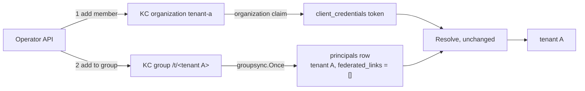

# ADR-007 spike S2: service account as an organization member

**SPIKE: PASS.** Task TICK-807 (PLAN-008 P8-02). It gates S24 (D4). Run on 2026-11-14.

Sync does not pick the account up on its own. The ADR's pass rule allows for that: the evidence must name the smallest change that makes sync write the row. That change needs **no sync code**: the operator also places the service-account user in the tenant's root group `/t/<tenant_id>`. With that placement, the sync and `Resolve` code on `main` pass every condition. The D4 fallback (a hardcoded-claim mapper plus a `Resolve` branch) is **not needed**.

## How it was run

`sh scratch/adr-007-s2/run.sh` starts a throwaway Keycloak `26.8.1` (start-dev, with the compose realm `nava` imported) and a throwaway PostgreSQL `16.10`. It then runs `scratch/adr-007-s2/s2_test.go` (`-tags spike`). The database is built the way `docker compose up` builds it: `db-roles`, then every migration. Tenants A and B are bound to organizations `tenant-a` and `tenant-b`.

The test calls production code from `main` and changes none of it:

- `keycloak.Directory`, logged in as `nava-groupsync`
- `groupsync.Syncer.Once`
- `pgstore`
- `keycloak.Adapter.Resolve`

Raw output, with token claims and table rows: `scratch/adr-007-s2/evidence-raw.md`.

The client is `s2-host-backend`:

- confidential, with only the service-account grant turned on;
- `fullScopeAllowed=false`;
- default scopes `basic`, `roles`, `organization` and `nava-api-audience`, the same tenant-token scopes `nava-web` has, without the user-only ones.

## Results against the pass conditions (RFC-017 §7 S2)

| # | Condition | Observed | Result |
|---|---|---|---|
| C1 | The token has exactly one `organization` entry | Keycloak accepts the service-account user as an organization member (`POST /organizations/{id}/members` → 201, no guard, as TA F10 read from the source). The `client_credentials` token carries `organization: {"tenant-a": {"id": "<org A>"}}`, `aud: nava-api`, `azp: s2-host-backend`, `typ: Bearer` and a 300 s lifetime | PASS |
| C2 | Sync creates a `principals` row with `LinksKnown = true` and no links | **As-is: no row.** Sync reads the members of groups under `/t/<tenant_id>/` (TICK-73 ruling, 2026-10-25), not organization members. **After the operator puts the user in group `/t/<tenant A>`**, the next sync writes exactly one row: tenant A, `email NULL`, `enabled true`, `federated_links = []`. No row appears in tenant B | PASS with the named change |
| C3 | `Resolve` returns that tenant | As-is: 401 `tenant_unresolved` ("principal not synced"). After the group placement and sync: tenant A, groups `[]`, `idp ""`. A token minted before the placement also resolves, because `Resolve` reads the row at request time | PASS with the named change |
| C4 | The same account in two organizations → 401 | With the default scope, Keycloak **leaves out** the `organization` claim for a two-organization service account. `Resolve` answers 401 `tenant_unresolved` ("no organization") | PASS |



## What this means for P8-16 (TICK-821)

The smallest change is in provisioning, not in sync or `Resolve`:

1. **Provisioning.** Creating the integration principal makes two Keycloak calls together: add the service-account user to the tenant's organization, and add it to the root group `/t/<tenant_id>`. Both use admin routes the platform already uses.
2. **`kind = integration` has no column yet.** `principals` has no `kind` today. The ADR's `kind = integration` therefore needs a migration, owned by the Postgres & Data Modeling Specialist, plus a way for sync to set it, for example from the `service-account-` username prefix or the Keycloak `serviceAccountClientId`. None of the pass conditions needs it. CI-E5, the attribution work and the "no impersonation" rule do.
3. **One tenant is not enforced by Keycloak.** Here the account was a member of both organizations but placed only in tenant A's group. It could still request a single organization:

| `scope` requested | Organizations in the token | `Resolve` |
|---|---|---|
| `organization:tenant-a` | `tenant-a` only | tenant A |
| `organization:tenant-b` | `tenant-b` only | 401 (no principal synced in B) |
| `organization:*` | both | 401 (organization count) |

What kept tenant B closed is the group placement, not the organization count. If the account were also placed in `/t/<tenant B>`, then `scope=organization:tenant-b` would resolve to tenant B. So P8-16 must:

- refuse in the operator API to add an integration service account to a second organization or a second `/t/` group;
- have CI-E5 cover "integration principal in two tenants' subtrees" as a refused case.

Restricting the client's scopes cannot do this job: dynamic `organization:<alias>` is available whenever the `organization` scope is assigned. This fits RR2: an integration principal never spans tenants.

## Reproduce

```sh
sh scratch/adr-007-s2/run.sh   # needs Docker; ~1 min; removes both containers on exit
```
