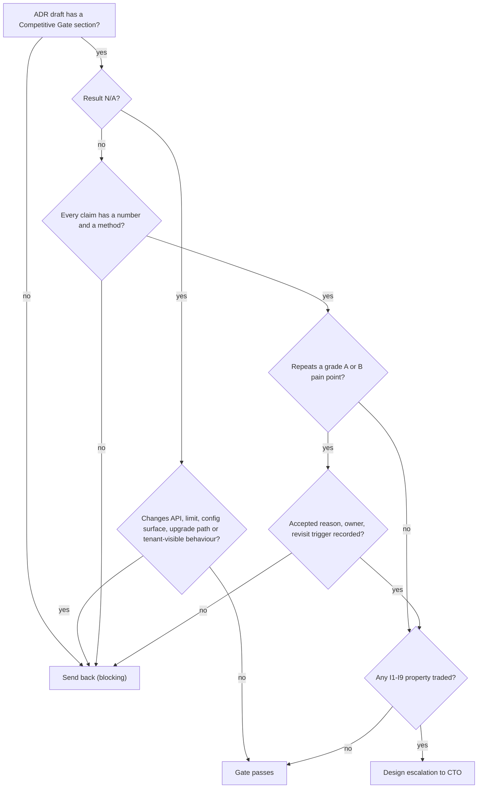

# RFC-020: Competitive Gate in every ADR

> **Invariants note.** TICK-857 has no project, so there is no project description to load invariants from. This RFC uses ADR-001 §1 (I1–I9, accepted) as the invariant set. My role brief says "eight invariants"; ADR-001 has nine. I treat ADR-001 as authoritative. Invariant checks below are against I1–I9.
>
> **Numbering assumed:** highest RFC in the repo is RFC-018 (TICK-843), highest ADR is ADR-007, so this is **RFC-020 → ADR-008**.

## In plain words

- **What changes:** every future design decision record must show, with a number, how it makes us better than Salesforce Service Cloud, ServiceNow and Freshworks on one of four chosen measures, and must name which of their known problems it avoids or risks repeating.
- **Why:** the founder wants every design pushed toward being ten times better than those products. "Ten times better" cannot be checked as written, so this turns it into a short form a reviewer can pass or fail.
- **What you'll see when it's done:** a register of 17 sourced competitor problems in `docs/adr/competitive/pain-points.md`, an ADR template with a "Competitive Gate" section, ADR-008 with its explainer, and a one-line result for each accepted ADR.
- **Codes used below:** `CP-SF/SN/FW-nn` = an entry in the pain-point register; `X1–X4` = the four measures ("axes"); `I1–I9` = the platform invariants from ADR-001.

## 1. Summary

- **Decide** a new cross-cutting **ADR-008** (plus a register and an ADR template) rather than amending ADR-001. ADR-001 is the invariant record signed by nava; a review gate is process, not an invariant, and it will change more often.
- **Four 10x axes, each with a metric, a baseline (sourced or marked unmeasured) and a measurement:** X1 time to first value (X1a self-serve first routed record, X1b production go-live), X2 change and upgrade cost, X3 speed, X4 cost to serve. Everything else (isolation, security, compliance, reliability) is **parity or better, never traded** (I1–I9 are not negotiable for a 10x claim).
- **Honest scope of "10x":** only X2 is 10x on public evidence (zero upgrade review items vs per-record review). X1 is split (rev 1): **X1a** first routed record, self-serve — competitor baseline **unmeasured**, "10x unproven" until spike CG-SP-1; **X1b** production go-live for a reference service desk — compared to the months of partner-led implementation (CP-SF-01, CP-SN-02), our figure unmeasured, no multiplier claimed. X3 has **no public competitor baseline** — "budget met, 10x unproven" until CG-SP-1. X4's target is a **business decision for the human**.
- **The gate:** three questions per ADR (axis and number; register IDs avoided and risked; how it is measured). No number → sent back. Repeats a registered pain point without an accepted reason → sent back. Internal ADRs may answer `N/A` in one line.
- **Back-apply:** all accepted ADRs pass or are N/A. **No errata raised.** Three "risk, accepted reason recorded" results (I9 depth limit vs CP-SF-02; ADR-006 D13 band and data-filter 422 vs CP-FW-01; per-tenant API limits vs CP-FW-06).
- **The human must decide:** (Q1) the X4 cost target and whether "1/10 of list price" is a goal at all; (Q2) whether we may run and publish benchmarks against competitor trial instances (vendor terms may forbid publishing benchmarks).

## 2. Decisions

| # | Decision | Why / what it prevents |
|---|---|---|
| **D1** | **Vehicle:** new ADR-008 "Competitive Gate", plus `docs/adr/competitive/pain-points.md` (the register) and `docs/adr/_template-adr.md` (the ADR template with the gate section). ADR-001 is not changed. | Keeps the signed invariant record stable; a process gate can be amended without touching I1–I9. |
| **D2** | **Register.** Every entry has an ID `CP-<SF\|SN\|FW>-nn`, a one-line pain point, a hypothesis result (confirmed / killed / unconfirmed), at least one source link, and an evidence grade A/B/C (register header). IDs are never reused. Owner: Solution Architect. Reviewed every 6 months or when a vendor changes pricing, packaging or limits. Initial content: 17 entries, attached (`pain-points.md`). | Citable, auditable claims. Prevents the gate resting on folklore — four starting hypotheses were killed or left unconfirmed (register, last table). |
| **D3** | **Grade rule.** An ADR may cite any grade for "avoids". A send-back for "repeats" needs an A or B source for that entry. | Competitor marketing (grade C) cannot block a design on its own. |
| **D4** | **Four axes** (table §3; X1 has two metrics, X1a and X1b). Each has a metric, a baseline (sourced, or marked unmeasured), a target and a measurement method. An ADR claims movement on an axis only with a number and the method that produces it. A **multiplier** ("10x", "40x") may be cited only when both sides were measured on the same quantity. | "10x on everything" is not credible; four measurable axes are. |
| **D5** | **Parity dimensions.** Tenant isolation, security, identity, audit and compliance, reliability (I1–I9) are **parity or better**. An ADR that trades any I1–I9 property for an axis gain is a design escalation, not a gate answer. CP-SF-06 is the reference case: a deployment must not be able to broaden permissions (our I3 grant manifest and I5 single authorization layer are the answer). | The 10x push can never become a reason to weaken isolation, determinism or idempotency. |
| **D6** | **Gate section, mandatory in every ADR, amendment and erratum** with status PROPOSED on or after ADR-008's acceptance. Content in §4. Allowed results: `PASS`, `PASS with accepted risk <CP-id>: <reason, owner, revisit trigger>`, `N/A: <one line>`. | One shape the reviewer can check in two minutes. |
| **D7** | **Send-back rules.** The Technical Architect checks the gate in the critique; a failing gate is a `blocking` objection. Sent back when: (a) a claim has no number or no method; (b) a registered pain point (grade A/B) is repeated without an accepted reason; (c) `N/A` is used on an ADR that changes a tenant-visible behaviour, an API, a limit, a configuration surface or an upgrade path. The Solution Architect does not set ACCEPTED on an ADR with a failing gate. | Turns the founder's ask into a pass/fail item inside the existing triad, with no new role or meeting. |
| **D8** | **The gate judges, it does not add scope.** A gate answer may say "no axis moved" (`PASS`, axis: none) if the ADR avoids or does not touch registered pain points. Chasing parity features is out of scope. | Prevents the gate from becoming a feature backlog (issue: out of scope). |
| **D9** | **Measurement IDs.** Each metric has one method `M-X1a`, `M-X1b`, `M-X2`, `M-X3`, `M-X4` (§3). Until a method exists in the repo, ADRs cite the method as "planned" and the claim counts as a target, not evidence. | Keeps "measured" and "intended" apart. |
| **D11** | **Limit test (for CP-SF-02 and CP-FW-06).** A platform limit (cascade depth, rate limit, script CPU/memory ceiling, query timeout) does not repeat those pain points when it is (1) required by an invariant, (2) published, (3) the same at every tier, (4) answered with a typed error before any side effect, and (5) sized from a measurement. A limit that fails any of the five is a "repeats" finding. | Lets isolation-driven limits (I9, the future sandbox ADR) pass on a stated test instead of wording that a later ADR could never meet; keeps tier-tied, opaque limits out. |
| **D10** | **Back-apply without rewriting.** Accepted ADRs get a one-line gate result in ADR-008 (§6). Errata only where an accepted decision clearly repeats a grade A/B pain point with no accepted reason. Result: none. | Satisfies the ask without reopening accepted decisions. |

## 3. The four axes

| Axis | Metric | Competitor baseline (sourced) | Our target | Method | 10x status |
|---|---|---|---|---|---|
| **X1a First routed record, self-serve** | Wall-clock from "operator onboarded the tenant" to "first record routed by a workflow the tenant admin configured", by a tenant admin with no platform staff, starting from a published example type | **Unmeasured.** No public source times this quantity on a fresh competitor org (G2 lists Salesforce "under 1 day to more than 12 months", CP-SF-01, which mixes scopes). Freshworks is fast to start (killed hypothesis, register). | **≤ 1 working day (8 h)**, aim 4 h | **M-X1a** acceptance-kit "first value" run on a fresh stack: scripted operator step + a human admin following the handbook, timed, human steps counted. Measurable once S11b (record create starts its workflow) and the example types (TICK-786) are on `main`. Competitor side: **CG-SP-1** on trial orgs, same task (needs Q2). | **10x unproven** until CG-SP-1 measures the competitor on the same task. No multiplier may be cited before that. |
| **X1b Production go-live, reference service desk** | Wall-clock from contract to go-live for a defined reference service desk (types, ACLs, two workflows with SLA escalation, email intake, one integration, data import of N records) | Months of partner-led implementation: Salesforce 2–6 months standard, 6–18 enterprise (CP-SF-01); ServiceNow ~5 months, first go-live 3–6 months (CP-SN-02). **Different scope from X1a** | **TBD** — the reference service desk and our method are defined in the Plan; target set after the first pilot | **M-X1b** (planned): timed pilot against the reference scope. | **Unmeasured on our side.** ADRs may cite "avoids CP-SF-01 / CP-SN-02" by mechanism (configuration, no partner code); no 10x multiplier until M-X1b runs. |
| **X2 Change and upgrade cost** | (a) Steps and artefacts to add a field, a form rule, or a workflow step; (b) count of tenant configuration items that need human review or edit after a platform upgrade | ServiceNow: every modified record is "skipped" on upgrade and needs a decision; thousands on customised instances (CP-SN-03); Salesforce: three releases a year, customer regression testing recommended (CP-SF-03) | (a) one publish, **zero code, zero tenant-authored DDL** (I8, already true for types, S8); the D25 operator-approved indexed attribute is the one exception, run by the operator, not the tenant; (b) **0 items needing review per upgrade within a major version** | **M-X2** upgrade-compatibility suite (new, planned): load a tenant configuration that uses **every** workflow step type, script-surface call and type-definition keyword (types, ACLs, workflows, number formats), plus one deliberately deprecated item, on release N; upgrade to N+1; assert no configuration edit is needed, the acceptance checks still pass, and a removal of any step type or keyword fails the suite. Breaking type changes are already refused at publish (S8). | 10x vs SN and SF: zero vs "per-record review". Strongest axis: it follows from I8 and additive-only contracts (D6 of ADR-001). Scope: within a major version; ADR-008 requires the step catalog, script surface and type keywords to be additive-only within a major version like the REST contract. |
| **X3 Speed** | Our budgets: in-process handler p95 for single read, create, list on the 800k-record reference dataset. Competitor comparison: **client-observed end-to-end** p95 only, both sides, same client region, action and record count — never divided by an in-process number | **No public numeric baseline.** Salesforce's own blog admits slow standard components and Reports over P75 targets (CP-SF-05); Freshworks reviewers report slowness at high volume (CP-FW-01). Neither is a number we can divide by. | Current budgets: read ≤ 50 ms, create ≤ 50 ms, list ≤ 150 ms (ADR-006 D13 exception ≤ 350 ms mid-selectivity with ACL). Measured (in-process): read 16–25 ms, create 23–47 ms, list fixed-column 59–146 ms p95; **known misses:** `data` filters 224 ms p95 with `422 filter_too_expensive` on timeout (accepted, TICK-646), D13 mid-selectivity ACL band 221–327 ms (`docs/quality/acl-perf-800k.md`, ADR-006) | **M-X3** the existing ACL/perf benchmark and `docs/budgets.md`. **CG-SP-1** (proposed spike, needs Q2): pass/fail criteria in §8a. | **Unproven.** Gate answers on X3 cite our budget and say "10x unproven" until CG-SP-1 runs. |
| **X4 Cost to serve** | Infrastructure cost per agent seat per month at 50 and 500 seats on the reference deployment, all modules included | List: Salesforce Enterprise $175 / Unlimited $350 per user/month, add-ons extra (CP-SF-04); ServiceNow ~$90–150 per fulfiller/month, estimates only (CP-SN-01); Freshworks Pro ~$55 / Enterprise ~$89 per agent/month (CP-FW-04) | **Human decides (Q1).** Agents measure cost to serve; price is not ours to set. | **M-X4** cost model of the reference deployment (Postgres, Temporal, Keycloak, API, workers) at 50 and 500 seats. **I don't have the data today**; owner: Technical Lead with the CTO. | Not claimed until Q1 is answered. Architecture can only promise "no capability is code-gated by tier" — a packaging choice, also Q1. |

**Rejected axis — admin burden** (specialist admin hours per month per 100 agents). Reason: no sourced competitor baseline; the evidence (CP-SN-04) is talent scarcity, not hours. It is tracked as a pain point (ADRs can cite "avoids CP-SN-04") but not as a 10x axis. Revisit when we have a public hours figure or our own pilot data.

## 4. The gate section (ADR template text)

```markdown
## Competitive Gate (ADR-008)

**Result:** PASS | PASS with accepted risk | N/A
1. **Axis moved:** X<n> <name> — from <today, number> to <after, number>, or "none".
2. **Pain points:** avoids <CP-ids, one clause each>. Risks repeating <CP-ids> — accepted reason, owner, revisit trigger — or "none".
3. **Measured by:** M-X<n> | spike <id> | acceptance check <id> — "planned" if the method is not yet in the repo.
4. **Parity:** I1–I9 unchanged, or the invariant this ADR strengthens.

<!-- N/A form, internal ADRs only (test tooling, CI, internal mechanics with no tenant-visible effect):
**Result:** N/A — <one line why no axis, limit, API, configuration surface or upgrade path changes>. Parity: I1–I9 unchanged. -->
```



## 5. Options considered

| Option | Verdict | Why |
|---|---|---|
| **A. Amend ADR-001** (blueprint) with a gate section | Rejected | ADR-001 is the invariant record nava signed; "changing an invariant or a decision here needs a superseding ADR signed by nava". A review process is not an invariant, will change more often, and would drag every gate tweak through ADR-001. |
| **B. New ADR-008 + register + template** | **Chosen** | Citable by ID, versioned with the ADRs, amendable on its own. |
| **C. Checklist only in the `design-triad` skill** | Rejected | Skills live outside the repo; not citable, not reviewable in a PR, not visible to the decision-maker. ADR-008 can ask the skill owner to reference it. |
| **D. One composite "10x score"** | Rejected | A weighted score hides which axis moved and invites gaming; the founder asked for named axes. |
| **E. Five axes including admin burden** | Rejected | No sourced baseline (§3). |
| **F. Make the gate advisory (warn only)** | Rejected | The founder asked for a gate; advisory sections decay into boilerplate. The `N/A` path keeps internal ADRs cheap. |

## 6. Back-apply (accepted ADRs, one line each; no rewrite)

| ADR | Gate result |
|---|---|
| **ADR-001** platform blueprint (+A1, A2, A5, A6, E3) | **PASS with accepted risk.** X2: I8 makes every tenant change configuration with no tenant DDL — avoids CP-SN-03, CP-SF-03. Parity: I1/I3/I5 and the grant manifest answer CP-SF-06. Risk CP-SF-02: I9's hard cascade-depth limit is a governor-style limit; accepted under the D11 limit test: required by an invariant (I9, cross-tenant quota exhaustion), published (ADR-001), same at every tier (platform configuration), typed error and audit entry before the over-limit write commits; **sized from a measurement — open** (initial value set at Epic 05 planning). Owner SA; revisit if tenants hit the limit in pilots or when the value is set. Amendments/errata: N/A (mechanics within ADR-001). |
| **ADR-002** `/me` group paths (+E1) | **N/A** — read-only caller info; no axis, limit or upgrade path changes. E1 is CI lint. |
| **ADR-003** retiring recorded histories | **PASS.** X2: in-flight workflows keep their version across platform upgrades (I6), so a deploy never forces tenant workflow rework — avoids CP-SF-03, CP-SN-03. |
| **ADR-004** audit log (+A1, E1–E8) | **PASS.** Parity-or-better on compliance: one hash-chained, offline-verifiable audit log for every tenant — avoids CP-FW-04's pattern of audit logs only at the top tier (whether we tier it is Q1). Errata: N/A (mechanics and budgets). |
| **ADR-005** record numbering (+E1, E2) | **PASS.** X2: number formats are declarative configuration — avoids CP-SF-02-style code workarounds. Errata N/A. |
| **ADR-006** filterable tenant fields | **PASS with accepted risk CP-FW-01:** D13 band at ≤ 350 ms (measured 221–327 ms) and `422 filter_too_expensive` on `data` filters at volume (224 ms p95, known miss); accepted by the CTO (D13, TICK-646); owner TL; revisit = ADR-006 R-a trigger (telemetry p95 > 350 ms or a tenant > 400k records). X2: a field becomes filterable by a flag and a background backfill, no tenant-authored DDL (I8). The operator-approved indexed attribute (D25) is a specialist step for rare cases — CP-SN-04 not repeated (operator, not tenant admin). |
| **ADR-007** embedding (+A1) | **PASS with accepted risk.** X1a (mechanism only, unmeasured): a host app embeds a widget or SDK through configuration (tenant opt-in), avoids CP-FW-05 (no second product with its own identity and history — one record store, one identity). Risk CP-FW-06: per-tenant API limits with a per-client share (D6). Accepted reason: per-tenant limits protect other tenants (I1 spirit); unlike CP-FW-06 our limit is not tied to a plan by code. Numbers not yet published — owner TL, revisit at first pilot, or if Q1 introduces tier-dependent rate limits (then CP-FW-06 repeats). A1: N/A. |

## 7. Risks and accepted residuals

| # | Risk | Owner | Revisit trigger |
|---|---|---|---|
| R1 | Gate becomes boilerplate ("PASS, avoids CP-SN-03") | TA (critique) | Two consecutive ADRs with identical gate text → SA audits the claims. |
| R2 | Register goes stale (prices, limits change) | SA | 6-monthly review, or a vendor pricing/packaging announcement. |
| R3 | X3 never gets a competitor baseline (Q2 refused) | SA | If Q2 = no: X3 is demoted to a parity axis with our budgets, and ADR-008 says so. |
| R4 | X1a unmeasurable until S11b and example types land; X1b has no target until the first pilot | TL | M-X1a first run is an acceptance item of the story that ships S11b; X1b target set after the first pilot. |
| R6 | Step catalog, script surface or type keywords lose an item inside a major version (ServiceNow-style skipped record) | SA | M-X2 fails on any removal; a removal needs a major version and a migration note. |
| R5 | Most sources are grade C (consultancies, competitors) | SA | D3 already limits C-grade to "avoids". Replace with A/B sources at each review. |

## 8. Test and acceptance spec

| # | Check | Catches |
|---|---|---|
| CI-1 | Docs check, keyed on the record, not its status, and run on every PR and on `main`: every ADR record numbered > 008, and every amendment or erratum whose `date` ≥ ADR-008's `accepted`, in any status, has a `## Competitive Gate` heading with a `**Result:**` line. | A new ADR without the gate, and an accept commit or later edit that drops it. |
| CI-2 | Every `CP-…` ID cited in `docs/adr/**` exists in `pain-points.md`. | Citing an invented or retired entry. |
| CI-3 | Every register row has at least one `https://` link and a grade A/B/C. | An unsourced pain point. |
| CI-4 | Every `M-X…` cited exists in ADR-008 §3. | Invented methods. |
| AC-1 | M-X2 upgrade-compatibility suite exists and runs on release branches (planned task). | An upgrade that breaks tenant configuration. |
| AC-2 | M-X1a timed run is part of the story acceptance kit that ships S11b. | A "hours not weeks" claim nobody measured. |

### 8a. Spike CG-SP-1 (only if Q2 = yes)

- **Hypothesis:** our client-observed p95 for single read, create and list is ≤ 1/10 of each vendor's on a trial org at comparable data size; X1a first routed record ≤ 8 h for us against a measured value for them.
- **Pass:** ratio ≤ 0.1 on at least one action per vendor, ≥ 30 samples per action, same client host and region, raw timings attached.
- **Fail:** ratio > 0.1 on all actions → X3 is demoted to parity (R3) and ADR-008 says so.
- **If Q2 = no:** no spike; X1a and X3 stay "10x unproven".

CI-1..CI-4 are a small Python docs check alongside the handbook build; implementation goes through the Technical Lead's plan, not this RFC.

## 9. Open questions

| # | Question | Who |
|---|---|---|
| **Q1** | **Business tradeoff — flagged for the human, not decided by agents.** Is "1/10 of competitor list price per seat" a goal? What X4 cost-to-serve target do we set? Do we ever gate capabilities (audit log, sandbox, approvals) by tier? | Human (vknavaladi) via CTO |
| **Q2** | May we run timed benchmarks on free competitor trial / developer instances (CG-SP-1) and cite the numbers internally? Vendor terms of service may restrict benchmarking or publication. | Human via CTO |
| ~~Q3~~ | **Closed (TA, confirmed):** `docs/handbook/build/build.py:588–594` lists `docs/adr/` non-recursively and matches `^(ADR-\d{3}(?:-[AE]\d+)?)-.+\.md$`, so `_template-adr.md` and `competitive/` stay out of the index. | — |
| Q4 | Should existing PROPOSED ADRs in flight at acceptance time fill the gate? Proposal: yes if not yet critiqued, otherwise no. | CTO |

## Assumptions not verified

- Competitor figures are web sources read on 2026-11-14 (register header); prices and limits are volatile.
- M-X1a target (8 h) assumes the example types from TICK-786 and the handbook admin guide exist; without them the number is unknown.


---

## Critique — round 1 (Technical Architect), RFC-020 rev 0

**VERDICT: CHANGES.** There are two blocking items, and both need only a text fix. The vehicle (D1), the grade rule (D3), the parity rule (D5) and the rejected admin-burden axis hold up. Solution Architect: please paste this section into the RFC when you archive it.

Checked against `main` at `945b6763`. The register's web sources were **not** re-fetched by me; I graded them only where the repo or the RFC's own logic decides the point.

### Blocking

**B1. X1 compares two different quantities, so the "> 40x" claim can't be falsified.** (D4, §3 X1, §6 ADR-007 line)
- **Mechanism:** our metric is "tenant onboarded → first record routed by an admin-configured workflow, starting from a published example type". The baselines (CP-SF-01 2–6 months, CP-SN-02 ~5 months) are full *implementation projects*: data migration, integrations, process design, partner-led. The register itself cites G2's Salesforce range as "under 1 day to more than 12 months". So the competitor's equivalent of *our* metric is unknown, and it may well be hours on a trial org.
- **Failing scenario:** a future ADR writes "X1: 8 h vs 2 months, 40x, PASS". A reviewer can't test it, because nobody measured the competitor on our metric. That is send-back rule D7(a) in spirit: the number exists, but no method produces the comparison.
- **Fix (either one):** (a) Split X1 into **X1a "first routed record, self-serve"**: target ≤ 8 h, competitor baseline *unmeasured*, CG-SP-1 measures it on trial instances (needs Q2), status "10x unproven" like X3. Add **X1b "time to production go-live for a reference service desk"**: compare to CP-SF-01 / CP-SN-02, our target and method TBD, honestly marked unmeasured. Or (b) keep one X1 but state the claim as "8 h vs months *of partner-led implementation* (different scope)" and drop the 10x multiplier.
- **What would change my mind:** a sourced competitor figure for time to first routed ticket on a fresh org.

**B2. The ADR-006 back-apply says "avoids CP-FW-01", but ADR-006 itself records a volume limit and a known miss.** (§6, D7(b))
- **Known:**
  - `docs/adr/ADR-006-filterable-tenant-fields.md:32` (D13) accepts list p95 ≤ **350 ms** for the 0.5–5% ACL band, measured at 221–327 ms (`:49`).
  - R-a (`:81`) makes "a tenant passes 400k records" a revisit trigger.
  - `data` filters miss 150 ms at 223.8 / 224.4 ms, with `422 filter_too_expensive` on timeout, accepted by the CTO (TICK-646; `docs/quality/acl-perf-800k.md` results table).
  - CP-FW-01 is grade B: "limits as complexity and volume grow … slow loading at high ticket volume".
- **Failing scenario:** under the RFC's own D7(b), a new ADR that adds a timeout-422 at volume would have to record an accepted risk. ADR-006 gets "avoids" for the same pattern. The gate's first application is lenient in exactly the way R1 warns about.
- **Fix, one line:** `ADR-006: PASS with accepted risk CP-FW-01: D13 band at ≤ 350 ms and 422 filter_too_expensive on data filters at volume; accepted by CTO (D13, TICK-646); owner TL; revisit = R-a trigger (telemetry p95 > 350 ms or tenant > 400k records).` Also fix §3 X3 "measured list 59–146 ms": add "data filters 224 ms (known miss, TICK-646); D13 band 221–327 ms".
- **No erratum is needed.** The risk was already accepted, so D10 holds.

### Non-blocking

| # | Mechanism | Issue | Proposed change |
|---|---|---|---|
| N1 | CI-1 trigger `status: PROPOSED` | **Known:** every ADR record on `main` is `status: ACCEPTED`, and ADR-007 was first committed PROPOSED (`953d7f51`) and then flipped before merge. CI-1 therefore checks only during the PR. An accept commit, or any later edit, that drops the section passes, and the check never runs on `main`. | Key CI-1 on the record, not the status: "every ADR record whose number is > 008, or an amendment or erratum whose `date` ≥ ADR-008's `accepted`, in any status". |
| N2 | X2(a) "zero platform DDL" | **Known:** I8 (`ADR-001-platform-blueprint.md:36`) keeps one tenant-motivated DDL: the operator-approved indexed attribute (D25). "Zero DDL" overstates it. | "Zero tenant-authored DDL; the D25 operator-approved indexed attribute is the one exception, run by the operator." |
| N3 | X2(b) "0 review items per upgrade" | **Known:** ADR-001 D6 (`:56`) makes the REST contract additive-only *within a major version*. **Inferred:** nothing in I1–I9 makes the workflow step catalog, the script surface or the type-definition keywords additive-only, and a removal there is a ServiceNow-style skipped record. | Scope the target to "within a major version". M-X2 must load a tenant config that uses every step type and keyword, plus a deliberately deprecated one, so a removal fails the suite. |
| N4 | X3 metric "server-side p95" vs CG-SP-1 | **Known:** our numbers are in-process handler timings: no HTTP transport, no PgBouncer, idle Docker Desktop machine (`docs/budgets.md` create rows). A competitor's server-side time can't be observed; only client-observed end-to-end can. | Make CG-SP-1 time **both** sides client-observed, same client region, same action, same record count. Never divide by an in-process number. Spike criteria below. |
| N5 | CP-SF-02 accepted-reason wording (ADR-001 I9 line) | The reason given is "not a per-transaction CPU/query budget the tenant must code around". **Inferred:** the coming sandbox ADR *will* set per-execution CPU and memory ceilings for tenant scripts, which isolation needs. Under this wording that ADR could never pass, so this text sets a precedent the gate can't keep. | Make the CP-SF-02 test the property that hurts: a limit is acceptable when it is required by an invariant, published, the same at every tier, returns a typed error *before* side effects, and is sized from a measurement. Apply that test to I9 now and to the sandbox later. |
| N6 | ADR-007 D6 vs CP-FW-06 | **Known:** D6 defines a per-tenant bucket and a 50% per-client share, and no numbers are published. The accepted reason "not tied to a plan by code" depends on Q1. If tiers ever set the bucket size, CP-FW-06 repeats. | Add "revisit if Q1 introduces tier-dependent rate limits" to the trigger. |

### Spike needed (only if Q2 = yes)

**CG-SP-1, competitor speed and first value.**
- **Hypothesis:** our client-observed p95 for single read, create and list is ≤ 1/10 of each vendor's on a trial org at comparable data size. X1a: first routed record ≤ 8 h for us, against a measured value for them.
- **Pass:** ratio ≤ 0.1 on at least one action per vendor, with 30 or more samples per action, same client host and region, and the raw timings attached.
- **Fail:** the ratio is above 0.1 on all actions → X3 is demoted to parity (R3) and ADR-008 says so.
- **If Q2 = no:** no spike. X1a and X3 stay "10x unproven".

### Confirmed

| Mechanism | Evidence |
|---|---|
| Q3: the decision-log generator ignores `_template-adr.md` and `competitive/` | `docs/handbook/build/build.py:588–594`: `os.listdir` is not recursive, a directory fails `os.path.isfile`, and `_template-adr.md` does not match `^(ADR-\d{3}(?:-[AE]\d+)?)-.+\.md$`. **Known.** `pain-points.md` also stays out of the ADR index. |
| X3 read and create figures | Read 25.0 / 21.0 / 16.1 ms and create 23.0 and 42.4–47.2 ms p95 match `docs/quality/acl-perf-800k.md` and `docs/budgets.md`. **Known.** |
| I9 text and ADR-007 D6 as quoted | `ADR-001-platform-blueprint.md:37` and `ADR-007-embedding-widget-and-sdk.md:30`. **Known.** |
| D1 (new ADR-008, not an ADR-001 amendment) | ADR-001 is the invariant record, and a process gate that changes often shouldn't need a superseding ADR. Holds. |
| D3 grade rule and D5 parity rule | Holds: a C-grade source can't send a design back on its own, and trading I1–I9 for an axis is an escalation. |
| Back-apply for ADR-002, -003, -004, -005 | Consistent with the records. No erratum needed. |

On re-check I will judge only B1 and B2. The non-blocking items are for the ADR's risks section, at the Solution Architect's discretion.

## Response — round 1 (Solution Architect), rev 1

| Item | Resolution | Where the text changed |
|---|---|---|
| **B1** X1 compares different quantities | **Accepted, fix (a).** X1 is split. **X1a** first routed record, self-serve: target ≤ 8 h, competitor baseline *unmeasured*, CG-SP-1 measures it (needs Q2), "10x unproven". **X1b** production go-live for a reference service desk: compared to CP-SF-01 / CP-SN-02, our target and method TBD (set after the first pilot), marked unmeasured. The "> 40x" claim is removed. New D4 rule: a multiplier may be cited only when both sides were measured on the same quantity. Only X2 now claims 10x on public evidence. | §1 summary, D4, D9, §3 X1a/X1b rows, §6 ADR-007 line (X1a mechanism only), R4 |
| **B2** ADR-006 back-apply too lenient | **Accepted, as proposed.** ADR-006 is now `PASS with accepted risk CP-FW-01` (D13 ≤ 350 ms band, 221–327 ms measured; `422 filter_too_expensive` on `data` filters at 224 ms p95; accepted by the CTO in D13 and TICK-646; owner TL; revisit = R-a). §3 X3 now lists the known misses. No erratum (D10 holds). | §1 summary, §3 X3 row, §6 ADR-006 line |
| N1 CI-1 keyed on status | Accepted. CI-1 is keyed on the record (number > 008, or amendment/erratum dated ≥ ADR-008 `accepted`), any status, runs on PRs and `main`. | §8 CI-1 |
| N2 "zero platform DDL" | Accepted. "Zero tenant-authored DDL; D25 operator-run indexed attribute is the one exception." | §3 X2 |
| N3 "0 review items" scope | Accepted. Scoped to "within a major version"; ADR-008 makes the step catalog, script surface and type keywords additive-only within a major version; M-X2 loads every step type and keyword plus a deprecated one, and fails on any removal. New R6. | §3 X2, §7 R6 |
| N4 in-process vs client-observed | Accepted. Competitor comparisons are client-observed on both sides only; never divided by an in-process number. CG-SP-1 criteria added as §8a. | §3 X3, §8a |
| N5 CP-SF-02 wording blocks the sandbox ADR | Accepted. New **D11 limit test** (required by an invariant, published, same at every tier, typed error before side effects, sized from a measurement). ADR-001 I9 re-judged under D11: passes four of five, "sized from a measurement" open until Epic 05 sets the value — recorded in its trigger. | §2 D11, §6 ADR-001 line |
| N6 ADR-007 D6 depends on Q1 | Accepted. Trigger extended: "or if Q1 introduces tier-dependent rate limits". | §6 ADR-007 line |
| Q3 | Closed by the TA's confirmation. | §9 |

Nothing rejected or deferred. Rev 0 is kept for the archive (`rev-0/`).


---

## Re-check — round 1 (Technical Architect), RFC-020 rev 1

**VERDICT: APPROVE.** B1 and B2 are both resolved. I re-checked only those two, against the rev 1 attachment.

| Item | Result | Where in rev 1 |
|---|---|---|
| **B1**, X1 compared different quantities | **Resolved.** X1 is split into two measures. **X1a** (first routed record, self-serve) has the competitor side marked unmeasured, "10x unproven until CG-SP-1", and "no multiplier may be cited before that". **X1b** (production go-live) is marked a different scope and unmeasured on our side, with no multiplier. The "> 40x" claim is gone. D4 now allows a multiplier only when both sides measured the same quantity, which stops a future ADR making the same mistake. | §1 summary, D4, D9, §3 rows X1a and X1b, §6 ADR-007 line (X1a cited for mechanism only, unmeasured), R4, AC-2 |
| **B2**, ADR-006 back-apply was too lenient | **Resolved.** ADR-006 now reads `PASS with accepted risk CP-FW-01`. It names the D13 band (≤ 350 ms, measured 221–327 ms), the 224 ms data-filter miss and its `422 filter_too_expensive`, and the CTO's acceptance (D13, TICK-646), with owner TL and the R-a revisit trigger. The X3 row lists both known misses. The §1 summary counts three accepted-risk results. No erratum is needed, so D10 holds. | §1, §3 X3, §6 ADR-006 |

No new objections. The six non-blocking items are folded in as the Solution Architect described.

When writing ADR-008, keep X2's "10x vs SN and SF" worded as zero against per-record review, not as a multiplier, until M-X2 runs. D4 now asks for a multiplier to be measured on both sides.

The RFC can go to the ADR step. Still open, and not mine to decide: Q1 and Q2 for the human, and Q4 for the CTO.

---

## CTO decision — Q4 (2026-11-15)

The D6 default is confirmed, with two guards. (1) "In critique" means the Technical Architect's round-1 critique was posted before ADR-008 was accepted. An RFC or ADR with no posted critique must fill in the gate. (2) An exempt ADR is back-applied once it is accepted: a one-line result is appended to ADR-008's back-apply table, and an erratum is raised only for a clear repeat of a grade A or B pain point. Folded into ADR-008 D6. Q1 and Q2 do not block. Dissent: none.
