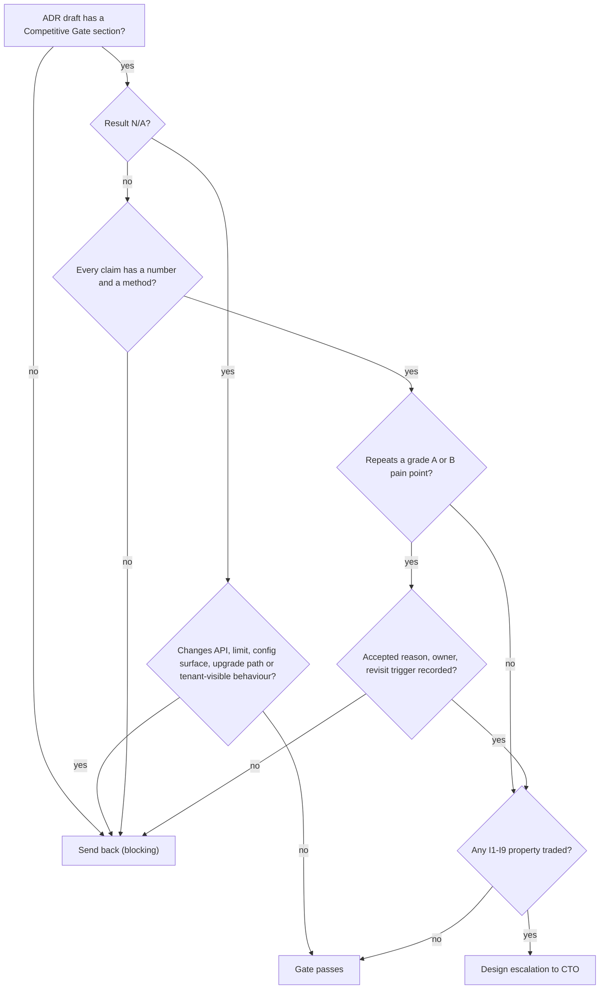

# RFC-020: Competitive Gate in every ADR

> **Invariants note.** TICK-857 has no project, so there is no project description to load invariants from. This RFC uses ADR-001 §1 (I1–I9, accepted) as the invariant set. My role brief says "eight invariants"; ADR-001 has nine. I treat ADR-001 as authoritative. Invariant checks below are against I1–I9.
>
> **Numbering assumed:** highest RFC in the repo is RFC-018 (TICK-843), highest ADR is ADR-007, so this is **RFC-020 → ADR-008**.

## In plain words

- **What changes:** every future design decision record must show, with a number, how it makes us better than Salesforce Service Cloud, ServiceNow and Freshworks on one of four chosen measures, and must name which of their known problems it avoids or risks repeating.
- **Why:** the founder wants every design pushed toward being ten times better than those products. "Ten times better" cannot be checked as written, so this turns it into a short form a reviewer can pass or fail.
- **What you'll see when it's done:** a register of 17 sourced competitor problems in `docs/adr/competitive/pain-points.md`, an ADR template with a "Competitive Gate" section, ADR-008 with its explainer, and a one-line result for each accepted ADR.
- **Codes used below:** `CP-SF/SN/FW-nn` = an entry in the pain-point register; `X1–X4` = the four measures ("axes"); `I1–I9` = the platform invariants from ADR-001.

## 1. Summary

- **Decide** a new cross-cutting **ADR-008** (plus a register and an ADR template) rather than amending ADR-001. ADR-001 is the invariant record signed by nava; a review gate is process, not an invariant, and it will change more often.
- **Four 10x axes, each with a metric, a sourced baseline and a measurement:** X1 time to first value, X2 change and upgrade cost, X3 speed, X4 cost to serve. Everything else (isolation, security, compliance, reliability) is **parity or better, never traded** (I1–I9 are not negotiable for a 10x claim).
- **Honest scope of "10x":** X1 and X2 are 10x against Salesforce and ServiceNow on public evidence; against Freshworks X1 is parity (they are fast to start). X3 has **no public competitor baseline** — it stays "budget met, 10x unproven" until spike CG-SP-1. X4's target is a **business decision for the human**.
- **The gate:** three questions per ADR (axis and number; register IDs avoided and risked; how it is measured). No number → sent back. Repeats a registered pain point without an accepted reason → sent back. Internal ADRs may answer `N/A` in one line.
- **Back-apply:** all accepted ADRs pass or are N/A. **No errata raised.** Two "risk, accepted reason recorded" results (I9 depth limit vs CP-SF-02; per-tenant API limits vs CP-FW-06).
- **The human must decide:** (Q1) the X4 cost target and whether "1/10 of list price" is a goal at all; (Q2) whether we may run and publish benchmarks against competitor trial instances (vendor terms may forbid publishing benchmarks).

## 2. Decisions

| # | Decision | Why / what it prevents |
|---|---|---|
| **D1** | **Vehicle:** new ADR-008 "Competitive Gate", plus `docs/adr/competitive/pain-points.md` (the register) and `docs/adr/_template-adr.md` (the ADR template with the gate section). ADR-001 is not changed. | Keeps the signed invariant record stable; a process gate can be amended without touching I1–I9. |
| **D2** | **Register.** Every entry has an ID `CP-<SF\|SN\|FW>-nn`, a one-line pain point, a hypothesis result (confirmed / killed / unconfirmed), at least one source link, and an evidence grade A/B/C (register header). IDs are never reused. Owner: Solution Architect. Reviewed every 6 months or when a vendor changes pricing, packaging or limits. Initial content: 17 entries, attached (`pain-points.md`). | Citable, auditable claims. Prevents the gate resting on folklore — four starting hypotheses were killed or left unconfirmed (register, last table). |
| **D3** | **Grade rule.** An ADR may cite any grade for "avoids". A send-back for "repeats" needs an A or B source for that entry. | Competitor marketing (grade C) cannot block a design on its own. |
| **D4** | **Four axes** (table §3). Each has a metric, a sourced baseline, a target and a measurement method. An ADR claims movement on an axis only with a number and the method that produces it. | "10x on everything" is not credible; four measurable axes are. |
| **D5** | **Parity dimensions.** Tenant isolation, security, identity, audit and compliance, reliability (I1–I9) are **parity or better**. An ADR that trades any I1–I9 property for an axis gain is a design escalation, not a gate answer. CP-SF-06 is the reference case: a deployment must not be able to broaden permissions (our I3 grant manifest and I5 single authorization layer are the answer). | The 10x push can never become a reason to weaken isolation, determinism or idempotency. |
| **D6** | **Gate section, mandatory in every ADR, amendment and erratum** with status PROPOSED on or after ADR-008's acceptance. Content in §4. Allowed results: `PASS`, `PASS with accepted risk <CP-id>: <reason, owner, revisit trigger>`, `N/A: <one line>`. | One shape the reviewer can check in two minutes. |
| **D7** | **Send-back rules.** The Technical Architect checks the gate in the critique; a failing gate is a `blocking` objection. Sent back when: (a) a claim has no number or no method; (b) a registered pain point (grade A/B) is repeated without an accepted reason; (c) `N/A` is used on an ADR that changes a tenant-visible behaviour, an API, a limit, a configuration surface or an upgrade path. The Solution Architect does not set ACCEPTED on an ADR with a failing gate. | Turns the founder's ask into a pass/fail item inside the existing triad, with no new role or meeting. |
| **D8** | **The gate judges, it does not add scope.** A gate answer may say "no axis moved" (`PASS`, axis: none) if the ADR avoids or does not touch registered pain points. Chasing parity features is out of scope. | Prevents the gate from becoming a feature backlog (issue: out of scope). |
| **D9** | **Measurement IDs.** Each axis has one method `M-X1..M-X4` (§3). Until a method exists in the repo, ADRs cite the method as "planned" and the claim counts as a target, not evidence. | Keeps "measured" and "intended" apart. |
| **D10** | **Back-apply without rewriting.** Accepted ADRs get a one-line gate result in ADR-008 (§6). Errata only where an accepted decision clearly repeats a grade A/B pain point with no accepted reason. Result: none. | Satisfies the ask without reopening accepted decisions. |

## 3. The four axes

| Axis | Metric | Competitor baseline (sourced) | Our target | Method | 10x status |
|---|---|---|---|---|---|
| **X1 Time to first value** | Wall-clock from "operator onboarded the tenant" to "first record routed by a workflow the tenant admin configured", by a tenant admin with no platform staff, starting from a published example type | Salesforce 2–6 months standard, partner-led (CP-SF-01); ServiceNow ~5 months, first go-live 3–6 months (CP-SN-02); Freshworks: days (killed hypothesis, register) | **≤ 1 working day (8 h)**, aim 4 h | **M-X1** acceptance-kit "first value" run on a fresh stack: scripted operator step + a human admin following the handbook, timed, human steps counted. Measurable once S11b (record create starts its workflow) and the example types (TICK-786) are on `main`. | 10x vs SF and SN on public evidence (8 h vs ≥ 2 months is > 40x). **Parity** vs Freshworks — we do not claim 10x there. |
| **X2 Change and upgrade cost** | (a) Steps and artefacts to add a field, a form rule, or a workflow step; (b) count of tenant configuration items that need human review or edit after a platform upgrade | ServiceNow: every modified record is "skipped" on upgrade and needs a decision; thousands on customised instances (CP-SN-03); Salesforce: three releases a year, customer regression testing recommended (CP-SF-03) | (a) one publish, **zero code, zero platform DDL** (I8, already true for types, S8); (b) **0 items needing review per upgrade** | **M-X2** upgrade-compatibility suite (new, planned): load the acceptance-kit tenant configurations (types, ACLs, workflows, number formats) on release N, upgrade to N+1, assert no configuration edit is needed and the acceptance checks still pass. Breaking type changes are already refused at publish (S8). | 10x vs SN and SF: zero vs "per-record review". Strongest axis: it follows from I8 and additive-only contracts (D6 of ADR-001). |
| **X3 Speed** | Server-side p95 for single read, create, list on the 800k-record reference dataset | **No public numeric baseline.** Salesforce's own blog admits slow standard components and Reports over P75 targets (CP-SF-05); Freshworks reviewers report slowness at high volume (CP-FW-01). Neither is a number we can divide by. | Current budgets: read ≤ 50 ms, create ≤ 50 ms, list ≤ 150 ms (ADR-006 D13 exception ≤ 350 ms mid-selectivity with ACL). Measured: read 16–25 ms, create 23–47 ms, list 59–146 ms p95 (`docs/quality/acl-perf-800k.md`) | **M-X3** the existing ACL/perf benchmark and `docs/budgets.md`. **CG-SP-1** (proposed spike, needs Q2): same three actions, timed end-to-end, on free trial/developer instances of each vendor. | **Unproven.** Gate answers on X3 cite our budget and say "10x unproven" until CG-SP-1 runs. |
| **X4 Cost to serve** | Infrastructure cost per agent seat per month at 50 and 500 seats on the reference deployment, all modules included | List: Salesforce Enterprise $175 / Unlimited $350 per user/month, add-ons extra (CP-SF-04); ServiceNow ~$90–150 per fulfiller/month, estimates only (CP-SN-01); Freshworks Pro ~$55 / Enterprise ~$89 per agent/month (CP-FW-04) | **Human decides (Q1).** Agents measure cost to serve; price is not ours to set. | **M-X4** cost model of the reference deployment (Postgres, Temporal, Keycloak, API, workers) at 50 and 500 seats. **I don't have the data today**; owner: Technical Lead with the CTO. | Not claimed until Q1 is answered. Architecture can only promise "no capability is code-gated by tier" — a packaging choice, also Q1. |

**Rejected axis — admin burden** (specialist admin hours per month per 100 agents). Reason: no sourced competitor baseline; the evidence (CP-SN-04) is talent scarcity, not hours. It is tracked as a pain point (ADRs can cite "avoids CP-SN-04") but not as a 10x axis. Revisit when we have a public hours figure or our own pilot data.

## 4. The gate section (ADR template text)

```markdown
## Competitive Gate (ADR-008)

**Result:** PASS | PASS with accepted risk | N/A
1. **Axis moved:** X<n> <name> — from <today, number> to <after, number>, or "none".
2. **Pain points:** avoids <CP-ids, one clause each>. Risks repeating <CP-ids> — accepted reason, owner, revisit trigger — or "none".
3. **Measured by:** M-X<n> | spike <id> | acceptance check <id> — "planned" if the method is not yet in the repo.
4. **Parity:** I1–I9 unchanged, or the invariant this ADR strengthens.

<!-- N/A form, internal ADRs only (test tooling, CI, internal mechanics with no tenant-visible effect):
**Result:** N/A — <one line why no axis, limit, API, configuration surface or upgrade path changes>. Parity: I1–I9 unchanged. -->
```



## 5. Options considered

| Option | Verdict | Why |
|---|---|---|
| **A. Amend ADR-001** (blueprint) with a gate section | Rejected | ADR-001 is the invariant record nava signed; "changing an invariant or a decision here needs a superseding ADR signed by nava". A review process is not an invariant, will change more often, and would drag every gate tweak through ADR-001. |
| **B. New ADR-008 + register + template** | **Chosen** | Citable by ID, versioned with the ADRs, amendable on its own. |
| **C. Checklist only in the `design-triad` skill** | Rejected | Skills live outside the repo; not citable, not reviewable in a PR, not visible to the decision-maker. ADR-008 can ask the skill owner to reference it. |
| **D. One composite "10x score"** | Rejected | A weighted score hides which axis moved and invites gaming; the founder asked for named axes. |
| **E. Five axes including admin burden** | Rejected | No sourced baseline (§3). |
| **F. Make the gate advisory (warn only)** | Rejected | The founder asked for a gate; advisory sections decay into boilerplate. The `N/A` path keeps internal ADRs cheap. |

## 6. Back-apply (accepted ADRs, one line each; no rewrite)

| ADR | Gate result |
|---|---|
| **ADR-001** platform blueprint (+A1, A2, A5, A6, E3) | **PASS with accepted risk.** X2: I8 makes every tenant change configuration with no tenant DDL — avoids CP-SN-03, CP-SF-03. Parity: I1/I3/I5 and the grant manifest answer CP-SF-06. Risk CP-SF-02: I9's hard cascade-depth limit is a governor-style limit; accepted reason: it bounds cross-tenant quota exhaustion, it is platform configuration with a typed error and an audit entry, not a per-transaction CPU/query budget the tenant must code around. Owner SA; revisit if tenants hit the limit in pilots. Amendments/errata: N/A (mechanics within ADR-001). |
| **ADR-002** `/me` group paths (+E1) | **N/A** — read-only caller info; no axis, limit or upgrade path changes. E1 is CI lint. |
| **ADR-003** retiring recorded histories | **PASS.** X2: in-flight workflows keep their version across platform upgrades (I6), so a deploy never forces tenant workflow rework — avoids CP-SF-03, CP-SN-03. |
| **ADR-004** audit log (+A1, E1–E8) | **PASS.** Parity-or-better on compliance: one hash-chained, offline-verifiable audit log for every tenant — avoids CP-FW-04's pattern of audit logs only at the top tier (whether we tier it is Q1). Errata: N/A (mechanics and budgets). |
| **ADR-005** record numbering (+E1, E2) | **PASS.** X2: number formats are declarative configuration — avoids CP-SF-02-style code workarounds. Errata N/A. |
| **ADR-006** filterable tenant fields | **PASS.** X3 measured: list p95 ≤ 150 ms (exception ≤ 350 ms, D13); X2: a field becomes filterable by a flag and a background backfill, no tenant DDL (I8). Avoids CP-FW-01. The operator-approved indexed attribute (D25) is a specialist step for rare cases — CP-SN-04 not repeated (operator, not tenant admin). |
| **ADR-007** embedding (+A1) | **PASS with accepted risk.** X1: a host app embeds a widget or SDK through configuration (tenant opt-in), avoids CP-FW-05 (no second product with its own identity and history — one record store, one identity). Risk CP-FW-06: per-tenant API limits with a per-client share (D6). Accepted reason: per-tenant limits protect other tenants (I1 spirit); unlike CP-FW-06 our limit is not tied to a plan by code. Numbers not yet published — owner TL, revisit at first pilot. A1: N/A. |

## 7. Risks and accepted residuals

| # | Risk | Owner | Revisit trigger |
|---|---|---|---|
| R1 | Gate becomes boilerplate ("PASS, avoids CP-SN-03") | TA (critique) | Two consecutive ADRs with identical gate text → SA audits the claims. |
| R2 | Register goes stale (prices, limits change) | SA | 6-monthly review, or a vendor pricing/packaging announcement. |
| R3 | X3 never gets a competitor baseline (Q2 refused) | SA | If Q2 = no: X3 is demoted to a parity axis with our budgets, and ADR-008 says so. |
| R4 | X1 unmeasurable until S11b and example types land | TL | M-X1 first run is an acceptance item of the story that ships S11b. |
| R5 | Most sources are grade C (consultancies, competitors) | SA | D3 already limits C-grade to "avoids". Replace with A/B sources at each review. |

## 8. Test and acceptance spec

| # | Check | Catches |
|---|---|---|
| CI-1 | Docs check: every `docs/adr/ADR-*.md` with `status: PROPOSED` and `date` ≥ ADR-008 acceptance has a `## Competitive Gate` heading with a `**Result:**` line. | A new ADR without the gate. |
| CI-2 | Every `CP-…` ID cited in `docs/adr/**` exists in `pain-points.md`. | Citing an invented or retired entry. |
| CI-3 | Every register row has at least one `https://` link and a grade A/B/C. | An unsourced pain point. |
| CI-4 | Every `M-X…` cited exists in ADR-008 §3. | Invented methods. |
| AC-1 | M-X2 upgrade-compatibility suite exists and runs on release branches (planned task). | An upgrade that breaks tenant configuration. |
| AC-2 | M-X1 timed run is part of the story acceptance kit that ships S11b. | A "hours not weeks" claim nobody measured. |

CI-1..CI-4 are a small Python docs check alongside the handbook build; implementation goes through the Technical Lead's plan, not this RFC.

## 9. Open questions

| # | Question | Who |
|---|---|---|
| **Q1** | **Business tradeoff — flagged for the human, not decided by agents.** Is "1/10 of competitor list price per seat" a goal? What X4 cost-to-serve target do we set? Do we ever gate capabilities (audit log, sandbox, approvals) by tier? | Human (vknavaladi) via CTO |
| **Q2** | May we run timed benchmarks on free competitor trial / developer instances (CG-SP-1) and cite the numbers internally? Vendor terms of service may restrict benchmarking or publication. | Human via CTO |
| Q3 | Does the ADR template live at `docs/adr/_template-adr.md`, and does the decision-log index generator ignore `_`-prefixed files and the `competitive/` folder? | Technical Lead (verify before the ADR PR) |
| Q4 | Should existing PROPOSED ADRs in flight at acceptance time fill the gate? Proposal: yes if not yet critiqued, otherwise no. | CTO |

## Assumptions not verified

- Competitor figures are web sources read on 2026-11-14 (register header); prices and limits are volatile.
- The decision-log generator's handling of new files under `docs/adr/` (Q3).
- M-X1 target (8 h) assumes the example types from TICK-786 and the handbook admin guide exist; without them the number is unknown.
