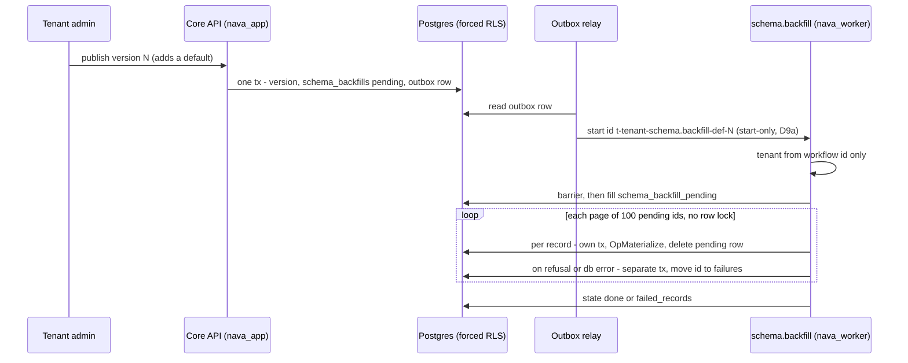
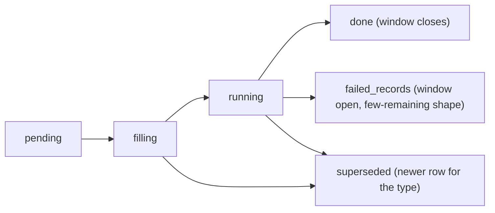

# RFC-021 · needs_backfill publishes: durable backfill, and reads, filters and uniqueness across schema versions

> **Invariants source.** The project description is empty, so there is no list of eight invariants to load. This RFC is checked against [[ADR-001-platform-blueprint]] §1 **I1–I9** (nine). If the project is meant to have its own list of eight, the invariant checks below are **incomplete** against it.
>
> **Numbering.** RFC-021 is the next number after RFC-020. The ADR is assumed to be **ADR-009**.
>
> **Rev 1 changelog (round 1).** Every blocking item is resolved. §13 has the item-by-item response.
> - **D2:** the tenant now comes from the workflow id `t:<tenant>:schema.backfill:…`. The workflow takes no tenant argument (Security **B1**).
> - **D2:** `schema.backfill` is start-only (Security **B2**).
> - **D7:** a new `schema_backfill_pending` table is the work queue. Each record is written in **its own transaction** with no batch row lock (Technical Architect **TA-2**, Postgres **PG-4**, PG-6, CTO ruling).
> - **D8:** there is no lock on `entity_definitions` and no new grant (Technical Architect **TA-1**, CTO ruling).
> - **D5:** `OpMaterialize` keeps `updated_at` (Technical Architect **TA-3**).
> - **D12:** the filter picks its shape from the number of records still lacking the value (Postgres **PG-6**).
> - **D15:** the rollout migration only enqueues (Postgres PG-8, Security N2).
> - Non-blocking items folded in: N1, N3, PG-9 and TA-4.
> - Corrections: the RLS allow-list holds 11 entries, not 10. The Temporal entry is on the `nava-relay` D9a start rule.
> - CI-3 is rewritten as Security listed. CI-12 now carries the measured numbers.

## In plain words

A tenant admin can publish a new version of a record type that gives a field a **default** (the value a record gets when nobody sets one). Today the platform stores that version and does nothing else. Old records never get the value written. Opening a record shows the default, because the read code fills it in on the fly. Searching does not: `filter[priority]=3` only finds records where `3` is actually stored. So one record can show `priority: 3` and still be missing from a search for priority 3.

This RFC makes three changes:
1. After such a publish, a **background job** rewrites the old records through the normal write path, one record at a time, for one tenant and one record type, until every record holds the value.
2. **While that job has work left, searches also match the default**, so results are correct from the moment of publish.
3. A field that must be **unique** can no longer have a default, because a default gives every record the same value.

## 1. Summary

- **Recommendation: Design A.** A publish that adds a default queues a durable `schema.backfill` workflow in the publish transaction. The job first lists the records that lack a default in `schema_backfill_pending`. Then it rewrites each one through the write pipeline (I4) in **its own transaction**: version +1, new ETag, **`updated_at` kept**, one audit entry, system actor `schema-backfill`. It **starts no tenant workflows** and **signals no waiting runs**, because the record's effective value does not change.
- **Tenant scoping is structural.** The tenant comes **only from the workflow id** `t:<tenant>:schema.backfill:<entity_definition_id>:<target_version>`, which the relay builds from the outbox row the publish committed (I2). The workflow has no tenant argument. It runs as `nava_worker` under forced RLS, with no new role, no new grant on existing tables, no new RLS allow-list entry and no `BYPASSRLS` (I1, I3). It needs one Temporal entry: the type is **start-only** on the `nava-relay` D9a rule.
- **Measured cost (Technical Architect spike, real pipeline):** each record is one transaction with no batch lock. Live-write p95 rose **+1.7%** at 20k records, with 2 conflicts, and a publish during the run took 49 ms. The rev-0 batch lock gave +28% at 20k and +416% at 100k. Pure work is 7.3 ms and about 4 KB of WAL per record, so a 100k-record type takes about 12 minutes plus pauses and writes about 400 MB of WAL. **The 100k run with per-record transactions is not yet measured.**
- **One rule for reads:** stored value, then the current version's default for any top-level key the record lacks. Audit diffs show the stored bytes as written.
- **Filters match effective values.** While records still lack the default, a filter that the default satisfies also matches them. The SQL shape depends on how many remain: an `OR <key absent>` scan when many remain, a `UNION ALL` driven by the pending list when few remain (0.45 ms against 98.6 ms measured).
- **Uniqueness stays on stored values.** `default` together with `x-nava-unique` is refused at publish (422).
- **Class table:** unchanged except one cell. *Making an existing property required* becomes `needs_backfill` when the property has a default. Removing a property, narrowing an enum, and adding a required property with no default stay **Breaking**.
- **The human/CTO must accept:** about 4 KB of WAL and one audit row per rewritten record, one 412 per edit form open during a rewrite, and records whose `version` moves while their `updated_at` does not.

## 2. Context (`main` at `ecedb2e9`)

| Fact | Where |
|---|---|
| The classifier returns `needs_backfill` for "add required with default" and "add default to existing". "Add optional **with** default" is `compatible`, but it leaves the same gap. | `internal/metadata/classify.go:39-75` |
| Publish locks `entity_definitions … FOR UPDATE`, stores `compat`, and starts nothing. | `internal/entitytypes/entitytypes.go:305-323` |
| Single read and list both apply **current** defaults. | `internal/server/records.go:247-252`, `records_list.go:453` |
| An update applies current defaults, validates against current, moves `schema_version`, sets `updated_at = now` (`pipeline.go:822`), and always bumps the version and appends audit (`pipeline.go:728-846`). There is no "nothing changed" path. | `internal/records/pipeline/pipeline.go` |
| The pipeline reads the current definition **inside each write's transaction** (`Pipeline.perform` → `defs.Current`). | TA-1 |
| After a database error or an `audit.Append` failure, "tx is unusable". Validation, unique and declarative refusals happen before any SQL. | `pipeline.go:425-441` (PG-4) |
| `ApplyDefaults` fills **top-level** absent keys only. | `internal/metadata/validate.go:83-93` |
| The data filter matches stored JSON only. | `internal/server/records_list.go:216-226` |
| Uniqueness reads stored values. | `internal/records/store/unique.go:65-110` |
| Every update starts every `on_updated` definition and signals every run waiting on the record. | `eventsink.go:88-130` |
| `nava_worker` has only `SELECT` on `entity_definitions`. A row lock needs UPDATE privilege. | `db/grants.yaml:207` (TA-1) |
| A worker's tenant comes from the `t:<tenant>:` workflow-id prefix (`workerguard.TenantOf`). `audit.seal` is the model start-only system workflow. | `internal/workerguard/tenant.go:46`, `temporal-server/authz/policy.go:244-248`, `internal/audit/seal/activities.go:161` |
| The RLS allow-list (policies that do not test `app.tenant_id`) holds **11** entries. | `internal/db/catalog/policy.go:27` |
| ADR-006 D4 trigger copies stored `data -> key` on `UPDATE OF data`. D9 is the snapshot barrier. D10 is the adaptive pause. | [[ADR-006-filterable-tenant-fields]] |

A published default **never changes or disappears** ("change or remove a default" is Breaking). Every rule below depends on this (trigger T1).

## 3. Bounded contexts and domain model

| Context | New in this RFC |
|---|---|
| Metadata engine | `Classify` also returns `AddedDefaults`. Compile refuses `default` together with `x-nava-unique`. One cell of the class table changes. |
| Entity types | Publish inserts the `schema_backfills` row and the outbox row in its transaction. |
| Record write pipeline | `OpMaterialize`: empty patch, system only, compares before SQL, keeps `updated_at`, sink suppressed. |
| Records read and list | Shared `effective()` shaping. D12 filter shapes. |
| Workflow worker | `schema.backfill` workflow plus activities. |
| Temporal authorizer | `schema.backfill` in `platformWorkflowTypes` **and** `startOnlyWorkflowTypes`, on the `nava-relay` D9a start rule. |
| ADR-006 side tables (S21) | The D12 shape on the side-table predicate. No trigger change. |

All three new tables are **tenant tables**: `ENABLE` + `FORCE ROW LEVEL SECURITY`, the canonical tenant policy, a PK led by `tenant_id`, and a composite FK `(tenant_id, entity_definition_id)` to `entity_definitions`. Grants come from `db/grants.yaml`.

**`schema_backfills`** is one row per job. PK `(tenant_id, entity_definition_id, target_version)`. Columns:
- `default_keys text[]`: every top-level default in the target version;
- `state` (`pending` → `filling` → `running` → `done` | `failed_records` | `superseded`);
- counters `rewritten`, `skipped`, `failed`;
- `publish_audit_id`, `started_at`, `finished_at`;
- `last_error`, a code only.

**`schema_backfill_pending`** is the work queue (PG-6). PK `(tenant_id, entity_definition_id, target_version, record_id)`. One row per record that lacked a default at fill time. A row is deleted **in the same transaction** as its record's rewrite, or when the record turns out to need no write.

**`schema_backfill_failures`** holds `(tenant_id, entity_definition_id, target_version, record_id, code)`. PK is the same as pending. It holds ids and typed codes only, never field values.

**Remaining count** of type T = rows in `pending` + `failures` for T's newest `schema_backfills` row, capped at 1,001. The **window is open** while that count is above 0, or while the newest row is in `pending` or `filling`.

## 4. Decisions

| # | Decision | Why / what it prevents |
|---|---|---|
| **D1** | **Trigger.** A publish whose next version adds at least one top-level default that the previous version lacked (every `needs_backfill`, and `compatible` "optional with default") does two things **in the publish transaction**: it inserts `schema_backfills(state='pending')` and an outbox row with `kind='schema.backfill'`, `dedupe_key='schema-backfill:<entity_definition_id>:<version>'`. Other publishes queue nothing. | A job exists if and only if the publish committed (I6). The `compatible` case has the same bug. |
| **D2** | **Actor and tenant scoping.** The relay starts workflow type `schema.backfill` with id **`t:<tenant_id>:schema.backfill:<entity_definition_id>:<target_version>`**, built from the outbox row (`outbox.tenant_id` is the RLS-written tenant, I2). The workflow takes **no tenant argument**. Every activity derives the tenant with `workerguard.TenantOf(activity.GetInfo(ctx).WorkflowExecution.ID)`, the `audit.seal` `RunOf` pattern. That value is `app.tenant_id` for `InTenantTx` **and** the explicit `tenant_id = $1` in every statement. Activities parse `entity_definition_id` and `target_version` from the id and check them against the `schema_backfills` row under RLS. A missing row is a non-retryable stop. **Temporal:** `schema.backfill` goes into `platformWorkflowTypes` and `startOnlyWorkflowTypes` (`policy.go:244-248`), allowed only on the `nava-relay` D9a start rule, so no worker command can start it as a child or continue-as-new it. **Database:** it runs as `nava_worker`, with no new role, no grant on any existing table, no new entry in the 11-entry RLS allow-list, and no `BYPASSRLS`. **Pipeline:** `Source=system` (already on the A1 authorizer-skip list), `actor_system='schema-backfill'`, `source_ref='schema_backfills:<entity_definition_id>:<target_version>'`, causation origin `publish_audit_id` at depth +1 (I9). One job is one tenant and one type, and no runtime path loops over tenants (the D15 migration is the one listed exception). | B1: a tenant taken from the input is a tenant taken from a payload, so an input naming B would run B's backfill. B2: without start-only, a tenant workflow could start a mass rewrite of its own type under a system identity, which falsifies the audit. |
| **D3** | **Write path.** For each pending record the activity calls `pipeline.Write` with `Op=OpMaterialize` and an empty patch. That runs current defaults, then JSON Schema, then declarative checks, then the unique check, then commit with audit (I4), and skips the authorizer and masks as any system source does. **`OpMaterialize` compares `ApplyDefaults(stored)` with `stored` before any SQL write.** If they are equal (a user write already filled the key), it bumps nothing, writes no audit, and only deletes the pending row (TA-4). `validate` refuses `OpMaterialize` unless the patch is empty, `Source == SourceSystem` and `actor_system == 'schema-backfill'` (N1). | One write pipeline. `OpMaterialize` cannot become a general authorizer-free write. Audit and WAL scale with the records that actually change. |
| **D4** | **Audit.** One entry per rewritten record: `action=update`, `source=system`, `actor_system='schema-backfill'`, normal before and after snapshots, and `occurred_at` set as usual. There is no batch-summary entry in place of them. The job writes one `entity_type`-domain entry at start and one at finish, with counts. | Per-record history stays complete (ADR-004 R1). |
| **D5** | **Version, ETag, `updated_at`.** `version` +1, so the ETag changes. `schema_version` moves to current. **`OpMaterialize` keeps `updated_at` as stored** (TA-3). When the rewrite happened is in the audit entry's `occurred_at`. A client holding the old ETag gets `412 version_conflict` once. | I4's one-bump-per-write. Rewriting `updated_at` reordered the default list mid-run, and a paging client **missed 10% of records** in TA-3. Keeping it also keeps `updated_at` syncs quiet for a non-change. A side effect, inferred but not measured: the update becomes HOT-eligible. |
| **D6** | **No events.** For `OpMaterialize` the event sink starts no `on_updated` definitions, signals no waiting runs, and writes no outbox rows. | The effective value is unchanged. Otherwise 100k records × N definitions start 100k·N workflows. |
| **D7** | **Work queue, one transaction per record** (TA-2, PG-6, CTO ruling).  1. **Fill.** One activity runs the ADR-006 D9 snapshot barrier, then in one `InTenantTx`: `INSERT INTO schema_backfill_pending SELECT … FROM records WHERE tenant_id=$1 AND entity_definition_id=$2 AND NOT (data ?& $default_keys)`. State goes to `running`. Measured: 441 ms and 11 MB for 60k ids. The barrier makes sure no write begun under an older version can commit after the fill.  2. **Rewrite.** Each activity reads pending in `record_id` order, 100 ids per page, **with no row lock**. Each record gets its own `InTenantTx` with `SET LOCAL synchronous_commit = off`: `OpMaterialize`, then `DELETE` of its pending row in the same transaction. The only row lock is the pipeline's own `UPDATE … WHERE version = $n` on that one record.  3. **Outcomes per record.** On a version conflict, the record is skipped and stays pending for the next pass. On a typed pre-SQL refusal (validation, unique, declarative) or a database error, the transaction rolls back, and a **separate** `InTenantTx` moves the id from pending to `schema_backfill_failures` with its code. No savepoints, no bisect.  4. **Pause and limits.** The pause between pages is the ADR-006 D10 adaptive controller. One data backfill per tenant at a time, shared with `FieldIndexBackfill`. A platform cap on concurrent tenant backfills per worker pool starts at 4 (unverified).  5. **End.** When pending is empty, the state is `done` (0 failures) or `failed_records`. | The batch lock made user writes wait for a whole batch and then fail with 412: +416% p95 at 100k (TA-2). A database error in a 100-record transaction rolled back the failure row too and livelocked (PG-4). Savepoints overflow the 64-subxact cache (TA-5). The queue writes 34 rows when 34 records lack the key, instead of walking 100k (PG-6). `synchronous_commit=off` is safe: a commit lost in a crash leaves the id pending, and the rerun is idempotent (I7). |
| **D8** | **Publish during a job** (TA-1, CTO ruling). **No lock on `entity_definitions`, and no new grant or policy.** Each per-record write reads the current definition in its own transaction, as a user write does, so a publish that commits mid-run applies from the next record. Before each page the activity reads `schema_backfills` (its own table). If a newer row exists for the type, it sets its own row to `superseded`, deletes its own pending rows, and ends. The newer job's fill uses **all** of the target version's defaults (`default_keys`), so it covers every key the superseded job left. A publish that adds no default queues nothing and supersedes nothing. | The rev-0 `FOR SHARE` failed with `42501` as `nava_worker`. With only a grant it returned 0 rows silently, and it needs a new UPDATE policy (I3). It also delayed a publish to 3.3–7.7 s. With per-record transactions, publish mid-run took 49 ms. PG-9 is moot. |
| **D9** | **Poison records.** See D7.3. One bad record never blocks a type. A `failed_records` type keeps its window open, so filters stay correct, served by the D12 few-remaining shape. No field value goes into a failure row or a log. | Failures are bounded and visible. |
| **D10** | **Status surface.** `GET /entity-types/{key}` gains `backfill: {state, target_version, rewritten, skipped, failed, remaining, started_at, finished_at}` under the entity-type read ACL. **Reading the failure ids (`GET /entity-types/{key}/backfill/failures`) needs the entity-type admin permission** (N3). | Admins can see why records lag. Ids and codes go only to people who can change the type. |
| **D11** | **Reads across versions (Q2).** Every surface that returns a record body (single, list, GraphQL, embed SDK, workflow record read, any future export) uses one function, `effective(rec) = cur.ApplyDefaults(rec.Payload(fixedColumnsOf(rec.SchemaVersion)))`, then masks. **Audit diffs and snapshots show stored bytes** and never apply defaults. | One answer per record. Audit stays evidence. |
| **D12** | **Filters across versions (Q3).** The contract is that `filter[f]` matches the **effective** value. While T's window is open, and only for a field `f` in `default_keys` whose predicate is true for the current default (evaluated in Go), the handler picks a shape from the remaining count it already reads (PG-6):  • **remaining > 1,000:** `(<stored predicate>) OR <f absent>`, where absent is `NOT (r.data ? 'f')`, or `r.<col> IS NULL` for a fixed column. Measured 0.3–0.6 ms (PG-6 A) and 7.0 ms against a 197.9 ms plain scan (TA-7).  • **remaining ≤ 1,000:** `(<stored predicate>) UNION ALL (records joined to pending ∪ failures for T, AND <f absent> AND NOT <stored predicate>)`, with the ACL and the other filters ANDed into **both** branches. Measured 0.45 ms against 98.6 ms (PG-6 B).  `total` uses the same shape. A closed window uses the plain plan. This applies to the JSONB `@>` path and to the ADR-006 side-table predicate (S21). The D4 trigger and D10 are unchanged (PG-7 confirmed). The 1,001 switch point is a starting value that S21 measures. | Correct from publish. The few-remaining case, including a long-lived `failed_records`, stays at index cost instead of 750× (PG-6). |
| **D13** | **Uniqueness (Q4).** Compile refuses a top-level property with both `default` and `x-nava-unique: true` (422 `invalid_schema`, with the pointer). The unique check stays on stored values. | Removes the stored-versus-effective question and the unique-value oracle (Security confirmed). |
| **D14** | **Remaining classes (Q5).** The fail-closed table stays, with one change: *making an existing property required* is `needs_backfill` when the next version has a default for it, and stays Breaking otherwise. Removing a property, narrowing an enum, adding a required property with no default, and changing or removing a default stay **Breaking (refused)**. No transforms (trigger T2). | Only that case can be materialised without losing data. |
| **D15** | **Rollout** (PG-8, N2). One migration, the **one listed exception** to "no tenant loop". For each tenant, with `app.tenant_id` set and subject to `FORCE`, and for each entity type whose current version has **any** default, it inserts a `schema_backfills` row and a `schema.backfill` outbox row, idempotent on the dedupe key. **It writes no `data`, and it does not scan `records`.** The D7 fill finds the records, and a type with nothing to fill becomes a no-op job. Before inserting, it refuses to run if any current version has `default` + `x-nava-unique` (assumption 4). | Covers types published before this ships, without a cross-tenant scan on the deploy path. |

## 5. Q2 read table

| Surface | Shape | Defaults |
|---|---|---|
| `GET /records/{entity}/{id}`, list | stored, under own version's fixed-column mapping | current version's, for absent top-level keys |
| GraphQL, embed SDK, workflow record read, future export | same function | same |
| Audit diff and snapshots | stored bytes at that write | **none** |

## 6. Flow

## 7. Candidate designs

| | Design | Verdict |
|---|---|---|
| **A** | Pending queue, per-record pipeline writes, effective-value filters while records remain | **Recommended** |
| A-batch | Rev 0: keyset batches of 100 under `FOR UPDATE SKIP LOCKED` | **Rejected in round 1:** +416% live p95 and 73 conflicts at 100k (TA-2). Livelock on a database error (PG-4). The fixes need savepoints, which overflow the subxact cache (TA-5). |
| B | Never backfill. Compute effective values in every query forever | **Rejected:** a permanent unindexable cost, and defaults duplicated into plpgsql. |
| C | Bulk `UPDATE … data \|\| defaults` from a migrator-class job | **Rejected:** bypasses I4. Uses an operator credential for a tenant action (I8). |
| D | Lazy only, with stored-only filters | **Rejected:** this is the reported bug. |
| E | Refuse defaulted-field filters while the job runs | **Rejected:** unusable on large types. |

## 8. Invariants touched

| Inv. | How it holds |
|---|---|
| I1 | Three new tenant tables with `FORCE RLS` and a PK led by `tenant_id`. No change to the RLS allow-list (stays at **11**, `internal/db/catalog/policy.go:27`). |
| I2 | The tenant comes only from the workflow id, which the relay builds from `outbox.tenant_id`. The workflow input carries no tenant. Ids are checked against the RLS-visible `schema_backfills` row. |
| I3 | `nava_worker` gets DML on the three new tables only. There is no grant on `entity_definitions` or any other existing table (TA-1). |
| I4 | Every rewrite is a pipeline write with expected version, validation and audit. |
| I5 | The system source skips the authorizer, as today. The D12 shapes AND the ACL predicate into every branch. |
| I6 | Started only by the relay from a committed outbox row. Start-only, so no worker can start it. All I/O is in activities. |
| I7 | The workflow id is per target version, and the outbox has a dedupe key. A rewrite and its pending-row delete commit together, so a replay finds the id gone or the record already holding the key (D3 compare). A commit lost under `synchronous_commit=off` leaves the id pending. |
| I8 | No DDL, no tenant code. D15 uses the migrator to enqueue only. |
| I9 | Causation origin is the publish audit entry, depth +1. No events, so no cascade. |

## 9. Risks and accepted residuals

| # | Risk | Owner | Revisit trigger |
|---|---|---|---|
| R1 | Write and WAL volume: about 4 KB WAL per record (≈400 MB per 100k). `records` grew 204→318 MiB and `audit_log` 53→161 MiB at 100k (TA-6). 7.3 ms of pure work per record, so a 100k type takes about 12 min plus pauses. | Postgres & Data Modeling Specialist | CI-12 at 100k with per-record transactions shows live p95 > +25% at pause 0, or wall time > 30 min |
| R2 | One 412 per edit form open on a record when it is rewritten | Solution Architect | support reports, or the embed SDK lacks automatic re-read on 412 |
| R3 | The many-remaining `OR NOT (data ? f)` shape is a seq scan (no worse than the plain scan, TA-7). The few-remaining shape depends on the 1,001 switch point. | Technical Architect | S21 measures a p95 above ADR-006 D13's 150 ms at 400k for either shape |
| R4 | **Sort** on a defaulted field while the window is open places records that lack it as null | Solution Architect | any tenant-visible report. Fix: `COALESCE` in the sort key while the window is open |
| R5 | Sealer lag from 100k audit rows (not measured) | Postgres & Data Modeling Specialist | CI-12 sealer lag > the ADR-004 SLO |
| R6 | `failed_records` keeps the window open. Filters stay cheap (D12), but the records stay unmaterialised. | Technical Lead | any type in `failed_records` > 7 days. Depends on OQ-4 |
| R7 | The design depends on "a published default never changes" | Solution Architect | **T1:** any RFC that makes changing or removing a default non-Breaking |
| R8 | `version` moves while `updated_at` does not. A client that infers "changed" from `updated_at` will not see the rewrite (the value it sees is unchanged anyway). | Solution Architect | an integration that depends on `updated_at` moving whenever `version` does |

## 10. Test and acceptance spec

| ID | Test | Catches |
|---|---|---|
| CI-1 | A publish that adds a default inserts the version, a `schema_backfills` row and an outbox row in one tx. A forced rollback leaves none. A publish with no added default inserts neither. | D1 |
| CI-2 | 500 old records, plus 50 that already hold the key: afterwards each of the 500 holds the key, has `version+1`, **the same `updated_at`**, and exactly one audit entry with `actor_system='schema-backfill'`. The 50 have **0 audit entries and an unchanged version** (TA-4). Zero workflow starts and zero signals, with an `on_updated` definition and a waiting run on the type. | D3–D6 |
| CI-3 (cross-tenant and identity, Security list) | (1) A D9a start of `schema.backfill` with an id that has no `t:` prefix is denied, in `temporal-server/authz/workload_schema_backfill_test.go`, following `workload_audit_seal_test.go`. (2) A child start and a continue-as-new of `schema.backfill` from a worker command are both denied (start-only). (3) A job with id `t:A:…` changes zero rows of tenant B, even when B has the same entity key and its own `schema_backfills` and pending rows. (4) `OpMaterialize` with a non-empty patch, a non-system source, or another `actor_system` is refused (N1). (5) An activity with no `app.tenant_id` reads zero rows. (6) As `nava_app` or `nava_worker` in tenant A, `schema_backfills`, `schema_backfill_pending` and `schema_backfill_failures` show zero B rows, and an insert with B's `tenant_id` is refused. (7) D15: every inserted row's `tenant_id` equals its `entity_definitions.tenant_id`. | D2, D15, I1, I2 |
| CI-4 | 4 live writers on the type during the job: no lost update. A live write never waits on more than one record's rewrite. Live 412s happen only on a real interleave (≤ 5 per 20k, against 2 measured). | D7 |
| CI-5 | Publish N+1 (another default) mid-run: N ends `superseded` with its pending rows gone, N+1 ends `done`, and every record holds both keys. A publish of N+1 that adds no default during N's run: N continues, and its writes land on N+1. Publish latency mid-run is within 2× idle. | D8 |
| CI-6 | Poison records: (a) a validation refusal, and (b) a database error (a CHECK violation forced in the test). Each gives one failure row with id and code and no value, and the job continues past it. State ends `failed_records`. The failure ids are readable by an entity-type admin and 404 for a plain tenant user. | D7.3, D9, D10 |
| CI-7 | Filters with the window open: `filter[f]=<default>` returns the records that lack f, with the right `total`, in both shapes (remaining 60k and remaining 34), on the JSONB path and the S21 side-table path, with an ACL that hides some of them. `filter[f]=<other>` is unchanged. The results are identical after the window closes. | D12, I5 |
| CI-8 | Single, list and GraphQL bodies are equal. The audit diff shows stored bytes. | D11 |
| CI-9 | `default` + `x-nava-unique` → 422, nothing stored | D13 |
| CI-10 | Classifier: optional→required with default → `needs_backfill`; without → `breaking` | D14 |
| CI-11 | Relay redelivers the outbox row. An activity is retried after a record committed. The worker is killed mid-page with `synchronous_commit=off`. In every case: one workflow, and exactly one audit entry per rewritten record. | I7 |
| CI-12 (spike, ADR evidence) | 100k records, 4 live writers, per-record transactions: live p95 ≤ +25% at pause 0, wall time, WAL, sealer lag, and the **workflow history event count** (assumption 6). Measured so far: +1.7% at 20k, 7.3 ms and ~4 KB per record. **100k per-record is not yet run.** | R1, R5, B2 budget |

**API test scenarios (for the ADR):**
- `GET /entity-types/{key}` with and without `backfill`.
- `GET /entity-types/{key}/backfill/failures`: 200 for an entity-type admin, 404 for anyone else, 404 for a cross-tenant type (the same response as a missing one).
- Publish 422 under D13 writes nothing.
- No endpoint starts a job.

## 11. Assumptions not verified

1. ~~SKIP LOCKED and the pipeline load~~: moot. There is no batch lock (D7).
2. ~~`audit.Append` serialises writers~~: **confirmed false** (PG-3, TA-8).
3. The ADR-006 D10 per-tenant limiter can be shared by `schema.backfill`. It is not built yet. **Verify:** TA, with S21.
4. No current version has `default` + `x-nava-unique`. The seed templates have none. D15 refuses to run otherwise.
5. Batch page 100, concurrency cap 4, switch point 1,001, 30-minute threshold: starting values.
6. **Single-history budget (B2, CTO ruling: this is an assumption).** The job is start-only, so it cannot continue-as-new. It must fit one Temporal history: about 1 fill activity + 1,000 page activities + 1,000 timers ≈ **8k events per 100k records**, under the 51,200-event limit (TA estimate, not spiked). CI-12 counts it. If a type's size would exceed the budget, the remedy is that each activity processes pages until a time box runs out (heartbeating per page) instead of one page each. Rescheduling through the outbox (the sealer pattern) is the fallback.
7. `synchronous_commit=off` per record keeps live p95 within +25% at pause 0 (not measured separately, TA). Checked in CI-12.

## 12. Open questions

| # | Question | Who |
|---|---|---|
| OQ-4 | A retry path for `failed_records`: a tenant-admin `POST /entity-types/{key}/backfill:retry`, or only "the next publish retries". **Left open per the CTO.** The Technical Lead decides at the delivery-cost step. | Technical Lead |

OQ-1 (Postgres: batch, locks, plan), OQ-2 (Security: system write, audit identity, allow-list) and OQ-3 (TA: 100k cost) were answered in round 1. See §13.

## 13. Response — round 1

**Blocking items**

| Item | Raised by | Resolution | Where |
|---|---|---|---|
| **B1** the tenant comes from the input | Security | **Accepted.** The id is `t:<tenant>:schema.backfill:<def>:<version>`, with no tenant argument. Activities use `workerguard.TenantOf(WorkflowExecution.ID)` as `audit.seal` does, and that value is also `$1`. The def and version are parsed from the id and checked against `schema_backfills` under RLS. A missing row is a non-retryable stop. | D2, CI-3 (1)(3) |
| **B2** the type must be start-only | Security | **Accepted.** In `platformWorkflowTypes` and `startOnlyWorkflowTypes`, on the `nava-relay` D9a start rule. The single-history budget is stated as **assumption 6**, checked by CI-12, with a named remedy and fallback. | D2, §11.6, CI-3 (2), CI-12 |
| **PG-4** a database error in a batch livelocks | Postgres | **Accepted, using the TA-2 fix (CTO ruling).** One transaction per record. A failure is recorded in a separate transaction. No savepoints, no bisect. | D7.2–3, CI-6 (b) |
| **PG-6** `OR <absent>` walks the type when few records remain | Postgres | **Accepted.** `schema_backfill_pending` is the work queue (CTO ruling) and drives the few-remaining `UNION ALL` shape. The shape is chosen from the remaining count. The table has `FORCE RLS`, a PK led by `tenant_id`, and a CI-3 row. | §3, D7.1, D12, CI-3 (6), CI-7 |
| **TA-1** `FOR SHARE` on `entity_definitions` needs a grant and a new policy | Technical Architect | **Accepted (CTO ruling).** No lock. Each write reads the current version in its own transaction. Supersession reads `schema_backfills`. This replaces Security's "D8 confirmed". | D8, CI-5 |
| **TA-2** the batch row lock blocks live writers | Technical Architect | **Accepted (CTO ruling).** No batch lock. Per-record `InTenantTx` with `synchronous_commit=off`, and the pending delete in the same transaction. | D7, CI-4 |
| **TA-3** rewriting `updated_at` breaks paging | Technical Architect | **Accepted.** `OpMaterialize` keeps `updated_at`. The rewrite time is in the audit `occurred_at`. New residual R8. | D5, CI-2 |

**Non-blocking items folded in:**
- **N1:** `OpMaterialize` is limited in `validate` (D3, CI-3 (4)).
- **N2:** the D15 tenant loop is listed as the one exception, enqueue-only, with a test (D15, CI-3 (7)).
- **N3:** failure ids need the entity-type admin permission (D10, CI-6).
- **PG-8:** D15 enqueues only.
- **PG-9:** moot after TA-1. Publish mid-run took 49 ms.
- **TA-4:** compare before SQL, and the CI-2 no-op records.
- Allow-list count corrected to 11. The Temporal entry is on `nava-relay` D9a, not "the `nava-core` allow-list".

**Superseded by the rulings:** PG-2 (`FOR NO KEY UPDATE`), because there is no batch lock. The savepoint and bisect path (TA-5 confirms why it is dropped). The PG-1/PG-5 lock-wait disagreement is settled by the TA-2 measurement.

**Spike archive (step 4):** the Postgres spike (`TICK-897/rfc-021-pg-spike-r1`, `scratch/rfc-021-backfill/`) goes to `docs/adr/ADR-009/spikes/postgres/r1/`. The Technical Architect's spike file and raw output (comment `01a1df34`) go to `docs/adr/ADR-009/spikes/pipeline/r1/`. The TA's proposed `docs/budgets.md` rows are committed with the ADR, with the Postgres specialist as owner.
