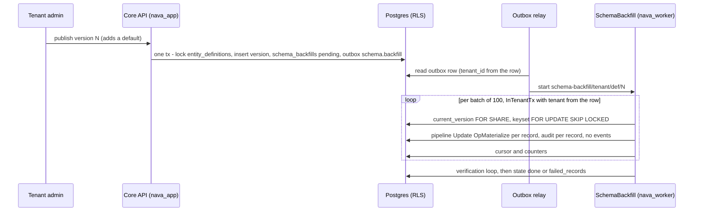
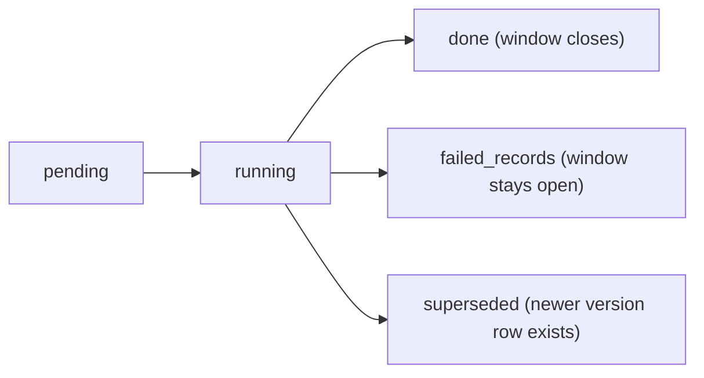

# RFC-021 · needs_backfill publishes: durable backfill, and reads, filters and uniqueness across schema versions

> **Invariants source.** The project description is empty, so there is no list of eight invariants to load. This RFC is checked against [[ADR-001-platform-blueprint]] §1 **I1–I9** (nine), the same source used by ADR-001-A2 and A6. If the project is meant to have its own list of eight, the invariant checks below are **incomplete** against it.
>
> **Numbering.** RFC-020 (ADR-008) is the highest RFC in `docs/adr/`, so this is **RFC-021**. ADR-008 is the highest ADR, so the resulting ADR is assumed to be **ADR-009**. This file is archived at `docs/adr/ADR-009/rfc/`.

## In plain words

A tenant admin can publish a new version of a record type that gives a field a **default** (the value a record gets when nobody sets one). Today the platform stores that version and does nothing else. Old records never get the value written. Opening a record shows the default, because the read code fills it in on the fly. Searching does not: `filter[priority]=3` only finds records where `3` is actually stored. So one record can show `priority: 3` and still be missing from a search for priority 3.

This RFC makes three changes:
1. After such a publish, a **background job** rewrites the old records through the normal write path, one tenant and one record type at a time, until every record has the value stored.
2. **While that job runs, searches match the default too**, so results are already correct before the job finishes.
3. A field that must be **unique** can no longer have a default, because a default gives every record the same value.

## 1. Summary

- **Recommendation: Design A.** A `needs_backfill` publish (and any publish that adds a default) queues a durable `SchemaBackfill` workflow in the publish transaction. It rewrites each old record through the one write pipeline (I4): version +1, new ETag, one audit entry per record, run as the system actor `schema-backfill`. It **starts no tenant workflows** and **signals no waiting runs**, because the record's effective value does not change.
- **Tenant scoping is structural.** One job is one tenant and one entity type. The tenant comes only from the outbox row the publish committed (I2). It runs as `nava_worker` under forced RLS. There is no new role, no allow-list entry, no `BYPASSRLS`, and no code path that loops over tenants (I1, I3).
- **One rule for reads:** stored value, then the current version's default for any top-level key the record does not hold. This applies to every surface that returns a record body. Audit diffs are the exception: they show the stored bytes as written.
- **Filters match effective values.** While the type's backfill window is open, a filter whose predicate is true for the default also matches records that lack the key. This works on both the JSONB `@>` path and the ADR-006 side tables. Once the window closes, stored and effective values are the same and the plain plan applies again.
- **Uniqueness stays on stored values.** `default` together with `x-nava-unique` is refused at publish (422), so for a unique field the stored value and the effective value cannot differ.
- **Class table:** unchanged except for one cell. *Making an existing property required* becomes `needs_backfill` when the next version has a default for it. Removing a property, narrowing an enum, and adding a required property with no default stay **Breaking (refused)**.
- **What the human/CTO must accept:** a write burst on large types (an estimated 1 record rewrite plus 1 audit row plus side-table rows per record; not yet measured, TA spike), ETag churn (a client holding a stale ETag gets 412 once), and a slower filter on defaulted fields while the window is open.

## 2. Context (`main` at `ecedb2e9`)

| Fact | Where |
|---|---|
| The classifier returns `needs_backfill` for "add required property with default" and "add default to existing property". "Add optional property **with** a default" is `compatible`, yet it leaves the same gap. | `internal/metadata/classify.go:39-75`, `docs/architecture/metadata-engine.md` "Compatibility classes" |
| Publish locks `entity_definitions … FOR UPDATE` and stores `compat`. No job is started. | `internal/entitytypes/entitytypes.go:305-323`, `api/paths/entity-types.yaml:454` |
| Single read and list both apply **current** defaults to the stored payload. | `internal/server/records.go:247-252`, `internal/server/records_list.go:453` |
| An update already applies current defaults, validates against the current version, and moves `schema_version` to it. Every write lazily backfills the record it touches. | `internal/records/pipeline/pipeline.go:758-821`, `docs/architecture/record-write-pipeline.md` "Current version wins" |
| `ApplyDefaults` fills **top-level** absent keys only. Present keys, including explicit `null`, are kept. | `internal/metadata/validate.go:83-93` |
| The data filter matches stored JSON only (`r.data @> $v`). A fixed column filter is `r.col = ANY(…)`. | `internal/server/records_list.go:216-226` |
| Uniqueness reads stored JSON or the fixed column. No index (D25). | `internal/records/store/unique.go:65-110` |
| Every update calls the event sink, which **starts every `on_updated` definition** and **signals every run waiting on the record**. | `internal/records/pipeline/eventsink/eventsink.go:88-130` |
| ADR-006 D4: the trigger on `UPDATE OF data` copies stored `data -> key` into side tables. D10: `FieldIndexBackfill` runs in batches of 1,000 with an adaptive pause and one backfill per tenant at a time. S21 has not started. | [[ADR-006-filterable-tenant-fields]] D4, D10 |
| Audit envelope has `actor_principal_id` **or** `actor_system` (exactly one), `source`, `source_ref`, `change_set_id`, `causation_*`. | [[ADR-004-audit-log]] R1 |
| System actors are a DB role per actor class, and backfills run "per tenant, batched by key range". | [[ADR-001-platform-blueprint]] D28, Annex A.3 |

A default, once published, **never changes or disappears**: "change or remove a default" is Breaking. Every rule below depends on this. If a later RFC relaxes it, this design must be revisited (trigger T1).

## 3. Bounded contexts and domain model

| Context | Owns | New in this RFC |
|---|---|---|
| Metadata engine (`internal/metadata`) | compile, classify, defaults | `Classify` also returns `AddedDefaults []string`. Compile refuses `default` together with `x-nava-unique`. One cell of the class table changes. |
| Entity types (`internal/entitytypes`) | publish | Publish inserts the `schema_backfills` row and the `schema.backfill` outbox row in its transaction. |
| Record write pipeline (`internal/records/pipeline`) | I4 | New op `OpMaterialize`: an update with an empty patch, system source, sink suppressed. |
| Records read and list (`internal/server`) | shaping, filters | Shared `effective()` shaping, and the window fallback in `where()`. |
| Workflow worker (`nava-core` task queue) | durable jobs | `SchemaBackfill` workflow plus activities. |
| ADR-006 side tables (S21) | filterable fields | The window fallback on the side-table predicate. No trigger change. |

**New table `schema_backfills`** (tenant table, `ENABLE` + `FORCE RLS`, canonical tenant policy, PK leads with `tenant_id`):

| Column | Type | Notes |
|---|---|---|
| `tenant_id` | uuid | PK part 1 |
| `entity_definition_id` | uuid | PK part 2, FK `(tenant_id, entity_definition_id)` |
| `target_version` | int | PK part 3. The version whose publish queued it |
| `added_defaults` | text[] | top-level keys the job materialises (from `Classify`) |
| `state` | text | `pending` → `running` → `done` \| `failed_records` \| `superseded` |
| `cursor` | uuid | last record id processed (keyset) |
| `rewritten`, `skipped`, `failed` | bigint | counters |
| `publish_audit_id` | uuid | causation origin (I9) |
| `started_at`, `finished_at` | timestamptz | |
| `last_error` | text | error **code** only, never a value |

**New table `schema_backfill_failures`** `(tenant_id, entity_definition_id, target_version, record_id, code)`, same RLS. It holds the record id and a typed error code only, never field values.

**Window.** The backfill window of entity type T is **open** when the row for T's current `target_version` (or a newer one) is in any state other than `done`. A type that never had a default added has no row, and its window is closed.

## 4. Decisions

| # | Decision | Why / what it prevents |
|---|---|---|
| **D1** | **Trigger.** A publish whose next version adds at least one top-level default that the previous version did not have (any `needs_backfill` publish, and a `compatible` "optional property with default") does this in the **publish transaction**: it inserts `schema_backfills(…, state='pending')` and an outbox row with `kind='schema.backfill'` and `dedupe_key='schema-backfill:<entity_definition_id>:<version>'`. Other publishes queue nothing. | A rolled-back publish leaves no job, and a committed publish always gets one (I6). Without the `compatible` case, "add optional with default" keeps the bug. |
| **D2** | **Actor and tenant scoping.** The relay starts `SchemaBackfill(tenant_id, entity_definition_id, target_version)` with workflow id `schema-backfill/<tenant_id>/<entity_definition_id>/<target_version>`. **Inputs come only from the outbox row** (I2). Every activity runs as `nava_worker` in `InTenantTx`, with `app.tenant_id` from the row. Every statement also carries an explicit `tenant_id = $1` on top of RLS. There is no new DB role, no allow-list policy, and no `BYPASSRLS` (I1, I3). One job is one tenant and one type. No tenant iteration exists anywhere. Pipeline identity: `Source=system`, `actor_system='schema-backfill'` (no principal), `source_ref='schema_backfills:<entity_definition_id>:<target_version>'`, causation origin `publish_audit_id` at depth +1 (I9). The workflow type is added to the `nava-core` allow-list ([[ADR-001-A2-f2-system-workflow-reach]] D9). No tenant-facing API, script or workflow can start it. | A job whose tenant came from a payload or a loop is exactly the cross-tenant job D28 forbids. The explicit `tenant_id` predicate makes a missing `app.tenant_id` return zero rows, never all rows. |
| **D3** | **Write path.** Each record is written by `pipeline.Update` with an **empty patch** and the new `Op=OpMaterialize`: defaults from the current version, then JSON Schema, then declarative checks, then the unique check, then commit with audit, in one transaction (I4). It skips the authorizer and field masks as any system source does. A record that `ApplyDefaults` would not change (it already holds every key) gets **no write**. | One write pipeline (I4). The no-op skip keeps audit and WAL proportional to records that actually change. |
| **D4** | **Audit.** **One entry per rewritten record**: `action=update`, `source=system`, `actor_system='schema-backfill'`, normal before and after snapshots. The diff is the materialised key(s). There is no batch-summary entry in place of per-record entries. The job also writes one `entity_type` domain entry at start and one at finish, with counts. | Per-record history stays complete: the diff read shows when and why `priority` appeared. A per-batch entry would leave records whose stored bytes changed with no entry (ADR-004 R1). |
| **D5** | **Version and ETag.** The record `version` is bumped, so the ETag changes, and `schema_version` moves to current. A client holding the old ETag gets `412 version_conflict` once and re-reads. | "One version bump per write" (record-write-pipeline). A silent rewrite without a bump would be a second write path, and would break audit `version_before`/`version_after` continuity and the `EnqueueAtVersion` lock contract. |
| **D6** | **No events.** For `OpMaterialize` the event sink starts no `on_updated` definitions, signals no waiting runs, and writes no outbox rows. Workflow activities already re-read on 412 (ADR-001 G4). | The effective value is unchanged, so there is no business event. Without this, 100k records × N `on_updated` definitions start 100k·N workflows, and the I9 depth and cycle claims fire on non-events. |
| **D7** | **Batching and throttle.** Keyset by `id` within `(tenant_id, entity_definition_id)`, `schema_version < target`, `ORDER BY id LIMIT 100 FOR UPDATE SKIP LOCKED`, one `InTenantTx` per batch. A record skipped because it is locked, or that hits a version conflict, needs no retry: the user write that holds it applies the current defaults itself. After the keyset pass, a **verification loop** counts records still missing any `added_defaults` key and reruns until that count is zero or only failed records remain (the ADR-006 D11 pattern). Pause between batches starts at 500 ms and adapts to keep live-write p95 within +25% (ADR-006 D10 controller, reused). **One data backfill per tenant at a time, shared with `FieldIndexBackfill`.** A platform cap on concurrent tenant backfills per worker pool starts at 4 (unverified). Activities return only the cursor and the counters. | PG-N5 (per tenant, by key range). Batch size 100 rather than 1,000, because each record is a full pipeline write with audit, not a side-table insert. The Postgres reviewer should confirm (OQ-1). |
| **D8** | **Publish during a backfill.** Each batch first reads `entity_definitions.current_version … FOR SHARE`, which serialises with publish's `FOR UPDATE`, and materialises with **that** version. If a newer `schema_backfills` row exists for the type, the job marks itself `superseded` and ends. The newer job is queued by the per-tenant limiter and covers the union of defaults, because records at an older `schema_version` are selected again. A newer publish that adds no default does not supersede: the running job's writes already land on the newest version. | There is never a write under a stale definition, and never two jobs rewriting the same type. No backfill is lost when a publish races the job's last batch, because the workflow id is per target version. |
| **D9** | **Poison records.** A validation, unique or declarative-check failure on one record writes `schema_backfill_failures(…, record_id, code)` and the job continues. It ends `done` (0 failures) or `failed_records`. A `failed_records` type keeps its window **open**, so filters stay correct, only slower. The failure codes are visible to the tenant admin (D10). | One bad record never blocks a tenant's type. No field value goes into a failure row or a log (house rule: never log tenant data). |
| **D10** | **Status surface.** `GET /entity-types/{key}` gains `backfill: {state, target_version, rewritten, skipped, failed, started_at, finished_at}`. It is absent when no row exists. It is read only, and the same ACL as the entity-type read applies. | Admins and support can see why a filter is slower, or why records are still at an older `schema_version`. |
| **D11** | **Reads across versions (Q2).** Every surface that returns a record body (single read, list, GraphQL, embed SDK, the workflow record-read capability, and any future export) uses one shaping function: `effective(rec) = cur.ApplyDefaults(rec.Payload(fixedColumnsOf(rec.SchemaVersion)))`, then masks. **Audit diffs and audit snapshots show stored bytes as written** and never apply defaults. | One rule removes the "same record, two answers" class. Audit is evidence of what was stored, and rewriting it with today's defaults would falsify history. |
| **D12** | **Filters across versions (Q3).** The contract is that **`filter[f]` matches the effective value**. Implementation: while T's window is open, and only for a field `f` in the union of `added_defaults` whose predicate is true for the current default (evaluated in Go), the predicate becomes `(<stored predicate>) OR <f absent>`. "Absent" is `NOT (r.data ? 'f')` for a data key, and `r.<col> IS NULL` for a fixed column. This applies to (a) the JSONB `@>` path in `records_list.go`, and (b) the ADR-006 side-table predicate built in S21. `total` uses the same predicate. When the window is closed, the plain plan is used. **The D4 trigger and D10 `FieldIndexBackfill` are unchanged**: materialisation writes `data`, which fires D4, so side tables converge without schema knowledge in plpgsql. | Correct results from the moment of publish, not from the end of the job. The extra cost exists only during the window, and only for queries whose predicate includes the default. |
| **D13** | **Uniqueness (Q4).** Compile refuses a top-level property that has both `default` and `x-nava-unique: true` (422 `invalid_schema`, with the pointer). The unique check stays on **stored** values, which for a unique field always equal the effective value. | A default on a unique field gives every defaulted record the same value, so the second create collides. Refusing it removes the stored-versus-effective question instead of answering it with a costlier check. |
| **D14** | **Remaining classes (Q5).** The fail-closed table stays, with **one change**: *making an existing property required* is `needs_backfill` when the next version has a default for it, and stays Breaking otherwise. Removing a property, narrowing an enum, adding a required property with no default, and changing or removing a default all **stay Breaking (refused)**. No declarative transforms in this ADR. | That one case is exactly what D3 can materialise with no data loss. The others destroy or reinterpret stored data. A transform language needs its own RFC (trigger T2). |
| **D15** | **Rollout.** One migration finds, per tenant, every entity type whose current version has defaults that some of its records lack. For each, it inserts a `schema_backfills` row and a `schema.backfill` outbox row, with `app.tenant_id` set per tenant (subject to `FORCE`, as the migrator always is). It is idempotent on the dedupe key. | Types already published as `needs_backfill` before this ships are covered. |

## 5. Q2 read table

| Surface | Shape | Defaults |
|---|---|---|
| `GET /records/{entity}/{id}` | stored, under own version's fixed-column mapping | current version's, for absent top-level keys |
| `GET /records/{entity}` (list) | same | same |
| GraphQL, embed SDK, workflow record read | same, through the same function | same |
| Export (none today) | must call the same function | same |
| `GET /audit…` diff, snapshots | stored bytes at that write | **none** |

## 6. Flow

## 7. Candidate designs

| | Design | Verdict |
|---|---|---|
| **A** | Durable materialising backfill through the pipeline, plus effective-value filters while the window is open (this RFC) | **Recommended** |
| B | Never backfill. Make every filter and unique check compute effective values forever (`COALESCE(data->'f', default)` in SQL, and a D4 trigger that knows defaults) | **Rejected:** the cost lasts forever on every query, and the COALESCE form cannot use the GIN or side-table B-tree. Defaults would have to be duplicated into plpgsql, so two schema interpreters. Audit never records the value. |
| C | Bulk `UPDATE records SET data = data \|\| $defaults` per batch from a migrator-class job | **Rejected:** it bypasses I4 (no validation, no unique check, no version, no audit). It needs the migrator credential for a tenant-initiated action, and I8 keeps tenant changes off operator paths. |
| D | Lazy only (records catch up on their next write), with stored-only filters and documentation | **Rejected:** this is the reported bug, and cold records never catch up. |
| E | Block `filter[f]` with 409 while the window is open | **Rejected:** fail-closed but unusable, because a 100k-record type loses filtering for the whole run. D12 gives correct answers at a bounded cost instead. |

## 8. Invariants touched

| Inv. | How it holds |
|---|---|
| I1 | New tables are tenant tables with `FORCE RLS` and a PK led by `tenant_id`. The job adds no allow-list entry (it stays at 10). |
| I2 | The tenant comes only from the committed outbox row. Workflow input is never trusted beyond what the relay copied from that row. |
| I3 | `nava_worker` only. No new role and no grant beyond DML on the two new tables, in `db/grants.yaml`. |
| I4 | Every rewrite is a pipeline write with expected version, validation and audit. |
| I5 | The system source skips the authorizer, as today. Filters still compile to SQL inside the ACL predicate, and the fallback is ANDed with the ACL, not ORed. |
| I6 | Started only by the relay from an outbox row committed with the publish. The workflow is deterministic: all I/O is in activities. |
| I7 | Workflow id per target version, and the outbox dedupe key. A batch replay finds the records already materialised (no-op skip) or at a newer version (conflict skip), so it writes nothing twice. |
| I8 | No DDL. No tenant code involved. |
| I9 | Causation origin is the publish audit entry, depth +1. `OpMaterialize` emits no events, so it cannot cascade. |

## 9. Risks and accepted residuals

| # | Risk | Owner | Revisit trigger |
|---|---|---|---|
| R1 | Write and WAL burst: each record is a full tuple rewrite (TOASTed `data`), plus one audit row, plus D4 side rows. Unmeasured. | Postgres & Data Modeling Specialist | TA spike shows 100k > 30 min or live p95 > +25% at the floor pause |
| R2 | ETag churn: clients with an open edit form get one 412 per record that gets rewritten | Solution Architect | Support reports, or the embed SDK lacks automatic re-read on 412 |
| R3 | The fallback `NOT (data ? 'f')` is not indexable, so the type's tenant rows are scanned while the window is open | Technical Architect | p95 of a defaulted-field filter during the window > 2× its closed-window p95 at 100k |
| R4 | **Sort** on a defaulted field while the window is open places unmaterialised records as null, not at the default | Solution Architect | any tenant-visible bug report. The fix would be `COALESCE` in the sort key, during the window only |
| R5 | Audit volume: 100k entries per backfill, and sealer throughput | Postgres & Data Modeling Specialist | sealer lag > its ADR-004 SLO during the spike |
| R6 | `failed_records` keeps the window open indefinitely | Technical Lead | any type in `failed_records` > 7 days. Needs the retry path (OQ-4) |
| R7 | The design depends on "a published default never changes" (Breaking today) | Solution Architect | **T1:** any RFC that makes default change or removal non-Breaking |

## 10. Test and acceptance spec

| ID | Test | Catches |
|---|---|---|
| CI-1 | A publish that adds a default inserts version + `schema_backfills` + outbox row in one tx. A forced rollback leaves none. A publish with no added default inserts neither. | D1 atomicity |
| CI-2 | 500 records at version N-1 → after the job, each holds the key in `data`, has `version+1`, and has exactly one audit entry with `actor_system='schema-backfill'`. Zero workflow starts and zero signals, even with an `on_updated` definition and a waiting run on the type. | D3–D6 |
| CI-3 (cross-tenant) | Tenants A and B have the same entity key and both publish. Running A's job changes zero B rows. An activity run without `app.tenant_id` reads zero rows. An outbox row for A with workflow input edited to B's id is refused at start (inputs only from the row). | D2, I1, I2 |
| CI-4 | A user update of record r interleaved with r's batch: no lost update, and the user gets no 412 unless their own ETag was stale. r ends materialised. | D7 SKIP LOCKED and conflict skip |
| CI-5 | Publish N+1 (another default) mid-run: N ends `superseded`, N+1 ends `done`, and every record holds both keys. A publish that adds no default mid-run does not supersede. | D8 |
| CI-6 | One record made invalid against the current version: a failure row with id and code and no value, the job finishes `failed_records`, and the filter fallback stays on. | D9 |
| CI-7 | While the window is open, `filter[f]=<default>` returns the records lacking f, with the same `total`. `filter[f]=<other>` is unchanged. This runs on both the JSONB path and the S21 side-table path, and the result is identical after the window closes. | D12 |
| CI-8 | For one record, single read, list item, and GraphQL bodies are equal. The audit diff shows the stored bytes without the default. | D11 |
| CI-9 | Publish with `default` + `x-nava-unique` → 422 `invalid_schema` with pointer, and nothing stored | D13 |
| CI-10 | Classifier: optional→required with default → `needs_backfill`; without a default → `breaking` | D14 |
| CI-11 | Relay redelivers the outbox row, and an activity is retried after commit: one workflow, one audit entry per record | I7 |
| CI-12 (spike) | 100k records in one tenant, plus concurrent live writes: wall time, WAL bytes, live-write p95, sealer lag | R1, R3, R5 |

API test scenarios (for the ADR): `GET /entity-types/{key}` with and without `backfill`. A cross-tenant entity type gives the same 404 as a missing one. Publish 422 for D13 writes nothing.

## 11. Assumptions not verified

1. That the pipeline's own record load is compatible with an outer `FOR UPDATE SKIP LOCKED` keyset (no double lock or self-deadlock). **Verify:** Postgres reviewer or a spike.
2. That `audit.Append` per record inside a 100-record transaction does not serialise the tenant's other writers on a shared row (chain head or sequence). **Verify:** read `docs/architecture/audit-append.md` and the spike.
3. That the ADR-006 D10 per-tenant "one backfill at a time" limiter can be shared by another workflow type. Its mechanism is not built yet (S21). **Verify:** TA, with S21.
4. That no published version today has `default` + `x-nava-unique` (D13 would refuse republishing it). The seed templates have none (checked). Tenant data is unchecked. **Verify:** a count query in the rollout migration, which refuses to run if any exist.
5. The batch size of 100, the concurrency cap of 4, and the 30-minute and 2× thresholds are starting values, not measurements.

## 12. Open questions

| # | Question | Who |
|---|---|---|
| OQ-1 | Batch size and lock and WAL profile per batch. Does `SKIP LOCKED` plus the verification loop beat plain `FOR UPDATE` with short batches? How does it interact with the D4 trigger? | Postgres & Data Modeling Specialist |
| OQ-2 | Is a system-source write that skips the authorizer and field masks acceptable for materialisation? Is `actor_system='schema-backfill'` with no principal the right audit identity? Is the workflow allow-list entry scoped tightly enough? | Security & Multi-Tenancy Reviewer |
| OQ-3 | The measured 100k cost (CI-12), and whether the R3 fallback scan is tolerable | Technical Architect |
| OQ-4 | A retry path for `failed_records`: a tenant-admin `POST /entity-types/{key}/backfill:retry` now, or only "the next publish retries"? My recommendation is the endpoint, because R6 needs it. This is scope and cost. | Technical Lead |
