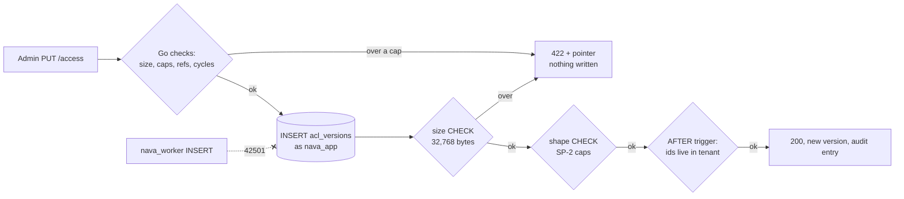

# ADR-010 amendment A1: smaller caps, a size cap, and publishing from the API only

> **Status: PROPOSED** on 2026-11-18. Waiting for the Technical Architect's critique and the Security & Multi-Tenancy Reviewer's sign-off on A1-3. It must merge before TICK-940 (the format-2 CHECK) merges. PR #727 (SP-2) merges first: the runner here reads its prototype.
>
> **Invariants source.** As in ADR-010: ADR-001 I1 to I9; the project description is empty. This amendment touches I1 (tenant wall), I3 (database roles, no `SECURITY DEFINER`) and I5 (the caps exist because access rules become a database filter). The others are unchanged.

## In plain words

- **What changes:**
  1. An access-rules document may hold at most **128 tests** (leaves) in all, down from 1,024.
  2. The saved document may be at most **32 KiB** of text. Today's realistic document is 4.5 kB; the largest one at every other cap is about 11 kB.
  3. Only the API's database login (`nava_app`) may save a new access-rules version. The background worker's login (`nava_worker`) loses that right. No worker code saves one today.
- **Why:**
  1. Above 128 tests, a ticket list costs more than its 150 ms budget (SP-2 item 1).
  2. The other caps count tests, not bytes. A document full of unused conditions or long id lists stayed inside every cap and still took up to 0.6 s to check. A byte cap bounds all of it at once.
  3. The id check that runs on save cannot see users as `nava_worker`, and the fix that would let it (`SECURITY DEFINER`) is banned by I3. Removing the right closes the question.
- **What you'll see:** a document over a cap is refused at save with a 422 that points at it. Saving takes about 4 to 7 ms for a realistic document and at most about 70 ms for the worst document that fits.
- **Codes used below:** D4 = ADR-010's save-time checks. R6 = ADR-010's "CHECK cost grows" risk. I3 = ADR-001's database-roles rule. C1 = PLAN-011's error-code contract.

## Decision

| # | Rule |
|---|---|
| **A1-1** | **D4 caps, final.** Depth after expansion **8**, children per `all`/`any` **16**, policies per document **64**, leaves per policy **128** (was 256), leaves per document **128** (was 1,024). The Go constants are SP-2's: `MaxDepth, MaxChildren, MaxPolicies, MaxPolicyLeaves, MaxDocumentLeaves = 8, 16, 64, 128, 128`. |
| **A1-2** | **New D4 cap: the stored `rules` document is at most 32,768 bytes.** The size is `octet_length(rules::text)`: the byte length of PostgreSQL's own text form of the stored `jsonb` (keys sorted, `", "` and `": "` separators). It applies to format 2 only; the route never stores format 1 (PLAN-011 D12). It bounds unused conditions, condition count and ids per `member_of`/`cmp` leaf together. |
| **A1-2a** | **The CHECK.** A separate constraint, `acl_versions_rules_size_check CHECK (NOT (rules ? 'format') OR octet_length(rules::text) <= 32768)`. `acl2_rules_valid` starts with the same size test and **returns true** above 32,768 bytes without walking, so an oversize document is refused by exactly one constraint, the size one, whatever order PostgreSQL evaluates them in, and is never walked. The tenant-id trigger is an AFTER trigger (SP-2), so it never sees an oversize row. |
| **A1-2b** | **The route.** `PUT /api/v1/entity-types/{key}/access` measures the same number in Go before it opens a transaction: a function `acl.CanonicalSize` that writes the decoded document in PostgreSQL's `jsonb` text form. Above 32,768 it answers **422** with C1 code `document_too_large` and pointer `/rules`, and writes nothing. A parity test (TICK-940) asserts `CanonicalSize(d) == octet_length(d::jsonb::text)` over the SP-2 and A1 bench corpora and fuzzed documents, including escaped strings, non-ASCII text and number forms. If the two ever disagree, the route maps SQLSTATE 23514 on `acl_versions_rules_size_check` to the same 422, so a divergence changes which layer refuses, never the answer. |
| **A1-3** | **`acl_versions` insert is `nava_app` only.** (a) `db/grants.yaml`: `nava_worker.acl_versions` becomes `{ SELECT: [] }` (INSERT removed). (b) `ALTER POLICY acl_versions_insert ON acl_versions TO nava_app`. (c) `nava_worker` loses EXECUTE on the CHECK functions: TICK-629's `acl_uuids_valid`, `acl_subject_valid`, `acl_cond_valid`, `acl_rules_valid`, `acl_masks_valid`, and TICK-940's new `acl2_*` functions are never granted to it. (d) The tenant-id trigger `acl2_tenant_ids` stays a `SECURITY INVOKER` function (I3 bans `SECURITY DEFINER`). It runs as `nava_app`, which has `SELECT` on `principals`, `groups` and `org_units` and is in their tenant `SELECT` policies; its lookups also filter `tenant_id = NEW.tenant_id` explicitly. (e) **Any future worker publish path needs its own amendment**, which must give the trigger a defined way to see the tenant's principals as that role. |

**Why A1-3 is safe today.** Every caller of `authz.PolicyStore.Publish` and `PublishIfNone` was traced on `main` (2026-11-18):

| Caller | Binary | Database login |
|---|---|---|
| `internal/server/access.go:212` (the access route) | `nava-core` | `nava_app` |
| `internal/onboard/acl.go:113` (default incident ACL, onboarding and `reconcile-acls`) | `nava-onboard` | `nava_app` (`NAVA_DATABASE_URL`, `compose.yaml:549`; `docs/operator/onboarding.md:188`) |

No package that `nava-worker` builds calls either function. A worker that tried would get SQLSTATE 42501 (no privilege), which fails closed.

## Evidence: the 32 KiB cost (A1-2)

The issue asked for a measured figure in place of SP-2's extrapolation of about 10 to 15 ms. `docs/adr/ADR-010/A1/check32k.sh` uses SP-2's harness (postgres 16.10 from `docs/pins.md`, TICK-629's functions, the SP-2 prototype, the same directory shape and timing method) with the A1 CHECK: the 32 KiB gate, then the walk at the SP-2 caps. Each document is the largest of its shape that fits in 32,768 bytes. Single-row inserts, 3 passes, in ms:

| Document | Text bytes | Ids | CHECK p50 / p95 | CHECK + trigger p50 / p95 |
|---|---:|---:|---:|---:|
| Format 1, 6 rules (today) | 4,500 | 71 | 0.5–0.6 / 0.8–1.3 | 1.1–2.1 / 2.4–4.8 |
| SP-2 caps, 128 leaves, 1 id | 10,783 | 51 | 2.9–3.8 / 3.6–5.7 | 3.6–7.4 / 6.4–14.9 |
| SP-2 caps, ids per leaf up to 32 KiB | 32,383 | 438 | 4.2–6.2 / 5.4–7.9 | 6.5–12.0 / 10.5–25.2 |
| SP-2 caps plus unused conditions | 32,045 | 149 | 8.1–8.3 / 10.7–12.5 | 8.6–20.5 / 15.7–29.1 |
| Unused `any` of 16 `{"shared": true}` (most nodes) | 32,493 | 0 | 8.1–9.3 / 13.1–13.2 | 9.5–23.6 / 15.6–31.3 |
| Unused chain of 16 refs per condition (most refs) | 32,608 | 0 | 18.6–18.9 / 26.9–31.8 | **16.9–40.7 / 24.1–68.7** |
| One `member_of` with 815 users (most ids) | 32,713 | 815 | 3.8 / 4.9–8.0 | 5.9–14.1 / 9.6–21.4 |
| 1 MiB, refused by the gate | 1,018,613 | — | 43–46 / 54–78 | 29–58 / 40–76 |

The ranges are run 1 to run 2. Both runs shared Docker with 32 other containers, including another agent's 800k ACL benchmark (`nava-aclperf-pg-*`), and run 2 was the more contended. The gate alone (`octet_length(rules::text)`) costs 0.2 to 1.2 ms at 32 KiB, and 16 to 33 ms at 1 MiB. The boundary holds: 32,768 bytes is accepted and 32,769 is refused.

**What this shows:**
- **The worst document that fits costs about 17 to 41 ms p50 and at most about 70 ms p95.** That is above SP-2's 10 to 15 ms extrapolation. The cost is in the CHECK's Kahn walk over about 2,000 `ref` edges and the trigger's seven `lax $.**` path scans over about 2,000 nodes, not in id lookups.
- **It is 15 times below the 0.15 to 0.6 s an uncapped 1 MiB document cost** (SP-2 item 2), and it happens on an admin's publish, never on the list path.
- **A realistic document stays near R6's 5 ms** (3.6 to 7.4 ms p50 at the SP-2 caps).
- **A 1 MiB document is refused in the database in about 45 ms** when the route is bypassed. The route refuses it before any database work.

**Why 32 KiB and not smaller.** Each id costs about 40 bytes of text. At 32 KiB, a document at the 128-leaf cap can still name about 440 distinct ids, and a single leaf about 815. The 128-leaf document with one id per leaf is already 10.8 kB, so 16 KiB would leave room for only about 130 more ids, which a regional policy listing users by name can reach. 32 KiB is 7 times today's 4.5 kB document. SP-2 suggested 64 KiB; 32 KiB is enough and halves the worst case.

## Consequences

- **ADR-010 D4** now reads: every `ref` resolves; no reference cycle; depth at most 8 after expansion; at most 16 children per node; at most 128 leaves per policy; at most 64 policies and 128 leaves per document; **the stored document at most 32,768 bytes**; every group, user and org-unit id belongs to the tenant.
- **ADR-010 R6** is restated: *the CHECK + trigger insert cost.* Measured: 3.6 to 7.4 ms p50 for a realistic document at the caps, at most about 70 ms p95 for the worst document that fits. Trigger: a realistic document above 10 ms p50, or the A1 bench's worst document above 100 ms p95, on an uncontended run. Owner: Postgres & Data Modeling Specialist.
- **ADR-010 Competitive Gate, D11 item 5** (caps sized from a measurement) now holds: SP-2 sized the leaf caps and this amendment sizes the byte cap.
- **TICK-940** ships: the A1-1 caps in `acl2_problem`; `acl_versions_rules_size_check`; the early return in `acl2_rules_valid`; the A1-3 grant, policy and EXECUTE changes in the same migration; `CanonicalSize` and its parity test (or TICK-939, whichever owns the route's Go checks).
- **TICK-939** (route, OpenAPI): the 422 code `document_too_large`, pointer `/rules`, and the new cap values in the access route's description.
- **Tenant isolation suite** (`internal/tenancy/isolation/acl_paths.go`): the path "publish an ACL in tenant A for tenant B's type" moves from `nava_worker` to `nava_app`, so it still tests the composite foreign key. A new path, "`nava_worker` publishes an ACL in its own tenant", expects `Denied`.
- **Handbook** (Technical Lead, TICK-945): the S30 page's cap table and the access route page.

## API test scenarios

| Endpoint | Scenarios |
|---|---|
| `PUT /api/v1/entity-types/{key}/access` | A format-2 document of exactly 32,768 bytes (PostgreSQL text form) gives 200. One byte more gives 422 `document_too_large` with pointer `/rules` and writes nothing. 129 leaves in one policy, or across the document, give 422 with the C1 cap code and write nothing. A document with 128 leaves and 4 KiB of unused conditions gives 200. |

| Database test (TICK-940) | Fails if |
|---|---|
| `nava_worker` inserts into `acl_versions` in its own tenant | It does not fail with 42501. |
| `nava_worker` has EXECUTE on any `acl_*` or `acl2_*` function (`has_function_privilege`) | Any returns true. |
| As `nava_app`, a valid format-2 row naming another tenant's user | It does not fail with 23514, detail `foreign_id`. |
| Direct insert of a 32,769-byte format-2 row | It does not fail on `acl_versions_rules_size_check`. |
| `CanonicalSize` parity over the bench corpora and fuzzed documents | Any document differs from `octet_length(d::jsonb::text)`. |

## Risks and residuals

| # | Risk | Owner | Trigger |
|---|---|---|---|
| A1-R1 (AR-TICK-971-01) | An admin can publish a crafted 32 KiB document that costs up to about 70 ms of database time per publish in their own tenant. Publishing is admin-only and versioned, and the cost is 15 times below the uncapped case. | Postgres & Data Modeling Specialist | The A1 bench's worst document above 100 ms p95 on an uncontended run, or a tenant publishing more than once a second for a minute. |
| A1-R2 | Go's `CanonicalSize` and PostgreSQL disagree for some input. Outcome: the same 422 from the database instead of the route (A1-2b). | Technical Lead (TICK-940) | The parity test fails, or a `document_too_large` 422 is logged as coming from SQLSTATE 23514. |
| A1-R3 | A future feature needs a worker to publish an ACL. | Solution Architect | Any such RFC: it needs its own amendment (A1-3 e). |

**Not covered here:** the `masks` column has no byte cap. It stays bounded by the 1 MiB request body limit and its TICK-629 CHECK. If masks grow past format 1, they need the same treatment.

## Competitive Gate (ADR-008)

**Result:** PASS with accepted risk CP-SF-02
1. **Axis moved:** none new. The amendment keeps ADR-010's X2 gain (a rule change is one publish) and makes its caps final.
2. **Pain points:**
   - Still risks CP-SF-02 (caps), now with all five D11 items holding: I5 requires the caps, they are published here and in the route's OpenAPI text, they are the same at every tier, they are refused at save with a typed 422 and a pointer, and they are sized from measurements (SP-2 for the leaf caps, the A1 bench for 32 KiB). This closes ADR-010's "item 5 waits for SP-2". Owner: Solution Architect (R2).
   - Avoids CP-SF-06: A1-3 removes a publish path whose tenant-id check could not run, rather than widening the worker's reads.
3. **Measured by:** SP-2 (`docs/data/acl-format2-caps.md`) and `docs/adr/ADR-010/A1/check32k.sh`.
4. **Parity:** I1 to I9 unchanged. I3 is kept: no `SECURITY DEFINER`, and `nava_worker` loses a right it did not use.

## Rejected options

| Option | Why not |
|---|---|
| Separate caps on unused conditions and on ids per leaf (SP-2's second option) | Two more numbers to explain and test, and each still leaves another shape uncapped (long names, long string values). One byte cap bounds every shape. |
| 64 KiB (SP-2's example) | Roughly doubles the worst case (not measured; the cost grows with the written size), for no legitimate document we can construct. |
| 16 KiB | A document at the 128-leaf cap is already 10.8 kB, leaving room for about 130 more ids; R2 would fire on real policies. |
| Measure compact JSON in Go and a looser limit in the CHECK | Two different numbers for one rule; the admin could not predict which one refuses. |
| Ask the database for the size before the Go checks | One more round trip, and the Go walk would need a transaction first. The parity test plus the A1-2b mapping gives the same answer without it. |
| `SECURITY DEFINER` trigger so `nava_worker` can keep INSERT | Banned by I3. |
| Give `nava_worker` SELECT on `principals` and add it to `principals_select` | Widens a worker's read surface to every principal of the tenant for a path no code uses. |
