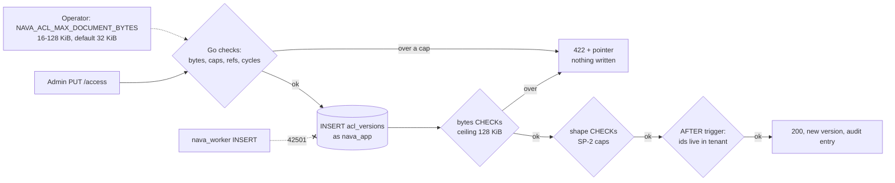

# ADR-010 amendment A1: smaller caps, a configurable size cap, and publishing from the API only

> **Status: ACCEPTED** on 2026-11-19 by the Solution Architect (TICK-971), under the merge policy set by vknavaladi. Record: the Technical Architect's round-1 critique was CHANGES with one blocking item (masks uncapped); rev 1 resolved it and every non-blocking item, and the round-2 re-check had no blocking findings. Its three text and migration notes (R2-1 to R2-3) are folded in. The Security & Multi-Tenancy Reviewer approved A1-3. The product owner set A1-2's shape (platform-wide, configurable). No CTO tie-break was needed; no dissent is outstanding. It must merge before TICK-940. Changing a rule here needs a superseding ADR or a further amendment.
>
> **Invariants source.** As in ADR-010: ADR-001 I1 to I9; the project description is empty. This amendment touches I1 (tenant wall), I3 (database roles, no `SECURITY DEFINER`), I5 (the caps exist because access rules become a database filter) and I8 (configuration over code). The others are unchanged.

## In plain words

- **What changes:**
  1. An access-rules document may hold at most **128 tests** (leaves) in all, down from 1,024.
  2. The access-rules document, and the field-hiding rules (masks) saved with it, may each be at most **32 KiB** of text by default. A platform operator can change that one number for the whole installation, between 16 KiB and 128 KiB. It is the same for every tenant and every ticket type. It limits access rules only, never tickets or their data.
  3. Only the API's database login (`nava_app`) may save a new access-rules version. The background worker's login (`nava_worker`) loses that right. No worker code saves one today.
- **Why:**
  1. Above 128 tests, a ticket list costs more than its 150 ms budget (SP-2 item 1).
  2. The other caps count tests, not bytes. A document full of unused conditions or long id lists stayed inside every cap and still took up to 0.6 s to check, and 1 MiB of masks took about 0.3 s. A byte cap bounds all of it at once. It is configurable because the product owner asked for it; it is platform-wide because a tenant admin is exactly who the cap protects the database from.
  3. The id check that runs on save cannot see users as `nava_worker`, and the fix that would let it (`SECURITY DEFINER`) is banned by I3. Removing the right closes the question.
- **What you'll see:** a document over a cap is refused at save with a 422 that points at it. At the default, saving takes about 5 to 8 ms for a realistic document and at most about 90 ms for the worst row that fits. At the 128 KiB ceiling the worst row takes at most about 340 ms.
- **Codes used below:** D4 = ADR-010's save-time checks. R6 = ADR-010's "CHECK cost grows" risk. I3 = ADR-001's database-roles rule. C1 = PLAN-011's error-code contract.

## Decision

| # | Rule |
|---|---|
| **A1-1** | **D4 caps, final.** Depth after expansion **8**, children per `all`/`any` **16**, policies per document **64**, leaves per policy **128** (was 256), leaves per document **128** (was 1,024). The Go constants are SP-2's: `MaxDepth, MaxChildren, MaxPolicies, MaxPolicyLeaves, MaxDocumentLeaves = 8, 16, 64, 128, 128`. These are **not** configurable: they protect the ticket-list budget every tenant shares. |
| **A1-2** | **New D4 cap: a byte limit on `rules` and on `masks`, platform-wide and configurable.** The size of each is `octet_length(<column>::text)`: the byte length of PostgreSQL's own text form of the stored `jsonb` (keys sorted, `", "` and `": "` separators). `rules` is limited for format 2 only (the route never stores format 1, PLAN-011 D12); `masks` for every row. One value applies to both columns, every tenant and every entity type. |
| **A1-2a** | **The setting.** `NAVA_ACL_MAX_DOCUMENT_BYTES`, read by `internal/platform/config` into nava-core's config. Default **32,768**. Allowed range **16,384 to 131,072**; outside it, or not an integer, nava-core refuses to start with a config error, as for every other `NAVA_*` value. The floor keeps a document at every A1-1 cap with one id per leaf (10.8 kB) publishable. The ceiling is the measured cost bound (Evidence). Only a platform operator sets it (deployment environment); **no tenant, admin or API can change it**. The route reports the effective limit only in the detail of a `document_too_large` 422, because the admin needs it to fix the document and D11 says caps are published. It is documented in `.env.example` and the operator guide. |
| **A1-2b** | **The database backstop is the ceiling, a constant.** Two CHECKs: `acl_versions_bytes_rules_check CHECK (NOT (rules ? 'format') OR octet_length(rules::text) <= 131072)` and `acl_versions_bytes_masks_check CHECK (octet_length(masks::text) <= 131072)`. The names start with `bytes_` so they sort, and therefore run, before `acl_versions_masks_check` and `acl_versions_rules_check` (PostgreSQL checks CHECKs "in alphabetical order by name", CREATE TABLE, PG 16): an oversize row is refused before any walk. `acl2_rules_valid` still returns **true** above 131,072 bytes without walking, so the guarantee survives a later rename; a comment on the function names this dependency on `acl_versions_bytes_rules_check`, and both ship in the same migration. The database does **not** read the configured value: a session GUC could be set by `nava_app` itself, and a settings table would need its own writer role, audit and isolation tests for no extra safety. The database bounds the worst cost; the route enforces the operator's value. Rows stored under a higher value stay valid when the operator lowers it; republishing one gets the 422. |
| **A1-2c** | **The route.** The D4 Go validator that every publish goes through takes the limit as a parameter. `PUT /api/v1/entity-types/{key}/access` passes the configured value and checks both columns before it opens a transaction. Over the limit it answers **422** with C1 code `document_too_large`, pointer `/rules` or `/masks`, and the limit in the problem detail; it writes nothing. nava-onboard publishes a fixed default document of under 2 kB and passes the default constant; a unit test asserts the default document is under the 16 KiB floor. |
| **A1-2d** | **Measuring in Go.** `acl.CanonicalSize` is a dedicated writer of PostgreSQL's `jsonb` text form, not `json.Marshal`. The bytes the route **stores** are that writer's output for the validated, decoded document, never the client's raw body, so client number forms and escapes never reach `jsonb`. A parity test asserts `CanonicalSize(d) == octet_length(d::jsonb::text)` over the SP-2 and A1 bench corpora, fuzzed documents, and these cases: U+2028/U+2029, `<>&`, `/`, `\b`, `\f` and other C0 controls, non-ASCII text, invalid UTF-8 (refused before measuring), and any number form that survives decoding. The route maps SQLSTATE 23514 on either `bytes_` constraint to the same 422. If Go and PostgreSQL ever disagree: below the 131,072-byte ceiling, a divergence can let a document slightly over the configured limit through, bounded by A1-R4's cost bound; at or above the ceiling it changes only which layer refuses. The parity test is the control. |
| **A1-3** | **`acl_versions` insert is `nava_app` only.** (a) `db/grants.yaml`: `nava_worker.acl_versions` becomes `{ SELECT: [] }` (INSERT removed). (b) `ALTER POLICY acl_versions_insert ON acl_versions TO nava_app`. (c) `nava_worker` loses EXECUTE on the CHECK functions: TICK-629's `acl_uuids_valid`, `acl_subject_valid`, `acl_cond_valid`, `acl_rules_valid`, `acl_masks_valid`, and TICK-940's new `acl2_*` functions are never granted to it (`00001_global_revokes.sql` revokes EXECUTE from PUBLIC by default, so leaving them out really removes access). (d) The tenant-id trigger `acl2_tenant_ids` stays a `SECURITY INVOKER` function (I3 bans `SECURITY DEFINER`). It runs as `nava_app`, which has `SELECT` on `principals`, `groups` and `org_units` and is in their tenant `SELECT` policies; its lookups also filter `tenant_id = NEW.tenant_id` explicitly. (e) **Any future worker publish path needs its own amendment**, which must give the trigger a defined way to see the tenant's principals as that role. |

**Why A1-3 is safe today.** Every caller of `authz.PolicyStore.Publish` and `PublishIfNone` was traced on `main` (2026-11-18), and the Technical Architect and Security reproduced it:

| Caller | Binary | Database login |
|---|---|---|
| `internal/server/access.go:212` (the access route) | `nava-core` | `nava_app` |
| `internal/onboard/acl.go:113` (default incident ACL, onboarding and `reconcile-acls`) | `nava-onboard` | `nava_app` (`NAVA_DATABASE_URL`, `compose.yaml:549`; `docs/operator/onboarding.md:188`) |

No package that `nava-worker` builds calls either function. A worker that tried would get SQLSTATE 42501 (no privilege), which fails closed.

## Evidence: the cost at the default and at the ceiling (A1-2)

`docs/adr/ADR-010/A1/cap_bench.sh` uses SP-2's harness: postgres 16.10 from `docs/pins.md`, TICK-629's functions, the SP-2 prototype from `main`, the same directory shape and timing method. Rev 1 runs the A1-2 form as written: the walk returns true above the cap, the `bytes_` constraints on `rules` and `masks`, the TICK-629 masks CHECK and the AFTER trigger. It runs once with the cap at 32,768 and once at 131,072. Each document is the largest of its shape that fits. Every row records whether it was inserted or which constraint refused it. The run was made twice (A and B); B ran the final constraint names. Single-row inserts, CHECKs + trigger, 3 passes, in ms, as the range over runs B and A:

| Row | 32 KiB p50 | 32 KiB p95 | 128 KiB p50 | 128 KiB p95 |
|---|---:|---:|---:|---:|
| Format 1, 6 rules (today) | 1.2–3.0 | 2.9–10.7 | 0.9–2.2 | 1.9–4.2 |
| **b** SP-2 caps, 128 leaves, 1 id (10.8 kB), the reference | 4.6–8.0 | 11.0–22.2 | 3.1–7.6 | 5.3–12.3 |
| SP-2 caps, ids per leaf up to the cap | 10.1–15.6 | 21.3–23.2 | 20.5–45.4 | 28.3–77.2 |
| SP-2 caps plus unused conditions | 14.3–17.3 | 27.6–33.0 | 33.7–67.3 | 49.6–100.3 |
| Unused `any` of 16 `{"shared": true}` (most nodes) | 16.1–16.6 | 23.4–33.9 | 37.4–101.8 | 49.1–156.5 |
| Unused chains of 16 refs (most refs) | 22.4–28.9 | 32.0–60.5 | 60.4–191.7 | 90.4–298.4 |
| One `member_of` with the most users | 6.8–10.3 | 11.7–19.7 | 22.5–58.3 | 30.4–78.1 |
| Masks at the cap (rules = b) | 8.4–13.1 | 15.2–25.5 | 23.6–61.6 | 29.3–84.4 |
| **Worst row: most refs + masks at the cap** | **23.4–41.5** | **33.3–92.4** | **78.1–251.7** | **102.5–336.6** |
| 1 MiB rules, refused by `acl_versions_bytes_rules_check` (run B) | 28.3 | 43.4 | 25.3 | 34.0 |
| 1 MiB masks, refused by `acl_versions_bytes_masks_check` (run B) | 23.4 | 25.6 | 17.2 | 26.4 |

The boundary holds for both columns at both caps, in both runs: the cap is inserted, and the cap plus 1 byte is refused by the matching `bytes_` constraint.

**Contention.** Every run shared Docker with 32 to 34 other containers, including another agent's 800k ACL benchmark, and run A was the busier one. Absolute figures move by up to 3× between runs. Ratios to row b in the same run are steadier. The worst row's p95 is **3.0–4.2×** b's at 32 KiB, and **19–27×** at 128 KiB. Rev 0's two runs (rules only, 32 KiB, `rev0/`) gave the worst rules shape 17–41 ms p50, which agrees.

**What this shows:**
- **At the default, the worst row costs about 23–42 ms p50 and at most about 90 ms p95**, masks included. A realistic document stays at 5–8 ms p50.
- **At the ceiling, the worst row costs about 80–250 ms p50 and at most about 340 ms p95.** Cost grows a little faster than linearly with bytes, because the trigger's `lax $.**` scans and the walk both visit every node. That is why the ceiling is 128 KiB and not higher. It is still below the uncapped 1 MiB case: 0.43–0.59 s for rules alone (SP-2) and about 0.3 s for masks alone (the Technical Architect's spike). And it is paid on an admin's publish, never on the list path.
- **A refusal costs one serialization.** With the `bytes_` names, a 1 MiB row is refused in 17–28 ms p50 without any walk. In run A, under rev 0's names, the masks walk ran first and a refusal cost up to 204 ms p50. The route refuses these before any database work in any case.

**Why 16 KiB to 128 KiB.** Each id costs about 40 bytes. The 128-leaf document with one id per leaf is already 10.8 kB, so a floor below 16 KiB could make the A1-1 caps unreachable. 32 KiB lets a document at the caps name about 440 ids, or 815 in one leaf, and is 7 times today's 4.5 kB document. Above 128 KiB, the worst row would cost more than a third of a second per publish under load.

## Consequences

- **ADR-010 D4** now reads: every `ref` resolves; no reference cycle; depth at most 8 after expansion; at most 16 children per node; at most 128 leaves per policy; at most 64 policies and 128 leaves per document; **`rules` and `masks` each at most the platform's configured byte limit (default 32,768, range 16,384 to 131,072)**; every group, user and org-unit id belongs to the tenant.
- **ADR-010 R6** is restated: *the CHECK + trigger insert cost.* Measured at the default: 5–8 ms p50 for a realistic document at the caps, at most about 90 ms p95 for the worst row. At the ceiling: at most about 340 ms p95. **Trigger, as a ratio that survives contention:** the worst row's p95 over row b's p95 in the same `cap_bench.sh` run is above **10×** at 32 KiB (3.0–4.2× today) or above **50×** at 128 KiB (19–27× today). Owner: Postgres & Data Modeling Specialist.
- **ADR-010 Competitive Gate, D11 item 5** (caps sized from a measurement) now holds: SP-2 sized the leaf caps and this amendment sizes the byte limit and its range.
- **TICK-939** (route, config, OpenAPI): `NAVA_ACL_MAX_DOCUMENT_BYTES` in `internal/platform/config` with its range check and tests, `.env.example` and the operator guide; the validator parameter; 422 `document_too_large` with pointer `/rules` or `/masks`; the 23514 mapping; the cap values in the access route's description, stating the byte limit as "the platform's configured limit, 32 KiB by default".
- **TICK-940** (database) ships, in one migration: the A1-1 caps in `acl2_problem`; `acl_versions_bytes_rules_check` and `acl_versions_bytes_masks_check` at 131,072; the early return in `acl2_rules_valid` with its dependency comment; the A1-3 grant, policy and EXECUTE changes; `CanonicalSize` and its parity test (or TICK-939, whichever owns the route's Go checks). **Both `bytes_` constraints are added `NOT VALID` and validated in the next migration under SHARE UPDATE EXCLUSIVE**, as TICK-629 did (`20261109100000_acl_versions_shape_check.sql`), because `masks` is checked on every row, format 1 included. A stored row above 128 KiB then fails at VALIDATE with a clear error instead of blocking publishes.
- **Tests that change with A1-3** (TICK-940), all of which assert the old grant today:
  - `internal/tenancy/isolation/acl_paths.go`: the path "publish an ACL in tenant A for tenant B's type" moves from `nava_worker` to `nava_app`, so it still tests the composite foreign key.
  - `internal/db/dbtest/acl_tables_test.go:80` (expects INSERT for `nava_worker`) and `:151` (`TestP330Immutable` publishes as `nava_worker`).
  - `internal/db/dbtest/acl_versions_shape_check_test.go:222` (expects EXECUTE for `nava_worker`).
  - The comments at `db/migrations/20261109100000_acl_versions_shape_check.sql:51-53` and in the `nava_worker` block of `db/grants.yaml` that say the worker inserts.
- **Handbook** (Technical Lead, TICK-945): the S30 page's cap table, the access route page, and the operator configuration page for the new setting.

## API test scenarios

| Endpoint | Scenarios |
|---|---|
| `PUT /api/v1/entity-types/{key}/access` | At the default, a format-2 `rules` of exactly 32,768 bytes (PostgreSQL text form) gives 200; one byte more gives 422 `document_too_large` with pointer `/rules` and writes nothing. The same for `masks` with pointer `/masks`. With the setting at 65,536, a 40,000-byte document gives 200. 129 leaves in one policy, or across the document, give 422 with the C1 cap code and write nothing. |

| Test (TICK-939 / TICK-940) | Fails if |
|---|---|
| nava-core starts with `NAVA_ACL_MAX_DOCUMENT_BYTES` of 16,383, 131,073 or `abc` | It starts. |
| nava-core starts with it unset | The limit is not 32,768. |
| No HTTP route accepts the setting, and none returns it except in the `document_too_large` 422 detail | Any route accepts it, or returns it anywhere else. |
| `nava_worker` inserts into `acl_versions` in its **own** tenant, with a valid tenant-A type and a valid document, so the grant is the only thing that can refuse it | The SQLSTATE is not exactly 42501. The isolation path of the same name expects `Denied`, but because `Denied` also accepts class-23 errors (`registry.go:74`), the database test is the one that pins 42501. |
| `has_function_privilege('nava_worker', p.oid, 'EXECUTE')` over **every** `pg_proc` in `public` with `proname LIKE 'acl%'`, enumerated at test time, not a fixed list | Any returns true. |
| As `nava_app`, a valid format-2 row naming another tenant's user | It does not fail with 23514, detail `foreign_id`. |
| Direct insert of a 131,073-byte format-2 `rules`, and of a 131,073-byte `masks` | It does not fail on the matching `acl_versions_bytes_*_check`. |
| `CanonicalSize` parity (A1-2d corpus) | Any document differs from `octet_length(d::jsonb::text)`. |
| nava-onboard's default incident document | It is 16,384 bytes or more. |

## Risks and residuals

| # | Risk | Owner | Trigger |
|---|---|---|---|
| A1-R1 (AR-TICK-971-01) | An admin can publish a crafted row that costs about 90 ms p95 of database time at the default, and about 340 ms p95 if the operator sets the ceiling, in their own tenant. Publishing is admin-only and versioned. | Postgres & Data Modeling Specialist | The R6 ratios above, or a tenant publishing more than once a second for a minute. |
| A1-R2 | Go's `CanonicalSize` and PostgreSQL disagree for some input. Below the ceiling, a document slightly over the configured limit can be stored (bounded by A1-R4); at or above it, the same 422 comes from the database instead of the route (A1-2d). | Technical Lead (TICK-939/940) | The parity test fails, or a `document_too_large` 422 is logged as coming from SQLSTATE 23514. |
| A1-R3 | A future feature needs a worker to publish an ACL. | Solution Architect | Any such RFC: it needs its own amendment (A1-3 e). |
| A1-R4 | The database backstop is the 128 KiB ceiling, not the configured value. A publish path that skipped the Go validator could store up to 128 KiB while the operator set less. Only `nava_app` can publish (A1-3), and both its callers go through the validator. | Technical Lead | Any new caller of `PolicyStore.Publish` that does not pass through the D4 validator. |

## Competitive Gate (ADR-008)

**Result:** PASS with accepted risk CP-SF-02
1. **Axis moved:** none new. The amendment keeps ADR-010's X2 gain (a rule change is one publish) and makes its caps final.
2. **Pain points:**
   - Still risks CP-SF-02 (caps), with all five D11 items holding: I5 requires the caps; they are published here and in the route's OpenAPI text; they are the same at every tier and for every tenant (the byte limit is one installation-wide operator setting, never per tenant or per plan); they are refused at save with a typed 422 and a pointer; and they are sized from measurements (SP-2 for the leaf caps, the A1 bench for the byte limit and its range). This closes ADR-010's "item 5 waits for SP-2". Owner: Solution Architect (R2).
   - Avoids CP-SF-06: A1-3 removes a publish path whose tenant-id check could not run, rather than widening the worker's reads.
3. **Measured by:** SP-2 (`docs/data/acl-format2-caps.md`) and `docs/adr/ADR-010/A1/cap_bench.sh`.
4. **Parity:** I1 to I9 unchanged. I3 is kept: no `SECURITY DEFINER`, and `nava_worker` loses a right it did not use. I8 is served: the byte limit is configuration, not code.

## Rejected options

| Option | Why not |
|---|---|
| A byte limit per tenant and entity type (asked, then withdrawn by the product owner for platform-wide) | The limit protects the shared database from tenant admins, so a tenant could never raise it; an operator-set value per tenant would still need a hard ceiling, a settings table with RLS, a writer role, audit and an API, and would reopen CP-SF-02 ("limits differ by customer"). |
| The database reads the configured value (a GUC or a settings table) | A custom GUC can be set by any session, `nava_app` included, so it is no backstop. A table needs its own writer role, audit and isolation tests. The constant ceiling bounds the cost, which is what the backstop is for (A1-2b). |
| A fixed 32 KiB with no setting (rev 0) | Superseded by the product direction; the default stays 32 KiB. |
| Leave `masks` uncapped and restate the risk at about 340 ms (the Technical Architect's option B) | Masks are part of the same publish and the same row; one limit for both is simpler to explain and test, and it bounds the row. |
| Separate caps on unused conditions and on ids per leaf (SP-2's second option) | Two more numbers to explain and test, and each still leaves another shape uncapped (long names, long strings). One byte limit bounds every shape. |
| A ceiling above 128 KiB | The worst row already costs about 340 ms p95 at 128 KiB, and no legitimate document comes close. |
| Measure compact JSON in Go and a looser limit in the CHECK | Two different numbers for one rule; the admin could not predict which one refuses. |
| Ask the database for the size before the Go checks | One more round trip, and the Go walk would need a transaction first. The parity test plus the A1-2d mapping gives the same answer without it. |
| `SECURITY DEFINER` trigger so `nava_worker` can keep INSERT | Banned by I3. |
| Give `nava_worker` SELECT on `principals` and add it to `principals_select` | Widens a worker's read surface to every principal of the tenant for a path no code uses. |

## Changelog

**Rev 1 (2026-11-19)**, from the Technical Architect's critique (comment 01a1efb1-ff5c), Security's sign-off (01a1efae-a83f) and the product owner's direction (01a1efbd-8f2d):

| Item | Change |
|---|---|
| Product direction | A1-2 is now one platform-wide operator setting, `NAVA_ACL_MAX_DOCUMENT_BYTES` (default 32 KiB, range 16 to 128 KiB). The database backstop is the ceiling (A1-2a, A1-2b). |
| TA #1 (blocking) | `masks` gets the same byte limit (option A). Re-measured with both limits at 32 KiB and 128 KiB; A1-R1 and R6 are restated from that run. |
| TA #2, #4 | The byte constraints are renamed `acl_versions_bytes_*_check` so they run before the walks; the early return stays and its dependency is commented (also Security's note). |
| TA #3 | The bench now runs the A1-2 form as written and records which constraint refused each row. |
| TA #6 | A1-2d: a dedicated writer, store the measured bytes, and the named parity corpus. |
| TA #9 | Consequences list every test and comment that asserts the old worker grant. |
| TA #10 | The R6 trigger is a ratio to row b in the same run. |
| Security 1, 2 | The worker-insert test pins 42501 with a valid document; the EXECUTE test enumerates `acl%` functions. |
| Housekeeping | Rebased on `main` after PR #727 merged; rev 0 text and results archived under `docs/adr/ADR-010/A1/rev0/`; the bench is renamed `cap_bench.sh` / `cap_bench.sql`. |

**Verdict edit (2026-11-19)**, from the Technical Architect's round-2 re-check (comment 01a1f06b-9f7d):

| Item | Change |
|---|---|
| R2-1 | A1-2a: no tenant, admin or API can change the setting; the route reports the effective limit only in the `document_too_large` 422. The test row now matches. |
| R2-2 | A1-2d and A1-R2: below the ceiling, a Go/PostgreSQL divergence can let a document slightly over the configured limit through, bounded by A1-R4; at or above it, only the refusing layer changes. |
| R2-3 | Consequences, TICK-940: both `bytes_` constraints are added `NOT VALID` and validated in the next migration. |
| Status | PROPOSED to ACCEPTED. |
