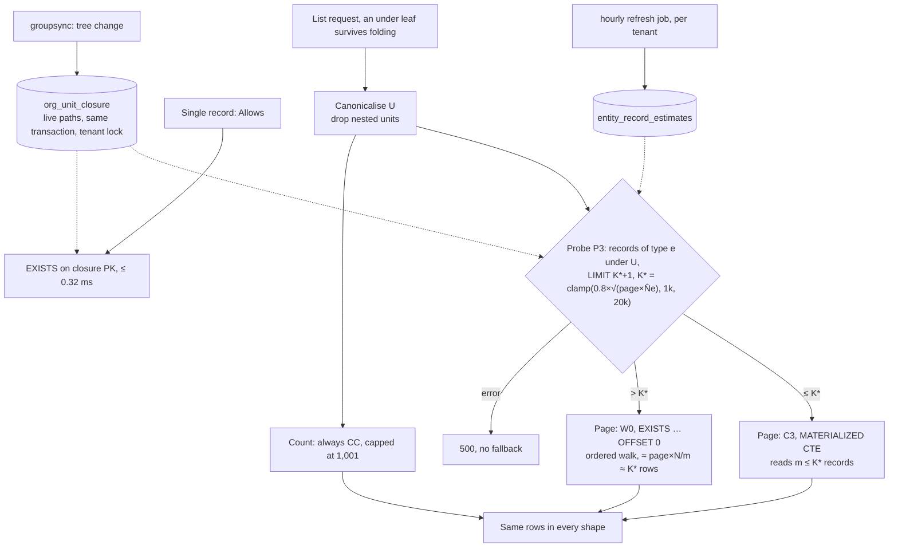

# ADR-010 amendment A2: the region leaf reads a closure table; the count is capped and the page picks its shape from a density threshold

> **Status: ACCEPTED** on 2026-11-21 by the Solution Architect (TICK-1040, PR #818), under the merge policy set by vknavaladi.
> - **Rev 1** was the one revision. It answered every round-1 item (B1 to B3, N1, N2), the security review, SP-1d and SP-1e.
> - **Round 2** found one blocking item, R2-B1 (sparse types under a large S), plus three non-blocking items. Both A2-12 conditions were met: the crossover cells set c = 0.8, and R2-B1 is folded in with measured rules (A2-5a, A2-7, A2-R6). The non-blocking items are folded in too. They are rules settled by a spike, not a new design round.
> - **One departure from the Technical Architect's recommendation**, stated in A2-7: the subtree bound is an alert, not a groupsync refusal, because refusing a sync would delay revocation.
> - No dissent is outstanding, and no CTO tie-break was needed.
>
> **Amended by [[ADR-010-A3-records-driven-region-shape]]** (ACCEPTED 2026-11-22): A2-5, A2-6, A2-7, A2-10 and A2-R6. A concentrated type under a large subtree renders shape R, chosen by a bounded closure count folded into P3.
>
> A2 decides the **mechanism** of the `under` leaf. It does **not** certify the list budget, which stays gated by TICK-1037 under R1 as rescored in A2-11. Changing a rule here needs a further amendment.
>
> **Invariants source.** As in ADR-010: ADR-001 I1 to I9. The project description is empty, so the checks below are against ADR-001's list. A2 touches I1 (tenant wall), I3 (database roles), I5 (the SQL list filter and the Go single-record check agree), I8 (configuration over code), and the Epic 06 150 ms list AC. It does not touch Temporal determinism, the sandbox or Mastra.

## Rev 1 changelog

| Item | Change |
|---|---|
| B1 (blocking) | `records_org_unit` key becomes `(tenant_id, org_unit_id, entity_definition_id) WHERE org_unit_id IS NOT NULL` (A2-3). SP-1e: probe 220 ms → 1.9 ms on a mixed-type district. |
| B2 (blocking) | C2 is out. The ≤ K page shape is **C3** (C2 inside a `MATERIALIZED` CTE), which cannot walk by construction (A2-5). L1 is rejected. |
| B3(a) (blocking) | The count's region branch is **always** the capped closure-driven CC, whatever the probe says. Only the page switches (A2-5). SP-1e: 0.6–1.1 s → 0.7–3.2 ms. |
| B3(b) (blocking) | "≤ about 1,000 rows at every size" is deleted. K is no longer the constant 1,000. It is **K\* = √(page × N̂_e)**, the point where C3 and W0 read the same number of rows, clamped to [1,000, 20,000] (A2-5, A2-7). SP-1e measured the failure the constant caused (+85 ms at m = 1,001 for a region-only caller). |
| Change 5 | The request-time "4 probes, then unprobed W0" path is deleted. It is replaced by a D4 publish rule: at most 4 distinct `under` start sets per policy, none nested (A2-8). |
| N1 | The closure build is specified from live roots (A2-1). The `closure_includes_tombstoned_path` mutant stays. |
| N2 | The groupsync rebuild takes a per-tenant transaction lock (A2-2). |
| SP-1d | The probe is **P3** (`unnest(U)` → closure → `LATERAL … LIMIT K+1`). It is O(K), not O(\|S\|), so no tree-size guard replaces `MaxUnderSet`. Disjoint branches are **not** in A2. R1 is scored on paired wall-clock. |
| SP-1e | U is canonicalised on every request (A2-4). N̂_e gets a source (A2-9). |
| Security | AR-TICK-1040-01 is rewritten as the reviewer gave it, at Low, with one sentence added for K\* (A2-6). The five implementation requirements are bound to tasks. |
| Removed | Rev 0's A2-8 ("SP-1d before ACCEPTED") is satisfied. Rev 0's K = 500 fallback is moot. |
| **At acceptance** (round 2 and the A2-12 (a) cells) | **c = 0.8**: the measured crossover is m ≈ 3,650 at N_e = 400k and page 51 (A2-9). **R2-B1:** rule 1, the rare-type shortcut (A2-5a); the O(K) claims corrected (A2-4, A2-7); the subtree bound as an alert at the certified 10,111 units, not a refusal (A2-7); residual A2-R6. **R2-N1:** `DISTINCT` on U, and duplicate ids refused at publish (A2-4, A2-8). **R2-N2:** residual A2-R5. **R2-N3:** the plan test also covers `sort=-created_at`. **ADR-008:** a Competitive Gate section, which CI-1 requires. |

## In plain words

- **The problem.** "Tickets in my region" means the ticket's org unit is my unit or any unit below it. ADR-010 D7 found "every unit below it" on each request by walking the tree, then passed the list of ids into the query. On S31's real schema that cost **+94 ms** at a 1,011-unit region and **+200 ms** at 10,000 units, against 3.8 ms of headroom.
- **What changes.**
  1. The tree is flattened once into `org_unit_closure`, rebuilt by groupsync in the same transaction as any tree change. No request walks the tree, and Go never holds the list of ids.
  2. A single-ticket check is one primary-key lookup.
  3. A ticket list caps its region count at the list's existing cap, so the count is cheap at every size. A probe counts the tickets under the units, stopping at K\* + 1. A small region gets a shape that reads only its own tickets (C3). A large one gets a walk over the newest tickets that stops after one page (W0). K\* is where the two cost the same, and it grows with how many tickets of that type the tenant has.
  4. Every shape asks the same question of each ticket. The probe changes speed, never which tickets you see.
- **What is not settled here.** Whether the worst case, a caller whose only access is "my region" at a subtree just above K\*, fits the budget. That needs a re-measured baseline and the crossover cells (A2-11, A2-12).
- **Codes used below.**
  - **U:** the start units of one `under` leaf, either the caller's units or the ids a policy lists.
  - **S:** the units at or below U.
  - **m:** the leaf's records of this entity type under S.
  - **N̂_e:** the estimated records of this entity type in this tenant.
  - **page:** the page statement's `LIMIT`.
  - **C3, W0, CC, P3:** the four SQL texts in A2-5.

## Decision

| # | Rule |
|---|---|
| **A2-1** | **Source: `org_unit_closure`.** Contract as in TICK-1032: `(tenant_id, ancestor_id, descendant_id)`, all `NOT NULL`, PK `(tenant_id, ancestor_id, descendant_id)`, FKs carrying `tenant_id` to `org_units`, ENABLE + FORCE RLS on `app.tenant_id`, `SELECT` only for `nava_app` and `nava_worker`, write grants for groupsync's role only, plus an isolation-registry row. **Live paths only:** `(a, d)` exists iff `a`, `d` and every unit from the tenant's root to `d` are live; every live-rooted unit has a self-row. The build starts from live roots, not from every live unit (critique T8; SP-1c's bench build left 1 orphan row): `WITH RECURSIVE live(id) AS (SELECT id FROM org_units WHERE tenant_id = $t AND parent_id IS NULL AND deleted_at IS NULL UNION ALL SELECT o.id FROM live l JOIN org_units o ON o.tenant_id = $t AND o.parent_id = l.id AND o.deleted_at IS NULL), c(a, d) AS (SELECT id, id FROM live UNION ALL SELECT c.a, o.id FROM c JOIN org_units o ON o.tenant_id = $t AND o.parent_id = c.d AND o.deleted_at IS NULL) INSERT INTO org_unit_closure SELECT $t, a, d FROM c` |
| **A2-2** | **Maintenance.** Groupsync deletes and re-inserts the tenant's closure rows **in the same transaction** as the org-tree change, with its config audit entry (TICK-1033). It first takes `pg_advisory_xact_lock(hashtext('org_unit_closure'), hashtext(tenant_id::text))`, so two rebuilds of one tenant serialise instead of failing on the PK or losing one (N2). A failed rebuild rolls the tree change back. A full rebuild of 10,111 units is about 0.3 s (SP-1b; re-measured on the live-roots build by TICK-1033). v1 has no incremental maintenance. |
| **A2-3** | **Index key (B1).** `records_org_unit` is `(tenant_id, org_unit_id, entity_definition_id) WHERE org_unit_id IS NOT NULL`, replacing TICK-947's `(tenant_id, org_unit_id)` on the story branch (TICK-1032, PR #819). The prefix still serves the FK check. No other `records` index is added; L1's `records_ou_list` (62 MB) is rejected. |
| **A2-4** | **U, and `Allows`.** • U for `{"of": "caller"}` is the caller's `org_unit_members` units, read per request. U for `{"of": [ids]}` is the listed ids, checked by D4 `foreign_id`. • **U is canonicalised on every request:** drop any u that has another member of U as a closure ancestor, in one statement (`… WHERE NOT EXISTS (SELECT 1 FROM org_unit_closure c WHERE c.tenant_id = $t AND c.descendant_id = u AND c.ancestor_id = ANY($U) AND c.ancestor_id <> u)`). U is first made `DISTINCT` (R2-N1): a policy can list an id twice, and one unit can have two membership rows. Without both steps, the `unnest(U)` renderings (P3, CC) count a record twice (SP-1e). A tree move can nest a published policy's ids, and a caller can be a member of nested units, so publish-time checks alone are not enough. TICK-1034 owns this step. • **`Allows`:** `under` is true iff `Row.OrgUnitID` is not NULL and `EXISTS (SELECT 1 FROM org_unit_closure WHERE tenant_id = $t AND ancestor_id = ANY($U) AND descendant_id = $row_org_unit)`. That is one PK probe, ≤ 0.32 ms p95 (SP-1b). • **Deleted** (TICK-1034, in the same PR as CC, never before it): `authz.ExpandUnder`, `BindUnder`'s set S, `MaxUnderSet`, `UnderSetTooLargeError`, the `access_scope_too_large` 500 and `authz_under_set_too_large_total`. No request-time refusal replaces the cap. For a type dense under S, P3 and CC read O(K) records (SP-1d). For a type sparse under a large S they visit every unit of S, which A2-5a and A2-7 bound (round 2, R2-B1). |
| **A2-5** | **List leaf, per surviving `under` leaf, per request.** All shapes are `r.org_unit_id IS NOT NULL AND …` with U bound as one `uuid[]`. • **Probe P3**, once per leaf before the statements, in the same transaction: `SELECT count(*) FROM (SELECT 1 FROM unnest($U) u(id) CROSS JOIN LATERAL (SELECT descendant_id FROM org_unit_closure WHERE tenant_id = $t AND ancestor_id = u.id) c CROSS JOIN LATERAL (SELECT 1 FROM records r WHERE r.tenant_id = $t AND r.entity_definition_id = $e AND r.org_unit_id IS NOT NULL AND r.org_unit_id = c.descendant_id LIMIT K+1) x LIMIT K+1) p`. It reads ≤ K + 1 records whatever \|S\| is (SP-1d: ≤ 1,008 at K = 1,000; root probe +4.2 → +0.7 ms). • **Count statement: always CC**, the same `unnest(U)` → closure → `LATERAL (records … AND NOT <earlier branches> LIMIT 1001)` shape, capped at the list's existing 1,001. **The CC cap does not follow K\***: it is the count's display cap, not a shape threshold. • **Page statement, probe ≤ K\* → C3:** `WITH acl_m AS MATERIALIZED (SELECT … FROM records r WHERE r.tenant_id = $t AND r.entity_definition_id = $e AND r.org_unit_id IS NOT NULL AND r.org_unit_id = ANY(ARRAY(SELECT descendant_id FROM org_unit_closure WHERE tenant_id = $t AND ancestor_id = ANY($U))) AND NOT <earlier branches>) SELECT * FROM acl_m ORDER BY <sort> LIMIT $page`. The CTE cannot be walked in sort order, so C3 reads exactly m ≤ K\* records whatever the statistics say. It was stable at three `n_distinct` values (SP-1e (7)). • **Page statement, probe > K\* → W0:** `EXISTS (SELECT 1 FROM org_unit_closure c WHERE c.tenant_id = $t AND c.ancestor_id = ANY($U) AND c.descendant_id = r.org_unit_id OFFSET 0)`. `OFFSET 0` keeps the ordered `records_list_updated` walk with one closure-PK probe per row (PG 16.10, SP-1c and critique C2). • **Rejected:** C1 (plan follows a sampled statistic), C2 (plan not fixed, T1b), L1 (62 MB, O(\|S\|) above K), disjoint branches (page-only gain of 1 to 2 ms, changes CI-6; the disjoint count costs 497 ms, SP-1d). • **Lifetime:** the probe result lives for this request only. Nothing is cached across requests in v1. • **A2-5a, the rare-type shortcut (R2-B1 rule 1).** When N̂_e ≤ K\*, P3 is skipped, and the page and the count both render W0. Each reads ≤ N̂_e ≤ K\* records, whatever \|S\| is. &nbsp;&nbsp;- Measured (crossover cells, X3): a 500-record type at root drops from +71.1 / +122.8 to +7.7 / +15.4 ms. &nbsp;&nbsp;- A missing N̂_e row counts as **not** rare, so P3 runs. &nbsp;&nbsp;- W0 is never used for the count of a type with N̂_e > K\*: the cells measured 64 to 288 ms for that. |
| **A2-6** | **Visibility invariant.** • C3, W0, CC and `Allows` compute one predicate on the row: *`org_unit_id` is not NULL and a closure row has `tenant_id = $t`, `ancestor_id ∈ U`, `descendant_id = org_unit_id`*. • `descendant_id` is `NOT NULL`, and `ARRAY()` over zero rows is `'{}'`. So an empty U is false in every shape, and `not under` is true (D5a; critique C1). • Canonical U makes CC's count equal the distinct-row count. • The probe and K\* select SQL text only: a stale or wrong probe count or N̂_e changes cost, never rows. A probe error returns 500 and never falls back to another shape (fails closed). **Security requirements (review 01a1fcad, bound to tasks):** 1. P3 runs only for ACL-policy `under` leaves. No request filter may reuse it without a new security review (TICK-1036). 2. The shape, the probe count, K\* and N̂_e never reach a response (no `Server-Timing` or debug header). They never appear in logs or spans that carry a tenant or user id (TICK-1036). 3. `$t` in P3, CC and the page comes from the same request-context value as `set_config('app.tenant_id', …)` (TICK-1036). 4. A cross-tenant test: tenant B has closure rows and more than K records under A's unit ids. A's P3, CC, C3, W0 and `Allows` see none of them, and A's probe count is unchanged by B (TICK-1032, TICK-1035). 5. Any future cross-request cache is keyed by (tenant, entity definition, canonical U) and needs a new security review. **Accepted risk AR-TICK-1040-01 (🟡 Low).** Time-to-response can reveal whether more than K\* records of that entity type sit under U, including records the caller cannot read. Through K\*, it can also roughly reveal the tenant's volume of that type. All of this stays inside the tenant. |
| **A2-7** | **Bounds that hold.** • P3 reads ≤ K\* + 1 records. CC reads ≤ 1,001 plus the earlier branches' anti-join probes. • C3 reads m ≤ K\* records. • W0 reads about page × N_e / m when the subtree's records are spread over time like the rest. At m just above K\* that is about page × N_e / K\* = **K\***. So both sides of the switch read about K\* records at the threshold, and fewer away from it. • **Where the W0 bound fails:** a subtree whose records are all older than most others, for example a dormant office. W0 then reads up to the newer records of the whole type. This is residual risk A2-R2. • Agents whose earlier branches fill the page stop the walk early: SP-1e saw 542 to 1,016 rows. • **Corrected at acceptance (R2-B1).** For dense types, P3, CC and C3 read O(K\*) records. For rare types (N̂_e ≤ K\*), A2-5a reads ≤ N̂_e. For **concentrated types** (N̂_e > K\* but few records under S), P3, CC and C3 visit every unit of S. That costs about **10 µs per unit**: +11.0 ms at 1,011 units, and **+93.9 / +151.6 ms at 9,099 units** for a region-only caller (crossover cells, X3). • **The subtree bound is an alert, not a refusal.** A2 is certified to the bench tree's **10,111 live units per tenant**. Groupsync exports `groupsync_org_units_live_max` (the largest tenant's live-unit count, with no tenant label) and alerts above 10,111. &nbsp;&nbsp;- Groupsync **never refuses a sync** on size. A refusal would stop tombstones and membership removals from reaching the closure, which delays revocation (AR-TICK-901-01; D7: "a deleted unit cannot stop sync"). That would trade a security property for latency, and house priority 2 outranks priority 6. &nbsp;&nbsp;- The Technical Architect recommended a refusal at 10,111; this text departs from that for the reason above. The cost case is carried as A2-R6. |
| **A2-8** | **D4 publish rule (change 5).** A policy may hold at most **4 distinct `under` start sets** across its leaves. Within one leaf, no listed id may appear twice, or be a closure ancestor of another listed id. Either violation is a 422 with a pointer, alongside A1-1's caps (TICK-1034). `{"of": "caller"}` counts as one set. No request-time probe cap or unprobed path remains. |
| **A2-9** | **N̂_e, the volume estimate.** No per-tenant, per-entity record count exists (Technical Lead, 01a1fcef; `record_counters` is the numbering sequence, purged per period, ADR-005 §4). A2 adds one: • **Table `entity_record_estimates`:** `tenant_id uuid NOT NULL`, `entity_definition_id uuid NOT NULL`, `live_records bigint NOT NULL CHECK (live_records >= 0)`, `refreshed_at timestamptz NOT NULL`. PK `(tenant_id, entity_definition_id)`, FK `(tenant_id, entity_definition_id)` → `entity_definitions`. ENABLE + FORCE RLS on `app.tenant_id`. `SELECT` for `nava_app`; `SELECT, INSERT, UPDATE` for the refresh job's role only. It gets an isolation-registry row. It is derived data, not configuration, so it gets no config audit entry. • **Refresh job:** hourly, one tenant at a time, under that tenant's `app.tenant_id` and RLS. It runs as a role that already has tenant-scoped `SELECT` on `records`. It must not add a cross-tenant read policy on `records`, and it must not write from the record write path. It upserts `count(*)` per `entity_definition_id` (an index-only scan on `records_list_updated`'s prefix). The Technical Lead picks the host process within these rules. If it is a Temporal workflow, the count runs in an activity. • **Use:** `K* = clamp(c × √(page × N̂_e), 1,000, 20,000)`, with **c = 0.8**, measured by the A2-12 (a) cells: C3 and W0 cross at m ≈ 3,650 for N_e = 400k and page 51, so c = 3,650 / 4,516 ≈ 0.81. A missing row means K\* = 1,000, which is also the value for any type under about 20,000 records. Bench scale (N_e = 400k, page 51) gives K\* ≈ 3,600. The ceiling is reached at N_e ≈ 12M. K\* is a computed value, not a setting: no tenant or operator can change it (I8 does not apply to a shared-budget guard, as with A1-1). |
| **A2-10** | **Observability.** `authz_under_list_shape_total{shape="c3"\|"walk"}` and `authz_under_probe_seconds`, with no tenant, user, unit, count or K\* label. Also `authz_under_estimate_age_seconds` (max over tenants) and `entity_record_estimates_refresh_failures_total` for the refresh job. |
| **A2-11** | **Budget scoring (R1, rescored).** R1 is judged on **paired wall-clock**, probe round trip included, behind the P3-36 floor gate. If the gate refuses, the run is "not scored"; there is no fallback to server-side `EXPLAIN` (SP-1d objection, accepted). The budget question is answered by TICK-1037: the handler p95 with a region policy, against **150 ms directly**. It is measured for the **worst persona**, a caller whose only grant is `under`, on the six P3-36 subtrees plus uniform m ∈ {1,001, 3,000, 4,500, 10,000}. The 3.8 ms headroom figure is retired; it was derived from a 146.2 ms baseline that SP-1d (119.99) and QA (159.01 to 176.48, contended) could neither confirm nor replace. If TICK-1037 fails for the worst persona, the Solution Architect takes option (iii) to the CTO with two costed options: an index matching the region top-N (a write cost on every ticket create), or a product decision on the budget for region-only callers. Either outcome is a further amendment. A2's mechanism stands in both. |
| **A2-12** | **Conditions for ACCEPTED: both met on 2026-11-21.** (a) gave c = 0.81, recorded as 0.8. The worst cell at K\* for the region-only caller is **+25.5 / +27.2 ms** (uniform m = 4,500), against +85.4 ms at K = 1,000. (b) The round-2 check is folded in. The conditions as written before acceptance: (a) The crossover cells on TICK-1043's harness: a count-only caller at uniform m ∈ {1,001, 3,000, 4,500, 10,000}, C3 uncapped against W0, then the A2-5 mechanism at K\* across all ten sets. They set **c** in A2-9 to the measured crossover, which is recorded at acceptance without a further revision. If C3 and W0 do not cross at all inside the clamp, A2 is re-decided, not patched. (b) The Technical Architect's round-2 check of this text. A2 is **not** held for the budget (A2-11). |

## Evidence

**Paired wall-clock, behind the floor gate (SP-1e, 07:04Z). Per-pair median / Δp95, in ms, with the mechanism at a fixed K = 1,000.** Other tasks' containers were up, so cells within ±2 to 3 ms are not separable. The baseline is not rebased. All mechanisms return the same ids and capped count as the reference, for 40 of 40 agents and the count-only caller in all 10 sets.

| Set (units, tickets) | agents | count-only (region-only caller) |
|---|---|---|
| area (10, 220) | +3.95 / +2.73 | +6.09 / +7.56 |
| district (101, 3,379) | +5.67 / +7.72 | **+31.45 / +41.27** |
| thin (101, 600) | +6.66 / +9.75 | +9.12 / +11.72 |
| hot (101, 22,996) | +3.57 / +4.71 | +8.15 / +11.31 |
| region (1,011, 37,930) | +3.95 / +5.12 | +9.37 / +11.04 |
| root (10,111, 380,048) | +2.51 / +2.34 | +5.54 / +8.62 |
| mixed (101, 900 + 150k other type) | +6.69 / +8.86 | +9.49 / +13.00 |
| uniform m = 1,001 | +6.12 / +7.48 | **+85.43 / +161.59** |
| uniform m = 3,000 | +9.59 / +13.05 | **+47.66 / +63.29** |
| uniform m = 10,000 | +7.06 / +11.82 | +20.45 / +26.85 |

What these cells show, and why K\* follows from them:

- **At K = 1,000, every region-only failure sits on the W0 side just above K.** The cost falls as m grows: +85, then +48, then +20 ms. That is the page × N_e / m curve. C3 at ≤ K costs +4 to +7 ms and reads m rows.
- **Moving the switch to where the two curves cross removes the steep end of the W0 curve.** The A2-12 (a) cells measured that crossover at m ≈ 3,650 (c = 0.8).
- **Measured, not inferred:**
  - B1: probe 220 ms → 1.9 ms on the mixed district.
  - CC: 0.7 to 3.2 ms, against 0.6 to 1.1 s for the W0 count.
  - P3: root probe +4.2 → +0.7 ms.
  - Disjoint count: 497 ms.
- **Measured at acceptance (crossover cells X2, probe harness, gated paired wall-clock):** the worst cell at K\* is **+25.5 / +27.2 ms** for the region-only caller and +22.6 / +25.6 ms for agents (uniform m = 4,500). The c = 0.8 cross-check worst is +24.8 ms, within noise. Every other set is ≤ +19.2 ms median. These are harness deltas, not handler p95s: the budget verdict is TICK-1037's.

## Risks and residuals

| # | Risk | Owner | Trigger to re-decide |
|---|---|---|---|
| A2-R1 | Region-only callers at m ≈ K\* are over the 150 ms budget | Solution Architect | TICK-1037 fails for the worst persona → (iii) to the CTO (A2-11) |
| A2-R2 | W0's bound fails on a subtree whose records are all older than the rest of the type (a dormant unit) | Technical Lead | `authz_under_list_shape_total{shape="walk"}` together with a slow-list report for a region-only caller; the fix is the top-N index in A2-11 |
| A2-R3 | N̂_e is stale or missing, so K\* is mis-set | Technical Lead | `authz_under_estimate_age_seconds` above 3 h. Cost only, never rows (A2-6) |
| A2-R4 | A PostgreSQL upgrade changes the `OFFSET 0` fence or the `MATERIALIZED` CTE behaviour | Postgres & Data Modeling Specialist | The CI plan test (Consequences) fails |
| A2-R5 | A selective request filter with no ordered index moves W0's effective crossover to √(page × N_e / f) (R2-N2). This is the same class as R-006 (PR #815, the broad-ACL page walk). | Technical Lead | As R-006. No mechanism change: the worst persona stays the design point. |
| A2-R6 | A type concentrated outside most of a large S costs about 10 µs per unit of S: +94 ms at 9,099 units for a region-only caller (R2-B1, X3). | Solution Architect | TICK-1037 adds the `bench_conc` set. If it fails, A2-R6 goes with A2-R1 to the CTO as (iii), with a sparse-type rendering spike as the SQL option (for example, a hash join on the closure side). Also re-decide when `groupsync_org_units_live_max` exceeds 10,111. |
| AR-TICK-1040-01 | Timing reveals K\*-side and type volume inside the tenant | Security & Multi-Tenancy Reviewer | Per-unit or per-type record volume becomes confidential from those users, or any client-supplied filter would run the probe |

R8 (AR-TICK-901-03, the 10,000-unit cap) is retired when TICK-1034 merges; its register row is deleted in that PR.

## Competitive Gate (ADR-008)

**Result:** PASS with accepted risk CP-SF-02
1. **Axis moved:** X3 (speed). On the probe harness, the region list leaf goes from +94 ms at 1,011 units and +200 ms at 10,000 (D7 as merged) to a measured worst of +25.5 ms median at K\*. The 150 ms budget verdict stays with TICK-1037, so X3 remains "Unproven" until then. X2 is unchanged: an access-rule change is still one publish.
2. **Pain points:**
   - **Still risks CP-SF-02**, through A2-8's new publish cap: 4 distinct `under` start sets per policy, with no nested or duplicate ids. All five D11 items hold:
     1. I5 requires it: a canonical, bounded U keeps the SQL count equal to the Go check.
     2. It is published here.
     3. It is the same at every tier and for every tenant.
     4. It is refused at save with a typed 422 and a pointer.
     5. It is sized from a measurement: no real policy has more than one U, and the request-time cost is measured per U.
   - Deleting the 10,000-unit refusal removes a limit (D7's typed 500).
   - **Avoids CP-SF-06.** The probe and every shape stay inside the tenant (A2-6, Security APPROVE), and a wrong estimate costs time, never rows.
3. **Measured by:** SP-1b to SP-1e and the A2-12 (a) cells. The budget is measured by TICK-1037 (R1, worst persona).
4. **Parity:** I1 to I9 unchanged.
   - I1 is kept: FORCE RLS on both new tables, and no cross-tenant read policy for the refresh job.
   - I3 is kept: no `SECURITY DEFINER`.
   - I5 is strengthened: three shapes share one predicate, checked by the agreement suite.
   - I8: K\* is computed, not configured, because it guards a budget every tenant shares.

## Rejected options

| Option | Why not |
|---|---|
| D7 as written: expand S per request, bind `ANY($S)` | +94 ms at region, +200 ms at 10,000 units, 305 ms to refuse (TICK-951) |
| C1 at every size | The plan follows a sampled `n_distinct`: an 8.5× miss in SP-1b, and plans that flip between runs (SP-1c). It is the interim list shape in TICK-1034 only. |
| C2 at ≤ K | Its plan is not fixed: it walked 11,001 rows on T1b. Without B1 it reads every entity type under S. |
| L1 (per-unit `LATERAL` top-N) | A new 62 MB index with an unmeasured write cost. O(\|S\|) above K: +44 ms at region, 1.1 s at root (SP-1e). |
| A groupsync refusal at a subtree size (R2-B1 rule 2, as proposed) | It would delay revocation for a large tenant, because tombstones and removals stop reaching the closure. The cost follows how sparse a type is under S, not tree size, so any size low enough to bound it (about 2,400 units) refuses the certified tree. It is replaced by an alert plus A2-R6 (A2-7). |
| Fixed K = 1,000 (rev 0) | Puts the worst case at W0's steepest point: +85 / +162 ms at m = 1,001 for a region-only caller |
| A second threshold K2 with a capped C3 between K and K2 | C3 reading up to K2 ≈ 20,000 rows costs more than W0 at that density. It adds a branch without lowering the worst case. |
| Disjoint branches (page) / disjoint count | Page: 1 to 2 ms gained, and it changes CI-6's text. Count: 497 ms (SP-1d). |
| N̂_e from `record_counters` | It is the numbering sequence, scoped per period and purged. It would read near zero in January for yearly numbering. |
| N̂_e from `pg_class` / extended statistics on `(tenant_id, entity_definition_id)` | `pg_stats_ext` would show `nava_app` other tenants' volumes (I1) |
| A per-write counter | Adds a hot row on every ticket create, to protect a value whose error only costs time |
| A configurable K | It guards a budget every tenant shares, so it is computed, never set |
| A planner hint extension | `OFFSET 0` and `MATERIALIZED` fix the plans in plain SQL on PG 16.10 |

## Consequences

- **Tasks.** All are already open under S31; the Technical Lead mapped them in 01a1fcc9 and 01a1fcef.
  - TICK-1032: closure, the B1 key, the cross-tenant test.
  - TICK-1033: rebuild with the tenant lock.
  - TICK-1034: canonical U, `Allows`, CC, the deletions, the A2-8 publish rule.
  - TICK-1035: agreement suite.
  - TICK-1036: P3, K\*, C3 / W0.
  - TICK-1037: R1 per A2-11.
  - **New, opened on ACCEPTED:** the `entity_record_estimates` migration and refresh job (A2-9). It gates TICK-1036. `postgres-dev` can start the table from A2-9 before the job code.
- **Tests that prove A2.**
  - **Agreement suite:** every case runs with C3 forced, W0 forced and through the probe, plus CC, and each result is compared with `Allows`.
  - **New cases:** a tombstoned intermediate unit; a live unit under a tombstoned one given as an `of` id, for both `under` and `not under`; the hot, thin and mixed districts; empty U; NULL `org_unit_id`; U = {EMEA, EMEA/Germany}, which must give the same rows and `total` as U = {EMEA}.
  - **Mutants:** `closure_includes_tombstoned_path`, `probe_changes_rows`, `u_not_canonical` (nested ids and a duplicate id), `count_follows_probe`, `c3_without_materialized`, `walk_without_offset`.
  - **CI plan test on the pinned PostgreSQL:** W0 plans a SubPlan on `org_unit_closure_pkey` under `records_list_updated`, with no semi-join. C3 plans a CTE Scan over a materialized CTE. P3's records access is per-unit `LATERAL` with `LIMIT`. The W0 fence is checked on two sort keys, `sort=-updated_at` and `sort=-created_at` (R2-N3).
  - **K\* unit tests:** both clamp ends; a missing N̂_e row gives 1,000 and runs P3; a wrong N̂_e still returns correct rows.
  - **A2-5a test:** N̂_e ≤ K\* skips P3 and renders W0 for both the page and the count, with the same rows as the probed path.
  - **TICK-1037 sets:** add `bench_rare` and `bench_conc` from the crossover cells.
- **Handbook:** the `core-acl` and region pages change (Technical Lead, TICK-954).
- **ADR-010 text:** D4, D7, R1 and R8 get a pointer to A2 on ACCEPTED, as E2 did.

## Open questions

None of these blocks the verdict.

1. **Should the refresh job also run after a bulk import?** v1 says no: a stale N̂_e only costs time. Revisit if A2-R3 fires.
2. **Should K\* include the earlier branches' expected fill?** That is the agents' case, where the walk stops early. No: it would make the shape depend on more than the leaf. The worst persona is the design point.
