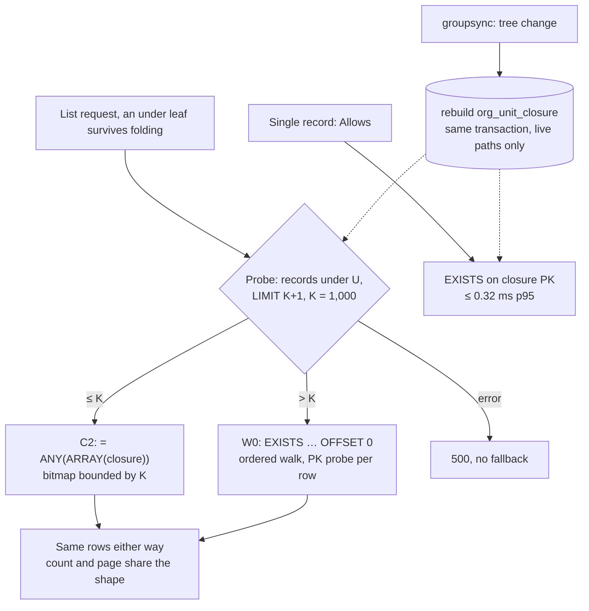

# ADR-010 amendment A2: the region leaf reads a closure table, and lists choose their SQL shape from a capped probe

> **Status: DRAFT** (2026-11-21). It is not ACCEPTED before SP-1d reports (A2-8). It decides the **mechanism** of the `under` leaf only. It does **not** certify the list budget: S31 (TICK-946) still goes to acceptance only after TICK-1037 passes ADR-010 R1 on an idle host.
>
> **Invariants source.** As in ADR-010: ADR-001 I1 to I9; the project description is empty, so the invariant checks below are against ADR-001's list. This amendment touches I1 (tenant wall), I5 (the SQL list filter and the Go single-record check agree) and the 150 ms list budget (Epic 06 AC). It does not touch Temporal, the sandbox or Mastra.

## In plain words

- **The problem.** "Tickets in my region" means: the ticket's org unit is my unit or any unit below it. ADR-010 D7 found "every unit below it" on each request by walking the tree, then passed the whole list of unit ids into the ticket query. On S31's real schema that costs **+94 ms** at a 1,011-unit region and **+200 ms** at 10,000 units (TICK-951), far over the 3.8 ms headroom the list budget has left.
- **What changes.**
  1. The tree is flattened once, into a table `org_unit_closure` that lists, for each live unit, every live unit at or below it. Groupsync rebuilds it in the same transaction as any tree change. No request walks the tree, and Go never holds the list of ids.
  2. A single-ticket check becomes one primary-key lookup in that table.
  3. A ticket list first runs a cheap **probe**: "are there more than 1,000 tickets under these units?" It stops counting at 1,001. With 1,000 or fewer it uses one SQL shape (C2); with more it uses another (W0, the walk). Both shapes ask exactly the same question of each ticket, so the probe changes speed, never which tickets you see.
- **What is not fixed yet.** A 101-unit district still costs about **+5.7 ms** median against the 3.8 ms headroom (SP-1c, not budget-grade). SP-1d tests the two levers that should close it. If they fail, the gap goes to the CTO as option (iii).
- **Codes used below.** S = the set of units at or below the start units. U = the start units (the caller's units, or the ids a policy lists). K = the probe threshold. C1, C2, W0 = the three SQL shapes SP-1b and SP-1c measured (A2-3). I5 = ADR-001's "SQL and Go agree". R1 = ADR-010's list-budget risk.

## Decision

| # | Rule |
|---|---|
| **A2-1** | **Source: `org_unit_closure`.** Contract as in TICK-1032: `(tenant_id, ancestor_id, descendant_id)`, all `NOT NULL`, PK `(tenant_id, ancestor_id, descendant_id)`, FKs carrying `tenant_id` to `org_units`, ENABLE + FORCE RLS on `app.tenant_id`, `SELECT` only for `nava_app` and `nava_worker`, write grants for groupsync's role only. **Rows are live paths only:** `(a, d)` exists iff `a`, `d` and every unit on the path from the tenant's root to `d` are live; every such unit has a self-row. So a tombstoned unit, and every unit below it, has no row as ancestor or descendant. This is D7's tombstone rule, now held by the data instead of by a per-request walk. |
| **A2-2** | **Maintenance.** Groupsync deletes and re-inserts the tenant's closure rows **in the same transaction** as the org-tree change, with its config audit entry (TICK-1033). A full rebuild is one `INSERT … WITH RECURSIVE`: 49,321 rows for 10,111 units in 234 to 347 ms (SP-1b, SP-1c). v1 has no incremental maintenance. A failed rebuild rolls the tree change back, so the closure never disagrees with `org_units` at commit. |
| **A2-3** | **The three shapes**, all `r.org_unit_id IS NOT NULL AND …`: • **C1** `r.org_unit_id IN (SELECT descendant_id FROM org_unit_closure WHERE tenant_id = $t AND ancestor_id = ANY($U))` • **C2** `r.org_unit_id = ANY(ARRAY(SELECT descendant_id FROM org_unit_closure WHERE tenant_id = $t AND ancestor_id = ANY($U)))` • **W0** `EXISTS (SELECT 1 FROM org_unit_closure c WHERE c.tenant_id = $t AND c.ancestor_id = ANY($U) AND c.descendant_id = r.org_unit_id OFFSET 0)` U is bound as one `uuid[]` argument. For `{"of": "caller"}` it is the caller's `org_unit_members` units; for `{"of": [ids]}`, the listed ids (already checked as the tenant's own by D4 `foreign_id`). |
| **A2-4** | **`Allows` (single record):** `under` is true iff `Row.OrgUnitID` is not NULL and `EXISTS (SELECT 1 FROM org_unit_closure WHERE tenant_id = $t AND ancestor_id = ANY($U) AND descendant_id = $row_org_unit)`: one PK probe, ≤ 0.32 ms p95 server side (SP-1b). **`authz.ExpandUnder`, `BindUnder`'s set S, `MaxUnderSet`, `UnderSetTooLargeError`, the `access_scope_too_large` 500 and `authz_under_set_too_large_total` are deleted** (TICK-1034). Go never builds S. |
| **A2-5** | **List leaf: the capped probe.** Only when an `under` leaf survives folding, and once per distinct U per request, before the count and page statements and in the same transaction: `SELECT count(*) FROM (SELECT 1 FROM records r WHERE r.tenant_id = $t AND r.entity_definition_id = $e AND r.org_unit_id IS NOT NULL AND r.org_unit_id IN (SELECT descendant_id FROM org_unit_closure WHERE tenant_id = $t AND ancestor_id = ANY($U)) LIMIT K + 1) p` (the exact text is SP-1d's records-driven rendering, A2-8). **K = 1,000**, a Go constant, not configurable: it protects the list budget every tenant shares (as A1-1's caps). • **probe ≤ K → C2.** C2 hides S from the planner and plans a bitmap over every record in S; that is safe **only** because the probe has just bounded those records to K. • **probe > K → W0.** `OFFSET 0` stops PostgreSQL pulling the `EXISTS` up into a semi-join, so the plan stays the ordered `records_list_updated` walk with one closure-PK probe per row (verified on PG 16.10, SP-1c Known 1). • **C1 is rejected** for lists: its plan follows a sampled `n_distinct`, so at district size it flips between a 3,434-row sort (SP-1b) and a 949-row walk (SP-1c) with no change to the request. • **W0 never runs at or below K**: on a 10-unit area it reads 6,396 rows, +30.6 ms median (SP-1c Known 2). • The count and page statements use the **same** shape. The probe result lives for this request only; nothing is cached across requests in v1. |
| **A2-6** | **Visibility invariant.** C2, W0 and `Allows` compute the same predicate on the row: *`org_unit_id` is not NULL and some closure row has `tenant_id = $t`, `ancestor_id ∈ U`, `descendant_id = org_unit_id`*. An empty U, or a U with no live rows, makes every shape false (and `not under` true), as D5a requires. The probe selects SQL text only: a stale or wrong probe count changes cost, never rows. Consequences: • The probe runs as `nava_app` under FORCE RLS with explicit `tenant_id`, and its count never leaves the server (no log field, no response field, no metric label). • **Side channel, accepted:** the request time can reveal whether more than K tickets of this entity type sit under the caller's own units. It is within the caller's tenant and about their own region; the Security & Multi-Tenancy Reviewer confirms or blocks this in critique. • A probe error fails the request (500), never falls back to a shape. |
| **A2-7** | **Bounds.** The region branch reads **≤ about 1,000 records** at every size (SP-1c: largest 949, at the district). At most **4 probes** per request: leaves with a 5th or later distinct U render W0 without probing (W0 is correct at every size; its worst case is bounded rows read on large S, against C2's unbounded bitmap). With no per-request walk there is no per-user subtree cap; R8 becomes `groupsync_org_subtree_max`, a metric with an alert, and any refusal moves to a groupsync tree-size check, never to a request. |
| **A2-8** | **Depends on SP-1d before ACCEPTED.** SP-1d (Technical Architect, same schema and harness as TICK-1038) must show: (1) a probe rendering that stays records-driven at K = 1,000 at region and root (SP-1c: the probe as written unique-ifies the whole closure set first, +5.1 ms at root); (2) the disjoint-branch variant (the four earlier branches' `AND NOT` removed) end to end with (1); (3) an idle-host pass, wall-clock and server-side both reported. **If (1) fails, A2 records K = 500 with its measured row** (worst +7.8 ms, thin district) and the probe rendering SP-1c used. A2's other rules do not change. |
| **A2-9** | **Residual risk, named.** A 101-unit district: **+5.7 ms median / +8.5 ms Δp95** (SP-1c, server-side, busy host) against 3.8 ms. SP-1c measures 39 % of that branch in the anti-joins; removing them is inferred at +3 to +3.5 ms, not measured. Closed by SP-1d (2), or escalated to the CTO as option (iii) (win back headroom elsewhere). Relaxing the 150 ms AC is a product call and is not proposed. |

## Evidence

SP-1c (TICK-1038), S31's migrated schema (`TICK-946/in-my-region` at `c84b1827`), 800k seed, PG 16.10, region branch fifth (worst position), as `nava_app` with `force_custom_plan`. Server-side planning + execution, probe included, 300 alternating pairs per cell. Per-pair median Δ / Δp95, ms. **Busy host: not budget-grade.**

| Mechanism | area 10 | district 101 | thin 101 (600 tickets) | hot 101 (22,996) | region 1,011 | root 10,111 | worst median |
|---|---|---|---|---|---|---|---|
| **A2: probe K=1000 → C2 / W0** | +2.3 / +3.3 | **+5.7 / +8.5** | +4.8 / +11.4 | +2.7 / +4.3 | +3.9 / +5.5 | +4.4 / +6.7 | **+5.7** |
| A2 fallback: probe K=500 → C2 / W0 | +2.3 / +3.3 | +5.7 / +9.5 | +7.8 / +19.6 | +2.7 / +4.6 | +3.3 / +4.6 | +1.7 / +2.4 | +7.8 |
| Rejected: probe K=1000 → C1 / W0 | +2.7 / +3.9 | +7.0 / +15.5 | +11.9 / +36.5 | +2.9 / +4.6 | +4.0 / +5.9 | +5.0 / +6.8 | +11.9 |
| Rejected: W0 alone | +30.6 / +71.5 | +3.5 / +5.6 | +8.3 / +26.0 | +1.8 / +3.1 | +1.6 / +2.8 | +0.2 / +0.9 | +30.6 |
| Rejected: C2 alone | +1.6 / +2.5 | +7.1 / +9.5 | +2.9 / +4.3 | +37.4 / +50.9 | +77 / +123 | +760 / +1,185 | +760 |
| Replaced: D7 as merged (TICK-951, wall-clock Δp95) | −0.3 | +21.8 | — | — | +94.4 | +199.9 (10,000) | — |

Rows read by the region branch under A2: area 220, district 949, thin 600, hot 448, region 329, root 52.

## Rejected options

| Option | Why not |
|---|---|
| D7 as written: expand S per request, bind `ANY($S)` | +94 ms at region, +200 ms at 10,000, 305 ms to refuse an oversized caller (TICK-951). Plans were fine; planning, binding S and the walk were the cost. |
| C1 at every size | Correct, and the interim rendering until TICK-1036 ships. Rejected as the final shape: at district size its plan follows a sampled statistic (8.5× underestimate in SP-1b; +30 to +37 ms Δp95), and raising the statistics target does not fix it. |
| C2 or B1 (`ANY` over a hidden set) at every size | Bitmap over every record in S: 380,048 rows and about +1 s at root. |
| Probe → C1 ≤ K (as first specified in SP-1c) | Same statistic dependence below K: worst +11.9 ms median on the thin district. |
| A stored per-subtree record count instead of a probe | Another table groupsync must keep exact under every ticket create and move; a stale count only costs speed, but the probe gives the same answer fresh for about 1 ms with nothing to maintain. Revisit if SP-1d's probe cannot stay records-driven. |
| A planner hint (`pg_hint_plan`) | A new extension in the database image for one leaf; `OFFSET 0` does the job on PG 16.10 without it. |
| A tenant- or operator-configurable K | K protects the shared list budget; a per-tenant value would let one tenant's setting decide another's latency. Changed by amendment, from a measurement. |

## Consequences

- **Tasks** (all under S31, already open; no new task): TICK-1032 closure migration; TICK-1033 groupsync rebuild; TICK-1034 `Allows` on the closure, C1 for lists in the interim, deletions per A2-4; TICK-1036 the probe switch, **C2 ≤ K, not C1**; TICK-1035 agreement suite; TICK-1037 the R1 rerun gate.
- **Tests that prove A2** (TICK-1035 and TICK-1036):
  - The agreement suite runs every case three times, forcing C2, forcing W0 and through the probe, and compares each with `Allows` (A2-6). New cases: a tombstoned **intermediate** unit (its live descendants drop out), a live unit below a tombstoned one used as an explicit `of` id, the skewed hot and thin districts, empty U, NULL `org_unit_id`, and `not under`.
  - New mutants: `closure_includes_tombstoned_path`, `probe_changes_rows` (a shape that drops a row on one side of K), `c2_above_k`, `walk_without_offset`.
  - A plan test on the pinned PostgreSQL (`docs/pins.md`): W0's plan contains a SubPlan on `org_unit_closure_pkey` under an Index Scan on `records_list_updated`, and no semi-join. A PostgreSQL upgrade that breaks it fails CI, and re-opens A2-5.
  - Cross-tenant: a closure row of tenant B never satisfies a tenant A leaf, probe included (isolation registry row from TICK-1032).
- **Observability:** `authz_under_list_shape_total{shape="c2"|"walk"|"walk_unprobed"}` and `authz_under_probe_seconds`. No unit id, no count and no tenant id in labels or logs.
- **Handbook:** the `core-acl` and region pages change (Technical Lead, TICK-954).
- **ADR-010 text:** D7's fourth and fifth bullets, R1 and R8 carry a pointer to A2 when it is ACCEPTED, as E2 did.

## Open questions for the critique

1. **Disjoint branches as a compiler rule?** Should A2 require the D4 compiler to emit disjoint branches (no `AND NOT` chain), which changes CI-6's expected SQL text, or leave it a performance option? I would decide from SP-1d (2).
2. **The 4-probe cap (A2-7).** Is 4 the right number, and is W0 the right unprobed default? No real policy today has more than one distinct U.
3. **The side channel (A2-6).** Security & Multi-Tenancy Reviewer: accept, or require the probe to be skipped when it would be the only region information the caller lacks?
