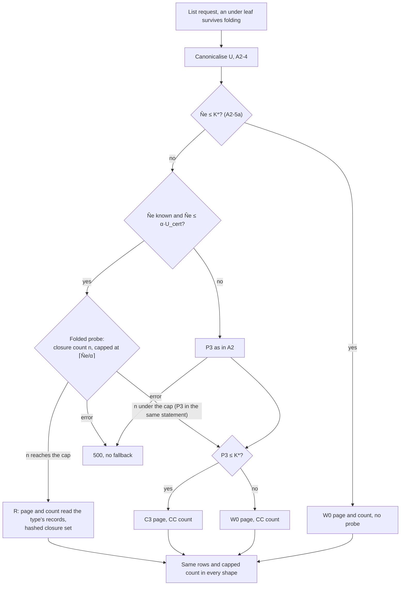

# ADR-010 amendment A3: a concentrated type under a large subtree reads its own records instead of visiting every unit

> **Status: PROPOSED** on 2026-11-22. Waiting for the Technical Architect's critique and the Security & Multi-Tenancy Reviewer's check of the AR-TICK-1040-01 extension (A3-7). The Solution Architect gives the verdict after both. A contested point goes to the CTO.
>
> A3 decides the **mechanism** for A2-R6. It does not rescore TICK-1037's FAIL. The budget verdict comes from the TICK-1037 rerun after the implementation task (A3-9).
>
> **Invariants source.** As in ADR-010 and A2: ADR-001 I1 to I9. The project description is empty, so the checks below are against ADR-001's list. A3 touches I1 (tenant wall), I5 (the SQL list filter and the Go single-record check agree), I8 (configuration over code) and the Epic 06 150 ms list AC. It does not touch Temporal determinism, the sandbox or Mastra.

## In plain words

- **The problem (A2-R6).** Under A2, the region part of a ticket list starts from the units: for each unit of the caller's subtree S, it looks for records of this type. A type with few records under S (a *concentrated* type: 20,000 records, almost all in other units) still visits every unit. The cost grows by 3.4 to 5.9 µs per unit, and TICK-1037 failed one row at 9,099 units (161.57 ms against 150).
- **What changes.** When the type is small next to the subtree, the query starts from the other side: it builds the subtree's unit set once, as a hash table, and reads the type's records, keeping those whose unit is in the set. That is shape **R**. Its cost follows the type's size, not the subtree's.
- **How the list chooses.** The probe A2 already runs first counts the subtree's units, stopping at N̂_e / α. If it reaches that cap, the type is small next to the subtree and R is used. Otherwise the probe continues as in A2, in the same statement. α = 3.3 is where R and A2 cost the same, measured by SP-1f.
- **What does not change.** Every shape asks the same question of each ticket, so the rows and the capped count are the same (A2-6). The choice changes speed, never results.
- **Why do it although the control passed.** In SP-1f's clean window, unchanged A2 scored 79.58 / 99.26 ms at 9,099 units, under budget. TICK-1037's FAIL was mostly host noise. A3 still pays for itself: it removes the per-unit growth, takes the worst concentrated cell from 99.26 to 64.40 ms, and leaves room for noise that A2's 50 ms margin does not. The SQL change is one leaf text and one probe text.
- **Codes used below** (as in A2): **U** the start units of one `under` leaf; **S** the units at or below U; **m** the leaf's records of this type under S; **N̂_e** the estimated records of this type in this tenant (`entity_record_estimates`, A2-9); **K\*** A2's density threshold; **C3, W0, CC, P3** A2-5's four SQL texts; **R** this amendment's records-driven text.

## Decision

| # | Rule |
|---|---|
| **A3-1** | **Shape R, the records-driven leaf.** The region term renders as: `((r.org_unit_id IN (SELECT descendant_id FROM org_unit_closure WHERE tenant_id = $t AND ancestor_id = ANY($U))) IS TRUE)` • R is used for **both the page and the count** of the leaf. The count keeps the list's 1,001 cap. It gets no closure driver and no `MATERIALIZED` CTE. • `IS TRUE` stops PostgreSQL from pulling the sublink up into a semi-join. That keeps the planner from driving the term from the units again. Every R plan in SP-1f is `(hashed SubPlan 1) IS TRUE`, which builds S once: 9,099 closure rows in 2.8 to 3.2 ms (PG 16.10). The page walks `records_list_updated` in order; the count scans the type's records. • **No `org_unit_id IS NOT NULL` conjunct** (SP-1f finding 2). `NULL IN (…)` is NULL and `IS TRUE` turns it into false, so the leaf stays two-valued and the rows are unchanged. Without the conjunct, the partial `records_org_unit` index is no longer implied. The R count should then read the type's slice through a `(tenant_id, entity_definition_id, …)` index instead of the tenant's whole unit-tagged slice (19,940 buffers for 20,000 rows in SP-1f). The implementation task verifies this with the plan test (Consequences). If the plan does not move, the leaf is still correct and the residual is A3-R2. • Earlier-branch negation is unchanged: a later branch negates an R leaf with A2's predicate form. |
| **A3-2** | **The selector, in order, per surviving `under` leaf.** 1. **A2-5a first.** N̂_e ≤ K\*: W0 for the page and the count, no probe. Unchanged. 2. **Missing N̂_e:** not R. P3 runs as in A2. 3. **R impossible: N̂_e > α · U_cert**, with U_cert = 10,111, A2-7's certified unit count. P3 runs as in A2, with no closure count (SP-1f finding 1). The ticket type at bench scale (N̂_e = 400,000 > 3.3 × 10,111 ≈ 33,400) never pays the count. SP-1f measured about 5 ms on ticket at root without this rule. 4. **Otherwise the folded probe, one round trip:** `SELECT s.n, CASE WHEN s.n >= $cap THEN NULL ELSE (<P3 at K*>) END FROM (SELECT count(*) AS n FROM (SELECT 1 FROM <canonical-U closure> LIMIT $cap) z) s`, with **`$cap = ⌈N̂_e / α⌉`**. &nbsp;&nbsp;- **n ≥ $cap → R** for the page and the count. P3 is `(never executed)` on every R path in SP-1f. &nbsp;&nbsp;- **n < $cap →** P3's value picks C3 (≤ K\*) or W0 (> K\*) for the page, and the count stays CC, exactly as A2-5. &nbsp;&nbsp;- The cap is N̂_e / α by construction, so the count can never stop short of the size R exists for (CTO condition 3). • A probe error, or a NULL P3 value when n < $cap, returns 500 and never falls back to another shape (A2-6, fails closed). |
| **A3-3** | **α and U_cert are computed constants, not settings.** • **α = 3.3.** It is where R and A2 cross on `bench_conc` (N̂_e 20,000, m = 0, \|S\| 1,011 to 9,099): R is flat at about 30 ms (agents) and 39 ms (count-only) net median; A2 grows 3.4 µs per unit (agents) and 5.9 µs per unit (count-only). The lines cross at \|S\| ≈ 6,000 for count-only, the binding persona (5,640 for agents), so α = 20,000 / 6,000 ≈ 3.3. The measured points at N̂_e/\|S\| = 4.9 (A2 cheaper) and 2.2 (R cheaper) bracket it. • **U_cert = 10,111.** It is the same number as `groupsync_org_units_live_max`'s alert threshold (A2-7). One test asserts the two are equal, so the alert and the skip rule move together. • Like K\*, both guard a budget every tenant shares, so no tenant or operator sets them (I8 does not apply, as for A1-1 and K\*). |
| **A3-4** | **Visibility invariant (A2-6, extended).** C3, W0, CC, **R** and `Allows` compute one predicate on the row: *`org_unit_id` is not NULL and a closure row has `tenant_id = $t`, `ancestor_id ∈ U`, `descendant_id = org_unit_id`*. For R: • A NULL `org_unit_id` is false through `IS TRUE`, so `not under` is true for it (D5a), as in every other shape. • An empty U gives an empty subquery, so `x IN (∅)` is false and the leaf is false. • R reads canonical U like every shape (A2-4). Duplicates in the subquery cannot duplicate rows, because `IN` is a membership test. • The closure count n, the cap, α, U_cert and N̂_e select SQL text only. A wrong or stale value changes cost, never rows. |
| **A3-5** | **Bounds.** • **R reads at most the type's records**, plus one hash build of \|S\| closure rows. The page stops after one page of matches; the count stops at 1,001 matches or at the type's end. The selector only picks R when N̂_e ≤ α·\|S\| and N̂_e ≤ α·U_cert ≈ 33,400, so at the certified size R reads at most about 33,400 records. That is next to SP-1f's measured point (20,000), where R costs 30 to 39 ms net median. • **The hash must fit in memory** (SP-1f finding 4). The planner chooses a hashed SubPlan only when it expects the set to fit in `work_mem`. A plain SubPlan would rescan S per record, O(N̂_e × \|S\|). The CI plan test pins `hashed SubPlan` at \|S\| = 10,111 and at 20,222 under the pinned server settings (Consequences). Above that the residual is A3-R4. • **The folded probe** costs a capped closure count, at most ⌈N̂_e/α⌉ ≤ U_cert rows (1.2 to 3.3 ms in SP-1f), on top of P3 only for types where R is possible. |
| **A3-6** | **m is invisible to the selector, accepted** (SP-1f finding 3). The selector cannot see m without the P3 it skips. When the type is entirely under S, R costs more than A2's W0: at 10,111 units, count-only 75.85 ms p95 against 46.52 (+6.3 ms net median). Both are far under budget. No second probe is added. Recorded as A3-R3. |
| **A3-7** | **Security.** A2-6's five requirements apply to the folded probe and to R unchanged, with these additions: 1. Requirement 2's never-exposed list gains n, the cap, α and U_cert, and the shape value `records`. 2. Requirement 3: `$t` in the closure count and in R comes from the same request-context value as `set_config('app.tenant_id', …)`. 3. Requirement 4's cross-tenant test is extended: tenant B has closure rows under A's unit ids and records of A's entity definition id. A's n, A's shape choice and A's R rows are unchanged by B. **AR-TICK-1040-01 gains one sentence** (proposed; the Security & Multi-Tenancy Reviewer confirms or rewrites it): *"Under ADR-010-A3, time-to-response can also reveal whether the caller's subtree has at least N̂_e / 3.3 units, which is a bound on the type's volume, inside the tenant."* That is a within-tenant timing bit in the same class, as the CTO allowed (01a2026d-bbf0). No cross-tenant signal is added: the count runs under the tenant's RLS and `$t`. |
| **A3-8** | **Observability.** `authz_under_list_shape_total` gains `shape="records"`. No new metric, and no tenant, user, unit, n or α label. `authz_under_probe_seconds` covers the folded probe. |
| **A3-9** | **Budget scoring.** Unchanged from A2-11: paired wall-clock behind the floor gate, handler p95 against 150 ms, worst persona. After the implementation task merges, **TICK-1037 reruns** with these rows added: • `bench_conc` at 9,099 units (m = 0) and 10,111 units, both personas; • ticket at root under the selector, within 1 ms of the A2 control's net median (verifies A3-2 step 3). A pass closes A2-R6 and A2-R1 for S31. The budget line goes to `docs/budgets.md` in the implementation PR (A3 Consequences). |
| **A3-10** | **Conditions for ACCEPTED.** (a) The Technical Architect's critique of this text. (b) The Security & Multi-Tenancy Reviewer's check of A3-7. No further spike: SP-1f's findings 1, 2 and 4 are verified by the implementation task's tests, and a miss there changes cost, never rows. |

## Evidence (SP-1f, TICK-1092, 2026-11-22)

Same harness as TICK-1037 (PR #846) plus the throwaway diff, on story head `700259e9`, `postgres:16.10`, P3-01's settings, alone on the host 10:27 to 11:57Z, `NAVA_PERF_SECONDS=60`, one client, paired with the plain agent request, behind the floor gate. All 68 rows scored on attempt 1 (floor p50 0.53 to 2.85 ms against 3.0). A2 unchanged ran first in the same window, as the control.

**`bench_conc`, handler p95 / p50 in ms (paired base p95):**

| \|S\| (N̂_e/\|S\|) | A2 control, agents | R, agents | A2 control, count-only | R, count-only |
|---|---|---|---|---|
| **9,099** (2.20), m = 0 | 79.58 / 60.86 (26.06) | **67.66** / 45.13 (22.58) | 99.26 / 74.84 (26.20) | **64.40** / 51.49 (19.77) |
| **10,111** (1.98), m = 20,000 | 41.86 / 27.26 (26.91) | **36.43** / 27.17 (21.82) | 46.52 / 30.27 (28.70) | **75.85** / 43.61 (42.95) |

- **Contract lines:** all pass. `bench_conc` ≤ 150 ms for both personas at both sizes. Every other TICK-1037 row is below its TICK-1037 p95 (largest: uniform m = 3,000 count-only, 64.86 against 86.83).
- **A2-6:** 0 mismatches across 201 callers × 17 R sets against the A2 control. The pipeline `TestUnderList*` tests with "R forced" pass against `Allows`.
- **Plan stability:** the R page (`records_list_updated`), the R count (`records_org_unit`, see A3-1) and the folded probe (P3 `never executed`) keep their plans at `n_distinct(org_unit_id)` analysed (3,311) and forced to 100. No `MATERIALIZED` CTE is needed.
- **α sweep (net median, m = 0):** R ≈ 29 to 36 ms (agents) and 37 to 42 ms (count-only) at every size; A2 from 15.2 / 9.9 ms at 1,011 units to 42.7 / 57.4 ms at 9,099. One noisy pair at 3,033 units is left out of the fit.
- **TICK-1037's FAIL stands as scored.** The control's paired bases were 26 ms here, against 87 / 45 ms in TICK-1037, so most of 161.57 was host load. That is information, not a rescore.
- **Inferred, not measured:** with α = 3.3 instead of the spike's provisional 8, every row makes the same choice (3.3 lies in (2.2, 39.6)); the `bench_conc` cap rises from 2,500 to 6,061 closure rows, about 1 to 2 ms on the probe. TICK-1037's rerun measures it.

## Risks and residuals

| # | Risk | Owner | Trigger to re-decide |
|---|---|---|---|
| A3-R1 | α is measured on one type size (N̂_e = 20,000). R's per-record cost could differ at the top of its range (about 33,400) | Solution Architect | TICK-1037 rerun or a later bench shows an R cell above its A2 control at N̂_e/\|S\| < 3.3 |
| A3-R2 | The R count may still pick `records_org_unit` and read the tenant's whole unit-tagged slice, which scales with tenant size (SP-1f finding 2) | Postgres & Data Modeling Specialist | The implementation plan test does not show a `(tenant_id, entity_definition_id, …)` index for the R count. The fix is then a covering index, costed as a further amendment |
| A3-R3 | m is invisible: a type entirely under S pays R instead of a cheaper W0 (+6.3 ms net median at 10,111 units) | Solution Architect | A region-only list on such a type comes within 30 ms of budget |
| A3-R4 | A subtree above about 20,000 units may lose the hashed SubPlan, making R O(N̂_e × \|S\|) | Postgres & Data Modeling Specialist | `groupsync_org_units_live_max` exceeds 10,111 (A2-7's alert), or the plan test fails at 20,222 |
| A3-R5 | A stale-low N̂_e lets R read far more records than α·\|S\| after a bulk import | Technical Lead | As A2-R3: `authz_under_estimate_age_seconds` above 3 h. Cost only, never rows |
| A2-R4 (extended) | A PostgreSQL upgrade starts pulling up `IS TRUE` sublinks, or changes the hashed-SubPlan choice | Postgres & Data Modeling Specialist | The CI plan test fails |
| AR-TICK-1040-01 (extended) | Timing also reveals whether the caller's subtree has at least N̂_e / 3.3 units (A3-7) | Security & Multi-Tenancy Reviewer | As in A2 |

A2-R6 closes when TICK-1037's rerun passes the A3-9 rows.

## Competitive Gate (ADR-008)

**Result:** PASS
1. **Axis moved:** X3 (speed). The concentrated-type region list at 9,099 units goes from 79.58 / 99.26 ms (A2, clean window) to 67.66 / 64.40 ms, and its cost stops growing with the subtree. The budget verdict stays with TICK-1037's rerun.
2. **Pain points:** none added. No new limit, setting or refusal. α and U_cert are computed (CP-SF-02 not touched). The probe and R stay inside the tenant (CP-SF-06 avoided, A3-7).
3. **Measured by:** SP-1f, then TICK-1037's rerun (A3-9).
4. **Parity:** I1 to I9 unchanged. I1: the closure count and R run under the tenant's RLS and `$t`. I5: R joins the agreement suite. I8: α is computed, not configured.

## Rejected options

| Option | Why not |
|---|---|
| Keep A2 and rerun TICK-1037 as is | The clean control passed, but TICK-1037's FAIL stands as scored, and A2 keeps growing 3.4 to 5.9 µs per unit with a 50 ms margin that host noise has already consumed once. R removes the growth for one leaf text and one probe text. |
| The region top-N index (A2-11) | Driven by units like P3, CC and C3, so O(\|S\|) for a concentrated type. It adds a write cost to every create. Parked by the CTO and not needed. |
| A product budget exception for region-only callers | Only on a spike fail (CTO ruling). SP-1f passed. |
| A semi-join or plain `IN` without `IS TRUE` | PostgreSQL pulls it up, and the planner may drive the join from the closure side again, which is the cost being removed |
| A `MATERIALIZED` CTE for the closure set | Not needed: the R plans were stable at both `n_distinct` values without it |
| A separate \|S\| count statement | One more round trip per leaf. Folding it into the probe costs nothing extra on the A2 path. |
| An uncapped \|S\| count | O(\|S\|) on every list. The cap ⌈N̂_e/α⌉ stops it exactly where R becomes the choice. |
| A selector that also sees m (a second probe) | m needs P3, which R exists to skip. The miss is +6.3 ms, far under budget (A3-6). |
| The tenant's live unit count instead of U_cert for the skip rule | An extra query or a new cache for a choice that only changes cost. The certified constant matches the alert, and a tenant above it is outside the certification anyway. |
| A configurable α | It guards a budget every tenant shares, so it is computed, as K\* is |

## Consequences

- **One new implementation task** (`core-dev`, created by the Technical Lead on ACCEPTED, against `TICK-946/in-my-region`): R in `internal/authz` (`ShapeRecords`, the R leaf without `IS NOT NULL`, R for page and count, no driver), the folded probe with the A3-2 order, `alpha = 3.3` and `uCert = 10,111` as constants, A3-8's label, and the `docs/budgets.md` line below. The SP-1f diff (`docs/adr/ADR-010/A3/sp1f/sp1f-spike.diff.txt`) is the starting point; its `SpikeAlpha` and `SpikeForceR` globals do not ship (tests use `FixedListShapes(ShapeRecords)`).
- **Then TICK-1037 reruns** with the A3-9 rows.
- **Tests that prove A3:**
  - **Agreement suite:** every case also runs with R forced and is compared with `Allows`, including NULL `org_unit_id` under both `under` and `not under`, empty U, nested U, and a tombstoned intermediate unit.
  - **Selector unit tests:** A2-5a wins over R; missing N̂_e never picks R; N̂_e > α·U_cert runs P3 with no closure count; n = cap − 1 picks P3's shape and n = cap picks R; a NULL P3 value under the cap is a 500.
  - **Mutants:** `r_without_is_true` (the plan test must fail), `r_cap_floor` (⌊ ⌋ instead of ⌈ ⌉ changes no row), `r_count_driven` (a closure driver on the R count, plan test fails), `ucert_differs_from_alert`.
  - **CI plan test, pinned PostgreSQL and settings:** the R page walks `records_list_updated` with `(hashed SubPlan 1) IS TRUE`; the R count uses a `(tenant_id, entity_definition_id, …)` index (A3-R2 if not); `hashed SubPlan` holds at \|S\| = 10,111 and 20,222; the folded probe shows P3 `never executed` when the cap is reached.
  - **Cross-tenant test:** A3-7 item 3.
- **Budget line** for `docs/budgets.md`, committed in the implementation PR: `ADR-010-A3 R selector α = 3.3 (crossover of R and A2 on bench_conc, m = 0, |S| 1,011–9,099, N̂_e 20,000; SP-1f, TICK-1092, 2026-11-22, postgres 16.10, story head 700259e9). R region list p95: 36.43–75.85 ms at 9,099–10,111 units.`
- **Handbook:** the `core-acl` and region pages gain shape R and the selector (Technical Lead, TICK-954).
- **A2 text:** A2-5, A2-6, A2-7, A2-10 and A2-R6 get a pointer to A3 on ACCEPTED.

## Open questions for the critique

1. **U_cert as a constant or the tenant's live count?** I chose the constant (rejected options). If the Technical Architect sees a cheap live source, it only widens where R can run.
2. **Should R also replace C3 for a dense type when N̂_e ≤ α·\|S\|?** As written, yes: R is chosen whenever the cap is reached, whatever m is (A3-6). The 10,111-unit cell (m = 20,000) shows R +6.3 ms over W0, so I accept it rather than add a second probe.
