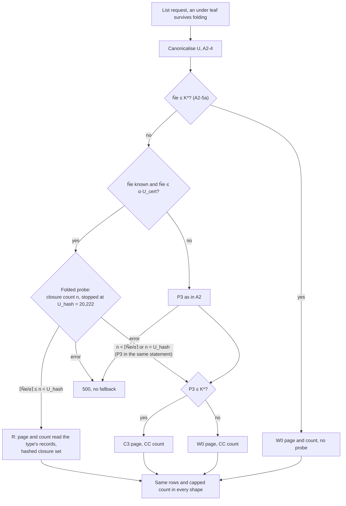

# ADR-010 amendment A3: a concentrated type under a large subtree reads its own records instead of visiting every unit

> **Status: PROPOSED, rev 1** on 2026-11-22. Rev 1 is the one revision. It answers the Technical Architect's round 1 (`VERDICT: CHANGES 1`, comment 01a2032d) and keeps the Security & Multi-Tenancy Reviewer's rewritten sentence (APPROVE, comment 01a20329). Waiting for the Technical Architect's re-check; the Solution Architect gives the verdict after it. A contested point goes to the CTO.
>
> A3 decides the **mechanism** for A2-R6. It does not rescore TICK-1037's FAIL. The budget verdict comes from the TICK-1037 rerun after the implementation task (A3-9).
>
> **Invariants source.** As in ADR-010 and A2: ADR-001 I1 to I9. The project description is empty, so the checks below are against ADR-001's list. A3 touches I1 (tenant wall), I5 (the SQL list filter and the Go single-record check agree), I8 (configuration over code) and the Epic 06 150 ms list AC. It does not touch Temporal determinism, the sandbox or Mastra.

## Rev 1 changelog

| Item | Change |
|---|---|
| TA 1 (blocking): R has no upper bound on \|S\| | **Adopted as proposed.** The folded count stops at U_hash = 20,222 = 2·U_cert instead of at the cap. R is chosen iff ⌈N̂_e/α⌉ ≤ n < U_hash; at n = U_hash, P3 decides as in A2 (A3-2 step 4, A3-3, A3-5). A tenant above U_hash keeps A2's linear cost and never gets a non-hashed SubPlan. Cost on the R path: about +1.7 ms at `bench_conc` 9,099 and about 11 ms at worst (Inferred; TICK-1037's rerun measures the 9,099 cell). A3-R4 is rewritten. |
| TA 2: Q1 | Confirmed: U_cert stays a constant. Open question 1 is closed. |
| TA 3: Q2 reworded | A dense type gets W0 under A2, not C3, so the tradeoff at the cap is R against W0 (A3-6's +6.3 ms). Open question 2 is closed. |
| TA 6: generic plans | A2-R4 (extended) gains the custom-plan assumption (`QueryExecModeExec`) and a plan-test run under `force_generic_plan` on any change to cached statements. |
| TA 7: dropping `IS NOT NULL` | Kept. The TA's data picked `records_list_updated` for both texts. The plan test stays the arbiter, and A3-R2 stays. |
| TA 8: mutant `r_cap_floor` | Specified as killed by the selector test at n = ⌈N̂_e/α⌉ − 1 with N̂_e = 20,000 (cap 6,061). |
| TA 9: probe cost | A3-5 states the worst case: about 5.5 ms for a count near U_cert off the R path, about 11 ms to U_hash on it. |
| TA 10: stale-low N̂_e | A3-R5's trigger gains a latency condition on lists served by R. |
| Security finding 1 | A3-7 and `docs/security/accepted-risks.md` use the reviewer's sentence verbatim (two bits: the skip rule and the R choice). The "re-check pending" markers are dropped. |
| Security finding 2 | The cross-tenant test is specified as the reviewer's five items (Consequences). |
| CI (`lint`) | The handbook summary page `docs/handbook/src/adr/adr-010-a3.md` is added, as `TestHandbookCoversEveryADR` requires. |

## In plain words

- **The problem (A2-R6).** Under A2, the region part of a ticket list starts from the units: for each unit of the caller's subtree S, it looks for records of this type. A type with few records under S (a *concentrated* type: 20,000 records, almost all in other units) still visits every unit. The cost grows by 3.4 to 5.9 µs per unit, and TICK-1037 failed one row at 9,099 units (161.57 ms against 150).
- **What changes.** When the type is small next to the subtree, the query starts from the other side: it builds the subtree's unit set once, as a hash table, and reads the type's records, keeping those whose unit is in the set. That is shape **R**. Its cost follows the type's size, not the subtree's.
- **How the list chooses.** The probe A2 already runs first counts the subtree's units, stopping at U_hash = 20,222. If the count is at least N̂_e / α, the type is small next to the subtree and R is used. If it is below that, or it reaches U_hash (a subtree too big for R's in-memory set), the probe continues as in A2, in the same statement. α = 3.3 is where R and A2 cost the same, measured by SP-1f.
- **What does not change.** Every shape asks the same question of each ticket, so the rows and the capped count are the same (A2-6). The choice changes speed, never results.
- **Why do it although the control passed.** In SP-1f's clean window, unchanged A2 scored 79.58 / 99.26 ms at 9,099 units, under budget. TICK-1037's FAIL was mostly host noise. A3 still pays for itself: it removes the per-unit growth, takes the worst concentrated cell from 99.26 to 64.40 ms, and leaves room for noise that A2's 50 ms margin does not. The SQL change is one leaf text and one probe text.
- **Codes used below** (as in A2): **U** the start units of one `under` leaf; **S** the units at or below U; **m** the leaf's records of this type under S; **N̂_e** the estimated records of this type in this tenant (`entity_record_estimates`, A2-9); **K\*** A2's density threshold; **C3, W0, CC, P3** A2-5's four SQL texts; **R** this amendment's records-driven text.

## Decision

| # | Rule |
|---|---|
| **A3-1** | **Shape R, the records-driven leaf.** The region term renders as: `((r.org_unit_id IN (SELECT descendant_id FROM org_unit_closure WHERE tenant_id = $t AND ancestor_id = ANY($U))) IS TRUE)` • R is used for **both the page and the count** of the leaf. The count keeps the list's 1,001 cap. It gets no closure driver and no `MATERIALIZED` CTE. • `IS TRUE` stops PostgreSQL from pulling the sublink up into a semi-join. That keeps the planner from driving the term from the units again. Every R plan in SP-1f is `(hashed SubPlan 1) IS TRUE`, which builds S once: 9,099 closure rows in 2.8 to 3.2 ms (PG 16.10). The page walks `records_list_updated` in order; the count scans the type's records. • **No `org_unit_id IS NOT NULL` conjunct** (SP-1f finding 2). `NULL IN (…)` is NULL and `IS TRUE` turns it into false, so the leaf stays two-valued and the rows are unchanged. Without the conjunct, the partial `records_org_unit` index is no longer implied. The R count should then read the type's slice through a `(tenant_id, entity_definition_id, …)` index instead of the tenant's whole unit-tagged slice (19,940 buffers for 20,000 rows in SP-1f). The implementation task verifies this with the plan test (Consequences). If the plan does not move, the leaf is still correct and the residual is A3-R2. • Earlier-branch negation is unchanged: a later branch negates an R leaf with A2's predicate form. |
| **A3-2** | **The selector, in order, per surviving `under` leaf.** 1. **A2-5a first.** N̂_e ≤ K\*: W0 for the page and the count, no probe. Unchanged. 2. **Missing N̂_e:** not R. P3 runs as in A2. 3. **R impossible: N̂_e > α · U_cert**, with U_cert = 10,111, A2-7's certified unit count. P3 runs as in A2, with no closure count (SP-1f finding 1). The ticket type at bench scale (N̂_e = 400,000 > 3.3 × 10,111 ≈ 33,400) never pays the count. SP-1f measured about 5 ms on ticket at root without this rule. 4. **Otherwise the folded probe, one round trip (rev 1, TA 1):** `SELECT s.n, CASE WHEN s.n >= $cap AND s.n < $uhash THEN NULL ELSE (<P3 at K*>) END FROM (SELECT count(*) AS n FROM (SELECT 1 FROM <canonical-U closure> LIMIT $uhash) z) s`, with **`$cap = ⌈N̂_e / α⌉`** and **`$uhash = U_hash`**. &nbsp;&nbsp;- **$cap ≤ n < $uhash → R** for the page and the count. P3 is an InitPlan referenced only in the `ELSE`, so it never executes on an R path (SP-1f: `(never executed)`). For integer \|S\|, n ≥ ⌈N̂_e/α⌉ ⟺ N̂_e ≤ α·\|S\|, so the condition is exact. &nbsp;&nbsp;- **n < $cap, or n = $uhash →** P3's value picks C3 (≤ K\*) or W0 (> K\*) for the page, and the count stays CC, exactly as A2-5. A subtree of U_hash units or more never gets R, so R never runs without its hashed set. &nbsp;&nbsp;- Step 3 guarantees $cap ≤ U_cert < $uhash, so the count never stops short of the size R exists for (CTO condition 3). • A probe error, or a NULL P3 value when R is not chosen, returns 500 and never falls back to another shape (A2-6, fails closed). |
| **A3-3** | **α and U_cert are computed constants, not settings.** • **α = 3.3.** It is where R and A2 cross on `bench_conc` (N̂_e 20,000, m = 0, \|S\| 1,011 to 9,099): R is flat at about 30 ms (agents) and 39 ms (count-only) net median; A2 grows 3.4 µs per unit (agents) and 5.9 µs per unit (count-only). The lines cross at \|S\| ≈ 6,000 for count-only, the binding persona (5,640 for agents), so α = 20,000 / 6,000 ≈ 3.3. The measured points at N̂_e/\|S\| = 4.9 (A2 cheaper) and 2.2 (R cheaper) bracket it. • **U_cert = 10,111.** It is the same number as `groupsync_org_units_live_max`'s alert threshold (A2-7). One test asserts the two are equal, so the alert and the skip rule move together. • **U_hash = 2·U_cert = 20,222 (rev 1).** The largest subtree, exclusive, for which R may run. It is the size at which the CI plan test pins `hashed SubPlan` (A3-5). PostgreSQL decides hashing from the planner's row estimate against `hash_mem` (`work_mem` × `hash_mem_multiplier`, 8 MB at defaults); the Technical Architect saw the flip between 161k and 255k estimated rows on PG 16.10, far above U_hash. • Like K\*, both guard a budget every tenant shares, so no tenant or operator sets them (I8 does not apply, as for A1-1 and K\*). |
| **A3-4** | **Visibility invariant (A2-6, extended).** C3, W0, CC, **R** and `Allows` compute one predicate on the row: *`org_unit_id` is not NULL and a closure row has `tenant_id = $t`, `ancestor_id ∈ U`, `descendant_id = org_unit_id`*. For R: • A NULL `org_unit_id` is false through `IS TRUE`, so `not under` is true for it (D5a), as in every other shape. • An empty U gives an empty subquery, so `x IN (∅)` is false and the leaf is false. • R reads canonical U like every shape (A2-4). Duplicates in the subquery cannot duplicate rows, because `IN` is a membership test. • The closure count n, the cap, α, U_cert and N̂_e select SQL text only. A wrong or stale value changes cost, never rows. |
| **A3-5** | **Bounds.** • **R reads at most the type's records**, plus one hash build of \|S\| < U_hash closure rows. The page stops after one page of matches; the count stops at 1,001 matches or at the type's end. The selector only picks R when N̂_e ≤ α·\|S\| and N̂_e ≤ α·U_cert ≈ 33,400, so R reads at most about 33,400 records. That is next to SP-1f's measured point (20,000), where R costs 30 to 39 ms net median. • **The hash must fit in memory** (SP-1f finding 4, TA 1). A plain SubPlan rescans S per record, O(N̂_e × \|S\|): the TA measured a planned cost of 3.4 × 10¹⁰ at 1M units. So R is never chosen at \|S\| ≥ U_hash (A3-2 step 4), and the CI plan test pins `hashed SubPlan` at \|S\| = 10,111 and 20,222, which covers the whole range where R can run. • **The folded probe** costs a closure count, on top of P3, only for types where R is possible. Off the R path the count stops at ⌈N̂_e/α⌉ ≤ U_cert rows: 1.2 to 3.3 ms at `bench_conc`, about 5.5 ms at worst (SP-1f, a count to 10,111). On the R path it runs to min(\|S\|, U_hash): about +1.7 ms at `bench_conc` 9,099 against rev 0, about 11 ms at worst, where A2 would cost about +120 ms (Inferred, at about 0.55 µs per closure row). |
| **A3-6** | **m is invisible to the selector, accepted** (SP-1f finding 3). The selector cannot see m without the P3 it skips. When the type is entirely under S, R costs more than A2's W0: at 10,111 units, count-only 75.85 ms p95 against 46.52 (+6.3 ms net median). Both are far under budget. No second probe is added. Recorded as A3-R3. |
| **A3-7** | **Security.** A2-6's five requirements apply to the folded probe and to R unchanged, with these additions: 1. Requirement 2's never-exposed list gains n, the cap, α and U_cert, and the shape value `records`. 2. Requirement 3: `$t` in the closure count and in R comes from the same request-context value as `set_config('app.tenant_id', …)`. 3. Requirement 4's cross-tenant test is extended: tenant B has closure rows under A's unit ids and records of A's entity definition id. A's n, A's shape choice and A's R rows are unchanged by B. **AR-TICK-1040-01 gains one sentence**, as the Security & Multi-Tenancy Reviewer wrote it (APPROVE, 01a20329): *"Under ADR-010-A3, time-to-response can also reveal two more bits about the same entity type, both inside the caller's tenant: whether N̂_e exceeds α·U_cert (about 33,400 records, where the closure count is skipped), and whether S has at least ⌈N̂_e/α⌉ units (R is chosen). N̂_e counts records the caller cannot read. Neither bit changes rows, and neither depends on another tenant's data."* Severity stays 🟡 Low, as the CTO allowed for this class (01a2026d-bbf0). Rev 1's U_hash bound adds whether S has at least 20,222 units: that is the caller's own subtree size, depends on no record the caller cannot read, and no other tenant's data. No cross-tenant signal is added: the count and R run under the tenant's RLS and `$t`. |
| **A3-8** | **Observability.** `authz_under_list_shape_total` gains `shape="records"`. No new metric, and no tenant, user, unit, n or α label. `authz_under_probe_seconds` covers the folded probe. |
| **A3-9** | **Budget scoring.** Unchanged from A2-11: paired wall-clock behind the floor gate, handler p95 against 150 ms, worst persona. After the implementation task merges, **TICK-1037 reruns** with these rows added: • `bench_conc` at 9,099 units (m = 0) and 10,111 units, both personas; • ticket at root under the selector, within 1 ms of the A2 control's net median (verifies A3-2 step 3). A pass closes A2-R6 and A2-R1 for S31. The budget line goes to `docs/budgets.md` in the implementation PR (A3 Consequences). |
| **A3-10** | **Conditions for ACCEPTED.** (a) The Technical Architect's critique of this text. (b) The Security & Multi-Tenancy Reviewer's check of A3-7. No further spike: SP-1f's findings 1, 2 and 4 are verified by the implementation task's tests, and a miss there changes cost, never rows. |

## Evidence (SP-1f, TICK-1092, 2026-11-22)

Same harness as TICK-1037 (PR #846) plus the throwaway diff, on story head `700259e9`, `postgres:16.10`, P3-01's settings, alone on the host 10:27 to 11:57Z, `NAVA_PERF_SECONDS=60`, one client, paired with the plain agent request, behind the floor gate. All 68 rows scored on attempt 1 (floor p50 0.53 to 2.85 ms against 3.0). A2 unchanged ran first in the same window, as the control.

**`bench_conc`, handler p95 / p50 in ms (paired base p95):**

| \|S\| (N̂_e/\|S\|) | A2 control, agents | R, agents | A2 control, count-only | R, count-only |
|---|---|---|---|---|
| **9,099** (2.20), m = 0 | 79.58 / 60.86 (26.06) | **67.66** / 45.13 (22.58) | 99.26 / 74.84 (26.20) | **64.40** / 51.49 (19.77) |
| **10,111** (1.98), m = 20,000 | 41.86 / 27.26 (26.91) | **36.43** / 27.17 (21.82) | 46.52 / 30.27 (28.70) | **75.85** / 43.61 (42.95) |

- **Contract lines:** all pass. `bench_conc` ≤ 150 ms for both personas at both sizes. Every other TICK-1037 row is below its TICK-1037 p95 (largest: uniform m = 3,000 count-only, 64.86 against 86.83).
- **A2-6:** 0 mismatches across 201 callers × 17 R sets against the A2 control. The pipeline `TestUnderList*` tests with "R forced" pass against `Allows`.
- **Plan stability:** the R page (`records_list_updated`), the R count (`records_org_unit`, see A3-1) and the folded probe (P3 `never executed`) keep their plans at `n_distinct(org_unit_id)` analysed (3,311) and forced to 100. No `MATERIALIZED` CTE is needed.
- **α sweep (net median, m = 0):** R ≈ 29 to 36 ms (agents) and 37 to 42 ms (count-only) at every size; A2 from 15.2 / 9.9 ms at 1,011 units to 42.7 / 57.4 ms at 9,099. One noisy pair at 3,033 units is left out of the fit.
- **TICK-1037's FAIL stands as scored.** The control's paired bases were 26 ms here, against 87 / 45 ms in TICK-1037, so most of 161.57 was host load. That is information, not a rescore.
- **Inferred, not measured:** with α = 3.3 instead of the spike's provisional 8, every row makes the same choice (3.3 lies in (2.2, 39.6)); the `bench_conc` cap rises from 2,500 to 6,061 closure rows, about 1 to 2 ms on the probe. TICK-1037's rerun measures it.

## Risks and residuals

| # | Risk | Owner | Trigger to re-decide |
|---|---|---|---|
| A3-R1 | α is measured on one type size (N̂_e = 20,000). R's per-record cost could differ at the top of its range (about 33,400) | Solution Architect | TICK-1037 rerun or a later bench shows an R cell above its A2 control at N̂_e/\|S\| < 3.3 |
| A3-R2 | The R count may still pick `records_org_unit` and read the tenant's whole unit-tagged slice, which scales with tenant size (SP-1f finding 2) | Postgres & Data Modeling Specialist | The implementation plan test does not show a `(tenant_id, entity_definition_id, …)` index for the R count. The fix is then a covering index, costed as a further amendment |
| A3-R3 | m is invisible: a type entirely under S pays R instead of a cheaper W0 (+6.3 ms net median at 10,111 units) | Solution Architect | A region-only list on such a type comes within 30 ms of budget |
| A3-R4 (rev 1) | Above U_hash, R is never chosen. Residual: at \|S\| < U_hash, the planner's estimate for the closure set exceeds `hash_mem`, so R loses its hashed SubPlan | Postgres & Data Modeling Specialist | The plan test at 20,222 fails, or the pinned `work_mem` / `hash_mem_multiplier` changes |
| A3-R5 | A stale-low N̂_e lets R read far more records than α·\|S\|, for example after a bulk import inside the hourly refresh period, when the age alert cannot fire | Technical Lead | As A2-R3: `authz_under_estimate_age_seconds` above 3 h; or the record-list p95 above 100 ms while `authz_under_list_shape_total{shape="records"}` is rising. Cost only, never rows |
| A2-R4 (extended) | A PostgreSQL upgrade starts pulling up `IS TRUE` sublinks, or changes the hashed-SubPlan choice. R's count also assumes custom plans (`QueryExecModeExec`, `cmd/nava-core/identity.go`, `allocator.go`): under a generic plan it becomes a sequential scan (274.7 against 7.4 ms, TA 6) | Postgres & Data Modeling Specialist | The CI plan test fails. A change to cached or prepared statements re-runs the plan test under `force_generic_plan` |
| AR-TICK-1040-01 (extended) | Timing also reveals whether N̂_e exceeds α·U_cert and whether S has at least ⌈N̂_e/α⌉ units (A3-7) | Security & Multi-Tenancy Reviewer | As in A2 |

A2-R6 closes when TICK-1037's rerun passes the A3-9 rows.

## Competitive Gate (ADR-008)

**Result:** PASS
1. **Axis moved:** X3 (speed). The concentrated-type region list at 9,099 units goes from 79.58 / 99.26 ms (A2, clean window) to 67.66 / 64.40 ms, and its cost stops growing with the subtree. The budget verdict stays with TICK-1037's rerun.
2. **Pain points:** none added. No new limit, setting or refusal. α and U_cert are computed (CP-SF-02 not touched). The probe and R stay inside the tenant (CP-SF-06 avoided, A3-7).
3. **Measured by:** SP-1f, then TICK-1037's rerun (A3-9).
4. **Parity:** I1 to I9 unchanged. I1: the closure count and R run under the tenant's RLS and `$t`. I5: R joins the agreement suite. I8: α is computed, not configured.

## Rejected options

| Option | Why not |
|---|---|
| Keep A2 and rerun TICK-1037 as is | The clean control passed, but TICK-1037's FAIL stands as scored, and A2 keeps growing 3.4 to 5.9 µs per unit with a 50 ms margin that host noise has already consumed once. R removes the growth for one leaf text and one probe text. |
| The region top-N index (A2-11) | Driven by units like P3, CC and C3, so O(\|S\|) for a concentrated type. It adds a write cost to every create. Parked by the CTO and not needed. |
| A product budget exception for region-only callers | Only on a spike fail (CTO ruling). SP-1f passed. |
| A semi-join or plain `IN` without `IS TRUE` | PostgreSQL pulls it up, and the planner may drive the join from the closure side again, which is the cost being removed |
| A `MATERIALIZED` CTE for the closure set | Not needed: the R plans were stable at both `n_distinct` values without it |
| A separate \|S\| count statement | One more round trip per leaf. Folding it into the probe costs nothing extra on the A2 path. |
| An uncapped \|S\| count | O(\|S\|) on every list. The count stops at U_hash, and off the R path at ⌈N̂_e/α⌉. |
| A count capped at ⌈N̂_e/α⌉ only (rev 0) | It cannot see a subtree too large for R's hash. A tenant above the certified size got R with a non-hashed SubPlan, O(N̂_e × \|S\|) on the shared database (TA 1). The U_hash bound costs about 1.7 ms at `bench_conc`. |
| A `statement_timeout` as the guard | It stops a runaway query after the damage, and turns a slow list into a failed one. The U_hash bound means the runaway plan is never chosen. |
| A selector that also sees m (a second probe) | m needs P3, which R exists to skip. The miss is +6.3 ms, far under budget (A3-6). |
| The tenant's live unit count instead of U_cert for the skip rule | An extra query or a new cache for a choice that only changes cost. The certified constant matches the alert, and a tenant above it is outside the certification anyway. |
| A configurable α | It guards a budget every tenant shares, so it is computed, as K\* is |

## Consequences

- **One new implementation task** (`core-dev`, created by the Technical Lead on ACCEPTED, against `TICK-946/in-my-region`): R in `internal/authz` (`ShapeRecords`, the R leaf without `IS NOT NULL`, R for page and count, no driver), the folded probe with the A3-2 order, `alpha = 3.3`, `uCert = 10,111` and `uHash = 2 * uCert` as constants, A3-8's label, and the `docs/budgets.md` line below. The SP-1f diff (`docs/adr/ADR-010/A3/sp1f/sp1f-spike.diff.txt`) is the starting point; its `SpikeAlpha` and `SpikeForceR` globals do not ship (tests use `FixedListShapes(ShapeRecords)`).
- **Then TICK-1037 reruns** with the A3-9 rows.
- **Tests that prove A3:**
  - **Agreement suite:** every case also runs with R forced and is compared with `Allows`, including NULL `org_unit_id` under both `under` and `not under`, empty U, nested U, and a tombstoned intermediate unit.
  - **Selector unit tests:** A2-5a wins over R; missing N̂_e never picks R; N̂_e > α·U_cert runs P3 with no closure count; n = cap − 1 picks P3's shape and n = cap picks R; n = U_hash − 1 picks R and n = U_hash picks P3's shape; a NULL P3 value when R is not chosen is a 500.
  - **Mutants:** `r_without_is_true` (the plan test fails); `r_cap_floor` (⌊ ⌋ instead of ⌈ ⌉ changes no row and no plan, so it is killed by the selector test at n = ⌈N̂_e/α⌉ − 1 with N̂_e = 20,000, cap 6,061); `r_no_upper_bound` (killed by the n = U_hash case); `r_count_driven` (a closure driver on the R count, plan test fails); `ucert_differs_from_alert`; `uhash_not_two_ucert`.
  - **CI plan test, pinned PostgreSQL and settings:** the R page walks `records_list_updated` with `(hashed SubPlan 1) IS TRUE`; the R count uses a `(tenant_id, entity_definition_id, …)` index (A3-R2 if not); `hashed SubPlan` holds at \|S\| = 10,111 and 20,222; the folded probe shows P3 `never executed` when the cap is reached.
  - **Cross-tenant test (Security finding 2):** extend `TestUnderListShapesStayInTheTenant` (`internal/records/pipeline/acl_under_shape_integration_test.go`):
    1. `FixedListShapes(ShapeRecords)` joins `hows()`, and A's rows and totals under R are the same before and after B is added.
    2. A's folded-probe n is unchanged by B, with the cap set to A's \|S\| + 1, and A's `ChooseListShapes` result is unchanged.
    3. B gets an `entity_record_estimates` row whose value would flip A's step 3 or step 4 if A read it. A's choice stays the same.
    4. B holds records whose `org_unit_id` is one of A's unit ids, with A's `entity_definition_id` where the FKs allow. A's R rows exclude all of them.
    5. A text test, in the style of `TestShapeTextsCastEveryPlaceholder`, asserts that the R leaf and the folded probe's closure count each carry `tenant_id = $t`.
- **Budget line** for `docs/budgets.md`, committed in the implementation PR: `ADR-010-A3 R selector α = 3.3 (crossover of R and A2 on bench_conc, m = 0, |S| 1,011–9,099, N̂_e 20,000; SP-1f, TICK-1092, 2026-11-22, postgres 16.10, story head 700259e9). R region list p95: 36.43–75.85 ms at 9,099–10,111 units.`
- **Handbook:** the `core-acl` and region pages gain shape R and the selector (Technical Lead, TICK-954).
- **A2 text:** A2-5, A2-6, A2-7, A2-10 and A2-R6 get a pointer to A3 on ACCEPTED.

## Open questions

None. Rev 0's two questions are closed by the critique (TA 2 and TA 3):
1. U_cert stays a constant. It only feeds the skip rule, where it changes cost only. With the U_hash bound, the folded count already is the per-leaf live bound wherever R can run.
2. At the cap, R is weighed against W0, not C3: a dense type gets W0 under A2. The miss is A3-6's +6.3 ms, and near the crossover both shapes cost about the same by construction, so α's precision is not material.
