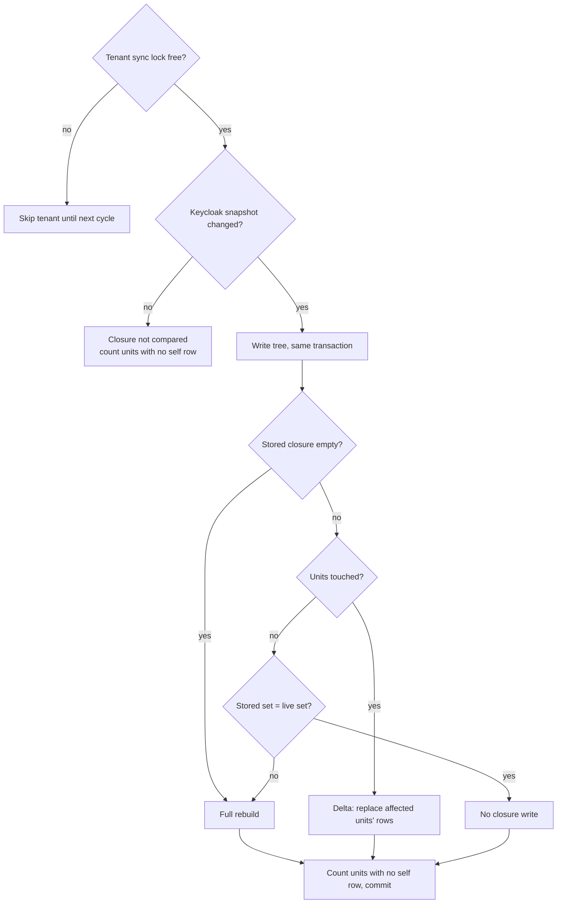

# ADR-010 erratum E4: how the stored region tree is kept current

> **Status: ACCEPTED** on 2026-11-25 by the Solution Architect (TICK-1118, PR #870), under the merge policy set by vknavaladi. The Technical Architect approved rev 1 and the Security & Multi-Tenancy Reviewer rated AR-TICK-1118-01 Medium. Nothing was contested. It changes no code and does not gate S31. "Built" means merged on the story branch `TICK-946/in-my-region` (PR #867); it reaches `main` with S31.
>
> **Invariants source.** The project description is empty, so the check is against ADR-001 I1 to I9 only and is incomplete against the project. E4 touches I1 (tenant wall) and I5 (list filter and single-record check agree). I1 holds. I5 holds while the closure equals A2-1's rows; with drift, a list's count can disagree with its pages, and read and write access follow the wrong row (AR-TICK-1118-01).

**What changes:** nothing on screen. The accepted design now describes how the stored list of "which unit (an office or region) is below which" is really kept up to date: only the entries a change affects are replaced.
**Why:** the design said every change deletes the whole list for that customer and builds it again, while holding a lock (a marker that lets only one such rebuild run at a time) made for that purpose. Engineers shipped a faster way, under a lock the service already held, so a later reader would build, or test for, the wrong thing.
**What you'll see when it's done:** the design page and its web-page version describe what the code does; the list of accepted risks has one new medium-severity row.
**Codes used below:**
- `ADR-010-A2` = the second amendment to the access-policy design. `A2-1`, `A2-2` = its sections on the region-tree table and on keeping it current.
- `org_unit_closure` (the closure) = the table with one row for each pair "unit A is at or above unit B". `org_units` = the units themselves; removing a unit marks it deleted (tombstones it).
- Group sync = the service that copies users, groups and units from Keycloak, one customer (tenant) at a time, every 5 minutes (a longer interval is a configuration error). A snapshot = what it reads from Keycloak (the sign-in system) in one run. Applied run = the snapshot differs from the last one, so it is written. Unchanged cycle = it does not differ, and nothing is written.
- `under` = the access-rule test "the ticket's unit is one of these units or below one"; `not under` is its opposite.
- Touched unit = a unit this run added, moved, revived or tombstoned. Drift = the stored closure differs from what the live tree gives. Self row = the closure row (u, u) that every live unit with a live path to a root must have.
- S31 = the story that ships "tickets in my region". `TICK-1054` = the task that built the partial writes. `TICK-1078` = the parked task for an index on `(tenant_id, descendant_id)`.
- `nava_groupsync`, `nava_migrator` = the database roles of group sync and of migrations. `A3` = the third amendment to the same design, on how lists read the closure.

**Rev 1** takes every round-1 finding: B1 the repair function's locks (E4-2), B2 the risk's `not under` half, B3 the 5-minute interval, N1 the import case, N2 the condition on I5, N3 "every cycle that gets the lock", N4 the fourth possible writer. **At acceptance:** the risk row is the Security & Multi-Tenancy Reviewer's text at Medium (the first text left out writes), plus two wording edits from the re-check.

## What was wrong

| A2-2 says | What is built (story head `57573b39`) |
|---|---|
| Every tree change deletes and re-inserts all the tenant's closure rows. "v1 has no incremental maintenance." | A run that touched units replaces only the affected units' rows (E4-1). The full rebuild remains for three cases (E4-2). |
| The rebuild takes `pg_advisory_xact_lock(hashtext('org_unit_closure'), hashtext(tenant_id::text))`, and a second rebuild waits. | No such lock exists. The whole sync already holds `pg_try_advisory_xact_lock(hashtextextended('nava-groupsync:<tenant_id>', 0))`, and a second sync **skips** the tenant until its next cycle (E4-3). |
| The change carries "its config audit entry". | There is none. `org_units` and `org_unit_closure` are listed as unaudited mirror and derived tables in `db/audited-tables.yaml` (E4-5). |
| A full rebuild of 10,111 units is about 0.3 s. | 0.8 to 2.0 s in CI, foreign-key checks included (E4-6). |

**How it happened.** TICK-1054 was parked until one of three triggers fired (a sync over 5 s; the TICK-1037 bench failing because of the rebuild; a tenant above 10,111 units). It was released on 2026-11-21 because its prerequisite was done; its thread records no trigger. The Technical Lead approved its scope, but the accepted design was not amended first.

**Is the built form wrong? No.** It gives exactly the full rebuild's rows (E4-4), and the sync is shorter after a move (E4-6). A large import into a closure that is not empty is slower (4.2 to 8.8 s, TICK-1123). That is a bulk import, not a routine change, and with stale statistics a forced full rebuild times out there too (in the count of units with no self row, which follows it), so it does not change the answer. For group sync, the existing lock covers more than A2-2's did: the Keycloak read and the tree write as well as the closure. Neither lock covers `org_unit_closure_rebuild_all()`; its own table locks do (E4-2).

## Correction

A2-2 reads from this erratum on:

| # | Rule |
|---|---|
| **E4-1** | **Delta write.** Group sync updates the closure in the **same transaction** as the tree write (`internal/groupsync/apply.go` calls `rebuildClosure` in `closure.go`), so both commit or neither does. When the run touched units and the stored closure is not empty: 1. The **affected set** = the touched units, their stored descendants, and everything now reached from those through live children (`closureAffectedSQL`). 2. Delete the tenant's closure rows whose `descendant_id` is affected. 3. For each affected live unit, walk up through live parents. Insert its rows only if the walk reaches a root (`closureDeltaInsertSQL`). |
| **E4-2** | **Full rebuild** (the query in [A2-1](ADR-010-A2-region-leaf-closure-probe-switch.md), delete then insert; from here "A2-1's rows" = what that query gives): (a) the stored closure is empty, which includes the first import; (b) an **applied** run that touched no unit finds drift, comparing the two sets with `EXCEPT` in both directions; (c) the operator and migration function `org_unit_closure_rebuild_all()`, as `nava_migrator`. It creates temporary policies, so it holds ACCESS EXCLUSIVE on `tenants`, `org_units` and `org_unit_closure` until it commits. It waits for every transaction that has read one of them, and every later reader of any tenant waits for it. It cannot interleave with a delta or a drift repair. Racing a sync that writes units can end in `40P01`; one side rolls back and the closure stays right. Run it in a maintenance window with `lock_timeout` set (TICK-1122). (a), and the comparison and repair in (b), run under `SET LOCAL enable_nestloop = off`: with no planner statistics the planner otherwise picks a quadratic plan (39 s against 0.65 s for the query alone, TICK-1054 comment 01a1ffab). `ANALYZE` is not used, because on PostgreSQL 16 only the table's owner may run it and group sync is not the owner. The plan setting does not cover the delta or the count of units with no self row. |
| **E4-3** | **Lock.** One lock per tenant sync: group sync's transaction-scoped advisory lock, taken before the Keycloak snapshot is read. It is a *try* lock: a replica that does not get it skips the tenant and tries again at its next cycle. A2-2's own lock must not be added. It would be redundant. |
| **E4-4** | **Equality rule.** After a delta, every row of an affected unit (as descendant) equals A2-1's rows. With no drift before the run, the whole closure does. A change to the delta SQL must keep `TestClosureFollowsTheTree`, `TestClosureDriftCheckComparesSetsNotCounts`, `TestClosureRolledBackWithTheTree` and `TestUnderClosureAgreementNestedMovedAndTombstoned` green. |
| **E4-5** | **No config audit entry.** The closure is derived from `org_units`, which mirrors Keycloak. Neither is configuration held here. |
| **E4-6** | **Figures for single moves and full rebuilds** (10,111 units, 40,321 rows, CI runners, whole sync, not only the closure write). Runs `077f1fca` / `73eca27f` (heads of PR #838 before its squash into the story branch; the second is what was merged. They differ only in the drift check's plan, and the second runner was about twice as slow): leaf move 70 / 144 ms; country move 95 / 216 ms; region move (about 1,000 units) 224 / 468 ms; no-tree-change run 130 / 484 ms; full rebuild 0.83 / 1.77 s; full rebuild with no statistics 1.07 / 2.03 s (test limit 5 s). TICK-1054's target, 350 ms after one move, holds for a leaf or country move. A region (the level above a country) may exceed it; TICK-1078's index is the expected fix, not measured. |
| **E4-7** | **Drift that a run does not see.** A run that touched units does not check the rest of the closure. An unchanged cycle does not check it either. Drift is repaired by the next applied run that touched no unit, or by the first cycle after group sync restarts if that run touches no unit (what "unchanged" is compared with is kept in memory only, so a restart always applies). This is AR-TICK-1118-01. Every cycle that gets the lock, applied or unchanged, counts live units with no self row: the metric `groupsync_org_closure_unrooted_units` and a WARN line naming the tenant (TICK-1058; the alert rule is TICK-1116). It includes a live unit whose path to a root is broken, which E4-1 rightly leaves out of the closure. It does not see an extra row, or a missing row that is not a self row. |
| **E4-8** | **A2-1, one grant.** `SELECT` on `org_unit_closure` is held by `nava_groupsync` as well as `nava_app` and `nava_worker`; the delta and the drift check read it. `INSERT` and `DELETE` stay with `nava_groupsync` only, plus `nava_migrator` inside the function in E4-2 (c). FORCE RLS and the foreign keys that carry `tenant_id` are unchanged. |

Everything else in A2 is unchanged. A2's read rules and A3 read the closure and do not depend on how it is written.

## Evidence

| Check | Result |
|---|---|
| Random trees, PostgreSQL 16.10, the shipped `closure.go` (`docs/adr/ADR-010/E4/spike/`): trees a snapshot can give | 1,887 runs, 1,821 of them deltas: **0** differ from the full rebuild |
| The same with live units under tombstoned ones and parent cycles | 1,916 runs, 1,742 deltas: **0** differ |
| Mutant: one touched unit left out | **1,011** of 1,887 runs differ, so the check can fail |
| A wrong row planted before a delta run | 275 trials: 0 wrong rows on affected units; drift left elsewhere in **216**; a no-touch run repaired **275 of 275** |
| Full rebuild with no statistics, red to green in CI | 37.1 s (fails the 5 s limit) → 1.07 / 2.03 s |
| `org_unit_closure_rebuild_all()` racing a drift repair, both orders, and a sync's insert (Technical Architect, real migrations, PostgreSQL 16.10; `docs/adr/ADR-010/E4/critique/`) | No `23505`. Between a drift repair and the function, whichever starts second waits, and both succeed. A sync that has read `org_units` and then inserts a unit can deadlock with it (`40P01`, the function was the victim). The closure was right after every race |
| Import of 10,111 units into a small closure that is not empty, whole sync (same source, shared laptop) | Delta 4.2 to 8.8 s, against 2.7 s for a one-shot import. After `ANALYZE` on a one-unit platform: the 2-minute timeout in the delta write; a forced full rebuild times out too, in the count of units with no self row (E4-2's plan setting covers neither) |

Not in the spike: RLS and grants (plain tables; `internal/tenancy/isolation/closure_paths.go` covers them), concurrent syncs (`TestTwoSyncersNeverSyncOneTenantConcurrently`, `TestOneTenantsLockDoesNotBlockAnother`), and E4-2 (c) racing a sync, which the Technical Architect's spike covers (above).

## Accepted risk

| ID | Sev | Risk | Owner | Trigger to revisit |
|---|---|---|---|---|
| AR-TICK-1118-01 | 🟠 Medium | ADR-010-E4 E4-7. Group sync replaces only the affected units' `org_unit_closure` rows, and compares the whole table with the live tree only on an applied run that touched no unit. A wrong row elsewhere lasts until such a run, with no time limit. An extra row grants through `under` and hides through `not under`; a missing row does the reverse. Either can let a user read **or change** tickets outside their rules, or refuse them tickets inside their rules, inside one tenant (FORCE RLS, FKs that carry `tenant_id`). An extra row can also make a list's count lower or higher than the tickets its pages show (inferred from code). Only a group-sync bug, the migrator, a superuser or a holder of group sync's database credentials can cause it; no user token can. No metric counts drift repairs (TICK-1124). | Security & Multi-Tenancy Reviewer | Any drift found in a live tenant, or a second writer of the closure or of `org_units`; then compare the sets on every cycle |

**Why the count can differ:** it removes units of the caller nested under another (by reading the closure) and then counts per unit; the pages test each ticket once against all of the caller's units.

**Compared with A2-2 as written:** its rebuild would have repaired such a row at the next tree change, but it had no comparison on runs without one.

**Known gap behind the trigger:** no metric counts drift repairs. The only sign is the log line `group sync applied` with `org_closure_rebuilt=true` while no unit was written or deleted. TICK-1124 (backlog) adds a count and an alert, then a time limit on a wrong row's life. It needs code, so it is not part of this erratum.

## Competitive Gate (ADR-008)

**Result:** N/A. The erratum describes code already built. It changes no access decision and moves no product axis.

## Rejected

| Option | Why |
|---|---|
| Keep A2-2 and change the code back to a full rebuild | 0.8 to 2.0 s inside every tree-changing sync, against 70 to 468 ms after a single move, for the same rows. A large import into a small closure would gain (TICK-1123 holds that case). It would end AR-TICK-1118-01 only at a tenant's next tree change. |
| Add A2-2's own lock as well | The sync lock already covers every group-sync write of the closure. A second lock adds an order to get wrong and protects nothing new. |
| Compare the sets on every run, tree-changing and unchanged cycles included | At most 130 to 484 ms (a whole no-tree-change sync) for each tenant of 10,111 units, A2-7's certified size, every 5 minutes, for drift nobody has observed. It is the fix if the trigger fires. |
| Rewrite A2-2 in place | A2 is ACCEPTED. It carries a pointer here, so the history of what was decided and what was built stays readable. |
