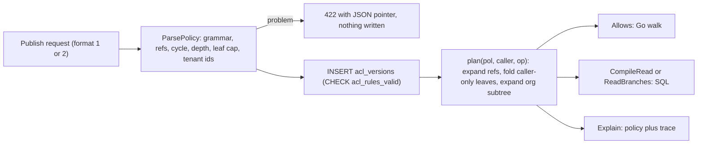

# RFC-022: Composable access rules

> **Invariant source.** The project description is empty, so the invariants were not loaded from it. I used the eight invariants in `docs/adr/ADR-001-platform-blueprint.md` (I1 to I8, lines 29 to 36). If the project description is meant to hold a different set, the invariant checks below are **incomplete**.
>
> **Numbering.** The highest RFC number referenced in the repo's `docs/` is RFC-020. TICK-897 has an RFC in flight with no number yet, so I left RFC-021 free for it and took **RFC-022**. The ADR number is assigned at step 4.

**What changes:** admins write access rules as named, reusable conditions (`is_requester`, `in_assigned_group`, `in_my_region`) and combine them into named policies with AND, OR and NOT. Workflow steps point at a policy by its name.
**Why:** nava wants security rules to be configuration, not code. Today each rule is one flat list of "who" plus "all of these conditions", with no reuse and no OR or NOT.
**What you'll see when it's done:** one access document per entity type holding conditions and policies. Saving a condition that cannot be turned into a database filter fails at save time with a pointer to the bad part. Editing a condition changes every policy that uses it in one new version. The explainer names the policy and the conditions that decided.
**Codes used below:** I5 = "access rules compile to SQL, and the single-record Go check agrees with them". I8 = "configuration, not code". S10 = the story that shipped today's flat rules (TICK-336). TICK-900 = the open fix that proves SQL and Go agree on JSON data fields.

## 1. Summary

- **Allow-only.** Access is the OR of the policies that grant the operation. There are no deny rules and no ordering. NOT exists only inside a condition (`in_assigned_group AND NOT is_requester`).
- **One document per entity type, one version.** Conditions and policies live in the same `acl_versions` row as today's rules and masks. Changing a condition writes one new version, and every policy that uses it changes in the same commit, because policies refer to conditions by name inside that document.
- **A closed JSON expression tree, not a text language.** The node kinds are listed in a table (D3). Anything outside it (a function call, a script, an HTTP call, a reference loop) cannot be saved: the publish route returns 422 and the database CHECK refuses the row.
- **Every leaf is two-valued (true or false, never NULL) in both SQL and Go**, so NOT means the same thing on both sides. A missing or NULL value makes a leaf false, so its NOT is true.
- **`in_my_region` is resolved once per request.** The caller's org units are expanded to their subtree from `org_units` (already synced from Keycloak), and the row test is `org_unit_id = ANY($subtree)`. That cost is **unmeasured**. Spike SP-1 measures it before the ADR.
- **What the human must accept:** composition ships on fixed columns first. Conditions on JSON data fields (such as a tenant's own `office` field) wait for TICK-900 to prove SQL and Go agree on data filters. The existing S10 rules keep working unchanged and are converted on read. Nothing is rewritten in the database.

## 2. Decisions

| # | Decision | Why / what it prevents |
|---|---|---|
| **D1** | **Allow-only.** A principal may perform op `o` on record `r` when at least one policy whose `ops` include `o` evaluates true. No deny rules, no precedence, no rule order. | Answers question 2. One OR'd predicate is one compiled SQL clause and one Go loop, with nothing to rank. Deny-overrides adds precedence to both the compiler and the evaluator, which is one more place for them to disagree (I5). The explainer can always say "granted by policy X". Separation of duties is still expressible with NOT inside a condition. |
| **D2** | **Storage: format 2 of the `acl_versions` document.** `rules` becomes `{"format": 2, "conditions": [{"name", "expr"}, ...], "policies": [{"name", "ops", "when": expr}, ...]}`. Both are **arrays** (rev 1, N1), so a duplicate name gets a 422 `duplicate`, exactly as a duplicate rule id does today, and the declared order survives `jsonb`. `masks` is unchanged. Names match `^[a-z][a-z0-9_]{0,62}$` and are unique within their array. Versioning is the existing `acl_versions.version`, with the existing optimistic publish (`ConflictError`) and the same-transaction audit (ADR-004). | Answers question 1. A condition change is a new version of the one document, so every policy that uses it changes atomically. There is no fan-out, and no state where policy P sees an old version of condition C. No new table, no new cache, no new grant (I3). A tenant change is a row insert, never DDL (I8). Object keys were rejected because Go `encoding/json` and `jsonb` both keep the last duplicate key without any error, so uniqueness could not be enforced. |
| **D3** | **Closed grammar.** An `expr` is exactly one of:<br/>• `{"all": [expr, ...]}` (1 to 16 children)<br/>• `{"any": [expr, ...]}` (1 to 16 children)<br/>• `{"not": expr}`<br/>• `{"ref": "<condition name>"}`<br/>• `{"member_of": {"groups": [...], "users": [...]}}`: about the caller only<br/>• `{"cmp": {"column", "op": "eq" or "in", "values" or "caller": "self" or "my_groups"}}`: today's `Cond`, same column list<br/>• `{"shared": true}`: today's share subject, pair-matched<br/>• `{"under": {"column": "org_unit_id", "caller": "my_org_units"}}`: subtree test (D7)<br/>Unknown keys, extra keys and empty arrays are refused. | Answers question 3. Custom functions, scripts and external calls cannot even be written: there is no node kind for them, so the strict decoder refuses them as `unknown_key`. Every node kind has exactly one SQL rendering and one Go rendering. |
| **D4** | **Save-time checks** (publish route 422 with a JSON pointer, then the database CHECK as backstop):<br/>• Every `ref` resolves inside the same document.<br/>• The reference graph has no cycle, self-reference included.<br/>• Nesting depth after reference expansion is at most 8.<br/>• **Per policy:** at most 256 leaves after expansion.<br/>• **Per document (rev 1, N3):** at most 64 policies and 1,024 leaves after expansion.<br/>• Every group, user and org-unit id belongs to the caller's tenant (the existing `TenantRefs` check).<br/>An unused condition is allowed. The CHECK counts leaves memoized per condition, never by full expansion. | Answers question 3 (unbounded recursion). The leaf cap matters because shared references can grow exponentially when expanded: a condition used twice at each of 8 levels is 256 leaves. The per-document cap bounds `ReadBranches`, whose SQL text grows with the square of the branch count (`acl.go:188-191`). The caps are my choice, not measured. SP-2 measures them and lowers them if needed. The CHECK matters because one malformed stored row makes every read of that entity type a 500, and versions cannot be fixed afterwards (`docs/data/acl-versions-shape-check.md`). |
| **D5** | **NOT, NULL and invalid nodes (rev 1, B1): two separate rules.**<br/>**(a) Semantic false.** Every valid leaf renders to a two-valued term (true or false, never NULL) on both sides. A NULL fixed column, an absent caller id, an empty caller group set or an empty org-unit set makes the leaf **false**. `not` is then plain boolean negation on both sides, so `NOT is_requester` is **true** on a record with no requester. Leaves that depend only on the caller (`member_of`, and any leaf whose resolved set is empty) fold to the constant `true` or `false` at plan time. `shared` folds to **false** when the caller id is Nil, **even if the caller has groups** (rev 1, N2), as `acl.go:296` does today.<br/>**(b) An invalid node voids the whole policy.** `plan` returns `(tree, error)` for each policy. A structurally invalid node anywhere in a policy sets that policy's error, and the policy grants **nothing**. Invalid nodes include an unknown column, `eq` with two values, an unresolved `ref`, a caller reference with values, and an exceeded cap. Invalid is never represented as a boolean, so it can never pass through `not`. The planner logs and counts it (`authz_policy_invalid_total`). | Answers question 4. SQL's NULL logic gives a different answer from Go only when a term can be NULL. If no leaf can be NULL, `NOT` agrees on both sides by construction, which is the property `ReadBranches` already relies on (`acl.go:152`). Rule (b) closes the fail-open path the Technical Architect found: if an invalid leaf were treated as false, `NOT invalid` would grant every row. The mutants `not_unguarded` and `invalid_leaf_false` enforce both rules (CI-2). |
| **D6** | **One planner, two renderings, as today.** `plan(pol, p, op)` expands references, folds caller-only leaves, and returns a tree whose leaves depend only on the row. `Allows` walks it in Go. `CompileRead` renders it to SQL.<br/>**`ReadBranches` (rev 1, B3):** the branches are the top-level OR across policies. Within each policy:<br/>(1) a top-level `any` splits into its children;<br/>(2) a top-level `all` with **exactly one** `any` child is distributed: `all[any[a,b,c], W...]` becomes `any[all[a,W...], all[b,W...], all[c,W...]]`. That gives at most 16 branches per policy, and it is exactly what today's `disjuncts` does (`acl.go:218-242`).<br/>There is no other rewrite: never more than one `any`, never below the top level. If there are more than 16 branches in total, `ReadBranches` returns fewer than two branches and the caller falls back to `CompileRead` (rev 1, N3). | Keeps the existing design (`acl.go:25-34`) and its proof. The one bounded distribution keeps TICK-644's plan, which answers each branch from its own index, for every converted S10 rule. Losing it would cost 38-166 ms per page against 2.0-4.0 ms (`docs/data/records-list-indexes.md:14-17`), and the agent `sort=-updated_at` list has only 3.8 ms of headroom today (`docs/quality/acl-perf-800k.md:16`). A full rewrite into an OR of ANDs was rejected because it can grow exponentially. |
| **D7** | **`in_my_region` (rev 1, B2, N4, N5).**<br/>**Data:**<br/>• `org_units` gains `deleted_at timestamptz NULL`. When a unit is gone from Keycloak, groupsync **tombstones** it instead of running the hard `DELETE` at `internal/groupsync/apply.go:507`. Principals already work this way (`apply.go:253`).<br/>• A new table `org_unit_members (tenant_id, org_unit_id, principal_id)`, with FORCE RLS and FKs that carry `tenant_id`. Groupsync writes it in the same tenant transaction, from the snapshot's OU members (`internal/identity/keycloak/directory.go:795`). This is a required Epic 03 change.<br/>• A platform fixed column `records.org_unit_id uuid NULL`, with FK `(tenant_id, org_unit_id)` to `org_units` and index `(tenant_id, org_unit_id)`. The FK is NO ACTION, which is safe because units are never hard-deleted.<br/>**Evaluation:**<br/>• The subtree is expanded only when an `under` leaf is still in the tree after the op filter and folding. This is lazy, so tenants without regions pay no extra query.<br/>• One recursive query over **live** `org_units` (`deleted_at IS NULL`), under the request's tenant (RLS, I1), expands the caller's live memberships to their subtree, giving set S.<br/>• A tombstoned unit, and every unit reached only through it, drops out of S. Records under a deleted unit therefore lose every `under` grant (fail closed).<br/>• The leaf renders as `r.org_unit_id IS NOT NULL AND r.org_unit_id = ANY($n::uuid[])` in SQL, and as membership in S in Go.<br/>• If S has more than 10,000 ids, the request fails with a typed 500 and an alert.<br/>• After each apply, groupsync measures the largest subtree and logs it with the metric `groupsync_org_subtree_max`, so an oversized tree shows up before a user hits the cap. | Answers question 5. It follows the existing rule that everything about the caller is resolved into fixed sets before the row is seen, so the agreement proof carries over. Tombstoning matters: with a hard delete and this FK, one ticket still pointing at a deleted unit would fail every sync for that tenant (error 23503). Revocations would then stop until someone fixed the record by hand. `ON DELETE SET NULL` was rejected because it rewrites records outside the I4 pipeline and without audit. **Unverified:** the cost of the expansion plus `ANY` at 800k records. SP-1 measures it, and the Technical Architect runs it after this revision. |
| **D8** | **Policy references from workflows and other consumers** are `(entity type key, policy name)`. They are resolved at decision time against the entity type's **current** ACL version, inside an activity (I6: the I/O stays out of workflow code). They are never pinned to the version that was current when the workflow started. A name that no longer exists **denies**, with a metric `authz_policy_ref_missing_total` and an audit entry. | Revocation must take effect on running workflows, so access is never frozen at a version. Missing means deny (fail closed). The rule "publish refuses to drop a name a published workflow references" waits until workflow definitions store such references (Epic 10). The trigger is recorded in §4. |
| **D9** | **Explainer.** `Explanation` gains two fields:<br/>• `Policy`: the policy that granted access. When several grant, it is the first **in declared array order** (rev 1, N1), so the answer is stable.<br/>• `Trace`: each named condition reached, with its true or false value, taken from the same planned tree `Allows` used.<br/>`RuleID` stays for one release, filled with the policy name. A policy voided as invalid (D5b) is listed as `invalid`, never as false. | The task asks for "the policy and the condition that decided". Taking the trace from the enforcing tree means the explainer cannot disagree with enforcement, the existing guarantee in `explain.go:27`. Converted format-1 rules keep their array order, so the explainer's output for existing tenants does not change. |
| **D10** | **One condition language (question 6).** This expression tree is the platform's base expression format. Epic 10's expression language (D11) extends it with more node kinds, such as arithmetic, dates and string functions. A registry marks each node kind `sql_safe: true/false`, and access rules accept only `sql_safe` kinds. **A build test enforces the flag, not review (rev 1, N6):** the build fails if a kind is marked `sql_safe` without a SQL renderer, a Go renderer and coverage in the CI-1 generator. Epic 10 must not ship a second parser or a second grammar for conditions. | Two languages would mean two validators, two sets of NULL rules, and admins learning both. One wrong `true` in a shared registry would let in a node kind that has only one proven rendering, so the check has to be mechanical. **Sequencing:** Epic 06 delivers the expression tree and the registry first. I have **not** read a D11 design (none is in the repo), so whether D11 fits as an extension of this tree is an open question for the CTO (§6, Q1). |
| **D11** | **Migration of S10 rules (question 7).** No rewrite of stored rows: `acl_versions` is insert-only and audited. The reader accepts format 1 (no `format` key) and converts it in memory to format 2: each `Rule` becomes a policy named `Rule.ID` with `when = all[ any[member_of(Groups, Users), cmp(requester_id, self), cmp(assignee_id, self), shared], ...Where ]`, keeping only the subjects that are set. The publish route accepts both formats and always stores format 2. Format-1 reading is removed once no tenant's newest version is format 1. | Behaviour-preserving by construction, and CI-6 proves it before the old planner is deleted. Policy names equal the old rule ids, so explainer output and audits stay readable across the change. |
| **D12** | **Out of scope, on purpose:** conditions on JSON `data` fields (wait for TICK-900 green, then add a `field` leaf that renders `COALESCE(data->>'f', <default for the row's schema_version>)`, as TICK-9 already requires). Row-dependent masks (masks stay caller-only, A2, because a row-dependent mask leaks through filter and sort). Deny rules (D1). Relationship-based authorization (Principle 19, deferred). | Each of these would reopen a property S10 already proved. The data-field leaf is the next increment, not a redesign: it adds one leaf kind. |

### The PF withdrawal example in format 2

```json
{
  "format": 2,
  "conditions": [
    {"name": "is_requester",      "expr": {"cmp": {"column": "requester_id", "op": "eq", "caller": "self"}}},
    {"name": "in_assigned_group", "expr": {"cmp": {"column": "assignment_group_id", "op": "in", "caller": "my_groups"}}},
    {"name": "in_my_region",      "expr": {"under": {"column": "org_unit_id", "caller": "my_org_units"}}},
    {"name": "is_regional_mgr",   "expr": {"member_of": {"groups": ["<pf_regional_manager group id>"]}}}
  ],
  "policies": [
    {"name": "pf_member_read",   "ops": ["read"],          "when": {"ref": "is_requester"}},
    {"name": "pf_manager_work",  "ops": ["read", "write"], "when": {"all": [{"ref": "in_assigned_group"}, {"not": {"ref": "is_requester"}}]}},
    {"name": "pf_regional_view", "ops": ["read"],          "when": {"all": [{"ref": "is_regional_mgr"}, {"ref": "in_my_region"}]}}
  ]
}
```

For a caller who is in the assigned group but has no id (a service principal), `is_requester` folds to false, so `NOT is_requester` folds to true, and `pf_manager_work` becomes the single row test `assignment_group_id = ANY(groups)`.



## 3. Options considered

| Option | Why it lost |
|---|---|
| **A. Tenant-wide condition library**, versioned on its own, referenced by every entity type's ACL. | Changing one condition then fans out to N entity ACLs. A reader could see policy version 7 with condition version 3 or 4, so it needs a joint version or a snapshot rule. It also needs a second table, a second cache and a second publish path. A condition on a field one entity type lacks becomes a runtime error instead of a save-time one. Per-entity reuse covers the stated examples. Revisit if admins duplicate the same condition across more than a few entity types (§4, R4). |
| **B. Deny rules with precedence** (deny overrides allow). | D1. Precedence in two renderings is a new class of SQL-versus-Go disagreement. Every deny case in the brief can be written as `allow AND NOT x`. |
| **C. A text expression language** (CEL, or a custom DSL parsed at save time). | It puts a parser in the trust path and needs a "SQL-safe subset" checker over a full language. CEL has no SQL translation of its own, so we would write and prove one anyway. The JSON tree gets JSON-pointer errors and a database CHECK for free. A text syntax can be added later as admin-UI sugar that compiles to this tree. |
| **D. `in_my_region` as a SQL join to a closure table** (`org_unit_closure(ancestor, descendant)`) inside the predicate. | It makes the predicate depend on a second table per row, which breaks "plan resolves the caller, the row test sees only the row" and makes the agreement suite seed and compare another table. It may be faster for very large trees. If SP-1 shows `ANY($subtree)` over budget, this is the fallback. |
| **E. `in_my_region` by materialized path on the record** (`records.org_path ltree`). | Moving an org unit in Keycloak would rewrite every record under it, which is an unbounded write burst through the I4 pipeline and an audit flood. |
| **F. Keep S10 flat and add OR only.** | It does not give NOT (separation of duties) or reuse. We would face the same migration again later. |

## 4. Risks and accepted residuals

| # | Risk | Owner | Revisit trigger |
|---|---|---|---|
| R1 | `ANY($subtree)` with a large subtree is over the 150 ms list budget. | Technical Lead (SP-1) | SP-1 p95 above 150 ms at 800k records with a 5,000-unit subtree, which switches to option D. |
| R2 | The caps block a legitimate policy: depth 8, 256 leaves per policy, 16 children, 64 policies and 1,024 leaves per document. | Solution Architect | An admin reports a real policy that hits a cap. |
| R3 | Org-unit or group changes reach access only at the next sync (the S5 window, 10 minutes). The same lag exists for groups today. Since rev 1 (D7 tombstones), a deleted unit can no longer make sync fail, so this window stays bounded. | Security & Multi-Tenancy Reviewer | A requirement for faster revocation. |
| R4 | Per-entity documents duplicate shared conditions across entity types. | Solution Architect | More than 3 entity types in one tenant carry an identical condition, which brings option A back. |
| R5 | A workflow references a removed policy and its step denies at run time (D8). | Technical Lead (Epic 10) | Workflow definitions store policy references, which adds the publish-time "referenced name" refusal. |
| R6 | The CHECK function now walks a tree. Insert cost goes up (today 0.30 ms for 6 rules). | Postgres & Data Modeling Specialist | SP-2 above 5 ms for a document at the caps, which lowers the caps. |
| R7 | A policy voided as invalid (D5b) silently removes access that an admin expects. | Technical Lead | `authz_policy_invalid_total` above zero in any tenant. It should stay at zero, because publish and the CHECK refuse invalid nodes first. |
| R8 | One user's subtree goes over 10,000 units, and that user's lists fail with a typed 500 (D7). | Technical Lead | `groupsync_org_subtree_max` close to the cap in any tenant. |

## 5. Test and acceptance spec

| ID | Test | What it catches |
|---|---|---|
| CI-1 | I5 agreement suite, extended: the generator builds trees of depth up to 4 from `all`, `any`, `not`, `ref` over every leaf kind, on rows with NULL `requester_id`, `assignee_id`, `assignment_group_id` and `org_unit_id`, and on callers with no id or no groups. 500 policies × 50 principals × 160 rows, real PostgreSQL under `nava_app` with RLS. | SQL admitting a row Go refuses, or the reverse, including NOT over NULL (question 4). |
| CI-2 | Mutants that must turn CI-1 red:<br/>• `not_unguarded`: a leaf without `IS NOT NULL`<br/>• `invalid_leaf_false` (rev 1, B1): an invalid node planned as a false leaf instead of voiding the policy, which the generator catches with `not` over malformed leaves<br/>• `under_direct_only`: no descendants<br/>• `under_ignores_tombstone` (rev 1, B2)<br/>• `ref_previous_version`<br/>• `fold_wrong`: a caller-only leaf folded to its negation<br/>• `shared_nil_caller` (rev 1, N2): group shares matched for a caller with no id | A suite too weak to see the bug. |
| CI-3 | Order independence: shuffle policies, `all` and `any` children, and condition declaration order. Decisions are identical in Go and SQL. The explainer's `Policy` is stable. | Hidden precedence (D1). |
| CI-4 | Save-time rejection table, each returns 422 with the JSON pointer, writes no `acl_versions` row and no audit row: unknown node (`fn`, `script`, `http`, `sql`), missing `ref`, self-reference, a→b→a cycle, depth 9, 257 leaves after expansion, 17 children, another tenant's group, user or org-unit id, `caller: self` on `state`, a duplicate condition or policy name (rev 1, N1), 65 policies, 1,025 leaves in one document (rev 1, N3). The same bodies inserted directly as superuser are refused by the CHECK. | Question 3, at both layers. |
| CI-5 | Propagation: condition C is used by P1 and P2. Edit C, which gives one new version. Both P1 and P2 decisions change for an affected record. The explainer shows the new version, the policy and C's value. | Question 1. |
| CI-6 | Migration equivalence: for every format-1 policy the S10 generator makes, the old planner and the converted format-2 tree agree in Go and in SQL on every case. The generator includes callers with no id but with groups, and group shares (rev 1, N2). **`ReadBranches` on the converted policy returns the same number of branches and the same SQL text as today's `ReadBranches` (rev 1, B3).** The explainer names the same rule id. Publishing a format-1 body stores format 2. | Question 7, a behaviour change hidden by the conversion. |
| CI-7 | Benchmark: `pf_regional_view` on 800k records (one large tenant among many small), with 5,000 and 10,000-unit subtrees, filtered list p95 at or below 150 ms, including agent `sort=-updated_at` on page 1 and page 20. Converted S10 policies keep today's numbers in `docs/quality/acl-perf-800k.md`. Runs in the `acl-perf` bench. | Question 5 budget. A regression in TICK-644's plan. |
| CI-10 | Sync resilience (rev 1, B2): delete an OU in Keycloak while tickets still carry it. The next sync commits, the unit is tombstoned, a user removed from a group in the same cycle loses access, and the tickets lose every `under` grant. The same test runs for a user removed from an OU. | Sync stopping and revocations freezing for a tenant. |
| CI-11 | Registry (rev 1, N6): a node kind marked `sql_safe` without a SQL renderer, a Go renderer or generator coverage fails the build. | A node kind admitted into access rules with only one proven rendering. |
| CI-8 | Workflow policy reference to a removed name denies, increments `authz_policy_ref_missing_total`, and writes an audit entry. | D8 fail-closed. |
| CI-9 | Cross-tenant: tenant A's policy naming tenant B's org unit is refused at publish. With RLS, the subtree expansion in tenant A never returns B's units, even if B's unit is a child id in A's data. | I1, I2. |

**API test scenarios** (`PUT /api/v1/entity-types/{key}/access`, `GET` of the same, the explainer):
- PUT format 2, valid → 200, new version, one audit entry. PUT format 1, valid → 200, stored as format 2.
- PUT invalid (each CI-4 body) → 422 with pointer, nothing written.
- PUT with a stale expected version → 409 `ConflictError` with the current version, nothing written.
- Two PUTs with the same expected version → the first writes, the second gets 409 (the publish path's existing protection against double writes; I did not check whether the route also takes an idempotency key).
- Another tenant's entity type key → the same response as an unknown key, nothing written.
- Explainer by a non-admin → refused. Explainer by an admin of another tenant → the same response as a missing record.

## 6. Open questions

| # | Question | Who answers |
|---|---|---|
| Q1 | Does Epic 10's expression language (D11) fit as an extension of this AST (D10)? If D11 is already designed as a text language, which one becomes the base? | CTO (sequencing call), with whoever owns Epic 10 |
| Q2 | ~~Does OU membership reach `group_members`?~~ **Answered by the Technical Architect (N4): no.** D7 now adds `org_unit_members`. Still open: the exact `org_unit_members` keys and grants, and whether the CHECK does the tree validation within the R6 budget (SP-2). | Postgres & Data Modeling Specialist |
| Q3 | Who sets `records.org_unit_id` on a ticket: a form field, a workflow step, or a default from the requester's org unit? This is a product rule, not a security one. | Technical Lead, with the human if it is a product choice |

## 7. Assumptions I have not verified

- **SP-1** (Technical Architect, after this revision, using its round-1 hypotheses): with `org_unit_members` and tombstoned `org_units`, the expansion is at most 5 ms p95, binding 10,000 ids adds at most 5 ms, and `pf_regional_view` keeps the agent list p95 at or below 150 ms under `sort=-updated_at`. If not, try the index `(tenant_id, org_unit_id, updated_at DESC, id DESC)` first, then option D.
- **SP-2:** a PL/pgSQL CHECK doing ref resolution, cycle detection and leaf counting memoized per condition costs at most 5 ms per insert at the document caps. Go `plan` plus `ReadBranches` plus PostgreSQL planning stays at or below 10 ms. Timebox: half a day, extending `scratch/acl-versions-shape-check/`.
- ~~Converted policies have the same top-level shape as today.~~ **Wrong in rev 0** (Technical Architect, B3). D6 now distributes the one `any`, and CI-6 checks the SQL text matches.
- Keycloak OU groups follow `/t/<tenant_id>/ou/...` (taken from the comment at `db/migrations/00003_identity_tables.sql:106`). I did not check the realm export.

## 8. Invariants touched

| Invariant | Effect |
|---|---|
| I1 tenant wall | Subtree expansion and every id check run under RLS. The new column's FK and `org_unit_members` both carry `tenant_id`, and `org_unit_members` has FORCE RLS. CI-9. |
| I2 tenant source | Unchanged: the caller comes from the verified principal. Policy ids are checked against the tenant at publish. |
| I3 roles | No new role. `org_unit_members` gets grants only from `db/grants.yaml`: INSERT and DELETE for `nava_groupsync`, SELECT for `nava_app`. `org_units` gains UPDATE (`deleted_at`) for `nava_groupsync` and loses DELETE. The CHECK function runs as the inserting role, as today. |
| I4 write pipeline | `CanWrite` uses the same tree, applied to both before and after, as today. |
| **I5 authorization in the query** | Main subject: D3, D5, D6, CI-1 to CI-3. |
| I6 durable path | D8 resolves policies in activities, never in workflow code. |
| I7 idempotency | Publish keeps its existing optimistic version and idempotency behaviour. |
| **I8 configuration, not code** | Main subject: D2, D3. A tenant change is a row insert. `records.org_unit_id` is a platform migration, not a tenant-motivated one. |

## Response, round 1

All three blocking items are accepted, and all six non-blocking items are folded in. I checked B2 and B3 against `main` myself: the hard `DELETE` at `internal/groupsync/apply.go:507`, and the 38-166 ms against 2.0-4.0 ms gap in `docs/data/records-list-indexes.md:14-17`.

| Item | Resolution | Where it changed |
|---|---|---|
| **B1** an invalid leaf is fail-open under `NOT` | **Accepted.** D5 is now two rules. An empty set is a semantic false. An invalid node anywhere voids the whole policy, and `plan` returns `(tree, error)` per policy, so "invalid" cannot be a boolean. This is the shape the Technical Architect asked for. New mutant `invalid_leaf_false`. | D5, D9, CI-2, R7 |
| **B2** the FK stops sync when an OU is deleted | **Accepted, the recommended fix.** `org_units` are tombstoned (`deleted_at`), never hard-deleted. Expansion reads live units only, so records under a deleted unit fail closed. `ON DELETE SET NULL` is rejected in the text, for the reason the Technical Architect gave. New sync test CI-10. | D7, CI-2, CI-10, R3, I3 |
| **B3** converted S10 rules lose index-per-branch | **Accepted.** D6 distributes a top-level `all` with exactly one `any` child, which is today's `disjuncts`, capped at 16 branches. CI-6 asserts the same branch count and the same SQL text as today. My §7 assumption is struck out as wrong. | D6, CI-6, CI-7, §7 |
| N1 names as object keys | **Accepted.** `conditions` and `policies` are arrays of named entries, so duplicates get a 422 and order is kept. The explainer's tie-break is declared order. | D2, D9, example, CI-4 |
| N2 `shared` with no caller id | **Accepted.** It folds to false, even with groups. Added to the CI-6 generator and as mutant `shared_nil_caller`. | D5, CI-2, CI-6 |
| N3 no document-wide cap | **Accepted.** 64 policies and 1,024 leaves per document. `ReadBranches` falls back above 16 branches. SP-2 measures both. | D4, D6, CI-4, R2 |
| N4 OU membership is not stored (answers Q2) | **Accepted.** New `org_unit_members` table, written by groupsync, as an Epic 03 change. The expansion is lazy. | D7, Q2, I1, I3 |
| N5 the 10,000 cap fails only at read time | **Accepted.** Groupsync reports `groupsync_org_subtree_max` after each apply. | D7, R8 |
| N6 `sql_safe` enforced only by review | **Accepted.** A build test enforces it (CI-11). Q1 stays with the CTO. | D10, CI-11 |

**Spikes.** SP-1 and SP-2 now use the Technical Architect's hypotheses and pass thresholds (§7). The setup changes that the Technical Architect was waiting for (tombstones, `org_unit_members`, the document caps) are in this revision, so both spikes can run now.

Earlier text: `rev-0/RFC-022-composable-access-rules.md` (archived under `docs/adr/ADR-NNN/rfc/rev-0/` at step 4).

## Close-out

- **Re-check, round 1 (Technical Architect, 2026-11-15 12:41): VERDICT: APPROVE.** B1, B2 and B3 are resolved, with no new items.
- **B3 wording fix, carried into ADR-010 D6.** The total-branch fallback threshold is the number SP-2 measures, not a fixed 16. CI-6 asserts the same branch count and the same SQL as today up to that threshold. When planning, the Technical Lead confirms that no published tenant document is above it.
- **Q3, decided by the Technical Lead and recorded as ADR-010 D8.** The write pipeline sets `records.org_unit_id` on create, from the requester's primary org unit. After that it is a stored field: masked on write, audited, and never recomputed on read. Tickets do not move when their user moves to another unit.
- **Dissent:** none. The discussion was closed by the Technical Lead (comment `01a1df3a-cb6b`).
