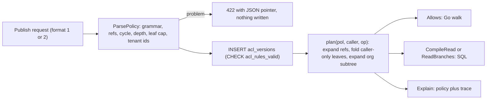

# RFC-022: Composable access rules

> **Invariant source.** The project description is empty, so the invariants were not loaded from it. I used the eight invariants in `docs/adr/ADR-001-platform-blueprint.md` (I1 to I8, lines 29 to 36). If the project description is meant to hold a different set, the invariant checks below are **incomplete**.
>
> **Numbering.** The highest RFC number referenced in the repo's `docs/` is RFC-020. TICK-897 has an RFC in flight with no number yet, so I left RFC-021 free for it and took **RFC-022**. The ADR number is assigned at step 4.

**What changes:** admins write access rules as named, reusable conditions (`is_requester`, `in_assigned_group`, `in_my_region`) and combine them into named policies with AND, OR and NOT. Workflow steps point at a policy by its name.
**Why:** nava wants security rules to be configuration, not code. Today each rule is one flat list of "who" plus "all of these conditions", with no reuse and no OR or NOT.
**What you'll see when it's done:** one access document per entity type holding conditions and policies. Saving a condition that cannot be turned into a database filter fails at save time with a pointer to the bad part. Editing a condition changes every policy that uses it in one new version. The explainer names the policy and the conditions that decided.
**Codes used below:** I5 = "access rules compile to SQL, and the single-record Go check agrees with them". I8 = "configuration, not code". S10 = the story that shipped today's flat rules (TICK-336). TICK-900 = the open fix that proves SQL and Go agree on JSON data fields.

## 1. Summary

- **Allow-only.** Access is the OR of the policies that grant the operation. There are no deny rules and no ordering. NOT exists only inside a condition (`in_assigned_group AND NOT is_requester`).
- **One document per entity type, one version.** Conditions and policies live in the same `acl_versions` row as today's rules and masks. Changing a condition writes one new version, and every policy that uses it changes in the same commit, because policies refer to conditions by name inside that document.
- **A closed JSON expression tree, not a text language.** The node kinds are listed in a table (D3). Anything outside it (a function call, a script, an HTTP call, a reference loop) cannot be saved: the publish route returns 422 and the database CHECK refuses the row.
- **Every leaf is two-valued (true or false, never NULL) in both SQL and Go**, so NOT means the same thing on both sides. A missing or NULL value makes a leaf false, so its NOT is true.
- **`in_my_region` is resolved once per request.** The caller's org units are expanded to their subtree from `org_units` (already synced from Keycloak), and the row test is `org_unit_id = ANY($subtree)`. That cost is **unmeasured**. Spike SP-1 measures it before the ADR.
- **What the human must accept:** composition ships on fixed columns first. Conditions on JSON data fields (such as a tenant's own `office` field) wait for TICK-900 to prove SQL and Go agree on data filters. The existing S10 rules keep working unchanged and are converted on read. Nothing is rewritten in the database.

## 2. Decisions

| # | Decision | Why / what it prevents |
|---|---|---|
| **D1** | **Allow-only.** A principal may perform op `o` on record `r` when at least one policy whose `ops` include `o` evaluates true. No deny rules, no precedence, no rule order. | Answers question 2. One OR'd predicate is one compiled SQL clause and one Go loop, with nothing to rank. Deny-overrides adds precedence to both the compiler and the evaluator, which is one more place for them to disagree (I5). The explainer can always say "granted by policy X". Separation of duties is still expressible with NOT inside a condition. |
| **D2** | **Storage: format 2 of the `acl_versions` document.** `rules` becomes `{"format": 2, "conditions": {name: expr}, "policies": {name: {ops, when: expr}}}`. `masks` is unchanged. Names match `^[a-z][a-z0-9_]{0,62}$` and are unique per document. Versioning is the existing `acl_versions.version` with the existing optimistic publish (`ConflictError`) and the same-transaction audit (ADR-004). | Answers question 1. A condition change is a new version of the one document, so every policy that uses it changes atomically, with no fan-out and no state where policy P sees old condition C. No new table, no new cache, no new grant (I3). A tenant change is a row insert, never DDL (I8). |
| **D3** | **Closed grammar.** An `expr` is exactly one of:<br/>• `{"all": [expr, ...]}` (1 to 16 children)<br/>• `{"any": [expr, ...]}` (1 to 16 children)<br/>• `{"not": expr}`<br/>• `{"ref": "<condition name>"}`<br/>• `{"member_of": {"groups": [...], "users": [...]}}`: about the caller only<br/>• `{"cmp": {"column", "op": "eq" or "in", "values" or "caller": "self" or "my_groups"}}`: today's `Cond`, same column list<br/>• `{"shared": true}`: today's share subject, pair-matched<br/>• `{"under": {"column": "org_unit_id", "caller": "my_org_units"}}`: subtree test (D7)<br/>Unknown keys, extra keys and empty arrays are refused. | Answers question 3. Custom functions, scripts and external calls cannot even be written: there is no node kind for them, so the strict decoder refuses them as `unknown_key`. Every node kind has exactly one SQL rendering and one Go rendering. |
| **D4** | **Save-time checks** (publish route 422 with a JSON pointer, then the database CHECK as backstop): every `ref` resolves inside the same document. The reference graph has no cycle (self-reference included). Nesting depth after reference expansion is at most 8. The number of leaves after expansion is at most 256 per policy. Every group, user and org-unit id belongs to the caller's tenant (existing `TenantRefs` check). An unused condition is allowed. | Answers question 3 (unbounded recursion). The leaf cap matters because shared references can grow exponentially when expanded (a condition used twice at each of 8 levels is 256 leaves). The caps are my choice, not measured. They keep the SQL text and planning time bounded, and SP-2 checks them. The CHECK matters because one malformed stored row makes every read of that entity type a 500, and versions cannot be fixed afterwards (`docs/data/acl-versions-shape-check.md`). |
| **D5** | **NOT and NULL.** Every leaf renders to a two-valued term on both sides. A NULL fixed column, an absent caller id, an empty caller group set or an empty org-unit set makes the leaf **false** (as S10's `colEq` and `plannedCond` already do). `not` is then plain boolean negation on both sides: `NOT is_requester` is **true** on a record with no requester. Leaves that depend only on the caller (`member_of`, and any leaf with an empty resolved set) fold to the constant `true` or `false` at plan time, before any SQL is written. | Answers question 4. SQL three-valued logic only differs from Go when a term can be NULL. If no leaf can be NULL, `NOT` agrees by construction. This is the same property `ReadBranches` already relies on (`acl.go:152`). It is written down as a rule, and a mutant test enforces it (CI-2). |
| **D6** | **One planner, two renderings, as today.** `plan(pol, p, op)` expands references, folds caller-only leaves, and returns a tree whose leaves depend only on the row. `Allows` walks it in Go. `CompileRead` renders it to SQL. `ReadBranches` splits only on the top-level OR across policies and on a policy's top-level `any`. Deeper structure stays inside one branch (no rewriting into OR-of-ANDs, which can grow exponentially). | Keeps the existing design (`acl.go:25-34`) and its proof. The branch split keeps TICK-644's index-per-branch plan for the common shapes without an exponential rewrite. |
| **D7** | **`in_my_region`.** Data: `org_units` (already synced from Keycloak by `internal/groupsync/apply.go`), plus the caller's org-unit memberships, plus a platform fixed column `records.org_unit_id uuid NULL` with FK `(tenant_id, org_unit_id)` to `org_units` and index `(tenant_id, org_unit_id)`. At plan time, one recursive query over `org_units` under the request's tenant (RLS, I1) expands the caller's units to their subtree, giving set S. The leaf renders as `r.org_unit_id IS NOT NULL AND r.org_unit_id = ANY($n::uuid[])` and in Go as membership in S. If S has more than 10,000 ids, the request fails with a typed 500 and an alert, not a silent deny. | Answers question 5. It follows the existing rule that everything about the caller is resolved into fixed sets before the row is seen, so the agreement proof carries over. Rejected alternatives are in §3. **Unverified:** whether Keycloak OU membership already reaches `group_members` or needs a sync change, and what the CTE plus `ANY` costs at 800k records (SP-1). |
| **D8** | **Policy references from workflows and other consumers** are `(entity type key, policy name)`. They are resolved at decision time against the entity type's **current** ACL version, inside an activity (I6: the I/O stays out of workflow code). They are never pinned to the version that was current when the workflow started. A name that no longer exists **denies**, with a metric `authz_policy_ref_missing_total` and an audit entry. | Revocation must take effect on running workflows, so access is never frozen at a version. Missing means deny (fail closed). The rule "publish refuses to drop a name a published workflow references" waits until workflow definitions store such references (Epic 10). The trigger is recorded in §4. |
| **D9** | **Explainer.** `Explanation` gains `Policy` (the granting policy: the first by name order when several grant, so the answer is stable) and `Trace` (each named condition reached, with its true or false value, from the same planned tree `Allows` used). `RuleID` stays, filled with the policy name, for one release. | The task asks for "the policy and the condition that decided". Computing the trace from the enforcing tree means the explainer cannot disagree with enforcement (the existing guarantee in `explain.go:27`). |
| **D10** | **One condition language (question 6).** This AST is the platform's base expression format. Epic 10's expression language (D11) extends it with more node kinds (arithmetic, dates, string functions). A registry marks each node kind `sql_safe: true/false`. Access-rule contexts accept only `sql_safe` kinds. Epic 10 must not ship a second parser or a second grammar for conditions. | Two languages would mean two validators and two sets of NULL semantics, and admins learning both. **Sequencing:** Epic 06 delivers the AST and registry first. I have **not** read a D11 design (none is in the repo), so whether D11 fits this AST as an extension is an open question for the CTO (§6, Q1). |
| **D11** | **Migration of S10 rules (question 7).** No rewrite of stored rows: `acl_versions` is insert-only and audited. The reader accepts format 1 (no `format` key) and converts it in memory to format 2: each `Rule` becomes a policy named `Rule.ID` with `when = all[ any[member_of(Groups, Users), cmp(requester_id, self), cmp(assignee_id, self), shared], ...Where ]`, keeping only the subjects that are set. The publish route accepts both formats and always stores format 2. Format-1 reading is removed once no tenant's newest version is format 1. | Behaviour-preserving by construction, and CI-6 proves it before the old planner is deleted. Policy names equal the old rule ids, so explainer output and audits stay readable across the change. |
| **D12** | **Out of scope, on purpose:** conditions on JSON `data` fields (wait for TICK-900 green, then add a `field` leaf that renders `COALESCE(data->>'f', <default for the row's schema_version>)`, as TICK-9 already requires). Row-dependent masks (masks stay caller-only, A2, because a row-dependent mask leaks through filter and sort). Deny rules (D1). Relationship-based authorization (Principle 19, deferred). | Each of these would reopen a property S10 already proved. The data-field leaf is the next increment, not a redesign: it adds one leaf kind. |

### The PF withdrawal example in format 2

```json
{
  "format": 2,
  "conditions": {
    "is_requester":      {"cmp": {"column": "requester_id", "op": "eq", "caller": "self"}},
    "in_assigned_group": {"cmp": {"column": "assignment_group_id", "op": "in", "caller": "my_groups"}},
    "in_my_region":      {"under": {"column": "org_unit_id", "caller": "my_org_units"}},
    "is_regional_mgr":   {"member_of": {"groups": ["<pf_regional_manager group id>"]}}
  },
  "policies": {
    "pf_member_read":   {"ops": ["read"],          "when": {"ref": "is_requester"}},
    "pf_manager_work":  {"ops": ["read", "write"], "when": {"all": [{"ref": "in_assigned_group"}, {"not": {"ref": "is_requester"}}]}},
    "pf_regional_view": {"ops": ["read"],          "when": {"all": [{"ref": "is_regional_mgr"}, {"ref": "in_my_region"}]}}
  }
}
```

For a caller who is in the assigned group but has no id (a service principal), `is_requester` folds to false, so `NOT is_requester` folds to true, and `pf_manager_work` becomes the single row test `assignment_group_id = ANY(groups)`.



## 3. Options considered

| Option | Why it lost |
|---|---|
| **A. Tenant-wide condition library**, versioned on its own, referenced by every entity type's ACL. | Changing one condition then fans out to N entity ACLs. A reader could see policy version 7 with condition version 3 or 4, so it needs a joint version or a snapshot rule. It also needs a second table, a second cache and a second publish path. A condition on a field one entity type lacks becomes a runtime error instead of a save-time one. Per-entity reuse covers the stated examples. Revisit if admins duplicate the same condition across more than a few entity types (§4, R4). |
| **B. Deny rules with precedence** (deny overrides allow). | D1. Precedence in two renderings is a new class of SQL-versus-Go disagreement. Every deny case in the brief can be written as `allow AND NOT x`. |
| **C. A text expression language** (CEL, or a custom DSL parsed at save time). | It puts a parser in the trust path and needs a "SQL-safe subset" checker over a full language. CEL has no SQL translation of its own, so we would write and prove one anyway. The JSON tree gets JSON-pointer errors and a database CHECK for free. A text syntax can be added later as admin-UI sugar that compiles to this tree. |
| **D. `in_my_region` as a SQL join to a closure table** (`org_unit_closure(ancestor, descendant)`) inside the predicate. | It makes the predicate depend on a second table per row, which breaks "plan resolves the caller, the row test sees only the row" and makes the agreement suite seed and compare another table. It may be faster for very large trees. If SP-1 shows `ANY($subtree)` over budget, this is the fallback. |
| **E. `in_my_region` by materialized path on the record** (`records.org_path ltree`). | Moving an org unit in Keycloak would rewrite every record under it, which is an unbounded write burst through the I4 pipeline and an audit flood. |
| **F. Keep S10 flat and add OR only.** | It does not give NOT (separation of duties) or reuse. We would face the same migration again later. |

## 4. Risks and accepted residuals

| # | Risk | Owner | Revisit trigger |
|---|---|---|---|
| R1 | `ANY($subtree)` with a large subtree is over the 150 ms list budget. | Technical Lead (SP-1) | SP-1 p95 above 150 ms at 800k records with a 5,000-unit subtree, which switches to option D. |
| R2 | Caps (depth 8, 256 leaves, 16 children) block a legitimate policy. | Solution Architect | An admin reports a real policy that hits a cap. |
| R3 | Org-unit or group changes reach access only at the next sync (the S5 window, 10 minutes). The same lag exists for groups today. | Security & Multi-Tenancy Reviewer | A requirement for faster revocation. |
| R4 | Per-entity documents duplicate shared conditions across entity types. | Solution Architect | More than 3 entity types in one tenant carry an identical condition, which brings option A back. |
| R5 | A workflow references a removed policy and its step denies at run time (D8). | Technical Lead (Epic 10) | Workflow definitions store policy references, which adds the publish-time "referenced name" refusal. |
| R6 | The CHECK function now walks a tree. Insert cost goes up (today 0.30 ms for 6 rules). | Postgres & Data Modeling Specialist | SP-2 above 5 ms for a policy at the caps. |

## 5. Test and acceptance spec

| ID | Test | What it catches |
|---|---|---|
| CI-1 | I5 agreement suite, extended: the generator builds trees of depth up to 4 from `all`, `any`, `not`, `ref` over every leaf kind, on rows with NULL `requester_id`, `assignee_id`, `assignment_group_id` and `org_unit_id`, and on callers with no id or no groups. 500 policies × 50 principals × 160 rows, real PostgreSQL under `nava_app` with RLS. | SQL admitting a row Go refuses, or the reverse, including NOT over NULL (question 4). |
| CI-2 | Mutants that must turn CI-1 red: `not_unguarded` (a leaf without `IS NOT NULL`), `under_direct_only` (no descendants), `ref_previous_version`, `fold_wrong` (a caller-only leaf folded to its negation). | A suite too weak to see the bug. |
| CI-3 | Order independence: shuffle policies, `all` and `any` children, and condition declaration order. Decisions are identical in Go and SQL. The explainer's `Policy` is stable. | Hidden precedence (D1). |
| CI-4 | Save-time rejection table, each returns 422 with the JSON pointer, writes no `acl_versions` row and no audit row: unknown node (`fn`, `script`, `http`, `sql`), missing `ref`, self-reference, a→b→a cycle, depth 9, 257 leaves after expansion, 17 children, another tenant's group, user or org-unit id, `caller: self` on `state`. The same bodies inserted directly as superuser are refused by the CHECK. | Question 3, at both layers. |
| CI-5 | Propagation: condition C is used by P1 and P2. Edit C, which gives one new version. Both P1 and P2 decisions change for an affected record. The explainer shows the new version, the policy and C's value. | Question 1. |
| CI-6 | Migration equivalence: for every format-1 policy the S10 generator makes, the old planner and the converted format-2 tree agree in Go and in SQL on every case. Publishing a format-1 body stores format 2. | Question 7, a behaviour change hidden by the conversion. |
| CI-7 | Benchmark: `pf_regional_view` on 800k records (one large tenant among many small), with 5,000 and 10,000-unit subtrees, filtered list p95 at or below 150 ms. Runs in the `acl-perf` bench. | Question 5 budget. |
| CI-8 | Workflow policy reference to a removed name denies, increments `authz_policy_ref_missing_total`, and writes an audit entry. | D8 fail-closed. |
| CI-9 | Cross-tenant: tenant A's policy naming tenant B's org unit is refused at publish. With RLS, the subtree expansion in tenant A never returns B's units, even if B's unit is a child id in A's data. | I1, I2. |

**API test scenarios** (`PUT /api/v1/entity-types/{key}/access`, `GET` of the same, the explainer):
- PUT format 2, valid → 200, new version, one audit entry. PUT format 1, valid → 200, stored as format 2.
- PUT invalid (each CI-4 body) → 422 with pointer, nothing written.
- PUT with a stale expected version → 409 `ConflictError` with the current version, nothing written.
- Two PUTs with the same expected version → the first writes, the second gets 409 (the publish path's existing protection against double writes; I did not check whether the route also takes an idempotency key).
- Another tenant's entity type key → the same response as an unknown key, nothing written.
- Explainer by a non-admin → refused. Explainer by an admin of another tenant → the same response as a missing record.

## 6. Open questions

| # | Question | Who answers |
|---|---|---|
| Q1 | Does Epic 10's expression language (D11) fit as an extension of this AST (D10)? If D11 is already designed as a text language, which one becomes the base? | CTO (sequencing call), with whoever owns Epic 10 |
| Q2 | Does Keycloak OU membership already reach `group_members`, or does `internal/groupsync` need a `principal_org_units` table? Can the deep tree validation (cycle, depth, leaf cap) run inside the PL/pgSQL CHECK within the R6 budget? | Postgres & Data Modeling Specialist (SP-2) |
| Q3 | Who sets `records.org_unit_id` on a ticket: a form field, a workflow step, or a default from the requester's org unit? This is a product rule, not a security one. | Technical Lead, with the human if it is a product choice |

## 7. Assumptions I have not verified

- **SP-1:** the recursive CTE plus `ANY($n::uuid[])` with 5,000 to 10,000 ids stays inside 150 ms p95 at 800k records. Timebox: 1 day, run against `bench/acl-perf`.
- **SP-2:** a recursive PL/pgSQL CHECK with cycle detection and expansion caps costs under 5 ms per insert at the caps. Timebox: half a day, extending `scratch/acl-versions-shape-check/`.
- `ReadBranches` splitting only at the top level keeps today's fixed-column list latency for policies converted from S10. CI-7 covers this, and I expect it because converted policies have the same top-level shape as today.
- Keycloak OU groups follow `/t/<tenant_id>/ou/...` (taken from the comment at `db/migrations/00003_identity_tables.sql:106`). I did not check the realm export.

## 8. Invariants touched

| Invariant | Effect |
|---|---|
| I1 tenant wall | Subtree expansion and every id check run under RLS. A new column FK includes `tenant_id`. CI-9. |
| I2 tenant source | Unchanged: the caller comes from the verified principal. Policy ids are checked against the tenant at publish. |
| I3 roles | No new role or grant. The CHECK function runs as the inserting role, as today. |
| I4 write pipeline | `CanWrite` uses the same tree, applied to both before and after, as today. |
| **I5 authorization in the query** | Main subject: D3, D5, D6, CI-1 to CI-3. |
| I6 durable path | D8 resolves policies in activities, never in workflow code. |
| I7 idempotency | Publish keeps its existing optimistic version and idempotency behaviour. |
| **I8 configuration, not code** | Main subject: D2, D3. A tenant change is a row insert. `records.org_unit_id` is a platform migration, not a tenant-motivated one. |
