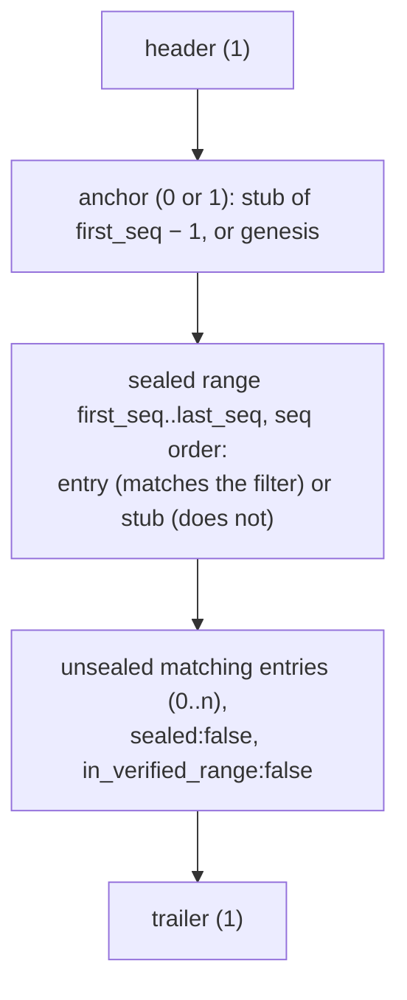

# Audit export format v1

This document pins two things that every implementation must agree on byte
for byte:

1. **The canonical form of an audit entry's envelope**, and the three hashes
   built on it (ADR-004 R13). The writer (`audit.Append`), the sealer and the
   offline verifier (`nava audit verify`) all use `internal/audit/chain`.
2. **The export file** `nava.audit.export/v1`, in JSONL and CSV (R20–R22).

The golden vectors in `internal/audit/chain/testdata/vectors.json` are the
executable form of section 1. **Changing either the canonical form or the
vectors is a breaking change to this format** and needs Technical Lead review
(PLAN-005 D-5-7). A new format gets a new id (`…/v2`); v1 files stay
verifiable.

## 1. Hashes

```text
envelope_sha256 = SHA-256( JCS(envelope) )
entry_hash      = SHA-256( prev_hash ‖ envelope_sha256 )      32 + 32 raw bytes
diff_sha256     = SHA-256( diff_salt ‖ diff )                 16 raw bytes + the stored diff bytes
prev_hash of seq 1 (genesis) = 32 zero bytes
```

- The chain is per tenant and ordered by `seq` only, never by `occurred_at`.
- `diff` is stored as `json`, not `jsonb`, so its bytes are kept exactly as
  written. `diff_sha256` covers **those bytes**: whitespace and member order
  matter, and nothing is re-encoded before hashing.
- **`diff_truncated`** (ADR-004-E1): a diff over 64 KB is cut to its leading
  whole RFC 6902 ops and stored with `diff_truncated = true`. `diff_sha256`
  covers the stored (cut) bytes, and the flag is **inside the envelope**, so
  clearing or setting it after sealing breaks `envelope_sha256`.
- An entry with no diff stores `diff`, `diff_salt` and `diff_sha256` as NULL.
- Erasure (R11) sets `diff` and `diff_salt` to NULL. `diff_sha256` is in the
  envelope and stays, so the chain still verifies (R24 decides whether the
  erasure was legitimate).

## 2. The envelope

The envelope is exactly these 22 columns: the R1 envelope columns plus
`diff_truncated`. **Not** in it: `txid`, `diff`, `diff_salt`, `seq`,
`prev_hash`, `entry_hash`, `sealed_at`, `erased_at`, `erasure_ref`.

| Member | Column type | JSON value | NULL? |
|---|---|---|---|
| `tenant_id` | uuid | UUID string | no |
| `id` | uuid (v7; v5 for backfill) | UUID string | no |
| `occurred_at` | timestamptz | timestamp string | no |
| `domain` | text (R2 CHECK) | string | no |
| `action` | text (R2 CHECK) | string | no |
| `subject_type` | text (R2 CHECK) | string | no |
| `subject_id` | uuid | UUID string | no |
| `entity_definition_id` | uuid | UUID string | yes |
| `version_before` | integer | integer | yes |
| `version_after` | integer | integer | yes |
| `actor_principal_id` | uuid | UUID string | yes (exactly one actor is set) |
| `actor_system` | text | string | yes |
| `source` | text (R2 CHECK) | string | no |
| `source_ref` | see note 3 | string | yes |
| `change_set_id` | uuid | UUID string | yes |
| `causation_id` | uuid | UUID string | yes |
| `causation_depth` | smallint | integer | no (note 4) |
| `request_id` | text | string | yes |
| `backfilled` | boolean | `true` / `false` | no |
| `content_sha256` | bytea (32) | hex string | yes |
| `diff_sha256` | bytea (32) | hex string | yes |
| `diff_truncated` | boolean | `true` / `false` | no |

### Canonical form (JCS, RFC 8785)

The envelope is serialised with RFC 8785, which here is short because the
envelope holds **only strings, integers, booleans and null — never a float**
(TICK-449):

- **Members:** all 22, always. **NULL is emitted as `null`, never omitted.**
  Sorted by UTF-16 code units of the name (all names are ASCII, so this is
  plain byte order). No whitespace anywhere.
- **Strings:** UTF-8. Escape only `"` → `\"`, `\` → `\\`, and U+0000–U+001F:
  `\b \t \n \f \r` where those short forms exist, otherwise `\u00xx` with
  **lowercase** hex. Everything else is written raw: `/`, `<`, `>`, `&`, DEL,
  U+2028, U+2029, non-ASCII and astral characters. (Go's `encoding/json`
  escapes `<>&` and U+2028/9 — do not use it to produce canonical bytes.)
  Invalid UTF-8 and U+0000 are errors.
- **Integers:** base-10, no `+`, no leading zeros, no fraction, no exponent,
  `0` not `-0`. Range ±(2^53 − 1) (I-JSON), which every DB integer here fits.
- **Booleans:** `true`, `false`.
- **Timestamps:** RFC 3339 in UTC with exactly six fractional digits and `Z`:
  `2026-11-02T10:00:01.123456Z`. Values with sub-microsecond precision are an
  error (PostgreSQL keeps microseconds; a value that was never stored must not
  be hashed).
- **UUIDs:** lowercase, 36 characters with hyphens.
- **bytea:** lowercase hex, no `\x` prefix.
- **Text values that are present are never empty.** An empty string is an
  error; write NULL. This keeps NULL and text apart in CSV (section 5).

Example (vector `config-create-minimal`, `envelope_sha256`
`75b2549d…69f92991`):

```json
{"action":"create","actor_principal_id":"0190f3a0-0000-7000-8000-0000000000a1","actor_system":null,"backfilled":false,"causation_depth":0,"causation_id":null,"change_set_id":null,"content_sha256":"c047e47e00000000000000000000000000000000000000000000000000000001","diff_sha256":"a0d863fe51797a35c46ce24f19570a9cc3674751d4a4641b22b8b0263ce4deda","diff_truncated":false,"domain":"config","entity_definition_id":null,"id":"0190f3a0-0000-7000-8000-000000000101","occurred_at":"2026-11-02T10:00:00.000000Z","request_id":null,"source":"user","source_ref":null,"subject_id":"0190f3a0-0000-7000-8000-0000000000d1","subject_type":"entity_definition","tenant_id":"0190f3a0-0000-7000-8000-000000000001","version_after":1,"version_before":null}
```

### Parsing an envelope

A reader (the verifier) parses an envelope object strictly and then
**re-canonicalises it**; it never hashes the bytes it read. It rejects:
a missing member, an unknown member, a duplicate member, a non-canonical value
(uppercase UUID or hex, a timestamp without six digits or not in `Z`, `1.0`,
`1e0`, `-0`, an integer outside ±(2^53 − 1), a boolean as a string, an empty
string). Member order and whitespace are free. The vectors' `invalid` list
covers each rejection.

Notes:

1. Vocabulary (R2) and the one-actor rule are checked by the writer and the
   database, not by the canonical form; the hash covers whatever was stored.
2. `version_before` / `version_after` are `integer` columns; the canonical form
   accepts any safe integer.
3. **`source_ref` is `text NULL`** (Technical Lead ruling, TICK-454; C2
   `SourceRef *string` is binding and supersedes the `uuid` type in RFC-008
   Annex A, because plugin, rule and workflow refs are not always UUIDs).
   When `source = ai`, `audit.Append` checks that it is a UUID (R4, I8) and it
   is stored in lowercase form, so it canonicalises to the same bytes as a
   uuid column would.
4. **`causation_depth` is `smallint NOT NULL DEFAULT 0 CHECK (causation_depth
   >= 0)`** (Technical Lead ruling, TICK-454; C2 `CausationDepth int16`).
5. **Present text is never empty, in the database too** (Technical Lead
   ruling, TICK-454). P5-10b adds `CHECK (col <> '')` on `domain`, `action`,
   `subject_type`, `actor_system`, `source`, `source_ref` and `request_id`, and
   `audit.Append` returns `ErrInvalidEntry` for an empty string. Without it a
   stored `''` could never be canonicalised and would stall the tenant's
   sealer. The same holds for U+0000, which PostgreSQL `text` cannot store and
   the canonical form rejects.

## 3. The export file (JSONL)

UTF-8, one JSON object per line, `\n` line ends, no blank lines. Every line
has a `kind`. Lines come in this order:



### `header`

```json
{"kind":"header","format":"nava.audit.export/v1","tenant_id":"…","export_id":"…","exported_at":"2026-11-02T12:00:00.000000Z","stubs":true,"filter":{"from":"…","to":"…","domain":null,"subject_type":null,"subject_id":null,"change_set_id":null,"after_seq":null}}
```

`export_id` is the `id` of the `audit/export` entry committed before the first
byte (R19). Every filter member is present (`null` when unset). Timestamps use
the canonical form.

### Range and anchor (R20)

- `first_seq` is the first sealed `seq` whose `occurred_at` is in the time
  window, **whatever the other filters say**. With `after_seq = n`,
  `first_seq = n + 1`.
- `last_seq` is `audit_chain_head.seq`, read once at the start.
- The **anchor** is the line for `first_seq − 1`:
  - `first_seq = 1`: `{"kind":"anchor","genesis":true,"seq":0,"prev_hash":null,"entry_hash":"000…000","envelope_sha256":null}`
  - otherwise: `{"kind":"anchor","genesis":false,"seq":41,"prev_hash":"…","entry_hash":"…","envelope_sha256":"…"}`
- Every `seq` in `first_seq..last_seq` then appears exactly once, ascending.
- If no sealed entry falls in the window, there is no anchor and no range
  lines; the trailer's `anchor_seq` and `last_seq` are `null`.

### `entry` (a full line)

```json
{"kind":"entry","sealed":true,"in_verified_range":true,"seq":42,"prev_hash":"…","entry_hash":"…","envelope_sha256":"…","sealed_at":"…","envelope":{…22 members…},"diff":"[{\"op\":\"replace\",\"path\":\"/status\",\"value\":\"open\"}]","diff_salt":"5a1700ff…","diff_redacted":false,"erased_at":null,"erasure_ref":null}
```

- `envelope` is the envelope object (canonical form recommended, any member
  order accepted).
- **`diff` is a JSON string holding the stored diff bytes**, not an embedded
  JSON value, so the bytes survive the line unchanged (a stored `json` value
  may contain newlines). `null` when there is no diff or it was erased.
- `diff_salt` is present **only with an unredacted diff** (R7). For a reader
  under a mask, `diff` holds the redacted diff, `diff_redacted` is `true`, and
  `diff_salt` is `null`; the diff hash is then not checkable from this file.
- Erased (R11): `diff` and `diff_salt` are `null`, `erased_at` and
  `erasure_ref` are set. The export includes the matching `audit/erase`
  entries (R24).

### `stub`

```json
{"kind":"stub","seq":43,"prev_hash":"…","entry_hash":"…","envelope_sha256":"…"}
```

A sealed entry in the range that the filter excludes. Exactly these members.

### Unsealed lines

Matching entries not yet sealed, with `occurred_at` ≤ the export start, come
after the range: `kind: "entry"`, `sealed: false`, `in_verified_range: false`,
and `seq`, `prev_hash`, `entry_hash`, `sealed_at` all `null`.
`envelope_sha256` is the exporter's computation, for information only.

### `trailer`

```json
{"kind":"trailer","anchor_seq":41,"last_seq":120,"head_hash":"…","count":12,"stub_count":67,"unsealed_count":3,"verifiable":true}
```

| Member | Meaning |
|---|---|
| `anchor_seq` | `seq` of the anchor line (`0` for genesis), `null` for an empty range |
| `last_seq` | the head `seq` read at the start (= `seq` of the last range line) |
| `head_hash` | `entry_hash` at `last_seq` |
| `count` | full `entry` lines in the range (sealed) |
| `stub_count` | `stub` lines (the anchor is not counted) |
| `unsealed_count` | unsealed `entry` lines |
| `verifiable` | `false` when exported with `stubs=false` (excluded entries are left out, so the range has gaps), or when the range is empty |

With `stubs=true`: `count + stub_count = last_seq − anchor_seq`.

## 4. Verification

What `nava audit verify` (P5-03) checks, offline:

1. The header's `format` is `nava.audit.export/v1`; the last line is the
   trailer; counts match.
2. The first range line is the anchor, and its `seq` is `anchor_seq`
   (R20: a file without the anchor is rejected).
3. For each range line in order, `seq` is the previous `seq + 1` and
   `prev_hash` equals the previous `entry_hash` (the anchor's for the first).
4. For each full line: parse the envelope strictly, recompute
   `envelope_sha256`, compare, and recompute `entry_hash`. For a stub,
   recompute `entry_hash` from its `prev_hash` and `envelope_sha256`.
5. Where `diff` and `diff_salt` are both present, `SHA-256(salt ‖ diff)`
   equals the envelope's `diff_sha256`.
6. The last range line's `entry_hash` is `head_hash`.
7. Erased entries: R24 (`tampered` unless a chain-valid `audit/erase` entry
   with `subject_id = erasure_ref` lists the id; `pending` if that entry is
   unsealed). **The `audit/erase` diff is RFC 6902 like every other diff**
   (R1, R5): exactly one op,
   `[{"op":"add","path":"/erased_ids","value":["<id>", …]}]`, with 1 to 10,000
   lowercase entry ids (R23). The verifier reads the ids from that op only and
   treats any other shape as not listing the id.
8. An export with an empty range (`anchor_seq: null`) is reported as
   **`empty`**, not as a failure.

The vectors' `tampered` list gives one case per failure kind
(`envelope_sha256_mismatch`, `diff_sha256_mismatch`, `entry_hash_mismatch`),
including **`diff-truncated-flag-cleared`**: a truncated entry whose flag was
cleared after sealing must fail.

## 5. CSV

Same lines, same order, one row per line, RFC 4180 (comma, `"` quoting,
CRLF row ends). The first row names the columns:

```text
kind,seq,prev_hash,entry_hash,envelope_sha256,genesis,sealed,in_verified_range,sealed_at,
tenant_id,id,occurred_at,domain,action,subject_type,subject_id,entity_definition_id,
version_before,version_after,actor_principal_id,actor_system,source,source_ref,
change_set_id,causation_id,causation_depth,request_id,backfilled,content_sha256,
diff_sha256,diff_truncated,diff,diff_salt,diff_redacted,erased_at,erasure_ref,meta
```

(one row; wrapped here for reading). The envelope members are flattened into
their own columns. Values use the canonical forms of section 2; booleans are
`true` / `false`; **NULL or "not applicable to this kind" is an empty cell**
(present text is never empty, so this is unambiguous). `header` and `trailer`
rows put their whole JSONL object in `meta` and leave the rest empty.

**Formula injection (OWASP, R22):** a cell whose value begins with `=`, `+`,
`-`, `@`, tab (U+0009) or CR (U+000D) is written with a `'` prefixed.
**So is a value that already begins with `'`**, which makes the rule
reversible: a reader drops exactly one leading `'` from any cell that has one,
then verifies exactly as for JSONL. JSONL is never prefixed.

## 6. Golden vectors

`internal/audit/chain/testdata/vectors.json`, regenerated by

```sh
go run ./internal/audit/chain/cmd/genvectors
```

`TestVectorsFileIsCurrent` fails if the committed file differs from the
generator's output. The file holds:

| List | Contents |
|---|---|
| `diffs` | salt, stored diff bytes, `diff_sha256`; includes the same ops compact and spaced (different hashes) |
| `chain` | seq 1..7 of one tenant: envelope, canonical bytes, `envelope_sha256`, `prev_hash`, `entry_hash`, diff and salt. Covers a minimal config entry, every nullable field set, string escapes (control characters, DEL, U+2028, astral, HTML), a backfilled UUIDv5 entry with integer bounds, **truncated-honest** (`diff_truncated: true`, hash over the stored cut bytes), an erased entry and its `audit/erase` entry |
| `tampered` | lines changed after sealing, each with the failure it must produce, including the **tampered `diff_truncated` flag** both ways and a diff re-serialised as jsonb would |
| `invalid` | envelope objects the parser must reject |

The writer (P5-12b), the sealer (P5-34a) and the verifier (P5-03) each test
against this file; the verifier's fixtures (TICK-425) are built from the
generator.
