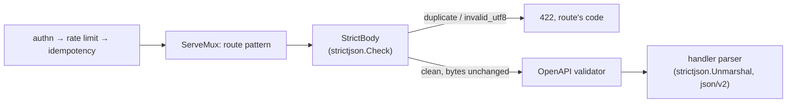

# Strict JSON request bodies

Every `/api/v1` operation with a request body refuses a body that has a
**duplicate object member name** or **invalid UTF-8** anywhere in it, at any
depth. This is the `encoding/json/v2` default. `encoding/json` v1 silently kept
the last duplicate and turned bad bytes or a lone surrogate escape into
U+FFFD, so the validator, a handler and PostgreSQL could each read a different
document from the same body.

## What is refused

| Rule | The body has | Examples |
| --- | --- | --- |
| `duplicate` | an object with the same member name twice, compared after unescaping | `{"a":1,"a":2}`; `{"x":{"y":[{"z":1,"z":2}]}}`; a name written once as `a` and once as its escape `\u0061` |
| `invalid_utf8` | bytes that are not valid UTF-8, or a `\u` escape that is a lone surrogate | `"\ud800"`, `"\udc00x"`, overlong `C0 AF`, UTF-8-encoded surrogate `ED A0 80` |

Names that differ only by case (`a` and `A`) are different names and are not
refused. A syntax error (a truncated body, trailing data) is not one of these
cases. It stays the validator's `400 validation_failed`, as before.

## The response

The status is `422`. The body is the usual `application/problem+json` problem.
The `code` is the one the operation already uses for a body it does not
accept, so no new code is introduced. `errors` has exactly one entry. Its
`pointer` is an RFC 6901 pointer under `/body`, and its `rule` is `duplicate`
or `invalid_utf8`.

| Operation | `code` |
| --- | --- |
| `POST /api/v1/operator/tenants` (onboardTenant) | `invalid_idp_config` |
| `POST /api/v1/entity-types` (createEntityType) | `invalid_definition` |
| `POST /api/v1/entity-types/{key}/versions` (publishEntityTypeVersion) | `invalid_definition` |
| `PUT /api/v1/entity-types/{key}/access` (putEntityTypeAccess) | `invalid_access_policy` |
| `POST /api/v1/workflow-definitions/{key}/versions` (publishWorkflowDefinitionVersion) | `workflow_definition_invalid` |
| `POST /api/v1/number-formats` (createNumberFormat) | `number_format_invalid` |
| `PUT /api/v1/number-formats/{id}` (publishNumberFormatVersion) | `number_format_invalid` |
| `POST /api/v1/number-formats/{id}/republish-linked` (republishLinkedTypes) | `number_format_invalid` |
| `PUT /api/v1/tenant/settings/time-zone` (putTenantTimeZone) | `invalid_time_zone` |
| `POST /api/v1/records/{entity}` (createRecord) | `record_invalid` |
| `PATCH /api/v1/records/{entity}/{id}` (patchRecord) | `record_invalid` |

```json
{
  "type": "urn:nava:problem:record_invalid",
  "title": "Record invalid",
  "status": 422,
  "code": "record_invalid",
  "detail": "The record is not accepted. See errors for the failing fields.",
  "instance": "urn:nava:request:…",
  "errors": [{ "pointer": "/body/data/tags/0/label", "rule": "duplicate" }]
}
```

The pointer names where the problem is. It never carries a value. For invalid
UTF-8 inside a member name, it stops at the enclosing object, so the bad bytes
are never echoed. Only the first problem in the body is reported.

## Where it runs



`StrictBody` runs before the OpenAPI validator. The handler parsers
(`parseCreate`, `parsePublish`, `parseRecordBody`, `parsePatchBody`,
`authz.ParsePolicy`) decode with `encoding/json/v2` as well. They refuse the
same bodies with the same pointer and rule if they are ever reached without
the middleware. The entity schema decode (`metadata.decodeSchema`) refuses
invalid UTF-8 in the schema; it already refused duplicate keys.

A test in `internal/server` fails if an operation with a request body has no
code in the table above.
