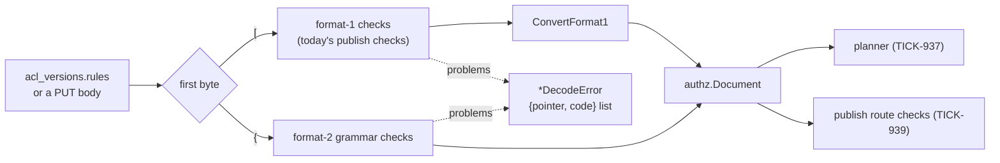

# Format-2 access document

ADR-010 (D2, D3, D11, D12), PLAN-011 contract C2, TICK-936 P11-04.

`acl_versions.rules` holds either S10's format-1 array of rules or a format-2
document. `authz.Decode` reads both kinds and always returns a format-2
`authz.Document`:

```json
{"format": 2,
 "conditions": [{"name": "is_requester", "expr": {"cmp": {"column": "requester_id", "op": "eq", "caller": "self"}}}],
 "policies":   [{"name": "requesters", "ops": ["read"], "when": {"any": [{"ref": "is_requester"}, {"shared": true}]}}]}
```

Masks are not part of the document. They stay in their own column, unchanged.



## What Decode checks

`Decode` checks only the grammar:

- the document's shape;
- whether each node has exactly one D3 key;
- names match `^[a-z][a-z0-9_]{0,62}$`, unique within conditions and unique within policies;
- `all` and `any` have 1 to 16 children;
- a `cmp` node follows today's `Cond` rules;
- no JSON object repeats a key (`encoding/json` and `jsonb` would both keep only the last copy).

Each problem is a JSON pointer into the document plus a code from C1. The
codes are declared in `internal/authz/document.go`. The publish route prefixes
each pointer with `/rules`.

These checks belong to the publish route (TICK-939) and the database CHECK
(TICK-940), not to `Decode`:

- every `ref` resolves, and no `ref` forms a cycle;
- depth and leaf caps;
- foreign ids;
- `under` is refused as `not_available`;
- the byte limit.

Both extend the shared fixture `internal/authz/testdata/format2_invalid.json`.
Cases marked `go_only` (duplicate keys) cannot reach the CHECK.

## Format-1 conversion (D12)

Each rule becomes a policy with the same `ops` and this `when`:

```
all[ any[member_of(groups, users)?, cmp(requester_id eq self)?, cmp(assignee_id eq self)?, shared?], cmp(where[0]), ... ]
```

The planner folds the tree, so `Decode` does not simplify it. If a rule id is
not a valid name, the policy gets a derived name and keeps the original id in
`legacy_id` for the explainer. For example, `default-admins` becomes
`default_admins`. Stored rows are immutable, so the same row always gets the
same names. A rule with no subject converts to an empty `any`, which grants
nothing, as it does today. The golden files are in
`internal/authz/testdata/format1/`.

The converter stays for as long as any stored format-1 row exists
(`docs/delivery/plan-adr-010.md` §Migration).

## Node registry (D11)

`authz.Kinds()` lists every node kind with `SQLSafe` and `Available`. Today
`under` is `SQLSafe` but not `Available` (S31). `TestRegistryKindsAreRendered`
fails when a kind that is SQLSafe and Available is missing a SQL rendering, a
Go rendering or agreement-generator coverage. Since TICK-942 there is no
allowed gap (`pendingRenderings` is empty, TODO-S30-01 fixed): the format-2
I5 generator builds every available kind, and
`TestI5Format2GeneratorCoversTheRiskyShapes` fails if it stops.
