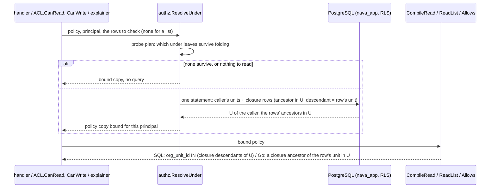

# The `under` leaf on the closure (TICK-950, TICK-1034)

Decision: [ADR-010](../adr/ADR-010-composable-access-rules.md) D7, D5a, as
amended by the R1 ruling on TICK-946 (formal text: ADR-010-A2); SP-1d
decisions 1 and 5. Code: `internal/authz/under.go`, `plan.go` (`pUnder`),
`acl.go` (`compiler.under`, `ReadList`, `RegionDriver`),
`internal/records/store/list.go` (`CountStatement`). Tests:
`internal/authz/under_test.go`,
`internal/records/pipeline/acl_under_integration_test.go`, the I5 format-2
agreement (`internal/tenancy/isolation/i5_format2_*`).

`{"under": {"of": "caller"}}` holds when the record's `org_unit_id` is at or
below one of the caller's units (`org_unit_members`);
`{"under": {"of": [ids]}}` when it is at or below one of the listed units.
Those start units are **U**. Both sides read
[`org_unit_closure`](../data/org-unit-closure.md): for each live unit, every
live unit at or below it, itself included. Go never builds the subtree, and no
request walks the tree.

## Flow

## Renderings

| Where | Rendering |
| --- | --- |
| `Allows` (one record) | `ResolveUnder` reads `EXISTS (org_unit_closure WHERE ancestor_id = ANY(U) AND descendant_id = row's unit)` as a PK probe, for every row it is given, in one statement with the caller's units. |
| List page, interim | C1 on `records_org_unit`: `r.org_unit_id IS NOT NULL AND r.org_unit_id IN (SELECT descendant_id FROM org_unit_closure WHERE tenant_id = $t AND ancestor_id = ANY($U))`. Only `compiler.under` writes this text, so ADR-010-A2's list shape (TICK-1036) changes that function alone. |
| List count, region term | Always P3, whatever any probe says: the units of U not below another unit of U, then the closure per unit, then `LATERAL (records … LIMIT K+1)`, K = 1,000 (`TotalCap`). It reads at most K + 1 records. The units kept have disjoint subtrees, so no record is counted twice. Source: the SP-1d decision comment on TICK-946 and the P3 SQL on TICK-1041; PR #818 (A2) had not merged. |

A count term is a region term when it is an `under` leaf, or an `all` with one
as a child (`RegionDriver`). Other terms, and an `under` under `not` or `any`,
keep today's count. The driver reuses the leaf's own placeholders, so the
count and the page bind the same arguments.

## Rules

| Case | Result |
| --- | --- |
| Live unit | under itself and every live unit above it |
| Tombstoned unit | no closure row: outside every U's region, and so is its whole subtree, live descendants included |
| A live unit below a tombstoned one, even the caller's own unit or a listed one | no closure row: outside (D7, fail closed) |
| Listed id that is tombstoned, another tenant's or unknown | matches nothing (the route refuses it at publish anyway) |
| `org_unit_id` NULL | never under, on both sides; `not under` is true |
| Caller with no id, or with no units | `under caller` is false, no argument |
| No binding for the principal planned | the policy is voided, `under_unresolved` (fails closed, counted in `authz_policy_invalid_total`) |
| `Allows` on a row whose unit `ResolveUnder` did not read | every policy reaching `under` is voided, `under_unresolved`, so `not under` never admits it |
| More than 4 distinct U in one policy | refused at publish, 422 `under_sets_exceeded` at `/rules/policies/<i>`; a stored one is voided by the planner |

There is no size cap: the 10,000-unit `MaxUnderSet`, its 500
`access_scope_too_large` and `authz_under_set_too_large_total` are gone
(TICK-1034). The capped count is O(K), not O(|S|), so nothing replaces them.

## Publish

`Prepare` reports each id of `under {"of": [ids]}` as a `KindOrgUnit` tenant
ref at `/rules/.../under/of/<i>`, and `NotInTenant` checks it against the
tenant's live `org_units`: a foreign, tombstoned or unknown unit is 422
`foreign_id` at that pointer, the same ids `acl2_tenant_ids` (TICK-947)
refuses past the route. It also counts each policy's distinct U, refs
expanded: `{"of": "caller"}` is one U, and the same ids in any order are one.

## Creates

A create resolves the record's unit (the requester's primary unit, ADR-010
D8) before the write check, so `CanWrite` judges the row as it will be
stored; `CanWrite` passes both the before and the after row to
`ResolveUnder`.

## Callers

`ACL.CanRead` and `ACL.CanWrite` (with their rows), the list route (no row,
before `ReadList`) and the explainer (the target and the record) call
`ResolveUnder`. A new caller of `Allows`, `CompileRead`, `ReadList`,
`ReadPredicate` or `ReadBranches` with a document that may hold `under` must
call it too, with every row `Allows` will see; without it such policies grant
nothing.

## Freshness

The closure is only as current as group sync keeps it (TICK-1033). Until
group sync rebuilds it on a tree change, a tombstoned or moved unit still
grants its old subtree, so TICK-1034 merges after TICK-1033.
