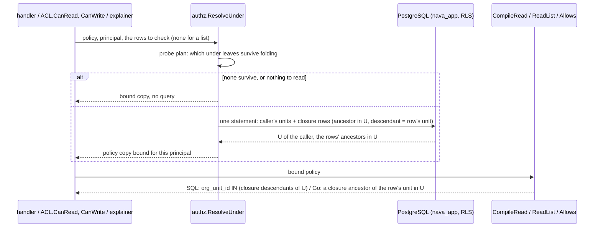
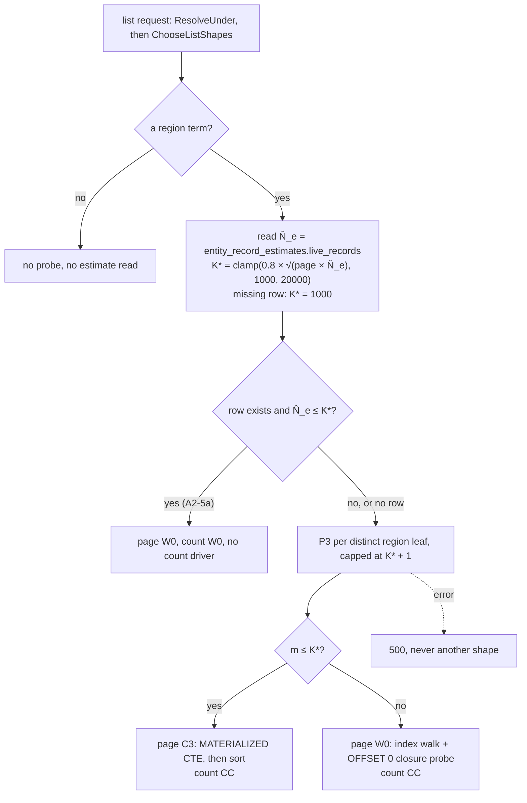

# The `under` leaf on the closure (TICK-950, TICK-1034, TICK-1036)

Decision: [ADR-010](../adr/ADR-010-composable-access-rules.md) D7, D5a, as
amended by the R1 ruling on TICK-946 (formal text: ADR-010-A2); SP-1d
decisions 1 and 5. Code: `internal/authz/under.go`, `plan.go` (`pUnder`),
`acl.go` (`compiler.under`, `ReadList`, `ReadListShaped`, `RegionDriver`),
`shape.go` (K\*, P3, `ChooseListShapes`),
`internal/records/store/list.go` (`PageStatement`, `CountStatement`). Tests:
`internal/authz/under_test.go`, `internal/authz/shape_test.go`,
`internal/records/pipeline/acl_under_integration_test.go`,
`internal/records/pipeline/acl_under_shape_integration_test.go`, the TICK-1035
agreement suite (`internal/groupsync/under_closure_agreement_integration_test.go`),
the I5 format-2 agreement (`internal/tenancy/isolation/i5_format2_*`).

`{"under": {"of": "caller"}}` holds when the record's `org_unit_id` is at or
below one of the caller's units (`org_unit_members`);
`{"under": {"of": [ids]}}` when it is at or below one of the listed units.
Those start units are **U**. Both sides read
[`org_unit_closure`](../data/org-unit-closure.md): for each live unit, every
live unit at or below it, itself included. Go never builds the subtree, and no
request walks the tree.

## Flow

## Renderings

| Where | Rendering |
| --- | --- |
| `Allows` (one record) | `ResolveUnder` reads `EXISTS (org_unit_closure WHERE ancestor_id = ANY(U) AND descendant_id = row's unit)` as a PK probe, for every row it is given, in one statement with the caller's units. |
| `CompileRead`, `ReadBranches` | The predicate form: `r.org_unit_id IS NOT NULL AND r.org_unit_id IN (SELECT descendant_id FROM org_unit_closure WHERE tenant_id = $t AND ancestor_id = ANY($U))`. |
| List page, region term | **C3** or **W0**, picked per request from the probe P3 (ADR-010-A2 A2-5; see "Page shape" below). Any other `under` in the page is W0. |
| List count, region term | Always CC, whatever the probe says: the units of U, made `DISTINCT`, not below another unit of U, then the closure per unit, then `LATERAL (records … LIMIT 1001)` (`TotalCap` + 1), the leaf inside in the predicate form. It reads at most 1,001 records. The units kept have disjoint subtrees, so no record is counted twice. The cap does not follow K\*. The one exception is A2-5a. |

Only `compiler.under` writes the leaf's text; its three forms (predicate, W0,
C3) bind the same two placeholders.

A count term is a region term when it is an `under` leaf, or an `all` with one
as a child (`RegionDriver`). Other terms, and an `under` under `not` or `any`,
keep today's count. The driver reuses the leaf's own placeholders, so the
count and the page bind the same arguments.

## Page shape (TICK-1036, ADR-010-A2 A2-5, A2-5a, A2-9)

| Statement | SQL (alias names as `shape.go` and `acl.go` render them) |
| --- | --- |
| P3 | `SELECT count(*) FROM (SELECT 1 FROM <canonical distinct U> CROSS JOIN LATERAL (closure descendants of u) CROSS JOIN LATERAL (SELECT 1 FROM records r WHERE r.tenant_id = $t AND r.entity_definition_id = $e AND r.org_unit_id IS NOT NULL AND r.org_unit_id = descendant LIMIT K+1) LIMIT K+1)`. No request filter. |
| C3 | `WITH acl_m AS MATERIALIZED (SELECT … FROM records r WHERE … AND r.org_unit_id = ANY(ARRAY(closure descendants of U)) AND NOT <earlier branches>) SELECT … FROM acl_m r ORDER BY <sort> LIMIT $page`. A later branch negates a C3 leaf in the predicate form, so a C3 page holds no `OFFSET 0`. |
| W0 | `r.org_unit_id IS NOT NULL AND EXISTS (SELECT 1 FROM org_unit_closure WHERE tenant_id = $t AND ancestor_id = ANY($U) AND descendant_id = r.org_unit_id OFFSET 0)`: the sort index walk, one closure-PK SubPlan probe per row. |

- The shape changes SQL text only. Every shape computes the predicate
  `Allows` computes (A2-6), so a wrong estimate or probe count costs time,
  never rows. The shapes live for one request; nothing is cached.
- Only a term an `under` leaf drives (the leaf, or an `all` with one) is
  probed. P3 never runs for a request filter (A2-6 requirement 1).
- The shape, the probe count, K\* and N̂_e reach no response, header, log line
  or error text (requirement 2). Every statement binds the transaction's
  tenant (`tenancy.TenantOf`, the `app.tenant_id` value; requirement 3).
- Metrics: `authz_under_list_shape_total{shape="c3"|"walk"}` (A2-5a counts as
  `walk`) and `authz_under_probe_seconds`, with no other label.

## Rules

| Case | Result |
| --- | --- |
| Live unit | under itself and every live unit above it |
| Tombstoned unit | no closure row: outside every U's region, and so is its whole subtree, live descendants included |
| A live unit below a tombstoned one, even the caller's own unit or a listed one | no closure row: outside (D7, fail closed) |
| Listed id that is tombstoned, another tenant's or unknown | matches nothing (the route refuses it at publish anyway) |
| `org_unit_id` NULL | never under, on both sides; `not under` is true |
| Caller with no id, or with no units | `under caller` is false, no argument |
| No binding for the principal planned | the policy is voided, `under_unresolved` (fails closed, counted in `authz_policy_invalid_total`) |
| `Allows` on a row whose unit `ResolveUnder` did not read | every policy reaching `under` is voided, `under_unresolved`, so `not under` never admits it |
| More than 4 distinct U in one policy | refused at publish, 422 `under_sets_exceeded` at `/rules/policies/<i>`; a stored one is voided by the planner |
| A listed `of` that lists one unit twice | refused at publish, 422 `under_duplicate_id` at each repeat's `.../under/of/<i>` (A2-8, R2-N1). A U with a repeat that reaches SQL anyway is made `DISTINCT` in every `unnest(U)` source (P3, CC) |
| A listed `of` that holds a unit and one of its ancestors | refused at publish, 422 `under_nested` at that leaf's `.../under/of` (SP-1e); one closure statement for all leaves (`NestedUnderUnits`). Ids that become nested later, after a tree move, still read correctly: the count driver drops the unit below |

There is no size cap: the 10,000-unit `MaxUnderSet`, its 500
`access_scope_too_large` and `authz_under_set_too_large_total` are gone
(TICK-1034). The capped count is O(K), not O(|S|), for a type dense under S,
so nothing replaces them; a sparse type under a large S is A2-5a and A2-R6.

## Publish

`Prepare` reports each id of `under {"of": [ids]}` as a `KindOrgUnit` tenant
ref at `/rules/.../under/of/<i>`, and `NotInTenant` checks it against the
tenant's live `org_units`: a foreign, tombstoned or unknown unit is 422
`foreign_id` at that pointer, the same ids `acl2_tenant_ids` (TICK-947)
refuses past the route. It also counts each policy's distinct U, refs
expanded: `{"of": "caller"}` is one U, and the same ids in any order are one.
`NestedUnderUnits` then refuses a leaf that lists a unit and one of its
ancestors in the tenant's closure (422 `under_nested` at the leaf's `of`),
in the route and in `PublishIfNone`, beside `NotInTenant`.

## Creates

A create resolves the record's unit (the requester's primary unit, ADR-010
D8) before the write check, so `CanWrite` judges the row as it will be
stored; `CanWrite` passes both the before and the after row to
`ResolveUnder`.

## Callers

`ACL.CanRead` and `ACL.CanWrite` (with their rows), `TestPolicyRef` (a
workflow policy test, with its record), the list route (no row,
before `ReadList`) and the explainer (the target and the record) call
`ResolveUnder`. A new caller of `Allows`, `CompileRead`, `ReadList`,
`ReadPredicate` or `ReadBranches` with a document that may hold `under` must
call it too, with every row `Allows` will see; without it such policies grant
nothing.

## Freshness

The closure is only as current as group sync keeps it (TICK-1033). Until
group sync rebuilds it on a tree change, a tombstoned or moved unit still
grants its old subtree, so TICK-1034 merges after TICK-1033.
