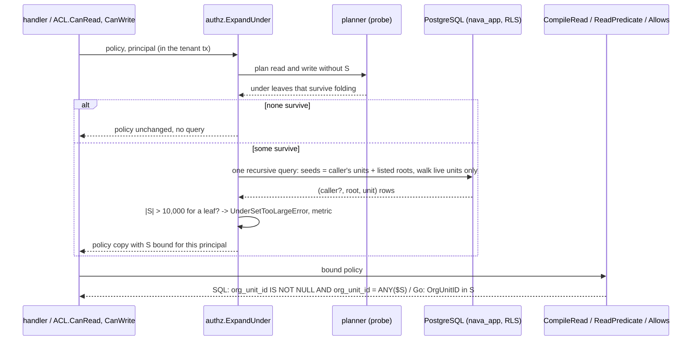

# The `under` leaf: set S (TICK-950)

Decision: [ADR-010](../adr/ADR-010-composable-access-rules.md) D7, D5a;
PLAN-011 D-11-5, P11-17. Code: `internal/authz/under.go`, `plan.go`
(`pUnder`). Tests: `internal/authz/under_test.go`,
`internal/records/pipeline/acl_under_integration_test.go`, the I5 format-2
agreement (`internal/tenancy/isolation/i5_format2_*`).

`{"under": {"of": "caller"}}` holds when the record's `org_unit_id` is in the
live subtree of one of the caller's units (`org_unit_members`);
`{"under": {"of": [ids]}}` when it is in the live subtree of one of the listed
units. That subtree is **set S**.

## Flow

The planner stays pure (no database). Set S is resolved before it runs, once
per request, and bound to a copy of the policy for that principal.

## Rules

| Case | S / result |
| --- | --- |
| Live unit | in S with every live unit below it |
| Tombstoned unit | out of S, and so is its whole subtree, live descendants included: the walk stops there |
| A caller's own unit that is live below a tombstoned one | in S (it is a seed; only walks stop at tombstones) |
| Listed id that is tombstoned, another tenant's or unknown | contributes nothing (the route refuses it at publish anyway) |
| `org_unit_id` NULL | never under, on both sides; `not under` is true |
| Caller with no id | `under caller` is false, no query |
| Empty S | the leaf folds to false |
| No S bound for the principal planned | the policy is voided, `under_unresolved` (fails closed, counted in `authz_policy_invalid_total`) |
| S above 10,000 units | `*authz.UnderSetTooLargeError` → 500 `access_scope_too_large`, `authz_under_set_too_large_total{entity_type}` |

S is one sorted `uuid[]` argument; the row predicate never joins `org_units`
(the rejected option of D7). `ReadBranches` splits on an `under` leaf like on a
`cmp`; the leaf is two-valued, so `AND NOT` exclusion holds.

## Publish

`Prepare` reports each id of `under {"of": [ids]}` as a `KindOrgUnit` tenant
ref at `/rules/.../under/of/<i>`, and `NotInTenant` checks it against the
tenant's live `org_units`: a foreign, tombstoned or unknown unit is 422
`foreign_id` at that pointer, the same ids `acl2_tenant_ids` (TICK-947)
refuses past the route.

## Callers

`ACL.CanRead` and `ACL.CanWrite`, the list route (before `ReadPredicate`) and
the explainer (for the target user) call `ExpandUnder`. A new caller of
`Allows`, `CompileRead`, `ReadPredicate` or `ReadBranches` with a document that
may hold `under` must call it too; without it such policies grant nothing.
