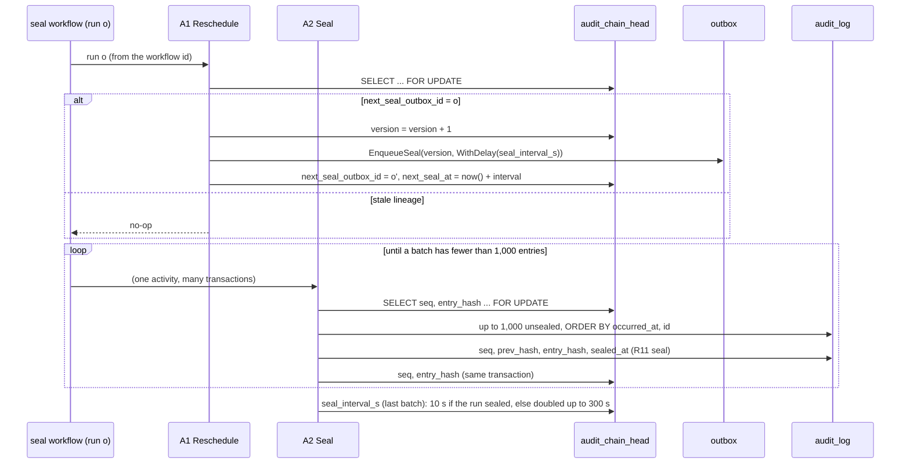

# Audit sealer activities (P5-34a)

`internal/audit/seal` holds the two activities of the self-rescheduling sealer (ADR-004 R13 to R16). The workflow that calls them is P5-34b. Both run as `nava_worker`, in transactions opened by `workerguard.InTenantTx`, so the tenant is always the one the activity guard verified (I2). Neither takes a tenant argument.

| Activity | Registered name | Transaction | Result in history |
| --- | --- | --- | --- |
| A1 `Reschedule` | `audit.seal.Reschedule` | one, commits before A2 | `{next_outbox_id}`, empty when the lineage is stale |
| A2 `Seal` | `audit.seal.Seal` | one per batch of 1,000 | none (workerguard records references only) |

## Rules the code holds

- **R15a.** `seq` comes only from the head row read `FOR UPDATE` in the transaction that assigns it. The head advances in that same transaction. A second sealer waits on the lock and then reads the moved head.
- **A1 is idempotent.** A retry after commit finds `next_seal_outbox_id = o′`, not `o`, and does nothing. Two A1s of one run racing produce one `o′`.
- **The interval is stored on the head.** A1 commits before A2 runs, so `o′` takes the interval the previous run's A2 left. That is why A2 returns no count: the next run needs nothing from the workflow history.
- **A poison entry fails its batch.** An envelope that cannot be canonicalised (`chain.ErrInvalidEnvelope`, for example `version_after` above 2^53 − 1) rolls back the whole batch, so no `seq` is used and the head does not move. The activity returns the non-retryable `nava.audit.seal.Unsealable`. Keeping the lineage alive past it is P5-34b's job.
- **Order.** Entries are sealed in `(occurred_at, id)` order within a batch. An entry that commits late, such as a back-filled one, gets the next `seq` when it arrives. The golden-vector test seeds the P5-02 chain in that arrival order.

Tests: `internal/audit/seal/*_integration_test.go` run against real PostgreSQL. They cover concurrent sealers (no duplicate `seq`), waiting on the head lock, the stale lineage, the A1 race, the interval rule, tenant isolation, the poison batch, and the golden vectors through `verify.Verify`.
