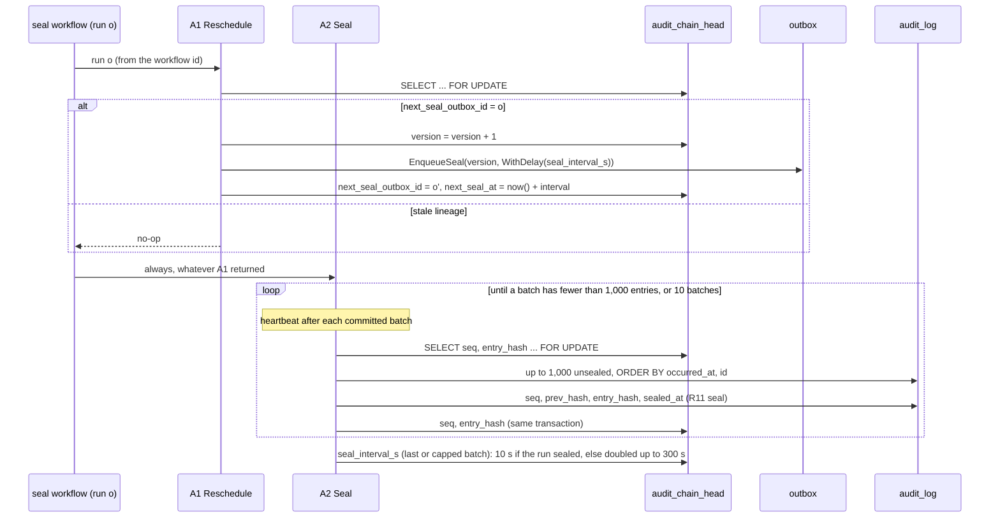

# Audit sealer: activities (P5-34a) and the `audit.seal` workflow (P5-34b)

`internal/audit/seal` holds the two activities of the self-rescheduling sealer (ADR-004 R13 to R16) and the `audit.seal` workflow that calls them (`workflow.go`), registered on `nava-tq` by `cmd/nava-worker`. Both run as `nava_worker`, in transactions opened by `workerguard.InTenantTx`, so the tenant is always the one the activity guard verified (I2). Neither takes a tenant argument.

| Activity | Registered name | Transaction | Result in history |
| --- | --- | --- | --- |
| A1 `Reschedule` | `audit.seal.Reschedule` | one, commits before A2 | `{next_outbox_id}`, empty when the lineage is stale |
| A2 `Seal` | `audit.seal.Seal` | one per batch of 1,000 | none (workerguard records references only) |

## Rules the code holds

- **R15a.** `seq` comes only from the head row read `FOR UPDATE` in the transaction that assigns it. The head advances in that same transaction. A second sealer waits on the lock and then reads the moved head.
- **A1 is idempotent.** A retry after commit finds `next_seal_outbox_id = o′`, not `o`, and does nothing. Two A1s of one run racing produce one `o′`.
- **The interval is stored on the head.** A1 commits before A2 runs, so `o′` takes the interval the previous run's A2 left. That is why A2 returns no count: the next run needs nothing from the workflow history.
- **A poison entry fails its batch.** An envelope that cannot be canonicalised (`chain.ErrInvalidEnvelope`, for example `version_after` above 2^53 − 1) rolls back the whole batch, so no `seq` is used and the head does not move. The activity returns the non-retryable `nava.audit.seal.Unsealable`. The lineage stays alive past it because A1 committed `o′` first; the next run meets the same entry and fails again, because skipping it would break the `(occurred_at, id)` order.
- **Order.** Entries are sealed in `(occurred_at, id)` order within a batch. An entry that commits late, such as a back-filled one, gets the next `seq` when it arrives. The golden-vector test seeds the P5-02 chain in that arrival order.

## The workflow (P5-34b)

`audit.seal` takes the relay's `outbox.Delivery` and does not read it: A1 takes run *o* from the workflow id `t:<tenant>:audit.seal:<o>`.

- **A1, then A2, always.** A2 runs whatever A1 returned. A1 returns no `o′` for a stale lineage, and for a retry of an A1 that had already committed (its worker died before reporting); R15's head lock makes the overlapping A2 safe. Only an A1 failure skips A2.
- **No child, no continue-as-new.** The only way to the next run is A1's outbox row, which the relay starts and the head fences. The Authorizer sees only the workflow id, so `TestWorkflowStartsNoChildAndNeverContinuesAsNew` and `TestRecordedHistoriesShape` enforce it.
- **Bounded A2.** One A2 call seals at most `DefaultMaxBatches` (10) batches, heartbeats after each committed batch (`HeartbeatTimeout` 30 s, `StartToClose` 5 min), and returns; the capped run sets the interval to 10 s and the next run continues the chain. Both activities have an explicit retry policy of 10 attempts; `NoRun` and `Unsealable` are non-retryable.
- **Kill between A1 and A2.** `o′` is already committed, so the next run seals what this run left.

## Metrics and alert (R-A2)

| Metric (Prometheus name) | Kind | Meaning |
| --- | --- | --- |
| `audit_unsealed_oldest_seconds` | gauge | Age, now, of the oldest unsealed entry over the tenants this worker sealed. Each A2 attempt measures its tenant; the value keeps growing between runs, and a tenant not measured for 15 min drops out. No tenant label. |
| `audit_seal_failures_total{reason}` | counter | Failed A2 attempts: `unsealable` (a poison entry) or `error` (retried). |

`deploy/compose/prometheus/rules/audit.yml` fires `AuditSealLag` at `max(audit_unsealed_oldest_seconds) > 600`. A failed attempt logs `audit seal failed` with `tenant_id` and `workflow_id`. The gauge is per worker, so a lineage that stops running (no worker measures it) is R17's `next_seal_at` check, not this alert.

## On the stack

`nava-worker` registers `audit.seal` on `nava-tq`, so the stack keeps one rule (TICK-453): every worker that polls a task queue registers the same workflow types. Cases that bring their own `nava-tq` workflow worker take `nava-worker` out for their run and are serial: `sdk` and `demo_outbox` swap it for the activity-only `nava-worker-activities` (`NAVA_WORKER_WORKFLOWS=off`, so `nava.workflow_ref.Close` still runs), the interpreter cases stop it. `with_worker_restored` (`deploy/compose/test/lib.sh`) puts `nava-worker` back even if the suite panics. Two checks keep it up and start no worker: `TestOnboardedTenantIsSealed` (an onboarded tenant's entry is sealed at seq 1 and the lineage moves on) and `TestWorkerServiceSealsThroughTheGuard` (A1 and A2 counted by the activity guard on `/metrics`).

## Replay gate

`internal/audit/seal/testdata/histories` holds four recorded runs (live lineage, stale lineage, A1 retried after commit, poison A2), recorded behind the worker guard by `make seal-record-histories`. `TestReplayRecordedHistories` replays them; histories are only ever added.

Tests: `internal/audit/seal/*_integration_test.go` run against real PostgreSQL. They cover concurrent sealers (no duplicate `seq`), waiting on the head lock, the stale lineage, the A1 race, the interval rule, tenant isolation, the poison batch, the golden vectors through `verify.Verify`, and CI-A16 for the workflow (`workflow_integration_test.go`: kill between A1 and A2, A1 retried after commit, poison, idle tenant within 300 s, bounded A2).
