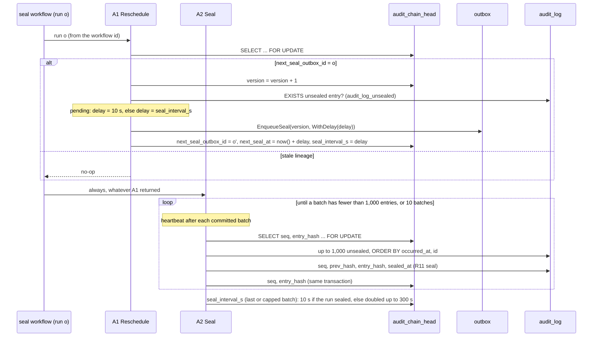
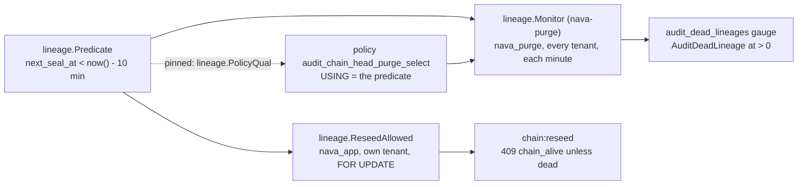

# Audit sealer: activities (P5-34a) and the `audit.seal` workflow (P5-34b)

`internal/audit/seal` holds the two activities of the self-rescheduling sealer (ADR-004 R13 to R16) and the `audit.seal` workflow that calls them (`workflow.go`), registered on `nava-tq` by `cmd/nava-worker`. Both run as `nava_worker`, in transactions opened by `workerguard.InTenantTx`, so the tenant is always the one the activity guard verified (I2). Neither takes a tenant argument.

| Activity | Registered name | Transaction | Result in history |
| --- | --- | --- | --- |
| A1 `Reschedule` | `audit.seal.Reschedule` | one, commits before A2 | `{next_outbox_id}`, empty when the lineage is stale |
| A2 `Seal` | `audit.seal.Seal` | one per batch of 1,000 | none (workerguard records references only) |

## Rules the code holds

- **R15a.** `seq` comes only from the head row read `FOR UPDATE` in the transaction that assigns it. The head advances in that same transaction. A second sealer waits on the lock and then reads the moved head.
- **A1 is idempotent.** A retry after commit finds `next_seal_outbox_id = o′`, not `o`, and does nothing. Two A1s of one run racing produce one `o′`.
- **The interval is stored on the head (ADR-004-E7).** A1, on the non-stale path and under the head lock, probes `EXISTS (... audit_log WHERE tenant_id = $1 AND sealed_at IS NULL)` (partial index `audit_log_unsealed`). If the tenant has work pending, A1 books `o′` 10 s ahead and stores `seal_interval_s = 10` in the same `UPDATE` that repoints the head; otherwise it books `o′` at the stored interval. A2's last (or capped) batch stores the interval for later runs: 10 s if the run sealed anything, otherwise doubled up to 300 s; an A2 error leaves it as it was. So an entry written after idle is sealed within the delay already booked when it was written (≤ 300 s) plus one run, absent an A2 failure. A2 returns no count: the next run needs nothing from the workflow history.
- **A poison entry fails its batch.** An envelope that cannot be canonicalised (`chain.ErrInvalidEnvelope`, for example `version_after` above 2^53 − 1) rolls back the whole batch, so no `seq` is used and the head does not move. The activity returns the non-retryable `nava.audit.seal.Unsealable`, which the worker guard records as is (TICK-585), so the run's failure in the history names it and the guard counts no deny; `nava.audit.seal.HeadNotFound` is allowed the same way. The lineage stays alive past it because A1 committed `o′` first; the next run meets the same entry and fails again, because skipping it would break the `(occurred_at, id)` order.
- **Order.** Entries are sealed in `(occurred_at, id)` order within a batch. An entry that commits late, such as a back-filled one, gets the next `seq` when it arrives. The golden-vector test seeds the P5-02 chain in that arrival order.

## The workflow (P5-34b)

`audit.seal` takes the relay's `outbox.Delivery` and does not read it: A1 takes run *o* from the workflow id `t:<tenant>:audit.seal:<o>`.

- **A1, then A2, always.** A2 runs whatever A1 returned. A1 returns no `o′` for a stale lineage, and for a retry of an A1 that had already committed (its worker died before reporting); R15's head lock makes the overlapping A2 safe. Only an A1 failure skips A2.
- **No child, no continue-as-new.** The only way to the next run is A1's outbox row, which the relay starts and the head fences. The Authorizer sees only the workflow id, so `TestWorkflowStartsNoChildAndNeverContinuesAsNew` and `TestRecordedHistoriesShape` enforce it.
- **Bounded A2.** One A2 call seals at most `DefaultMaxBatches` (10) batches, heartbeats after each committed batch (`HeartbeatTimeout` 30 s, `StartToClose` 5 min), and returns. The next run continues the chain 10 s after this run's A1 committed: A1 saw the backlog and booked `o′` at 10 s (E7), so a backlog above the cap after idle is not held for the stored 300 s; the capped A2 then stores 10 s for later runs. A run can therefore start while the previous one's A2 is still sealing; the two serialise on the head lock (R15a). A2 has an explicit retry policy of 10 attempts, after which the next run, already committed by A1, tries again. A1 retries with no attempt cap (TICK-587): it is the step that commits the next run, so a capped A1 that ran out during a PostgreSQL or PgBouncer outage would end the lineage silently until `chain:reseed`. A1 is idempotent (R16), so retrying until the outage ends is safe; both cap the backoff at 1 min. `NoRun`, `HeadNotFound` (A1, TICK-588 M1: otherwise a tenant with no head would be retried forever) and `Unsealable` (A2) are non-retryable.
- **Kill between A1 and A2.** `o′` is already committed, so the next run seals what this run left.

## Metrics and alert (R-A2)

| Metric (Prometheus name) | Kind | Meaning |
| --- | --- | --- |
| `audit_unsealed_oldest_seconds` | gauge | Age, now, of the oldest unsealed entry over the tenants this worker sealed. Each A2 attempt measures its tenant; the value keeps growing between runs, and a tenant not measured for 15 min drops out. No tenant label. |
| `audit_seal_failures_total{reason}` | counter | Failed attempts: A2 `unsealable` (a poison entry) or `error` (retried), and A1 `reschedule` (retried without a cap, so a lineage held up before it commits shows here). |

`deploy/compose/prometheus/rules/audit.yml` fires `AuditSealLag` at `max(audit_unsealed_oldest_seconds) > 600`. A failed attempt logs `audit seal failed` with `tenant_id` and `workflow_id`. The gauge is per worker, so a lineage that stops running (no worker measures it) is caught by `AuditDeadLineage` below, not this alert.

## Capacity

A run seals at most `DefaultMaxBatches` × 1,000 = 10,000 entries. While the tenant has work pending, each A1 books the next run 10 s after it commits (ADR-004-E7), so in steady state runs start every 10 s and, when an A2 takes longer than that, overlap: the later run's batches wait on the head lock, so `seq` stays single and ordered, and throughput is bounded by how fast A2 seals under the lock, not by the interval. After idle, the first pending entry waits at most the delay already booked (≤ 300 s) plus one run, absent an A2 failure; a poison entry instead blocks the tenant (a run every 10 s, each failing) until `chain:reseed` or a fix, which `audit_seal_failures_total` shows. A tenant that writes faster than A2 seals builds a backlog that keeps growing until `AuditSealLag` fires at 600 s; nothing is lost, sealing only falls behind. The knob is `DefaultMaxBatches` (more batches per run, inside A2's 5 min `StartToClose`), not the interval, whose 10 s floor is the head's `seal_interval_s` check.

## Dead lineages (R17)

A lineage is dead when no run will come: its head's `next_seal_at` is more than 10 min in the past. Whatever ended it (A1's `HeadNotFound`, a guard deny on A1, an operator terminating the run, a relay outage that outlived the row), the head shows it the same way, so one check covers them all (TICK-590).

`internal/audit/lineage` holds R17's predicate once, `lineage.Predicate` (`next_seal_at < now() - interval '10 minutes'`), and both readers evaluate it:

- **The gate.** `lineage.ReseedAllowed` runs `ReseedGateSQL` first in the reseed transaction, as `nava_app` under the head lock. The `chain:reseed` endpoint (P5-42) must call it, not restate it.
- **The gauge.** `nava-purge` runs `lineage.Monitor` every minute as `nava_purge` and exports `audit_dead_lineages`, the number of dead heads, with no tenant label. Each dead tenant goes on a `audit seal lineage dead` warning with `tenant_id` and `next_seal_at`. A failed read logs `audit dead lineage check failed` and withdraws the value rather than leaving a stale 0.
- **The role.** `nava_purge` reads `audit_chain_head` through `audit_chain_head_purge_select`, whose `USING` is the same predicate, and its grant is SELECT on `tenant_id` and `next_seal_at` only (`db/grants.yaml`). It sees dead heads and nothing else, and writes nothing. The policy is on `internal/db/catalog.AllowList`, pinned to `lineage.PolicyQual`.
- **The alert.** `AuditDeadLineage` fires at `max(audit_dead_lineages) > 0` (`deploy/compose/prometheus/rules/audit.yml`), so it fires exactly when a reseed becomes allowed. Recovery is `POST /api/v1/audit/chain:reseed` for the logged tenant.
- **The check itself.** A read that keeps failing withdraws the gauge, so `AuditDeadLineage` would go quiet; `AuditDeadLineageCheckDown` (warning) fires on `absent(audit_dead_lineages)` for 5 min instead, pointing at the `audit dead lineage check failed` log line. nava-purge's `/readyz` only pings the pool, so this alert, not readiness, is what reports a lost grant, a dropped policy or a renamed column.

What keeps the two sides together: `TestPredicateIsR17` pins the 10 min; `TestBothReadersUseThePredicate` requires both SQL statements to contain `Predicate` and no other interval; `TestNoOtherCopyOfThePredicate` fails on any production Go or SQL file that compares `next_seal_at` itself (the policy's migration excepted); the catalog guard and `TestPolicyIsThePredicate` fail when the policy, `PolicyQual` or `Predicate` drift apart. Against PostgreSQL, heads 30 s either side of 10 min must read 1 and 0 on the gauge and agree with the gate (`lineage_integration_test.go`), and `TestAlertRules` runs `promtool test rules` on `deploy/compose/prometheus/tests/audit_test.yml` (both alerts, and `AuditSealLag`).

## On the stack

`nava-worker` registers `audit.seal` on `nava-tq`, so the stack keeps one rule (TICK-453): every worker that polls a task queue registers the same workflow types. Cases that bring their own `nava-tq` workflow worker take `nava-worker` out for their run and are serial: `sdk` and `demo_outbox` swap it for the activity-only `nava-worker-activities` (`NAVA_WORKER_WORKFLOWS=off`, so `nava.workflow_ref.Close` still runs), the interpreter cases stop it. `with_worker_restored` (`deploy/compose/test/lib.sh`) puts `nava-worker` back even if the suite panics. Two checks keep it up and start no worker: `TestOnboardedTenantIsSealed` (an onboarded tenant's entry is sealed at seq 1 and the lineage moves on) and `TestWorkerServiceSealsThroughTheGuard` (A1 and A2 counted by the activity guard on `/metrics`).

## Replay gate

`internal/audit/seal/testdata/histories` holds four recorded runs (live lineage, stale lineage, A1 retried after commit, poison A2), recorded behind the worker guard by `make seal-record-histories`. `TestReplayRecordedHistories` replays them; histories are only ever added.

Tests: `internal/audit/seal/*_integration_test.go` run against real PostgreSQL. They cover concurrent sealers (no duplicate `seq`), waiting on the head lock, the stale lineage, the A1 race, the interval rule, A1's pending-work probe (E7: 10 s with pending work, the stored interval without, a backlog above the cap after idle, poison after idle), tenant isolation, the poison batch, the golden vectors through `verify.Verify`, and CI-A16 for the workflow (`workflow_integration_test.go`: kill between A1 and A2, A1 retried after commit, poison, idle tenant within 300 s, bounded A2).
