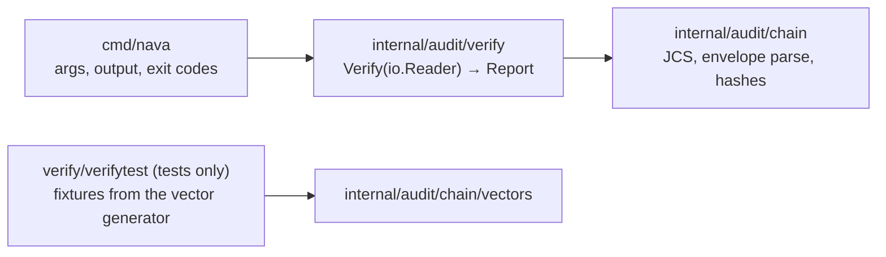
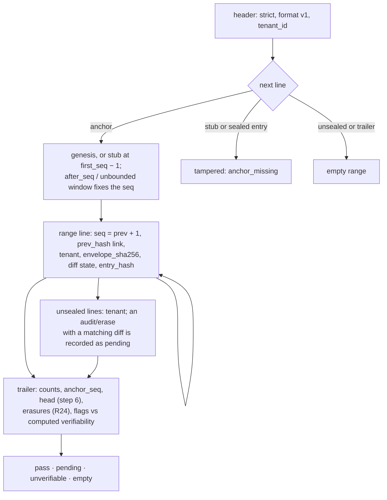

# Offline audit verifier: `nava audit verify`

P5-03 (TICK-425), ADR-004 R20, R22, R24 and R7, PLAN-005 C4 and D-5-6.
Package `internal/audit/verify`, command `cmd/nava`. The file format and the
check list are in [audit-export-v1.md](../api/audit-export-v1.md) §3 and §4.
Hashes come from `internal/audit/chain` (P5-02).

```sh
task build                                   # bin/nava and bin/nava-core
bin/nava audit verify export.jsonl; echo $?  # or - for stdin
```

## Packages



`arch_test.go` fails if `cmd/nava` or `internal/audit/verify` links
`net/http`, `database/sql`, pgx or `internal/db`, or any platform package
other than `chain` and `verify`.

## One pass over the file

`Verify` streams the file once. Memory is bounded by one line (4 MiB) plus
the erasure bookkeeping.



The first failing check stops the pass and becomes `Report.Failure`: line
number, seq and reason code.

## Outcomes and exit codes

| Outcome | Exit | When |
|---|---|---|
| `pass` | 0 | every check holds. Redacted lines are `diff_unverified`: printed as "diff not verifiable: redacted". |
| `tampered` | 1 | the first failing check, with its reason code |
| (usage) | 2 | bad arguments, unreadable file |
| `pending` | 3 | an erased entry is listed only by an unsealed `audit/erase` entry (R24) |
| `unverifiable` | 4 | "not verifiable: stubs omitted": a `stubs=false` file, honestly flagged |
| `empty` | 5 | no sealed entry in the window |

Order when several apply: tampered, then unverifiable, then pending.

## Choices worth knowing

- **Seq gaps.** In a `stubs: true` file a gap is `seq_missing` at the line
  after it. In a `stubs: false` file gaps are expected, and the file ends
  `unverifiable` if its flags say so.
- **Anchor position.** When the header filter fixes `first_seq`
  (`after_seq = n` gives anchor `n`; no `from` gives genesis), a different
  anchor is `anchor_mismatch`. That catches a forger who deletes the first
  entry and re-anchors on it. A time-window export (`from` set) cannot be
  checked this way offline; `nava audit verify -h` lists this with the other
  §4 step 9 limits.
- **Erase entries** list an id only if their diff is the one R23 shape and
  their diff hash verifies. A redacted erase diff lists nothing.
- **An unsealed line's** `envelope_sha256` is informational (§3) and is not
  compared.
- **Formats.** JSONL only. CSV (R22) is not read yet.
