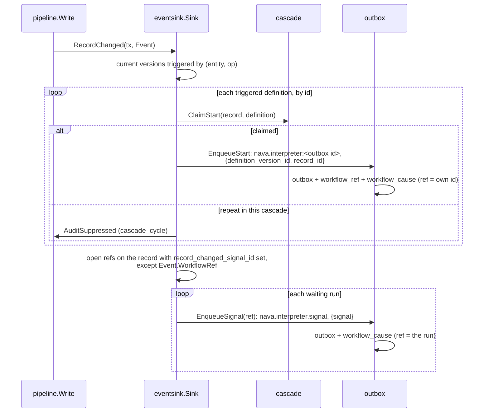

# The records EventSink (P3-42)

`internal/records/pipeline/eventsink` is the pipeline's `EventSink` from S11b on
(PLAN-003 D-3-14, S11b contract D-3-29). The API's pipeline uses it. The worker
has no pipeline until P3-43's `RecordWriter` adapter, which must use it too.
It runs in the write's transaction, so a failure rolls the write back.

## What one write does

- **Starts.** `target_key` is `nava.interpreter:<outbox id>` (D-3-13 as amended
  on 2026-11-01). The causation is the record's, read by `ClaimStart`.
- **Signals.** Only runs whose `NextStep` left them waiting on the
  `record_changed` signal get one (R9). The run whose own write this is
  (`Command.WorkflowRef`, which only a system writer may set) never does. A run
  that closes between the lookup and the enqueue is skipped. The signal
  carries the write's causation.
- **Creates.** A create has no run on its record yet. The sink's trigger check
  is a column of the prefetch's existing entity-type read
  (`pipeline.CreateTriggerQueuer`), so it costs no statement and no trip. If the create fires
  no definition, the sink is not called,
  and an `InsertAtCommit` create keeps its 4 round trips (TICK-692,
  TODO-S10-02).

## Causation (Security condition, TICK-88)

`outbox.EnqueueStart` and `outbox.EnqueueSignal` are the only ways to enqueue a
row an interpreter run acts on. Each one writes the row's `workflow_cause` row
in the same transaction, copied from the row itself, never from a `Command`
field. The relay never writes it.

The interpreter carries `StepRef.Cause`, the outbox id of the delivery that
last resumed the run. `workerguard.ResolveCause` reads that row under RLS. It
refuses the row unless `ref_outbox_id` is the run's own ref, taken from the
workflow id, and it returns origin and depth + 1. It takes no `RunInput`,
`Delivery` or `StepRef` value. P3-43's `RecordWriter` calls it.

## Waiting state

`NextStep` calls `WaitTracker.SetRecordChangedWait` before it returns a
Directive. A `wait_signal` on `record_changed` sets the signal id, and any
other Directive clears it. `workerguard.WaitTracker` updates the calling run's
own `workflow_ref` row as `nava_worker`.

## Payload allow-list (AR-041)

`outbox.ValidateKindPayload` runs in every `Enqueue*` function and in the
relay. A row of a listed kind carries exactly its listed keys:

| Kind | Keys |
| --- | --- |
| `nava.interpreter` (start) | `definition_version_id`, `record_id` |
| `nava.interpreter.signal` (signal) | `signal` |
| `audit.seal` (start) | none |

The relay dead-letters any other row of these kinds as `invalid_payload`.

## Tests

- `internal/records/pipeline/eventsink_integration_test.go`: starts, the
  cascade-cycle suppression, signals only to waiting runs and never to the
  writer, a `workflow_cause` row for every interpreter-bound row, and CI-10
  (g) `TestCI10_G_SignalPingPongBetweenTwoRunsStopsAtDepth9`.
- `internal/workerguard/cause_integration_test.go`: the resolver and the wait
  tracker under RLS.
- `internal/outbox/outbox_test.go`, `internal/relay/dispatch_test.go`: the
  allow-list at enqueue and at the relay.
- `internal/workflow/interp/cause_test.go`: `NextStep` wait state and
  `StepRef.Cause`.
