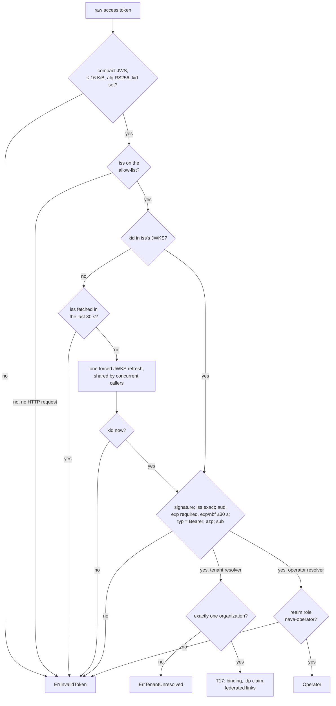

# Identity port and access-token validation (T15)

The core reaches the identity provider only through `internal/identity`
(ADR-001 A.4, D-P6). `internal/identity/keycloak` is the one adapter in M1 and
the only package that imports the JWT/JWKS library, calls the Keycloak admin
API or reads Keycloak-specific claims.

| Piece | Where | Who fills it |
| --- | --- | --- |
| `IdentityResolver`, `OperatorResolver`, `DirectoryAdmin`, `ErrInvalidToken`, `ErrTenantUnresolved` | `internal/identity` | T15 |
| Access-token validation (A.1 step 1), `ResolveOperator` | `internal/identity/keycloak` | T15 |
| Tenant resolution (A.1 steps 2–4) | `keycloak.Adapter.Resolve`, reading `identity.Store` (`internal/identity/pgstore`) | T17, see [tenant-resolution.md](tenant-resolution.md) |
| `DirectoryAdmin` adapter | `internal/identity/keycloak` | T18 |
| Contract suite every adapter must pass | `internal/identity/contracttest` | T15 harness; T17, T18, T19 add cases |

## Validation order

- **Keys come only from the issuer's own discovery document.** On first use of
  an issuer the adapter reads `<iss>/.well-known/openid-configuration`; its
  `issuer` must equal `iss` exactly and its `jwks_uri` must lie under `iss`
  (no `..`, `@`, query or fragment). The JWKS URL then goes on the cache's URL
  allow-list. So a token cannot point key fetches at another host, and a key
  of realm X never verifies a token with `iss=Y`.
- **Fetch budget** (TICK-94 item 11): background refresh no more often than
  every 5 minutes (`WithMinInterval(5m)`); an unknown `kid` forces at most one
  refresh per issuer per 30 s, and discovery and the first fetch count toward
  that window. A rotated key is accepted at the first unknown-`kid` token once
  the window allows, without a restart. Spike, in real time: 1,000 random-`kid`
  tokens in 60 s caused 2 JWKS fetches; a key rotated at +40 s was accepted
  after about 19 s (`go test -tags spike -run TestSpike ./internal/identity/keycloak/`).
- **One audience per resolver:** `nava-api` for `Resolve`, `nava-operator-api`
  for `ResolveOperator`. The operator resolver also requires the realm role
  `nava-operator`: audience alone is never enough (TICK-57).
- **Errors** wrap one of the two sentinels with a fixed reason (`expired`,
  `issuer`, `kid`, …). Library error text, which can quote token values, never
  leaves the adapter.

## Outbound calls

Discovery and JWKS fetches go through `telemetry.OutboundClient` (TICK-94
item 2), whose timeouts also bound the background refresh. jwx's cache takes
any `Do(*http.Request)` client, so the adapter passes the outbound client
itself, wrapped to set the route template; no `*http.Client` leaves
`internal/platform/telemetry` and no lint exception is needed. Spans are named
`GET /realms/{realm}/.well-known/openid-configuration` and
`GET /realms/{realm}/protocol/openid-connect/certs`. The span filter exports an
outbound client span only under a method and a route template, else `_OTHER`.

Metric: `nava.identity.jwks.fetch{trigger=initial|unknown_kid, result=ok|error|throttled}`.

## CI-11

| Check | How | Fixture (`task lint:fixture`) |
| --- | --- | --- |
| Only the adapter imports a Keycloak client or jwx/httprc | depguard rule `identity-port` in `.golangci.yml`, `files: ["$all", "!**/internal/identity/keycloak/**"]` | `internal/platform/lintfixture/identityport.go` imports jwx |
| No Keycloak claim read (`organization`, `idp`, `realm_access`, `resource_access`) or admin API path (`/admin/realms`) outside the adapter | navalint `idpclaims` (`tools/navalint/idpclaims`); the `_test.go` files of `internal/identitystack`, the realm's own acceptance tests, are exempt | the same fixture reads `organization` and builds an admin URL |
| Every adapter meets the port contract | `contracttest.Suite.Run`, run by `internal/identity/keycloak/contract_test.go` | — |

depguard sees direct imports only; a re-exporting wrapper would get around it,
which is why the contract suite stays as the backstop.
