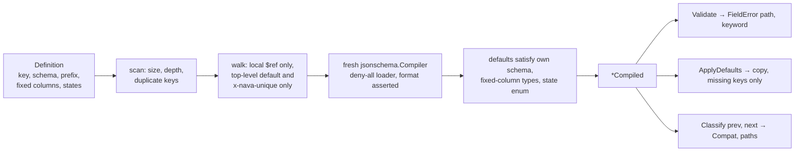

# Metadata engine: compiling and classifying entity definitions

`internal/metadata` (P3-03, TICK-341; PLAN-003 D-3-2, D-3-4, D-3-5, D-3-18)
turns a tenant's entity definition into a `*Compiled` that validates records,
fills defaults and is compared with the previous version. The package is pure:
no database, network or file-system code (`import_test.go` checks the graph).

## Rules that are review blockers

- **No loader.** v6's `NewCompiler()` installs `FileLoader{}`. Every compiler
  gets `UseLoader(denyAllLoader{})`. A `$ref`/`$dynamicRef` that does not start
  with `#` is refused before compiling; the loader is the backstop.
- **One compiler per `Compile`.** A compiler caches resources and compiled
  schemas; a shared one could hand tenant B tenant A's schema.
- **Fail-closed classification.** Only the listed changes are Compatible or
  NeedsBackfill; anything else, including widening `maxLength`, dropping
  `pattern` or any unknown keyword change, is Breaking.

## Caps

| Constant | Value | Meaning |
| --- | --- | --- |
| `MaxSchemaBytes` | 64 KiB | Largest `Definition.Schema` |
| `MaxSchemaDepth` | 32 | Deepest object/array nesting; the root is depth 1 |

## Compatibility classes

| Class | Changes |
| --- | --- |
| Compatible | add an optional property (with or without a default); widen an `enum`; add a state or transition; change `title`, `description`, `$comment`, `examples` |
| NeedsBackfill | add a required property that has a default; add a default to an existing property |
| Breaking | everything else: change a `type`, narrow or add an `enum`, add a required property with no default, remove a property, change `FixedColumns` or `NumberPrefix`, change or remove a default, add or remove `x-nava-unique`, make a property required or optional, remove a state or transition, change the initial state, any other keyword change |

Paths are JSON pointers into the definition's JSON form
(`/schema/properties/priority/default`, `/states/initial`). Seed definitions
`incident`, `request` and `change` are in `internal/metadata/templates/`
(`metadata.Template(key)`, used by P3-06).
