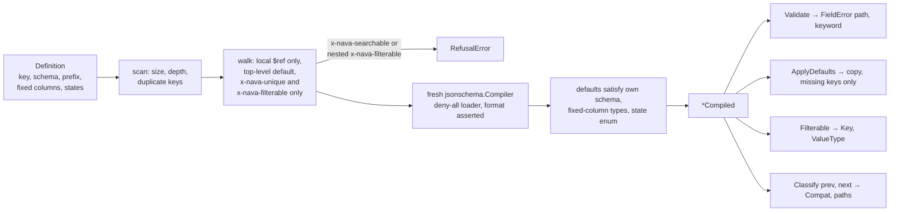

# Metadata engine: compiling and classifying entity definitions

`internal/metadata` (P3-03, TICK-341; PLAN-003 D-3-2, D-3-4, D-3-5, D-3-18)
turns a tenant's entity definition into a `*Compiled` that validates records,
fills defaults and is compared with the previous version. The package is pure:
no database, network or file-system code (`import_test.go` checks the graph).

## Closed root

The root must set `"additionalProperties": false` and must not use
`patternProperties` (TICK-341 review). Otherwise a row could already hold a key
that a later version types, and "add an optional property" would not be
provably Compatible. A local `$ref` must target a subschema the walker checks
(or an anchor one declares), and `$id` is allowed only at the root.

## Rules that are review blockers

- **No loader.** v6's `NewCompiler()` installs `FileLoader{}`. Every compiler
  gets `UseLoader(denyAllLoader{})`. A `$ref`/`$dynamicRef` that does not start
  with `#` is refused before compiling; the loader is the backstop.
- **One compiler per `Compile`.** A compiler caches resources and compiled
  schemas; a shared one could hand tenant B tenant A's schema.
- **Fail-closed classification.** Only the listed changes are Compatible or
  NeedsBackfill; anything else, including widening `maxLength`, dropping
  `pattern` or any unknown keyword change, is Breaking.

## Caps

| Constant | Value | Meaning |
| --- | --- | --- |
| `MaxSchemaBytes` | 64 KiB | Largest `Definition.Schema` |
| `MaxSchemaDepth` | 32 | Deepest object/array nesting; the root is depth 1 |

## Secret-marked properties (`writeOnly`)

A top-level property may carry `x-nava-secret: true` or `writeOnly: true`. On
this platform, for a record, `writeOnly` is narrowed from JSON Schema's
"accepted, not returned" to **"never accepted in a record"**: a value at a
marked path is refused with `422 audit_secret_in_diff`. The marker is also a
definition-time rule (ADR-004-E5 D9): create and publish refuse a definition
that requires a marked property, through `required` or `dependentRequired`, at
the root or in any subschema that applies at the root instance location
(`allOf`, `anyOf`, `oneOf`, `if`, `then`, `else`, `not`, `dependentSchemas`),
with `422 definition_secret_required` and `errors[].pointer` naming the
offending entry. No record could satisfy such a definition. The marker itself,
on a property that is not required, stays legal.

## Filterable properties (`x-nava-filterable`)

ADR-006 D8 (P7-03, TICK-743). `"x-nava-filterable": true` is allowed only
directly on a top-level property, and `Compiled.Filterable()` lists the
flagged properties, sorted, with the `fieldindex.ValueType` their values are
stored as:

| Property schema | `ValueType` |
| --- | --- |
| `"type": "string"` (any other `format`, with or without `enum`), or no `type` and an `enum` of strings only | `text` |
| `"type": "string"` with `format: date-time` or `date` | `ts` |
| `"type": "number"` or `"integer"` | `num` |
| `"type": "boolean"` | `bool` |
| `"type": "array"` whose `items` is one of the above | the element's type |

The value type is read from the property's own `type`, `format` and `enum`,
so a flagged property may not use `$ref`, `$dynamicRef`, `allOf`, `anyOf`,
`oneOf`, `not` or `if`/`then`/`else` (nor `prefixItems`/`contains` for an
array). A type list such as `["string","null"]` is refused too.

| Case | Answer |
| --- | --- |
| The flag anywhere else (nested, `$defs`, in an applicator, `items`, the root), with any value | `*RefusalError` → 422 `filterable_field_not_top_level` |
| `x-nava-searchable` anywhere, with any value (reserved until RFC-016) | `*RefusalError` → 422 `searchable_not_available` |
| A top-level flag with a non-boolean value or a type outside the table | `*ErrInvalidDefinition` → 422 `invalid_definition` at the flag |
| `Classify`: a property flagged in `prev` whose value type in `next` differs (or is unsupported), flagged in `next` or not | `*RefusalError` → 422 `filterable_field_type_change` at the property |

Refusals come ahead of every other problem in the definition, searchable
first. Adding or removing the flag is Compatible; any other change to the
property keeps its usual class (`integer` → `number` stays Breaking on the
`type` keyword but keeps `num`, so it is not a type-change refusal).

## Compatibility classes

| Class | Changes |
| --- | --- |
| Compatible | add an optional property (with or without a default); widen an `enum`; add a state or transition; change `title`, `description`, `$comment`, `examples`; add or remove `x-nava-filterable` |
| NeedsBackfill | add a required property that has a default; add a default to an existing property |
| Breaking | everything else: change a `type`, narrow or add an `enum`, add a required property with no default, remove a property, change `FixedColumns` or `NumberPrefix`, change or remove a default, add or remove `x-nava-unique`, make a property required or optional, remove a state or transition, change the initial state, any other keyword change |

Paths are JSON pointers into the definition's JSON form
(`/schema/properties/priority/default`, `/states/initial`). Seed definitions
`incident`, `request` and `change` are in `internal/metadata/templates/`
(`metadata.Template(key)`, used by P3-06).
