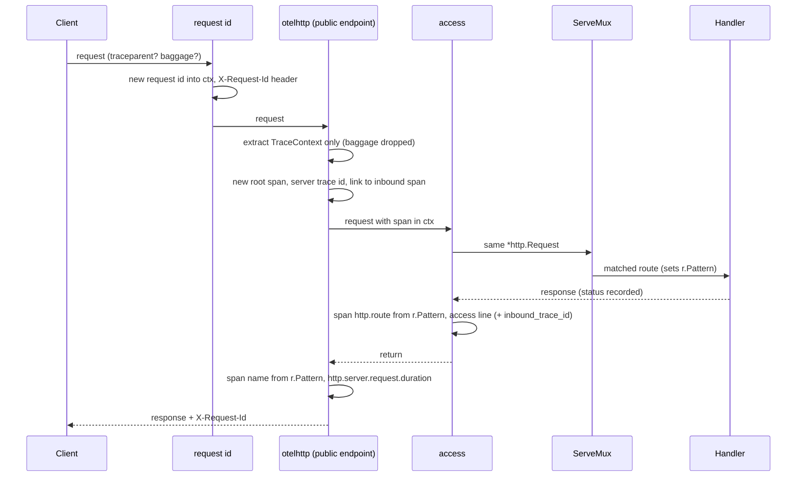

# nava-core service skeleton

PLAN-001 T01 (TICK-50). This is the shape every later task builds on.

## Layout

| Path | Holds |
|---|---|
| `cmd/nava-core` | `main`: wiring only (config → logger → telemetry → handler → server). Graceful shutdown stops the server, then calls `telemetry.Shutdown` |
| `internal/platform/config` | Typed `Config` loaded from `NAVA_*` and the standard `OTEL_*` variables. No globals: `Load(os.LookupEnv)` in `main`, a map in tests |
| `internal/platform/telemetry` | OpenTelemetry providers: SDK tracer provider (behind the span attribute filter), meter provider exported as Prometheus on our own registry, the edge propagator, `Shutdown`. No `otel.Set*` |
| `internal/platform/logging` | The process `slog.Logger` (JSON by default) and `ContextHandler`, which adds `trace_id`, `span_id` and `request_id` to every `*Context` record |
| `internal/platform/requestid` | The server-generated request id and its context helpers |
| `internal/platform/httpobs` | The public-listener edge: request id → `otelhttp` → access log |
| `internal/server` | Root handler and `*http.Server`; later tasks register routes here |
| `api/`, `db/`, `deploy/compose/` | Placeholders for T20, T03 and T02 |
| `docs/` | ADRs, the delivery plan, the decision log and notes. Its own `go.mod` keeps the ADR spike code out of `go build ./...` |

Go is pinned by `go.mod` (`go 1.26.0`, `toolchain go1.26.9`); SDK v1.49.0 needs Go ≥ 1.26 (ADR-001 §3). Telemetry is decided in `docs/delivery/decision-log.md` (2026-10-16).

## Running locally

You need Go 1.26 (a newer `go` command fetches the pinned toolchain itself) and golangci-lint v2. You also need one of the two task runners:
- **make.** The `Makefile` is the CI entry point (T05).
- **[go-task v3](https://taskfile.dev).** `Taskfile.yml` mirrors the Makefile, for hosts without make, such as Windows. Install it with `go install github.com/go-task/task/v3/cmd/task@latest`, `winget install Task.Task`, `scoop install task` or `brew install go-task`.

| make | task | Does |
|---|---|---|
| — | `task` | Lists the tasks (`task --list`) |
| `make build` | `task build` | `go build -o bin/nava-core ./cmd/nava-core` (`.exe` on Windows with task) |
| `make test` | `task test` | `go test -race ./...` (the race detector needs cgo) |
| — | `task test:short` | `go test ./...`, for hosts with no cgo |
| `make lint` | `task lint` | `golangci-lint run ./...` |

The two files must stay in step: a change to one is a change to the other. Run the binary with `bin/nava-core` and check `GET http://localhost:8080/metrics`.

## Request path

Nothing between `otelhttp` and the mux may replace the `*http.Request`: `otelhttp` reads `r.Pattern` from the request it handed down. That is why the request id is set outside `otelhttp`.

## Edge rules (the listener is a trace trust boundary)

- **Linked, never continued.** Every request starts a new root span with a server-generated trace id. A valid inbound `traceparent` becomes a span link and the access line's `inbound_trace_id`; it is never the parent. The sampling decision is ours: an inbound sampled flag cannot force sampling. `otelhttp.WithPublicEndpoint()` was removed upstream; `WithPublicEndpointFn` returning `true` is the same behaviour.
- **No inbound baggage.** The edge propagator is `propagation.TraceContext{}` only. `baggage.FromContext` in a handler is always empty.
- **This whole listener is public.** ADR-001 has no internal HTTP caller of nava-core: the relay and workers talk to Temporal and Postgres. An internal HTTP caller, if one is ever added, needs its own listener or mTLS-peer trust, never a header.
- **Span attributes.** Spans carry `http.route` (the pattern's path, e.g. `/items/{id}`); unmatched requests carry none. A filtering tracer provider drops `url.path`, `url.query`, `url.full`, `user_agent.original`, `client.address`, `client.port`, `network.peer.address`, `network.peer.port` and `http.request.header.*`, at start and on `SetAttributes`.
- **Metric attributes.** A metric View keeps only `http.request.method` (standard methods, else `_OTHER`), `http.response.status_code`, `http.route`, `url.scheme`, `network.protocol.*` and `error.type` on `http.server.*` metrics. `server.address` and `server.port` come from the client's `Host` header and are dropped.

## Other rules this skeleton sets

- **Request id** is always generated by the server and echoed in `X-Request-Id`. It is never taken from a client header and never derived from the trace id.
- **Logging.** Log with the `*Context` methods (sloglint `context: all`) so `ContextHandler` adds `trace_id`, `span_id` and `request_id`. `tenant_id` joins once the identity middleware exists (T17). Logs go to stdout as JSON; OTLP log export is deferred to T02.
- **Metrics.** `/metrics` serves the telemetry registry, never the Prometheus default one: `http_server_request_duration_seconds` (its `_count` is the request count), `http_server_request_body_size_bytes`, `http_server_response_body_size_bytes`, the Go runtime metrics (`go_*`) and the process collector (`process_*`). Tenant and user ids are never attributes.
- **Config errors** name the variable, never its value.

## Configuration

| Variable | Default |
|---|---|
| `NAVA_HTTP_ADDR` | `:8080` |
| `NAVA_HTTP_READ_HEADER_TIMEOUT` / `_READ_TIMEOUT` / `_WRITE_TIMEOUT` / `_IDLE_TIMEOUT` | `5s` / `15s` / `30s` / `120s` |
| `NAVA_HTTP_SHUTDOWN_TIMEOUT` | `15s` |
| `NAVA_LOG_LEVEL` | `info` |
| `NAVA_LOG_FORMAT` | `json` (`text` for local use) |
| `OTEL_SERVICE_NAME` | `nava-core` |
| `OTEL_EXPORTER_OTLP_ENDPOINT` | unset: no trace exporter, nothing dials out. Set: OTLP/HTTP to `<endpoint>/v1/traces` |
| `OTEL_TRACES_SAMPLER` | `parentbased_traceidratio` (all six spec names are accepted) |
| `OTEL_TRACES_SAMPLER_ARG` | `1.0` |

The OTLP exporter still reads its own transport variables (`OTEL_EXPORTER_OTLP_HEADERS`, `_TIMEOUT`, TLS) when an endpoint is set.
