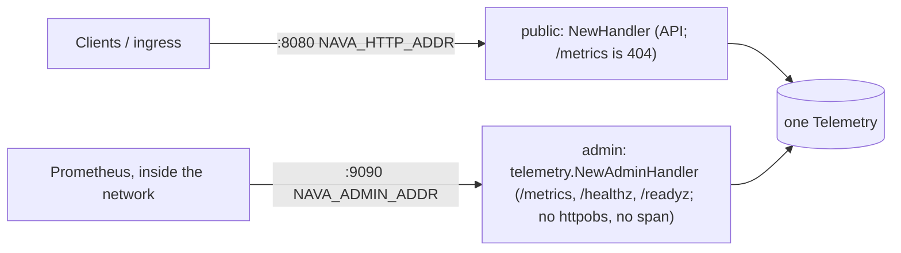

# nava-core service skeleton

PLAN-001 T01 (TICK-50). This is the shape every later task builds on.
[observability-notes.md](observability-notes.md) explains how telemetry
flows, the security controls behind these rules, and options for later tasks.

## Layout

| Path | Holds |
|---|---|
| `cmd/nava-core` | `main`: wiring only (config → logger → `telemetry.RouteErrors` → telemetry → handlers → two servers). Graceful shutdown drains both servers, then flushes telemetry, each with its own deadline |
| `internal/platform/config` | Typed `Config` loaded from `NAVA_*` variables, plus the two OTLP endpoint variables that decide whether traces are exported. No globals: `Load(os.LookupEnv)` in `main`, a map in tests |
| `internal/platform/telemetry` | The admin listener (`NewAdminHandler`, `NewAdminServer`) and, below, the OpenTelemetry providers: SDK tracer provider (every exporter behind the export-time attribute filter), meter provider exported as Prometheus on our own registry, the edge propagator, `Shutdown`. The only `otel.Set*` is `RouteErrors` (OTel's own errors → slog) |. `NewOutboundClient` is the one client for outbound HTTP: otelhttp with the explicit providers, timeouts at client, dial and TLS, and errors reduced to scheme, host and the `WithRoute` template
| `internal/platform/logging` | The process `slog.Logger` (JSON by default) and `ContextHandler`, which adds `trace_id`, `span_id` and `request_id` to every `*Context` record |
| `internal/platform/requestid` | The server-generated request id and its context helpers |
| `internal/platform/httpobs` | The public-listener edge: request id → `otelhttp` → access log → panic recovery. Only the public listener uses it. Exact `METHOD /path` routes can be marked untraced (a route that needs no span, which also covers `HEAD`); they keep the request id and panic recovery |
| `internal/server` | `NewHandler` (public API listener) and `New` for its `*http.Server`; later tasks register routes here |
| `internal/platform/health` | `Monitor`: probes PostgreSQL (critical), Keycloak (management port) and Temporal (`GetSystemInfo`) in the background, caches the result, and serves `/healthz` (`{status, checks}`) and `/readyz` on the admin listener. Only PostgreSQL gates `/readyz`; the others show as `degraded` and in `nava.dependency.degraded{dependency}` |
| `api/`, `db/`, `deploy/compose/` | Placeholders for T20, T03 and T02 |
| `docs/` | ADRs, the delivery plan, the decision log and notes. Its own `go.mod` keeps the ADR spike code out of `go build ./...` |

`/healthz` is a report, not a liveness probe: it returns 503 while PostgreSQL is down, so pointing a restart policy at it would turn a database outage into a restart loop. Liveness is the process answering on the admin listener (`/metrics`); readiness is `/readyz`.

Outbound HTTP goes through `telemetry.NewOutboundClient` only: `forbidigo` rejects `http.Client`, `http.DefaultClient` and `http.Get`/`Head`/`Post`/`PostForm` everywhere except `internal/platform/telemetry` and tests, and `task lint:fixture` checks the rule still fires.

Go is pinned by `go.mod` (`go 1.26.0`, `toolchain go1.26.10`); SDK v1.49.0 needs Go ≥ 1.26 (ADR-001 §3). Telemetry is decided in `docs/delivery/decision-log.md` (2026-10-16).

## Running locally

You need Go 1.26 (a newer `go` command fetches the pinned toolchain itself) and golangci-lint v2. You also need one of the two task runners:
- **make.** The `Makefile` is the CI entry point (T05).
- **[go-task v3](https://taskfile.dev).** `Taskfile.yml` mirrors the Makefile, for hosts without make, such as Windows. Install it with `go install github.com/go-task/task/v3/cmd/task@latest`, `winget install Task.Task`, `scoop install task` or `brew install go-task`.

| make | task | Does |
|---|---|---|
| — | `task` | Lists the tasks (`task --list`) |
| `make build` | `task build` | `go build -o bin/nava-core ./cmd/nava-core` (`.exe` on Windows with task) |
| `make run` | `task run` | `go run ./cmd/nava-core` with `.env` loaded when present (task: shell variables win; make: `.env` wins) |
| `make test` | `task test` | `go test -race ./...` (the race detector needs cgo) |
| — | `task test:short` | `go test ./...`, for hosts with no cgo |
| `make lint` | `task lint` | `golangci-lint run ./...` |

The two files must stay in step: a change to one is a change to the other. Run the service with `task run` (or the built `bin/nava-core`) and check `GET http://localhost:9090/metrics` (`:8080/metrics` answers 404). For local settings, copy `.env.example` to `.env` (gitignored); it lists every variable with its default.

## Listeners



`run` serves both through `serve`/`recovered`. Either one stopping cancels a
shared context, so the other drains too; both finish draining before
telemetry is flushed.

## Request path

```mermaid
sequenceDiagram
  participant C as Client
  participant R as request id
  participant O as otelhttp (public endpoint)
  participant A as access
  participant X as ServeMux
  participant H as Handler
  C->>R: request (traceparent? baggage?)
  R->>R: new request id into ctx, X-Request-Id header
  R-->>X: untraced route (GET or HEAD /metrics, admin listener only, not through httpobs): panic recovery only, no span, no access line
  R->>O: request
  O->>O: extract TraceContext only (baggage dropped)
  O->>O: new root span, server trace id, link to inbound span
  O->>A: request with span in ctx
  A->>X: same *http.Request, writer wrapped once by httpsnoop (status, committed), panics recovered
  X->>H: matched route (sets r.Pattern)
  H-->>A: response (status captured; a panic becomes a 500, or an abort once committed)
  A->>A: span http.route + nava.request_id, access line (+ inbound_trace_id)
  A-->>O: return
  O->>O: span name from r.Pattern, http.server.request.duration
  O-->>C: response + X-Request-Id
```

Nothing between `otelhttp` and the mux may replace the `*http.Request`: `otelhttp` reads `r.Pattern` from the request it handed down. That is why the request id is set outside `otelhttp`. Panic recovery sits inside access, so a recovered 500 still gets its access line and HTTP metrics; any new middleware goes outside it or must keep the same `*http.Request`. The one response wrapper uses `httpsnoop`, so handlers keep `http.Flusher`, `http.Hijacker` and `io.ReaderFrom` (streaming, upgrades, `sendfile`).

## Edge rules (the listener is a trace trust boundary)

- **Linked, never continued.** Every request starts a new root span with a server-generated trace id. A valid inbound `traceparent` becomes a span link and the access line's `inbound_trace_id`; it is never the parent. The sampling decision is ours: an inbound sampled flag cannot force sampling. `otelhttp.WithPublicEndpoint()` was removed upstream; `WithPublicEndpointFn` returning `true` is the same behaviour.
- **No inbound baggage.** The edge propagator is `propagation.TraceContext{}` only. `baggage.FromContext` in a handler is always empty.
- **The public listener is wholly public.** ADR-001 has no internal HTTP caller of nava-core: the relay and workers talk to Temporal and Postgres. An internal HTTP caller, if one is ever added, needs its own listener or mTLS-peer trust, never a header. The admin listener (`NAVA_ADMIN_ADDR`) is for operational endpoints only (scrapes and probes), not API callers. It is not wrapped in `httpobs.Middleware`: scrapes and probes start no span and add no HTTP series.
- **Span attributes.** Spans carry `http.route` (the pattern's path, e.g. `/items/{id}`; unmatched requests carry none) and `nava.request_id`, so a quoted `X-Request-Id` can be searched for in the trace backend. `server.address` is `nava-core` (`otelhttp.WithServerName`), never the client's `Host`.
- **Export filter.** Every span exporter, test ones included, sits behind a filter applied at export, so it holds however data reached the span. It is an allow-list on span, event and link attributes: the server span's semconv keys, `error.type`, `exception.type`, `exception.stacktrace`, the declared `nava.*` constants and `temporalWorkflowID` / `temporalRunID`. Every other key is dropped, so a new library's keys never leave the process by default. Span links keep only the trace and span id: the inbound `tracestate` is stripped. The status description becomes the span's `error.type` (empty without one), because instrumentation fills it with `err.Error()` (a `*url.Error` quotes the full URL with its query); the status code stays. `TestServerSpanAttributeKeysAreGolden` pins the server span's exact key set. Each new instrumentation (pgx in T07, Temporal in T27/T29) adds the keys it needs to the allow-list, reviewed against the span id policy in [observability-notes.md](observability-notes.md) section 2.2.
- **Metric attributes.** A metric View keeps only `http.request.method` (standard methods, else `_OTHER`), `http.response.status_code`, `http.route`, `url.scheme`, `network.protocol.name` and `error.type` on `http.server.*` metrics. `server.address` and `server.port` (from the client's `Host` header) and `network.protocol.version` (client-chosen) are dropped.
- **Access log.** The `method` field is the same normalised value as the metric label (standard method, else `_OTHER`), never the raw token.
- **Adversarial suite.** `internal/platform/httpobs/edge_adversarial_test.go` (from the Security & Multi-Tenancy review) writes crafted requests onto raw TCP and fails if a planted marker reaches a span, link, metric label or the access log.

## Other rules this skeleton sets

- **Request id** is always generated by the server and echoed in `X-Request-Id`. It is never taken from a client header and never derived from the trace id.
- **Logging.** Log with the `*Context` methods (sloglint `context: all`) so `ContextHandler` adds `trace_id`, `span_id` and `request_id`. Do not call `WithGroup` on a request-scope logger: the ids would land under the group (`x.trace_id`) and break joins on `trace_id`. Use `slog.Group` attributes instead (revisit in T17). `tenant_id` joins once the identity middleware exists (T17). Logs go to stdout as JSON; OTLP log export is deferred to T02.
- **Metrics.** `/metrics` is served only on the admin listener (`NAVA_ADMIN_ADDR`); the public one answers 404. It serves the telemetry registry, never the Prometheus default one: `http_server_request_duration_seconds` (its `_count` is the request count), `http_server_request_body_size_bytes`, `http_server_response_body_size_bytes`, the Go runtime metrics (`go_*`) and the process collector (`process_*`). Tenant and user ids are never attributes. Scrapes themselves are untraced and add no HTTP series.
- **Exemplars.** `/metrics` offers OpenMetrics. In that format, duration buckets carry the `trace_id` of a sampled request, so a latency spike links straight to a trace. Prometheus needs `--enable-feature=exemplar-storage` to keep them. An exemplar carries only `trace_id` and `span_id`: the SDK would otherwise attach the attributes the View dropped (`server.port`, `network.protocol.version`) as exemplar labels, putting client-chosen values back on `/metrics` and pushing the label set past OpenMetrics' 128-character limit.
- **OTel's own errors** go through `telemetry.RouteErrors` to the process logger, not plain text on stderr, in two shapes. Errors passed to `otel.Handle` (a failed export, an invalid sampler) arrive as `"opentelemetry error"` warnings. OTel's internal `global.Error` lines arrive through the logr bridge at ERROR with their own message and fields (for example `"msg":"parse headers"` with `"input"`); those fields can quote the variable's value. That is why `config` validates the OTLP header and timeout variables first: a value the exporter would reject fails startup, naming the variable only.
- **Shutdown.** Both listeners stop together: a signal, or either one failing to listen or serve, drains both before the flush. The HTTP drain (`NAVA_HTTP_SHUTDOWN_TIMEOUT`, per listener, run in parallel) and the telemetry flush (`NAVA_TELEMETRY_SHUTDOWN_TIMEOUT`) have separate deadlines. A failed flush is logged with its error. A signal and the serve goroutine ending (an error, or a panic recovered into one) take the same path, so in-flight requests are drained either way; a serve failure is also logged at ERROR by the process logger.
- **Panics.** A handler panic is recovered per request in `httpobs`: logged at ERROR with its stack and request/trace ids, the span marked as an error, the handler's headers cleared (except `X-Request-Id`), and a plain-text 500 returned (problem+json is TODO-002), so the access line and HTTP metrics still record it. If the response was already committed (including a `101`), the panic is re-raised as `http.ErrAbortHandler` and net/http drops the connection. A handler panic never stops the server.
- **Config errors** name the variable, never its value.

## Configuration

| Variable | Default |
|---|---|
| `NAVA_HTTP_ADDR` | `:8080`, the public API listener. `host:port` with a numeric port |
| `NAVA_ADMIN_ADDR` | `:9090`, the admin listener for `/metrics`, `/healthz` and `/readyz`; never published in compose. Same format; must differ from `NAVA_HTTP_ADDR`; never expose it through the ingress |
| `NAVA_HTTP_READ_HEADER_TIMEOUT` / `_READ_TIMEOUT` / `_WRITE_TIMEOUT` / `_IDLE_TIMEOUT` | `5s` / `15s` / `30s` / `120s`, for both listeners |
| `NAVA_HTTP_SHUTDOWN_TIMEOUT` | `15s` |
| `NAVA_LOG_LEVEL` | `info` |
| `NAVA_LOG_FORMAT` | `json` (`text` for local use) |
| `NAVA_TELEMETRY_SHUTDOWN_TIMEOUT` | `5s` |
| `NAVA_DATABASE_URL` | unset. `postgres://` URL; a credential, never logged or echoed. Unset: `/readyz` fails closed |
| `NAVA_KEYCLOAK_MANAGEMENT_URL` | unset. Keycloak management base URL (port 9000); checked at `/health/ready` |
| `NAVA_TEMPORAL_ADDRESS` | unset. Temporal frontend `host:port`; checked with `GetSystemInfo` |
| `OTEL_EXPORTER_OTLP_TRACES_ENDPOINT` / `OTEL_EXPORTER_OTLP_ENDPOINT` | both unset: no trace exporter, nothing dials out. Either set: OTLP/HTTP, resolved by the exporter as the spec says (the signal endpoint as is, else the base endpoint + `/v1/traces`). `config` checks both are http(s) URLs and never echoes them |

Every other standard `OTEL_*` variable is read by the OTel SDK and exporter themselves, not by `config`:

| Variable | Default / note |
|---|---|
| `OTEL_SERVICE_NAME` | `nava-core` |
| `OTEL_RESOURCE_ATTRIBUTES` | none. Set `deployment.environment.name` here so services sharing a backend can be told apart. A malformed value fails startup, naming the variable only |
| `OTEL_TRACES_SAMPLER` / `_ARG` | `parentbased_always_on`, the same as `parentbased_traceidratio` at `1.0`. An invalid value is logged as an OTel error and the default is used; it does not fail startup |
| `OTEL_EXPORTER_OTLP_HEADERS`, `_TIMEOUT`, `_COMPRESSION`, `_CERTIFICATE` (and `_TRACES_` forms) | exporter transport. `config` also checks `_HEADERS` (comma-separated `key=value`, the key a header token, the value percent-decodable) and `_TIMEOUT` (whole milliseconds) and fails startup on a bad one, naming the variable only. A blank value counts as unset |
| `OTEL_BSP_*`, `OTEL_SPAN_*_LIMIT`, `OTEL_ATTRIBUTE_*_LIMIT` | batching and span limits |
