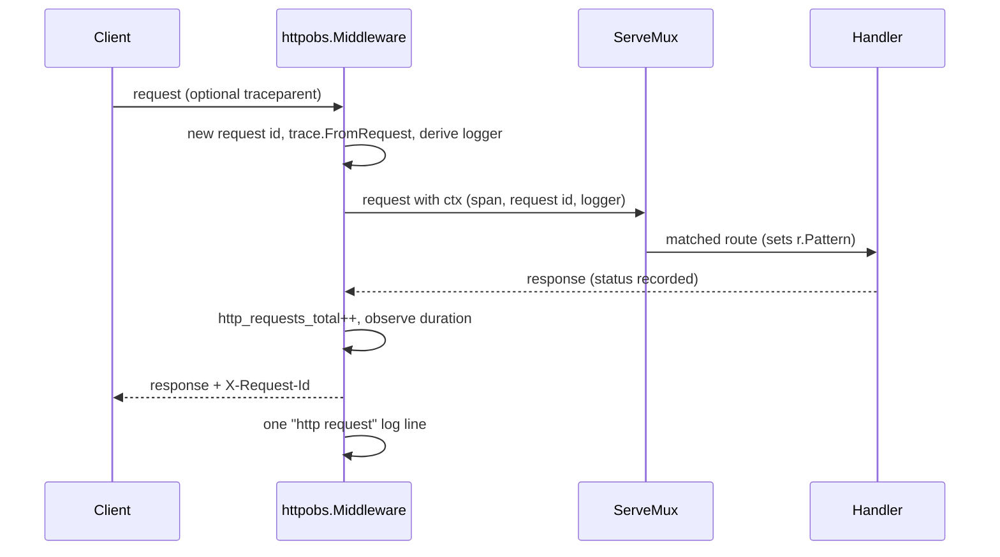

# nava-core service skeleton

PLAN-001 T01 (TICK-50). This is the shape every later task builds on.

## Layout

| Path | Holds |
|---|---|
| `cmd/nava-core` | `main`: wiring only (config → logger → handler → server, graceful shutdown) |
| `internal/platform/config` | Typed `Config` loaded from `NAVA_*` environment variables. No globals: `Load(os.LookupEnv)` in `main`, a map in tests |
| `internal/platform/logging` | The process `slog.Logger` (JSON by default, text for local use) |
| `internal/platform/trace` | W3C `traceparent` parsing, server span ids, context helpers |
| `internal/platform/httpobs` | Request middleware: request id, trace context, request-scoped logger, access log, RED metrics |
| `internal/server` | Root handler and `*http.Server`; later tasks register routes here |
| `api/`, `db/`, `deploy/compose/` | Placeholders for T20, T03 and T02 |
| `docs/` | ADRs, the delivery plan and notes. Its own `go.mod` keeps the ADR spike code out of `go build ./...` |

Go is pinned by `go.mod` (`go 1.26.0`, `toolchain go1.26.9`); SDK v1.49.0 needs Go ≥ 1.26 (ADR-001 §3).

## Request path

## Rules this skeleton sets

- **Request id** is always generated by the server and echoed in `X-Request-Id`. A client-sent value is ignored.
- **Trace context.** A valid inbound `traceparent` keeps its trace id and flags; this process gets a new span id. An invalid or absent header starts a new trace. Use `trace.FromContext(ctx)` and `SpanContext.Traceparent()` on outbound calls.
- **Logging.** Handlers log through `httpobs.Logger(ctx, fallback)`, so every line carries `request_id`, `trace_id` and `span_id`. `tenant_id` joins the derived logger once the identity middleware exists (T17).
- **Metrics** live on a per-handler registry, never the Prometheus default one. `http_requests_total` and `http_request_duration_seconds` are labelled `method`, `route` (the ServeMux pattern, or `unmatched`) and `status_class`. Tenant and user ids are never labels.
- **Config errors** name the variable, never its value.

## Configuration

| Variable | Default |
|---|---|
| `NAVA_HTTP_ADDR` | `:8080` |
| `NAVA_HTTP_READ_HEADER_TIMEOUT` / `_READ_TIMEOUT` / `_WRITE_TIMEOUT` / `_IDLE_TIMEOUT` | `5s` / `15s` / `30s` / `120s` |
| `NAVA_HTTP_SHUTDOWN_TIMEOUT` | `15s` |
| `NAVA_LOG_LEVEL` | `info` |
| `NAVA_LOG_FORMAT` | `json` (`text` for local use) |
