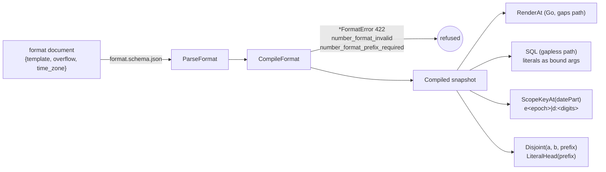

# Number-format compiler (`internal/records/numbering`)

TICK-667, PLAN-006 P6-03, ADR-005 §3.1, §3.3, §3.5, §3.6. It is pure Go, with no database and no API. Until S18 links a format to a type, every create still uses `numbering.Default()` (`{prefix}{seq:7}`, grow, epoch 0, scope key `''`).

## Order of checks in `CompileFormat`

1. Overflow is `grow` or `refuse`.
2. Lexing: literal runs of `[A-Z0-9_/.-]` (at most 16 characters each) and the tokens `{prefix}`, `{yyyy}`, `{yy}`, `{MM}`, `{dd}`, `{seq:N}` (canonical N from 1 to 12) and `{field:…}`. Any other character or token fails here, so a quote, `;`, `\`, `$` or space never reaches a `Compiled`.
3. The leading-`{prefix}` rule: `number_format_prefix_required`.
4. `{field:…}` (S19) and a second `{prefix}` or `{seq:N}`: `number_format_invalid`.
5. Grow is ambiguous when a digit touches `{seq:N}`, before or after it: a date part or a literal digit.
6. The longest rendering is at most 64 characters. It counts a 6-letter prefix, and under grow a 19-digit counter.
7. `time_zone` is empty (the tenant's setting) or a name `time.LoadLocation` knows (`time/tzdata` is embedded). `Local` is refused.

`Position` is the 0-based byte offset of the offending token, or `-1` when the error is not about one position. `Reason` is fixed text and never echoes the input.

## Invariants

- **Every method re-checks the snapshot.** `RenderAt`, `SQL`, `ScopeKeyAt`, `DatePart`, `LiteralHead` and `Disjoint` first recompile `Head{seq:N}Tail` and require the same scope parts and hash, and epoch 0 if and only if it is the default. An edited snapshot fails with `ErrInvalidCompiled`, or `Disjoint` returns false.
- **Literal text never enters SQL text.** `SQL` appends each literal run to `args` and refers to it as `$n::text`.
- **The scope key holds only the epoch number and date digits:** `''` for epoch 0, `e<epoch>` otherwise, and `e<epoch>|d:<digits>` when the format has date parts. It is at most 128 characters, and no tenant text can reach it.
- **`CompiledSHA256`** is the SHA-256 of the fixed-order JSON `{"scope_parts","head","width","tail","overflow"}`. Golden tests pin it.
- **`Disjoint` is sound.** It returns true only when the literal heads differ, or when the longer head continues with a non-digit where the shorter template continues with digits. `TestDisjointProperty` (fixed seed, 300 templates, about 45k pairs) and `FuzzDisjoint` (its seed corpus runs in CI) check that no rendering of one epoch matches the other's pattern.
